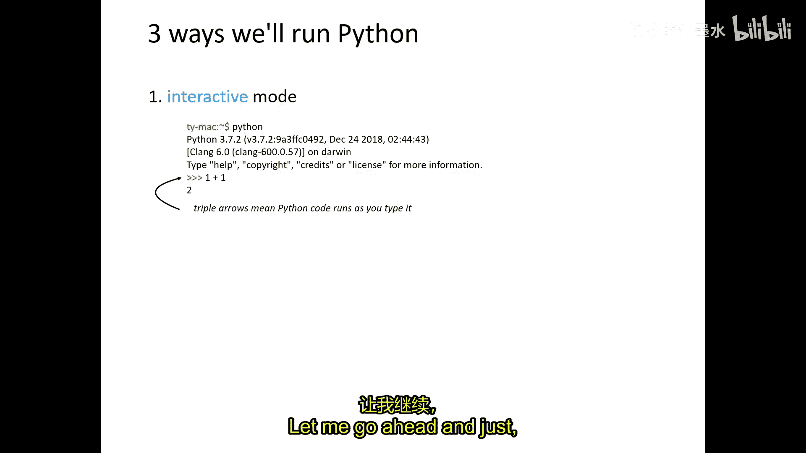
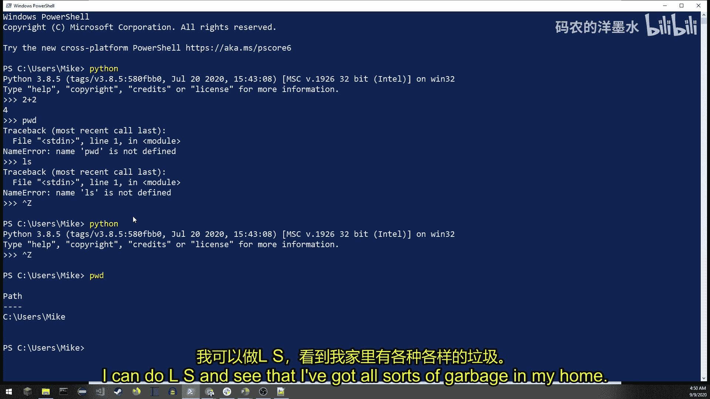
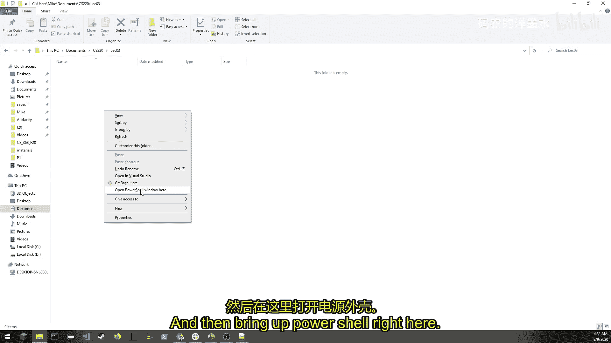
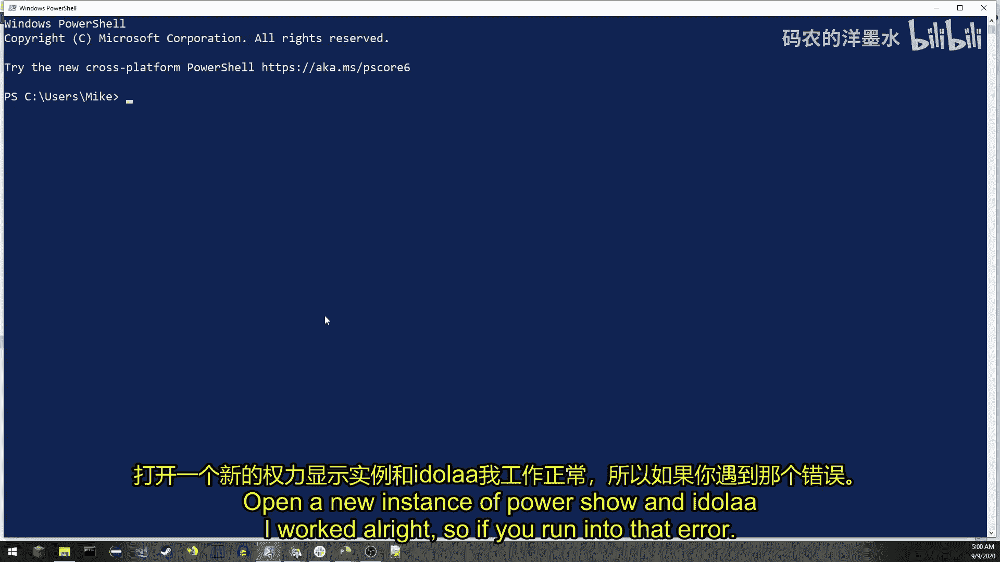
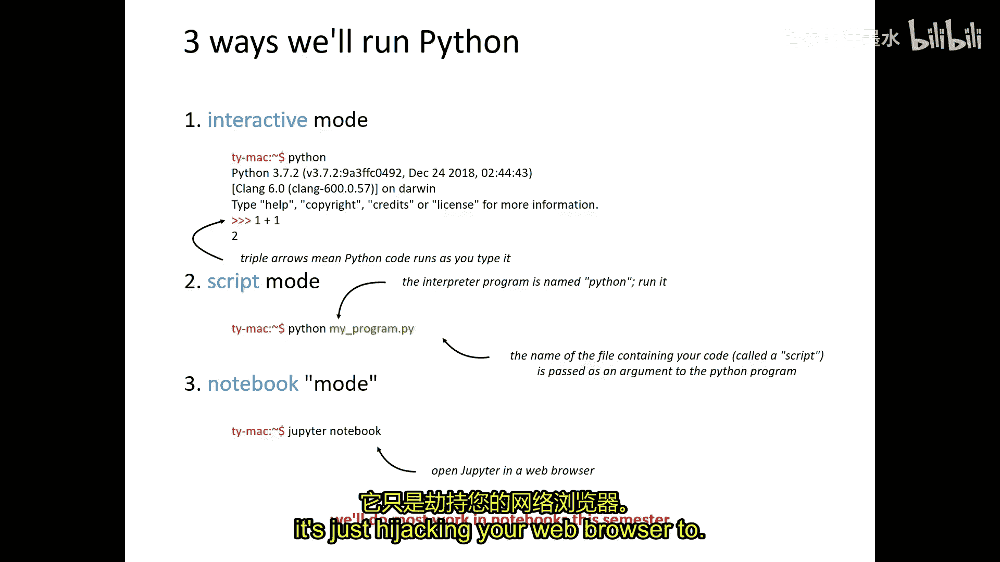
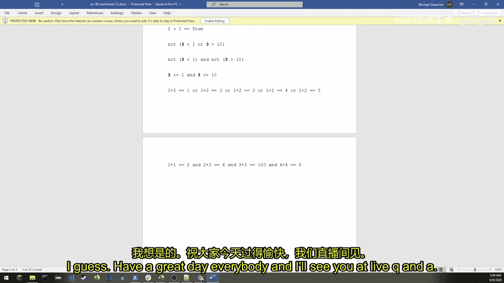

# 005：Python导论

在本节课中，我们将开始实际编写Python代码。我们将学习如何运行Python代码、使用Jupyter Notebook，并了解Python中的基本运算符、数据类型和布尔逻辑。

## 运行Python代码的三种方式

上一节我们介绍了课程概述，本节中我们来看看如何运行Python代码。Python代码可以通过三种主要方式来运行。

### 交互模式

交互模式是最简单的方式，它允许你逐行输入并立即执行代码，类似于一个计算器。

以下是启动交互模式的步骤：
1.  打开命令行（如PowerShell或终端）。
2.  输入 `python` 或 `python3` 并回车。
3.  你将看到Python提示符 `>>>`，在此处可以直接输入代码。



例如：
```python
>>> 2 + 2
4
```
要退出交互模式，在Windows上按 `Ctrl+Z` 然后回车，在Mac上按 `Ctrl+D`。

### 脚本模式



脚本模式用于运行存储在 `.py` 文件中的完整程序。



以下是使用脚本模式的步骤：
1.  使用文本编辑器（如IDLE）创建一个新文件。
2.  编写Python代码并保存为 `.py` 文件（例如 `main.py`）。
3.  在命令行中导航到文件所在目录，运行 `python main.py`。
4.  或者在IDLE中，直接按 `F5` 运行当前脚本。



在脚本模式中，需要使用 `print()` 函数来输出结果。例如，文件 `main.py` 中的代码：
```python
print(1 + 2)
print(3 + 4)
```
运行后将输出：
```
3
7
```

### 笔记本模式（Jupyter Notebook）

Jupyter Notebook将代码分成独立的“单元格”，便于分步执行和展示结果。



以下是使用Jupyter Notebook的步骤：
1.  在命令行中输入 `jupyter notebook` 并回车。
2.  浏览器会自动打开Jupyter界面。
3.  点击“New” -> “Python 3”创建一个新的笔记本。
4.  在单元格中输入代码，按 `Shift+Enter` 运行该单元格。


在笔记本中，最后一个表达式的值会自动显示在“Out[]”区域。例如，在一个单元格中输入：
```python
1 + 2
3 + 4
```
运行后，`Out[]` 区域将只显示 `7`。若要显示多个结果，需使用 `print()` 函数。

## Python中的基本运算符

了解了如何运行代码后，本节我们来看看Python中用于计算和比较的基本运算符。

### 算术运算符

算术运算符用于执行数学计算。

以下是常见的算术运算符：
*   `+`：加法，如 `2 + 3` 结果为 `5`。
*   `-`：减法，如 `5 - 2` 结果为 `3`。
*   `*`：乘法，如 `3 * 4` 结果为 `12`。注意不能使用 `x` 或 `·` 表示乘法。
*   `/`：除法，返回浮点数（带小数点的数），如 `4 / 2` 结果为 `2.0`，`3 / 2` 结果为 `1.5`。
*   `//`：整数除法，返回商的整数部分（向下取整），如 `11 // 4` 结果为 `2`。
*   `%`：取模（求余数），如 `11 % 4` 结果为 `3`。
*   `**`：幂运算（乘方），如 `2 ** 3` 结果为 `8`，`4 ** 0.5` 结果为 `2.0`（即平方根）。

**注意**：Python中不能除以零，尝试 `1 / 0` 会引发 `ZeroDivisionError`。

### 比较运算符

比较运算符用于比较两个值，并返回布尔值（`True` 或 `False`）。

以下是常见的比较运算符：
*   `==`：等于，检查两个值是否相等。
*   `!=`：不等于，检查两个值是否不相等。
*   `<`：小于。
*   `<=`：小于或等于。
*   `>`：大于。
*   `>=`：大于或等于。

例如：
```python
5 > 3      # 结果为 True
2 == 1+1   # 结果为 True
3 != 2     # 结果为 True
```

### 运算符优先级

当表达式中包含多个运算符时，Python会按照特定的优先级顺序进行计算，这与数学中的运算顺序类似。

以下是Python运算符的优先级顺序（从高到低）：
1.  **括号 `()`**：优先计算括号内的表达式。
2.  **幂运算 `**`**。
3.  **正负号 `+x`, `-x`**（一元运算符）。
4.  **乘法、除法、取模、整数除法 `*`, `/`, `%`, `//`**（从左到右计算）。
5.  **加法、减法 `+`, `-`**（从左到右计算）。
6.  **比较运算符 `==`, `!=`, `<`, `<=`, `>`, `>=`**。
7.  **逻辑非 `not`**。
8.  **逻辑与 `and`**。
9.  **逻辑或 `or`**。

例如，表达式 `3 * 3 + 2 * 2 + (1 / 2) + 16 ** 0.5` 的计算顺序如下：
1.  先计算括号内 `1 / 2`，得 `0.5`。
2.  计算幂运算 `16 ** 0.5`，得 `4.0`。
3.  计算乘法 `3 * 3` 和 `2 * 2`，得 `9` 和 `4`。
4.  从左到右进行加法：`9 + 4` 得 `13`，`13 + 0.5` 得 `13.5`，`13.5 + 4.0` 得 `17.5`。

## Python中的数据类型

掌握了运算符的使用，本节我们来认识Python中几种基本的数据类型。

### 整数和浮点数

Python可以处理不同类型的数字。

以下是两种主要的数字类型：
*   **整数**：不带小数点的数，类型为 `int`。例如：`1`, `-5`, `1000`。
*   **浮点数**：带小数点的数，类型为 `float`。例如：`1.0`, `3.14`, `-2.5`。

使用 `type()` 函数可以查看任何值的类型：
```python
type(5)    # <class 'int'>
type(5.0)  # <class 'float'>
```
整数除法 `//` 和取模 `%` 在数据处理中非常有用，例如从数字中提取特定位数：
```python
987 % 10      # 提取个位数，结果为 7
987 // 10     # 去掉个位数，结果为 98
(987 // 10) % 10  # 提取十位数，结果为 8
```

### 字符串

字符串用于表示文本数据，用单引号 `'` 或双引号 `"` 括起来。

以下是字符串的基本操作和注意事项：
*   **创建字符串**：`‘Hello’` 或 `“World”`。
*   **引号嵌套**：如果字符串内部包含引号，需交替使用或使用转义字符 `\`。
    ```python
    print("She said, \"Hello.\"")  # 输出：She said, "Hello."
    print('It\'s a nice day.')     # 输出：It's a nice day.
    ```
*   **转义字符**：`\n` 表示换行。
    ```python
    print("Line 1\nLine 2")
    # 输出：
    # Line 1
    # Line 2
    ```
*   **字符串运算**：
    *   `+` 用于拼接字符串：`‘3’ + ‘4’` 结果为 `‘34’`。
    *   `*` 用于重复字符串：`‘Ha ‘ * 3` 结果为 `‘Ha Ha Ha ‘`。
*   **字符串比较**：基于字符的编码（如ASCII）按字典顺序进行比较。
    ```python
    ‘a’ < ‘b’   # True
    ‘A’ < ‘a’   # True (大写字母编码小于小写字母)
    ```

## 布尔逻辑

最后，我们来学习布尔逻辑，它用于处理真值判断，是程序做出决策的基础。

### 布尔值与逻辑运算符

布尔类型只有两个值：`True` 和 `False`（注意首字母大写）。逻辑运算符用于组合或修改布尔值。

以下是三个基本的逻辑运算符：
*   `not`：逻辑“非”。取反操作。
    *   `not True` 为 `False`
    *   `not False` 为 `True`
*   `and`：逻辑“与”。仅当两边都为 `True` 时结果为 `True`。
    *   `True and True` 为 `True`
    *   `True and False` 为 `False`
    *   `False and True` 为 `False`
    *   `False and False` 为 `False`
*   `or`：逻辑“或”。只要有一边为 `True`，结果就为 `True`。
    *   `True or True` 为 `True`
    *   `True or False` 为 `True`
    *   `False or True` 为 `True`
    *   `False or False` 为 `False`

逻辑运算符的优先级为：`not` > `and` > `or`。可以使用括号 `()` 来明确运算顺序。
```python
True and False or True   # 先计算 and，等价于 False or True，结果为 True
not True or False        # 先计算 not，等价于 False or False，结果为 False
(True or False) and False # 先计算括号，等价于 True and False，结果为 False
```

## 总结



本节课中我们一起学习了Python编程的入门知识。我们了解了运行Python代码的三种模式：交互模式、脚本模式和Jupyter Notebook模式。我们学习了Python的基本算术运算符、比较运算符以及它们的优先级规则。我们还认识了三种重要的数据类型：整数、浮点数和字符串，并了解了如何对它们进行基本操作。最后，我们探讨了布尔逻辑，包括布尔值以及 `not`、`and`、`or` 三个逻辑运算符的使用。掌握这些基础知识是后续编写更复杂程序的关键。建议你打开Python环境，亲自尝试本节提到的所有示例，并通过完成配套练习来巩固理解。