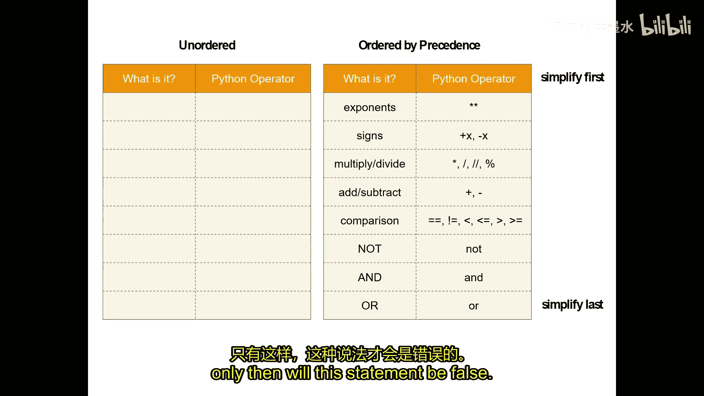
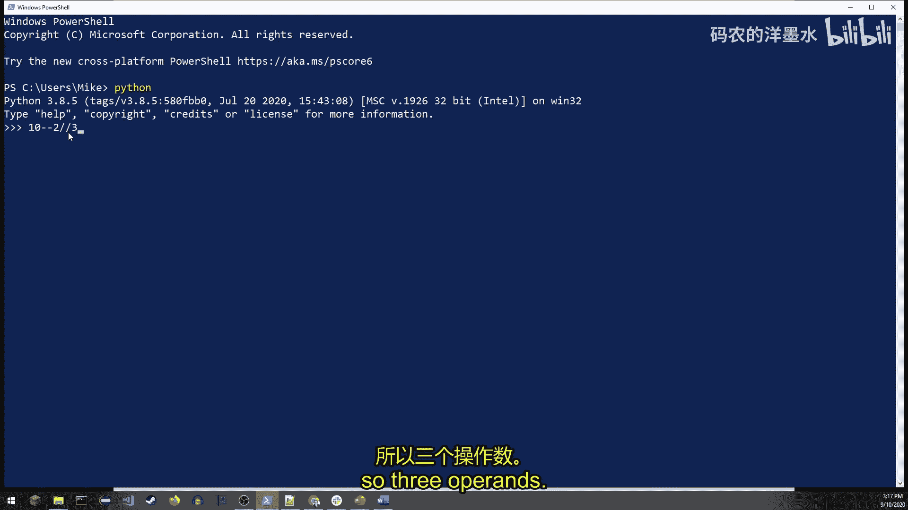
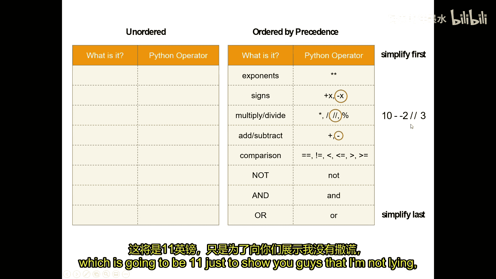
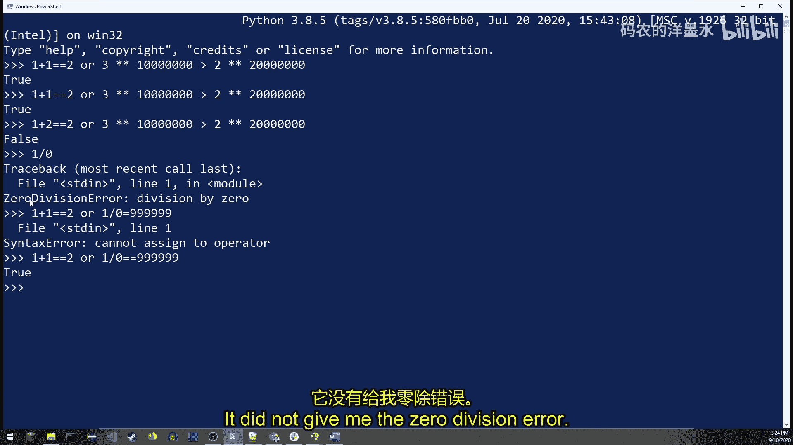
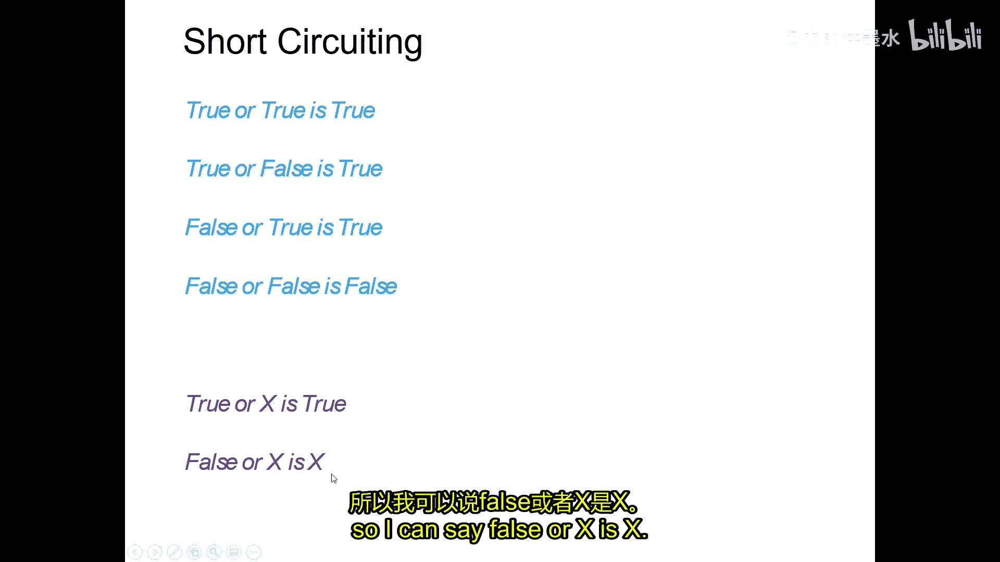
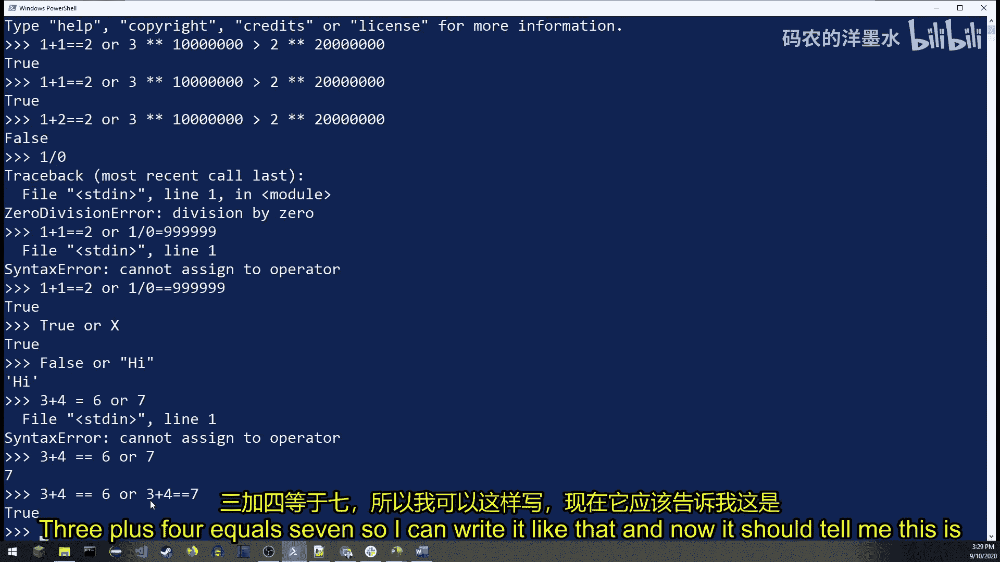
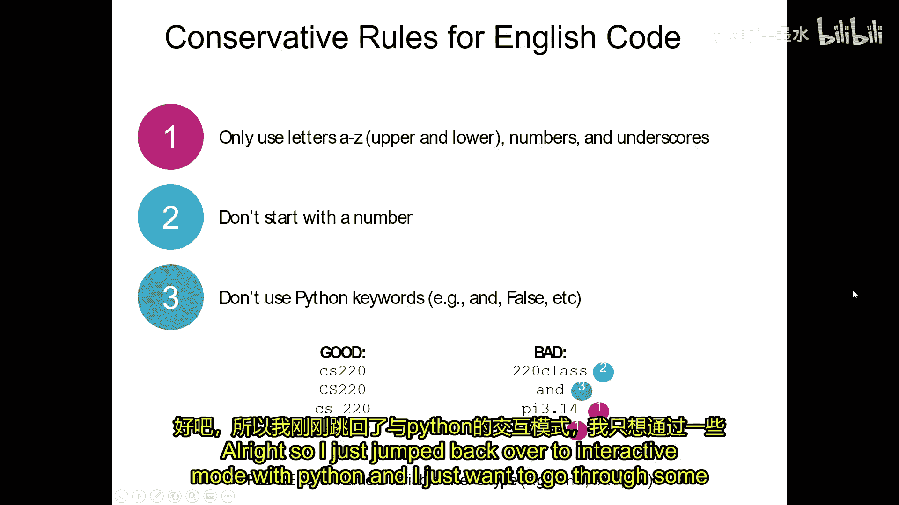
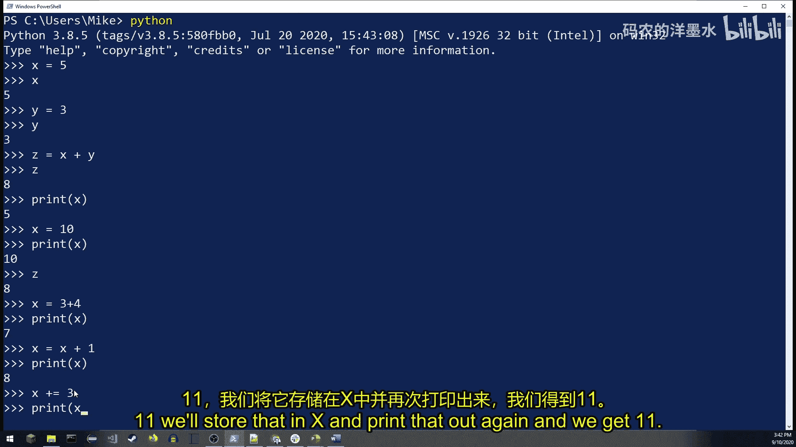
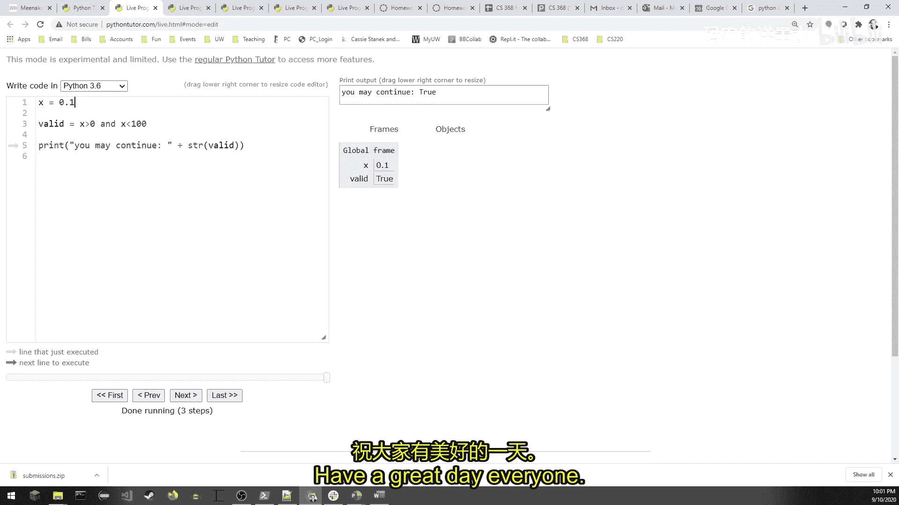

# 006：变量与表达式 🐍

在本节课中，我们将学习Python编程中的核心概念：变量与表达式。我们将探讨如何存储数据、进行计算以及理解代码执行过程中的不同错误类型。

---

## 运算符优先级回顾 🔢





上一节我们介绍了不同的运算符。本节中，我们来看看当多个运算符出现在同一个表达式中时，Python如何决定计算的先后顺序，即运算符的优先级。



以下是Python中主要运算符的优先级列表，从高到低排列：

1.  **指数运算**：`**`
2.  **一元正负号**：`+`（正号）， `-`（负号）
3.  **乘法、除法、取整除法、取模**：`*`， `/`， `//`， `%`
4.  **加法、减法**：`+`， `-`
5.  **比较运算符**：`==`， `!=`， `<`， `<=`， `>`， `>=`
6.  **布尔运算符**：
    *   `not`
    *   `and`
    *   `or`

让我们通过一个例子来理解优先级如何工作。考虑表达式 `10 - -2 // 3`：
*   首先计算一元负号：`-2`。
*   然后进行取整除法：`-2 // 3` 结果为 `-1`（因为 `-2/3` 向下取整为 `-1`）。
*   最后进行减法：`10 - (-1)` 结果为 `11`。



---



## 布尔运算与短路求值 ⚡

在布尔运算中，Python使用一种称为“短路求值”的优化策略。这意味着在某些情况下，Python无需计算整个表达式就能得出结果。



对于 `or` 运算符：
*   如果左侧为 `True`，则整个表达式必定为 `True`，Python会跳过右侧的计算。
*   如果左侧为 `False`，则必须计算右侧才能确定结果。

对于 `and` 运算符：
*   如果左侧为 `False`，则整个表达式必定为 `False`，Python会跳过右侧的计算。
*   如果左侧为 `True`，则必须计算右侧才能确定结果。

这种特性非常有用，例如可以避免除零错误：
```python
# 左侧为True，右侧的 1/0 永远不会被执行，因此不会引发错误
result = (1 + 1 == 2) or (1 / 0)
```
但需要注意，短路求值有时会导致意想不到的结果。例如，`3 + 4 == 6 or 7` 这个表达式，由于 `3+4==6` 为 `False`，Python会继续计算右侧的 `7`，并将 `7`（而非 `True`）作为整个表达式的结果。正确的写法应该是 `3 + 4 == 6 or 3 + 4 == 7`。

---

## 表达式、字面量与变量 📝

表达式是Python可以简化为一个值（数字、文本或布尔值）的代码片段。例如 `5 + 5` 或 `x > y`。

字面量是代码中直接写出的固定值，例如数字 `5`、字符串 `"hello"` 或布尔值 `True`。



变量是内存中一个命名的位置，用于存储数据。与字面量不同，变量的值可以改变。例如，`x = 5` 将数字 `5` 存储在名为 `x` 的变量中。

---

## 变量赋值与命名规则 🏷️



我们使用单等号 `=` 进行变量赋值。可以将其理解为“得到”。Python会先计算等号右边的表达式，然后将结果存储在左边的变量名中。

以下是变量命名的基本规则（为确保兼容性，建议遵循）：
*   只能使用字母（A-Z， a-z）、数字（0-9）和下划线（_）。
*   不能以数字开头。
*   避免使用Python的关键字（如 `and`， `or`， `not`， `True`， `False`）或内置函数名（如 `print`， `len`， `int`）作为变量名。

以下是命名示例：
*   **好的命名**：`cs220`， `Capitalized`， `_private_var`
*   **坏的命名**：`220class`（以数字开头）， `and`（关键字）， `pi.3.14`（包含点号）， `my-var`（包含连字符）

---

## 编程实践与错误类型 🐛

在编程时，逐步编写并频繁测试代码是一个好习惯。这有助于及早发现错误。

Python中的错误主要分为三类：
1.  **语法错误**：代码不符合Python语法规则，程序无法运行。例如 `5 = x`。
2.  **运行时错误**：代码语法正确，但在执行时出现问题。例如 `1 / 0`（除零错误）。
3.  **语义错误**：代码能正常运行，但产生了错误的逻辑结果。例如计算正方形面积时使用了 `side * 2` 而不是 `side ** 2`。这类错误最难调试。

---

## 实战示例：计算奇数之和 ➕

假设我们有四个变量 `a`， `b`， `c`， `d`，分别存储了数字。我们的目标是只对其中的奇数求和。

我们可以利用取模运算符 `%`：一个数除以2的余数为1则是奇数，为0则是偶数。技巧是将每个数乘以它自身对2取模的结果。这样，偶数会变成0，奇数则保持不变，然后再将所有结果相加。
```python
a = a * (a % 2)
b = b * (b % 2)
c = c * (c % 2)
d = d * (d % 2)
sum_odd = a + b + c + d
```

---

## 实战示例：复利计算 💰

计算一笔资金在固定年利率下，经过若干年复利增长后的总额。公式为：
`最终金额 = 本金 * (1 + 利率) ** 年数`

在代码中，我们使用变量来代表公式中的各个部分，使代码更灵活：
```python
principal = 1000  # 本金
interest_rate = 7 # 利率百分比
years = 30        # 年数

multiplier = 1 + interest_rate / 100
final_amount = principal * (multiplier ** years)
```

---

## 实战示例：生成对齐的条形图 📊

我们希望根据两位玩家的得分生成一个视觉化的条形图，并且让玩家名字和冒号对齐。

步骤如下：
1.  定义玩家姓名和得分变量。
2.  在姓名后添加冒号。
3.  计算每个玩家姓名（含冒号）的长度。
4.  假设一个最大名字长度（例如7个字符）。
5.  为每个玩家的名字字符串添加足够数量的空格，使其长度达到最大长度。
6.  将得分数字转换为相应数量的符号（如 `|`）并打印。

```python
player1 = “Alice”
player1_score = 10
player2 = “Bob”
player2_score = 8

player1 += “:”  # 添加冒号
player2 += “:”

max_name_length = 7
# 为名字添加空格以对齐
player1 += “ ” * (max_name_length - len(player1))
player2 += “ ” * (max_name_length - len(player2))

print(player1 + “|” * player1_score)
print(player2 + “|” * player2_score)
```

---

## 实战示例：验证数字范围 ✅

检查一个数字是否在0到100之间（不包含0和100），并输出验证结果。

我们使用一个布尔表达式来检查条件，并将结果存储在变量中：
```python
x = 50
valid = (x > 0) and (x < 100)
print(“You may continue: ” + str(valid))
```
这里 `(x > 0) and (x < 100)` 构成了完整的范围检查条件。

---



本节课中我们一起学习了Python中变量与表达式的核心概念。我们回顾了运算符优先级，理解了短路求值，学会了如何命名和使用变量进行赋值，并通过多个实战示例巩固了这些知识。我们还了解了编程中常见的三种错误类型。掌握这些基础是迈向有效数据编程的关键一步。