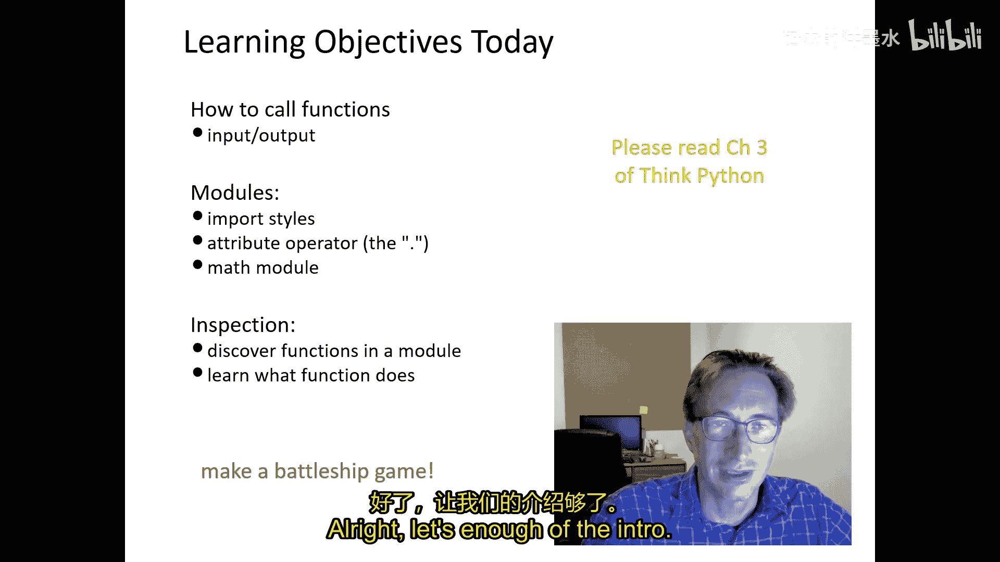
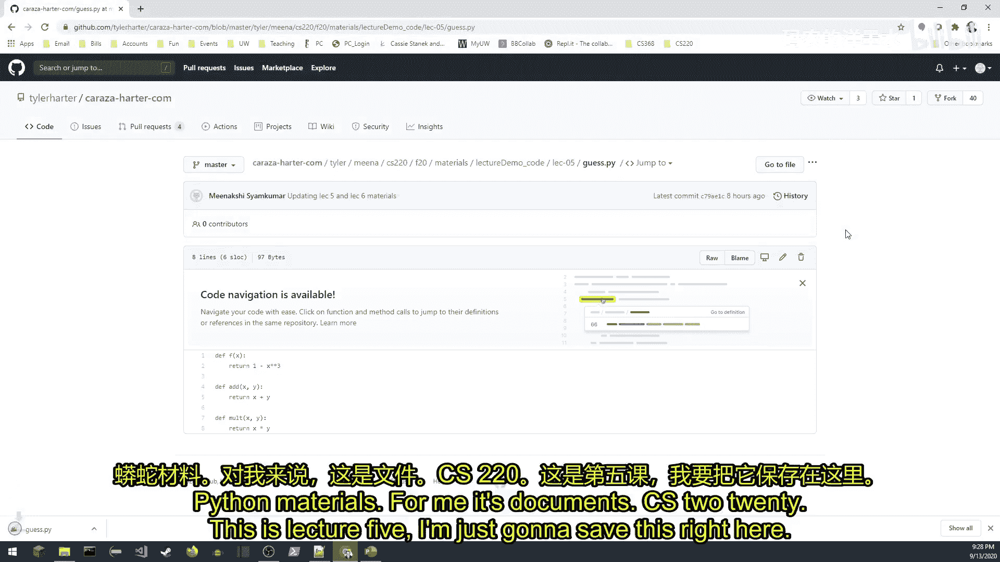
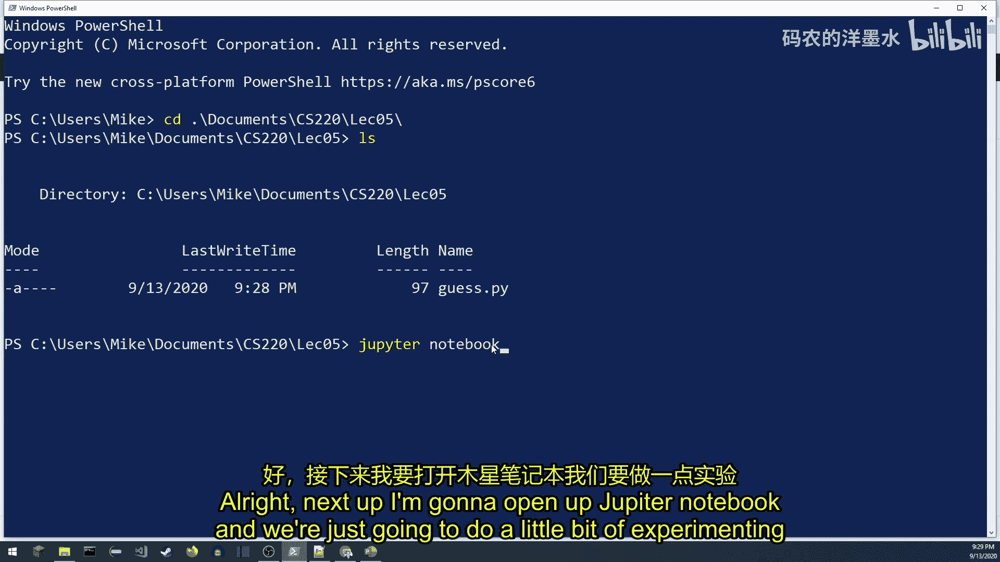
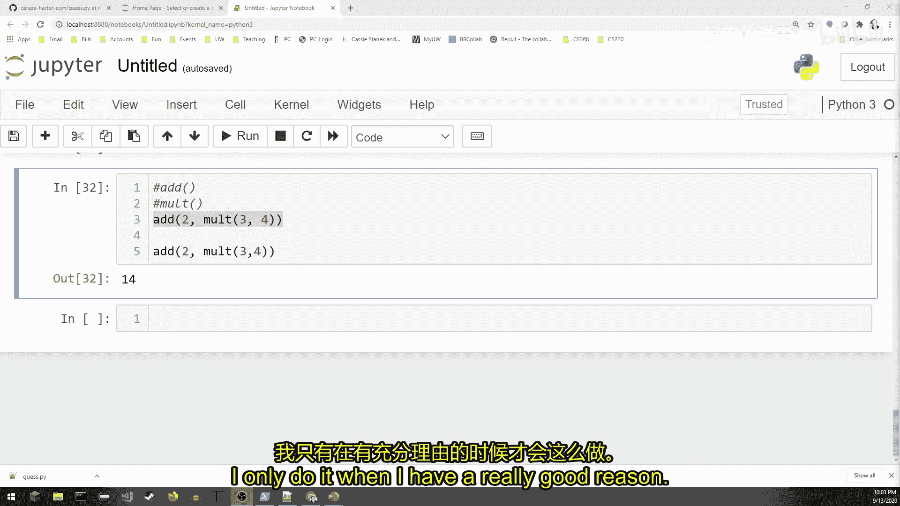
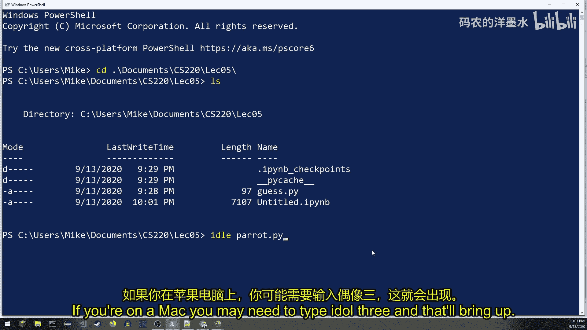
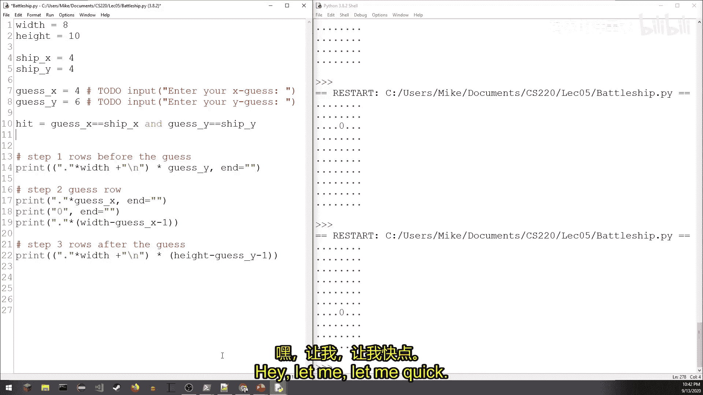
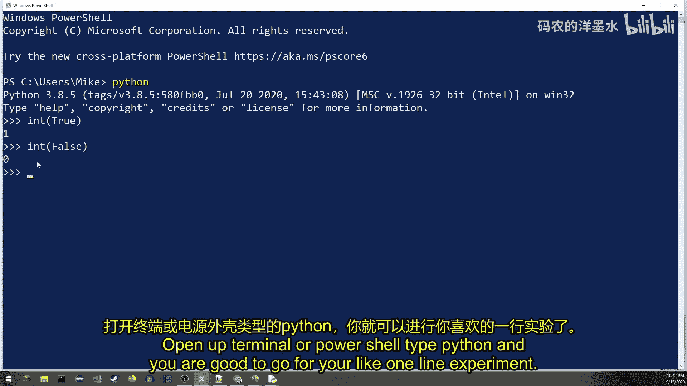
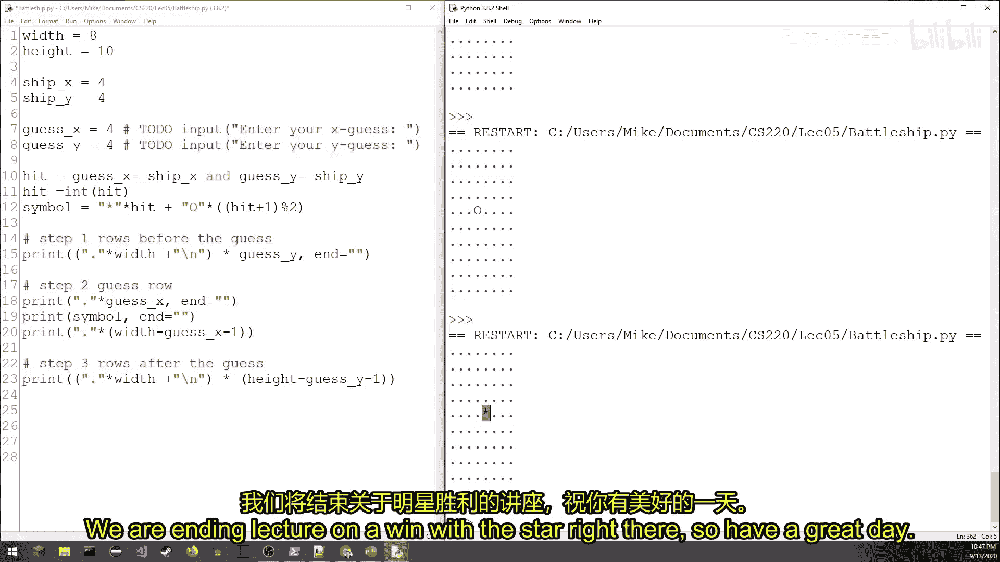

# 007：函数







在本节课中，我们将要学习Python中函数的基本概念和使用方法。函数是编程中用于封装代码、执行特定任务的重要工具。我们将从调用现有函数开始，理解参数传递和返回值，并通过一个简单的“战舰”游戏项目来实践所学知识。

## 调用函数

上一节我们介绍了课程概述，本节中我们来看看如何调用函数。调用函数意味着告诉Python执行一段预先定义好的代码。

要调用一个函数，你需要知道它的名称，并在名称后加上一对括号 `()`。括号内可以放置传递给函数的数据，这些数据称为**参数**。

以下是调用函数的基本语法：
```python
函数名(参数1, 参数2, ...)
```

例如，我们常用的 `print` 函数：
```python
print("Hello, World!")
```
这行代码调用了 `print` 函数，并将字符串 `"Hello, World!"` 作为参数传递给它，函数执行后会在屏幕上输出这段文字。

另一个例子是 `type` 函数，它返回一个值（即数据的类型），我们可以将这个返回值存储在一个变量中：
```python
x = 3.14
t = type(x)
print(t)  # 输出：<class 'float'>
```
在这个例子中，`type(x)` 是一个**函数调用**，`x` 是传递给它的**参数**，函数执行后**返回**了 `x` 的数据类型，我们将其存储在变量 `t` 中。

## 参数与返回值

上一节我们学习了如何调用函数，本节中我们来深入了解函数的两个核心概念：参数和返回值。

**参数**是调用函数时传递给它的信息。函数内部使用**参数**（在函数定义时指定的变量名）来接收这些外部传入的值。
**返回值**是函数执行完成后，返回给调用者的结果。

考虑一个数学函数 `f(x) = -x³ + 1`。在编程中，我们可以这样调用它（假设它已被定义）：
```python
y = f(2)  # 调用函数f，传入参数2
print(y)  # 输出：-7
```
这里，`2` 是调用函数 `f` 时传递的**参数**。函数内部进行计算 `-(2³) + 1 = -7`，然后将结果 `-7` **返回**，我们将其赋值给变量 `y`。

函数也可以没有参数或不返回任何值。例如，`print` 函数的主要作用是输出信息，它通常不返回有意义的值（在Python中，它返回 `None`）。



## 使用现有函数



Python内置了许多有用的函数，我们一直在使用它们，比如 `print`、`type` 和 `input`。

`input` 函数用于从用户那里获取输入。它会暂停程序，等待用户在终端输入一些内容并按回车键，然后将输入的内容作为字符串返回。
```python
name = input("请输入你的名字：")
print("你好，" + name)
```
运行这段代码时，程序会显示“请输入你的名字：”，等待你输入。你输入“小明”并回车后，程序会输出“你好，小明”。

需要注意的是，`input` 函数**总是返回字符串**。即使你输入的是数字，它也会被当作字符串处理。如果需要进行数学计算，需要使用 `int()` 或 `float()` 函数进行类型转换，这个过程称为**类型转换**或**强制转换**。
```python
num_str = input("请输入一个数字：")  # 用户输入"5"
num_int = int(num_str)             # 将字符串"5"转换为整数5
result = num_int * 2
print(result)                      # 输出：10
```

## 函数的更多特性：关键字参数

`print` 函数有一些高级用法，它接受**关键字参数**来改变其默认行为。

默认情况下，`print` 用空格分隔多个参数，并在输出末尾添加换行符。但我们可以通过 `sep` 和 `end` 参数来自定义这些行为。

`sep` 参数指定了分隔多个输出项的字符串：
```python
print(1, 2, 3, sep='-')  # 输出：1-2-3
print(1, 2, 3, sep=', ') # 输出：1, 2, 3
```

`end` 参数指定了在输出末尾添加的字符串，默认是换行符 `\n`：
```python
print("Hello", end=' ')
print("World!")          # 输出：Hello World!（在同一行）
```
在第一个 `print` 中，我们将 `end` 设置为空格，所以它输出“Hello”后没有换行，而是加了一个空格。接着第二个 `print` 在同一行继续输出“World!”。

## 实践项目：简单战舰游戏

现在，让我们运用所学的关于函数、输入、输出和字符串操作的知识，来创建一个简单的文本版战舰游戏。

这个游戏的目标是猜测电脑隐藏在一张网格中的战舰位置。网格大小为8x8，战舰只占一个格子且位置固定。玩家输入坐标进行猜测，程序会显示猜测结果。

以下是构建这个游戏的核心步骤和代码逻辑：

1.  **设置游戏参数**：定义网格大小、战舰位置和玩家猜测。
    ```python
    width = 8
    height = 8
    ship_x = 4
    ship_y = 4
    guess_x = 1  # 可以改为从 input 获取
    guess_y = 1  # 可以改为从 input 获取
    ```

2.  **绘制初始网格**：用点号 `.` 表示未知区域。
    ```python
    # 打印整个网格
    print(('.' * width + '\n') * height, end='')
    ```

3.  **处理猜测并更新显示**：这是游戏的核心逻辑。我们需要分三部分打印网格：猜测行之前的行、猜测行本身、猜测行之后的行。在猜测行中，需要判断是击中（用`*`表示）还是未击中（用`O`表示）。
    ```python
    # 判断是否击中
    hit = (guess_x == ship_x) and (guess_y == ship_y)
    # 击中为1，未击中为0
    hit_num = int(hit)

    # 打印猜测行之前的行
    print(('.' * width + '\n') * guess_y, end='')

    # 打印猜测行
    # 击中显示*，未击中显示O
    symbol = '*' * hit_num + 'O' * (1 - hit_num)
    print('.' * guess_x + symbol + '.' * (width - guess_x - 1))

    # 打印猜测行之后的行
    print(('.' * width + '\n') * (height - guess_y - 1), end='')
    ```

4.  **整合与交互**：将上述步骤整合，并使用 `input` 函数让玩家动态输入猜测坐标，替换掉代码中写死的 `guess_x` 和 `guess_y`。
    ```python
    guess_x = int(input("请输入猜测的X坐标（0-7）："))
    guess_y = int(input("请输入猜测的Y坐标（0-7）："))
    ```

通过这个项目，你实践了如何调用函数（`print`, `input`, `int`）、传递参数、使用返回值，并利用这些基础构建了一个有交互的小程序。





## 总结

本节课中我们一起学习了Python函数的基础知识。我们了解了如何**调用**函数，以及**参数**和**返回值**的概念。我们练习使用了 `print`、`input`、`type`、`int`、`float` 等内置函数，并探索了 `print` 函数的 `sep` 和 `end` 等关键字参数。最后，我们通过创建一个简单的文本版战舰游戏，综合运用了这些知识，包括获取用户输入、进行类型转换、条件判断和格式化输出。



记住，函数的核心思想是**封装**：你不需要知道函数内部如何实现，只需要知道它的名称、需要什么参数以及它会返回什么结果。这就像开车不需要懂得发动机原理一样。掌握如何使用现有函数是成为高效程序员的关键第一步。