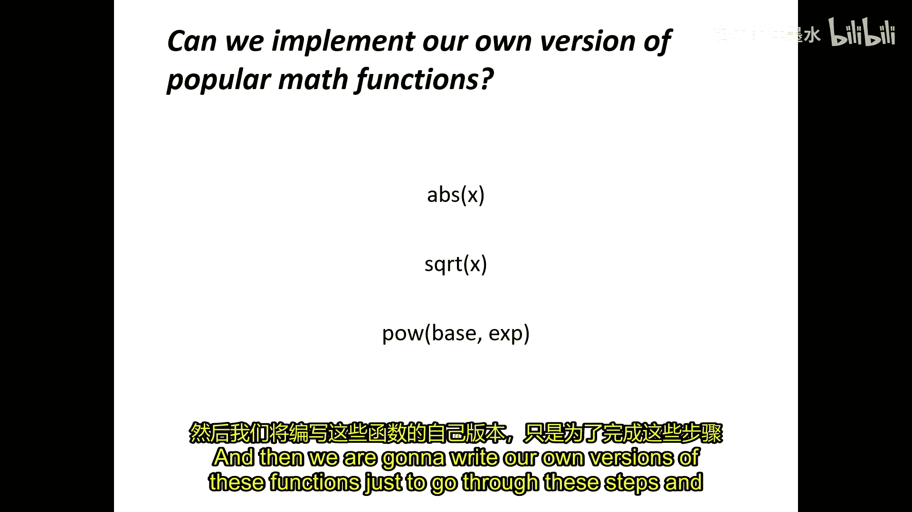
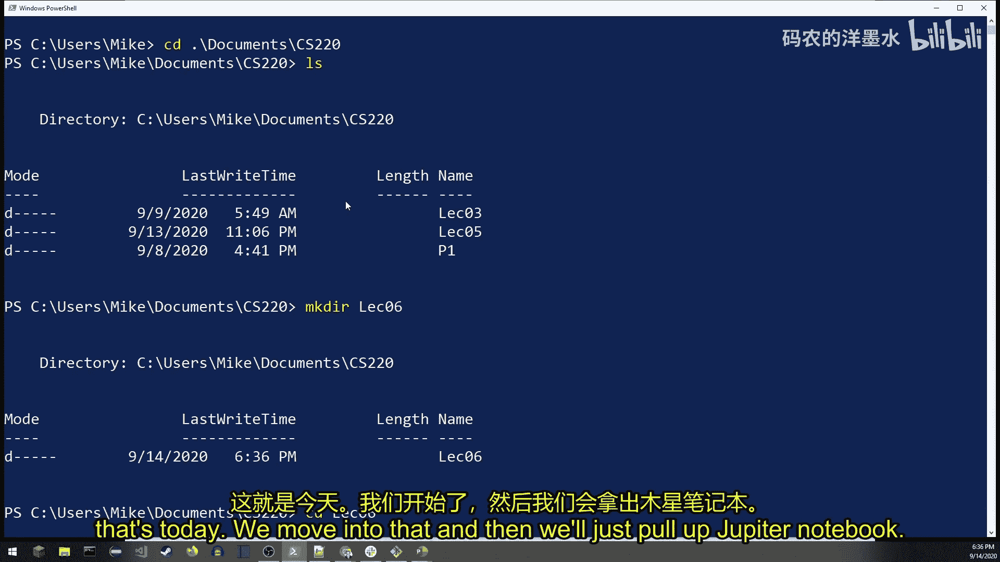
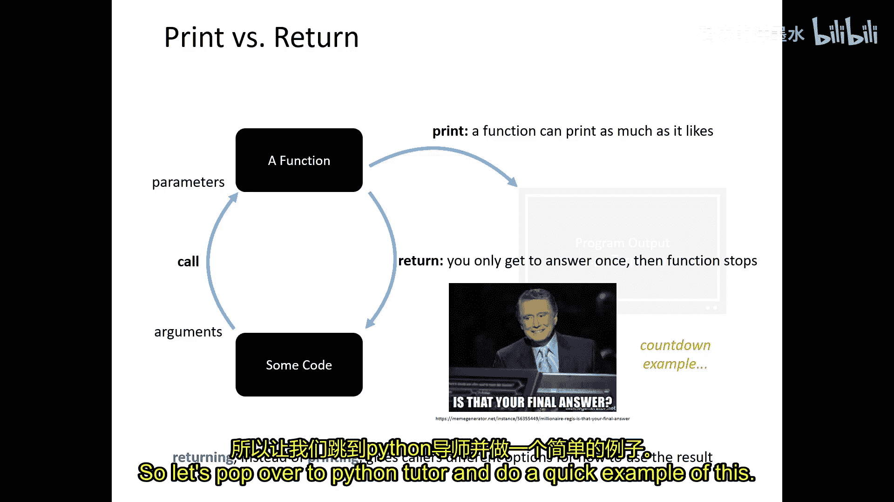
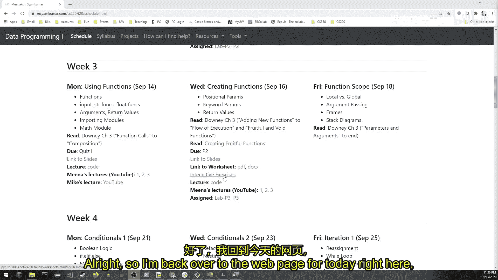
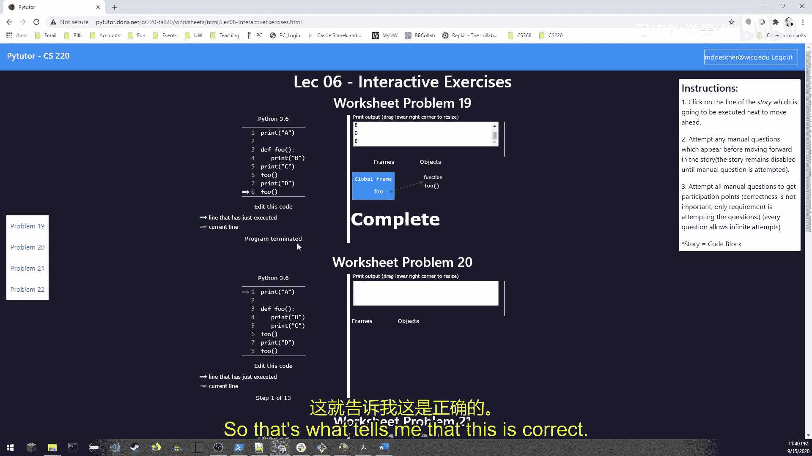

# 008：创建函数

在本节课中，我们将学习如何创建自定义函数。我们将涵盖函数的基本语法、不同类型的参数（位置参数、关键字参数、默认参数），以及函数如何通过打印或返回值来执行操作。课程最后，我们将通过一些示例来巩固理解。

---

## 函数基础：语法与结构

上一节我们介绍了课程概述，本节中我们来看看函数的基本语法。

在数学中，我们有一个函数，例如 **f(x) = x²**。在Python中，我们将其转换为代码。以下是其对应关系：

*   **函数名**：在数学中是 `f`，在Python中也是 `f`。
*   **参数**：数学函数接受 `x`，在Python中，`x` 放在括号内。
*   **定义关键字**：Python使用 `def` 关键字来定义一个函数。
*   **冒号**：Python中的冒号 `:` 类似于数学中的等号 `=`，表示后续缩进的代码属于该函数。
*   **函数体**：在数学中是等号右侧的表达式。在Python中，我们需要使用 `return` 语句明确指定要返回的值。
*   **缩进**：函数体内的所有语句必须缩进（通常是4个空格），这是Python识别代码块的方式。

让我们看另一个计算圆面积的函数。数学公式是 **A = πr²**。在Python中，我们可以这样写：

```python
def area_of_circle(radius):
    pi = 3.14159
    area = pi * radius ** 2
    return area
```

我们也可以使用更长的、描述性的变量名，并且函数体可以包含多个步骤。例如，如果我们从直径开始计算：



```python
def area_from_diameter(diameter):
    radius = diameter / 2
    pi = 3.14159
    area = pi * radius ** 2
    return area
```



所有属于函数体的代码行都必须保持相同的缩进。

---

## 函数类型：执行操作与返回值

上一节我们介绍了函数的基本结构，本节中我们来看看函数的两种主要类型。

函数主要分为两类：
1.  **执行操作的函数**：这类函数执行一个动作，例如打印内容、修改变量或移动机器人。它们不一定返回一个具体的值。
2.  **返回值的函数**：这类函数进行计算并返回一个结果，类似于数学函数。在课程中，我们有时称之为“有成果的函数”。

有些函数可能同时具备这两种特性。

---

## 实践：探索与创建函数

了解了函数类型后，让我们通过实践来加深理解。我们将先探索Python内置函数的行为，然后创建自己的版本。

以下是几个内置函数的例子及其自定义实现：

**1. 绝对值函数 `abs()`**

内置函数 `abs(-3)` 返回 `3`。我们可以创建自己的版本：

```python
def absolute_value(x):
    return (x ** 2) ** 0.5
```

**2. 平方根函数 `sqrt()`**

平方根函数位于 `math` 模块中，需要先导入：

```python
from math import sqrt
print(sqrt(25)) # 输出 5.0
```

自定义版本：

```python
def square_root(x):
    return x ** 0.5
```

**3. 幂函数 `pow()`**

内置函数 `pow(2, 3)` 返回 `8`。自定义版本：

```python
def power(base, exp):
    return base ** exp
```

---

## 参数详解：位置、关键字与默认值

上一节我们实践了创建函数，本节中我们深入探讨如何向函数传递参数。

Python提供了灵活的参数传递方式：

*   **位置参数**：根据参数在定义时的顺序进行匹配。
*   **关键字参数**：在调用函数时，通过参数名明确指定值。关键字参数必须位于所有位置参数之后，但彼此之间顺序可以任意。
*   **默认参数**：在定义函数时为参数指定默认值。调用时如果未提供该参数的值，则使用默认值。

以下是使用示例：

```python
def power(base, exp=2): # exp 是默认参数，默认值为 2
    return base ** exp

# 使用位置参数
print(power(4, 3)) # 64
# 使用关键字参数（顺序可调换）
print(power(exp=3, base=4)) # 64
# 使用默认参数
print(power(4)) # 16，相当于 power(4, 2)
# 错误示例：位置参数在关键字参数之后
# print(power(exp=3, 4)) # 语法错误
```

理解参数填充的优先级很重要：**位置参数 > 关键字参数 > 默认参数**。

---

## 模块：组织你的代码

上一节我们讨论了函数参数，本节中我们来看看如何通过模块来组织函数。

模块是包含函数集合的Python文件（扩展名为 `.py`）。它们可以帮助你组织代码，使其更易于管理和复用。

**使用现有模块**

例如，使用我们提供的 `dog.py` 模块：

```python
from dog import * # 导入 dog 模块中的所有函数
speak() # 输出: bark bark bark bark bark
stick = fetch() # fetch 函数返回字符串 'stick'
print(stick) # 输出: stick
```

**创建自己的模块**

创建一个名为 `cat.py` 的文件，内容如下：

```python
def speak():
    """This function makes the cat meow.""" # 文档字符串
    print("meow")
```

然后在主程序中使用它：

```python
import cat # 导入整个模块
cat.speak() # 输出: meow
```

为了避免函数名冲突，建议使用 `import module_name` 的方式，然后通过 `module_name.function_name()` 来调用函数。

**探索模块**



你可以查看模块中包含哪些函数：

```python
import math
print(dir(math)) # 列出 math 模块中的所有属性和函数
```

你也可以查看特定函数的文档：

```python
print(math.ceil.__doc__) # 查看 ceil 函数的文档字符串
print(math.ceil(2.3)) # 3，向上取整
```

---

## 返回值 vs. 打印输出

在编写函数时，一个重要决策是让函数返回值，还是在函数内部直接打印。

*   **在函数内部打印**：函数直接控制输出。这适用于始终需要显示结果的情况，但限制了调用者对结果的使用方式（例如，无法将结果用于进一步计算）。
*   **返回值**：函数将结果交给调用者处理。调用者可以决定是打印、存储还是进行其他计算。这通常使函数更加灵活和通用。

一个函数只能执行一次 `return` 语句。一旦执行 `return`，函数会立即结束，其后的代码不会运行。

---

## 代码追踪练习

理解代码执行流程至关重要。让我们手动追踪一个包含多个函数调用的程序。

考虑以下代码：

```python
def c():
    print("C")

def b():
    print("B1")
    c()
    print("B2")

def a():
    print("A1")
    b()
    print("A2")

a()
```

执行顺序和输出如下：
1.  调用 `a()`。
2.  `a()` 打印 `A1`。
3.  `a()` 调用 `b()`。
4.  `b()` 打印 `B1`。
5.  `b()` 调用 `c()`。
6.  `c()` 打印 `C`。
7.  `c()` 结束，返回 `b()`。
8.  `b()` 打印 `B2`。
9.  `b()` 结束，返回 `a()`。
10. `a()` 打印 `A2`。

最终输出为：
```
A1
B1
C
B2
A2
```

---

## 课程总结

本节课中我们一起学习了如何创建和使用Python函数。



我们涵盖了以下核心概念：
*   函数的基本语法，包括 `def` 关键字、参数、冒号和缩进。
*   两种主要的函数类型：执行操作的函数和返回值的函数。
*   三种参数传递方式：位置参数、关键字参数和默认参数，以及它们的优先级规则。
*   如何通过模块来组织函数，以及如何导入和使用模块。
*   在函数内部打印输出与返回值的区别，通常返回值的函数更具灵活性。
*   通过代码追踪来理解程序的执行流程。



掌握这些概念是构建更复杂、模块化程序的基础。