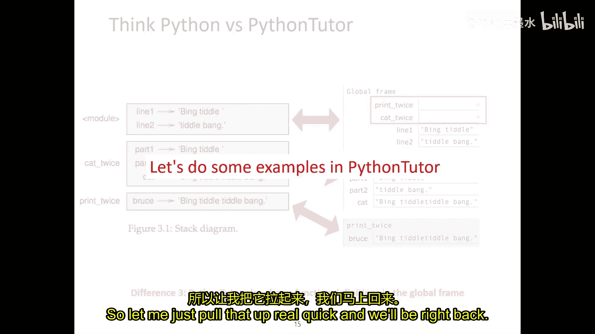
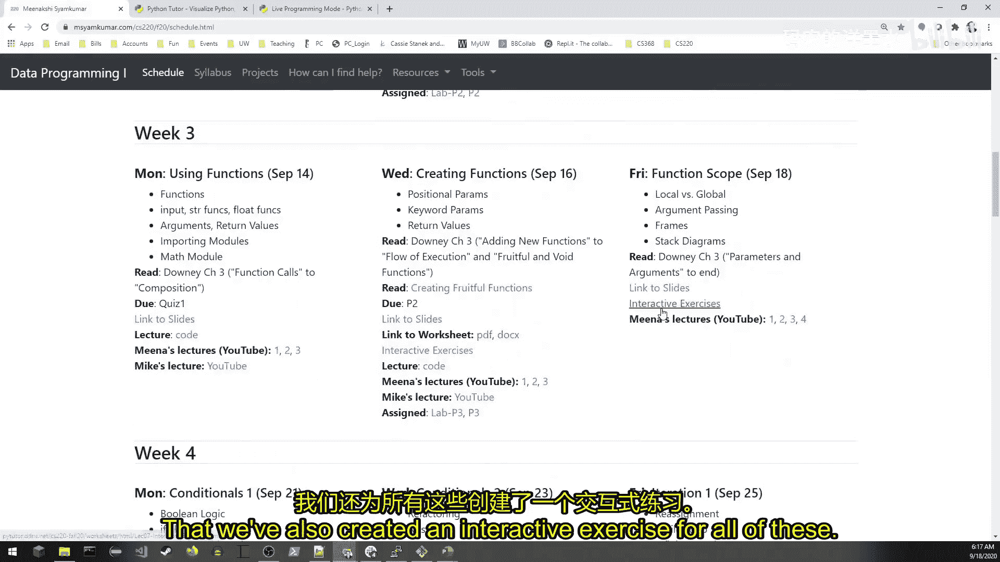
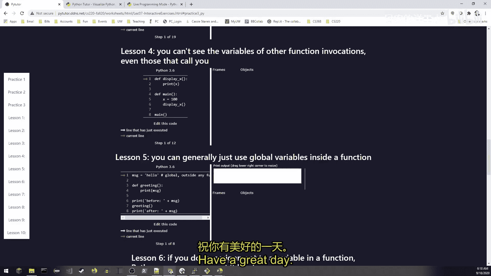

# 009：函数作用域 🧭

在本节课中，我们将要学习函数作用域。这是一个关于函数与变量关系的核心概念，理解它对于编写和阅读Python代码至关重要。我们将探讨变量在何处被创建、如何被访问以及何时被销毁，并学习管理变量可见性的规则。

## 概述

上一节我们介绍了函数的基本概念。本节中，我们来看看函数作用域。作用域决定了在代码的哪个部分可以访问哪个变量。我们将通过10条规则来系统地学习局部变量、全局变量以及参数传递的相关知识。

## 局部变量规则

首先，我们来学习关于局部变量的四条规则。局部变量是在函数内部创建的变量。

### 规则 1：函数不执行，除非被调用

函数定义本身不会执行其内部的代码。只有在函数被调用时，其内部的语句才会运行。

```python
def set_x():
    x = 100

print(x)  # 错误：NameError: name 'x' is not defined
```
在上面的代码中，`set_x`函数从未被调用，因此变量`x`从未被创建。

### 规则 2：函数内创建的变量在函数返回后消亡

在函数内部创建的变量（局部变量）的生命周期仅限于该函数的执行期间。一旦函数执行完毕并返回，其局部变量就会被销毁。

```python
def set_x():
    x = 100

set_x()
print(x)  # 错误：NameError: name 'x' is not defined
```
即使调用了`set_x`函数，其内部的变量`x`在函数返回后也不复存在。

### 规则 3：每次函数调用都会创建全新的局部变量

每次调用函数时，都会为其创建一个全新的帧（frame），其中的局部变量也是全新的，不会保留上一次调用的值。

```python
def count():
    x = 1
    x += 1
    print(x)



count()  # 输出：2
count()  # 输出：2 （不是3）
```
两次调用`count`函数，每次都会创建一个新的变量`x`并将其初始化为1。

### 规则 4：函数无法看到调用者的局部变量

一个函数不能直接访问调用它的那个函数（父函数）的局部变量。这些变量对它是“不可见”或“超出作用域”的。

```python
def display_x():
    print(x)

def main():
    x = 100
    display_x()

main()  # 错误：NameError: name 'x' is not defined
```
`display_x`函数试图访问变量`x`，但`x`是`main`函数的局部变量，对`display_x`不可见。

## 全局变量规则

接下来，我们学习关于全局变量的四条规则。全局变量是在所有函数之外定义的变量。

### 规则 5：函数可以读取全局变量（无需特殊声明）

在函数内部，可以直接读取（访问）全局变量的值。

```python
message = “hello”

def greeting():
    print(message)  # 可以访问全局变量 message

greeting()  # 输出：hello
```

### 规则 6：在函数内赋值会创建新的局部变量（而非修改全局变量）

如果在函数内部对变量进行赋值操作（使用`=`），Python会默认创建一个新的局部变量，即使存在同名的全局变量。

```python
message = “hello”

def greeting():
    message = “welcome”  # 创建新的局部变量 message
    print(message)

print(“before:”, message)  # 输出：before: hello
greeting()                 # 输出：welcome
print(“after:”, message)   # 输出：after: hello （全局变量未改变）
```

### 规则 7：Python会向前查找函数内的赋值语句

Python在解析函数时，会预先扫描整个函数体。如果发现任何对变量的赋值语句，那么在整个函数范围内，该变量都会被当作局部变量处理，即使在赋值之前引用它也是如此。

```python
message = “hello”

def greeting():
    print(message)        # 错误！因为下一行有对message的赋值
    message = “welcome”   # 这使得整个函数内的message都是局部变量

greeting()  # UnboundLocalError: local variable ‘message’ referenced before assignment
```

### 规则 8：使用`global`声明可以修改全局变量

如果确实需要在函数内部修改全局变量，可以使用`global`关键字进行声明。

```python
message = “hello”

def greeting():
    global message        # 声明 message 是全局变量
    print(message)        # 输出：hello
    message = “welcome”   # 修改全局变量

print(“before:”, message)  # 输出：before: hello
greeting()                 # 输出：hello （函数内打印）
print(“after:”, message)   # 输出：after: welcome （全局变量被修改）
```
使用`global`会带来“副作用”，即函数影响了外部状态，通常建议谨慎使用。

## 参数传递规则

最后，我们来看关于参数传递的两条规则。参数是将数据从函数外部传递到内部的桥梁。

### 规则 9：修改形参不会影响实参

函数内部的参数（形参）是局部变量。修改形参的值，不会影响函数外部用来传递数据的那个变量（实参）。

```python
def f(x):
    x = “b”
    print(“inside f:”, x)  # 输出：inside f: b

val = “a”
print(“before:”, val)  # 输出：before: a
f(val)                 # 传递 val 的值 “a” 给形参 x
print(“after:”, val)   # 输出：after: a （val 未改变）
```

### 规则 10：即使形参与实参同名，它们也是不同的变量

即使函数外部的变量（实参）和函数内部的参数（形参）名字相同，它们也是两个独立的变量，位于不同的作用域。

```python
def f(x):               # 这个 x 是局部形参
    x = “b”
    print(“inside f:”, x)  # 输出：inside f: b

x = “a”                 # 这个 x 是全局变量
print(“before:”, x)     # 输出：before: a
f(x)                    # 将全局变量 x 的值 “a” 复制给局部形参 x
print(“after:”, x)      # 输出：after: a （全局变量 x 未改变）
```
函数`f`内部的`x`是局部变量，修改它不会影响外部的全局变量`x`。



## 总结



本节课中我们一起学习了Python函数作用域的10条核心规则。
我们了解了局部变量的生命周期和独立性，掌握了全局变量的访问与修改方法，并理解了参数传递时值复制的特性。
记住这些规则的关键在于理解“帧”的概念：每次函数调用都会创建一个新的局部帧，变量在其中诞生、被访问、然后消亡。
合理运用这些知识，可以帮助你编写出结构清晰、易于调试的代码。