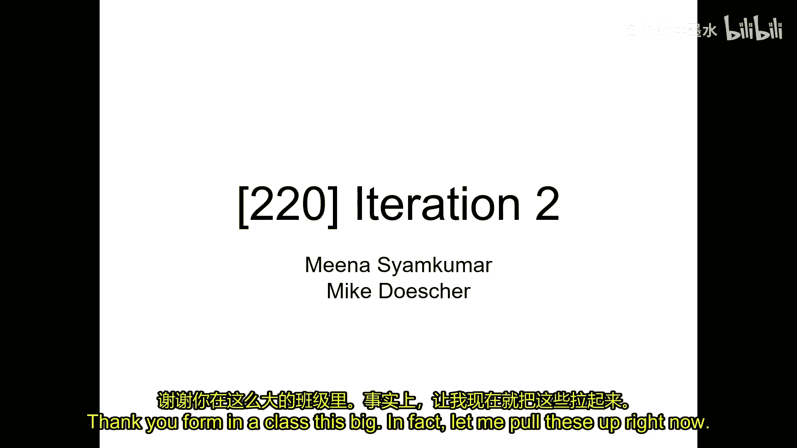
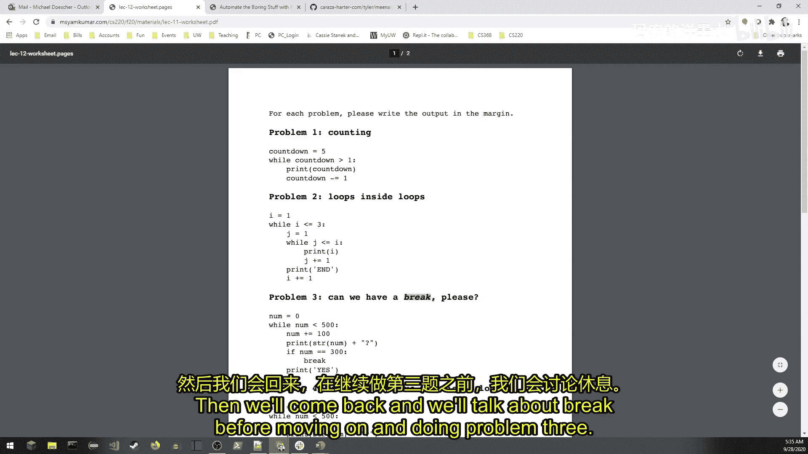
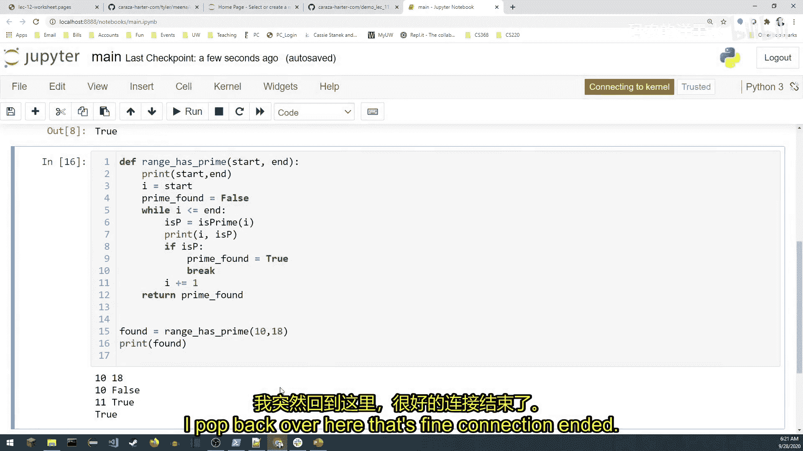
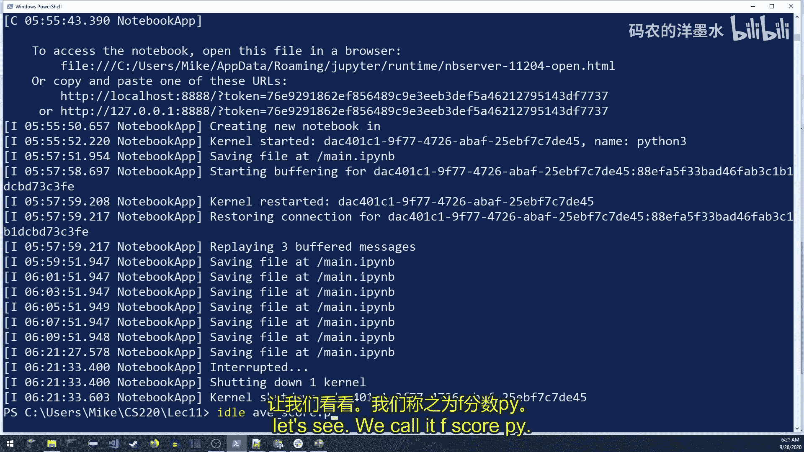
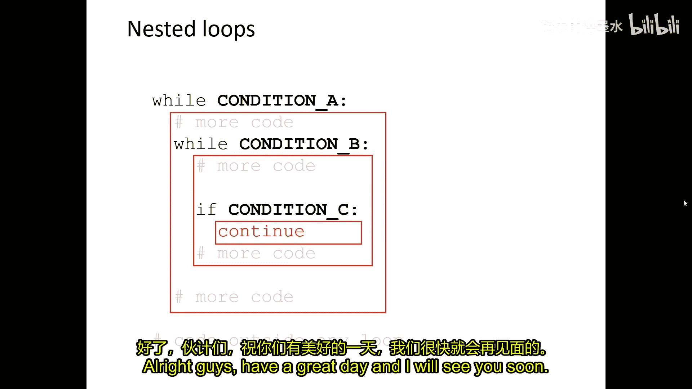

# 010：第二轮迭代



## 概述

在本节课中，我们将学习高级迭代概念，包括 `break` 和 `continue` 语句。我们将探讨几种常见的循环设计模式，并通过实例理解如何高效地阅读和编写循环代码。掌握这些模式将帮助你更清晰地理解他人代码的逻辑。

---

## 课程公告与安排

在深入技术内容之前，有几个课程相关的通知。

首先，感谢大家的关心。我上周日出现胸痛，今天下午在急诊室接受了心电图和心脏压力测试。因此，我将无法参加今天的办公时间，明天恢复。对此带来的不便，我深表歉意。

关于课程安排，我们有一个合作伙伴匹配表格，适用于为即将在周三发布的下一个项目寻找搭档的同学。随着学期推进，项目会变得更长，期末项目每周可能耗时长达8小时。填写表格后，我们会为你推荐合适的搭档。

此外，我们还有一个感谢表格。如果你觉得某位助教在办公时间提供了特别帮助，请填写此表格。他们的工作值得被看见和感谢。

最后，第一次考试将在周五进行。考试详情已通过邮件发送。我强烈建议你通过复习往期试卷、阅读教材（如《Automate the Boring Stuff》的前三章）以及查看课程大纲来备考。考试期间，你可以使用网络和笔记，但禁止与他人交流。

---

## 循环设计模式

上一节我们介绍了循环的基础。本节中，我们来看看几种常见的循环设计模式。理解这些模式能让你更快地解读代码逻辑，就像熟悉五段式文章结构有助于快速理解论文一样。

### 模式一：执行固定次数

这种模式用于将一段代码重复执行固定的次数。

**核心结构：**
```python
i = 0
while i < n:
    # 执行某些操作
    i += 1
```
或者从1开始计数：
```python
i = 1
while i <= n:
    # 执行某些操作
    i += 1
```



**分析步骤：**
1.  找到循环条件（`while`语句）。
2.  识别循环控制变量（例如 `i`）。
3.  找到所有改变该变量的地方（初始化和递增/递减）。
4.  理解循环体（“三明治”的中间部分）在每个迭代中做了什么。

通过“展开”循环（想象将循环体复制粘贴N次）来思考，比逐行跟踪执行更高效。

### 模式二：处理数据集中的所有项

这种模式用于遍历一个已知大小的数据集（例如列表、表格中的每一行）。

**核心结构：**
```python
i = 0
while i < count_rows(data_table):
    item = get_item(data_table, i) # 获取第i项数据
    # 对item进行操作（如求和、查找最大值等）
    i += 1
```
这里，`count_rows` 函数返回数据项的总数，`get_item` 函数根据索引 `i` 获取具体数据。

### 模式三：处理数据直到结束

这种模式适用于数据量未知或由模块提供数据流的情况。

**核心结构：**
```python
while has_more_data():
    item = get_next_data()
    # 对item进行操作
```
模块会提供两个函数：`has_more_data()` 返回布尔值指示是否还有数据；`get_next_data()` 返回下一个数据项，并在内部管理当前读取位置。

---

## 循环嵌套分析

现在，我们来看看包含嵌套循环的代码。处理嵌套循环的关键是由外向内逐层分析。

以下是分析嵌套循环的步骤：
1.  识别最外层的循环及其控制变量。
2.  确定该变量的变化范围和规律。
3.  将外层循环体（包含内层循环）视为一个整体，针对外层变量的每个取值，“展开”执行一次。
4.  在每次“展开”中，再对内层循环进行分析。

通过这种分层“展开”的方法，可以清晰地理解复杂的嵌套逻辑。

---

## Break语句

`break` 语句提供了一种提前退出循环的方式。它通常与条件判断 `if` 结合使用。

**控制流图示：**
当循环体中的 `if` 条件满足并执行 `break` 时，程序会立即跳出当前循环，继续执行循环之后的代码。

**常见用途：**
在数据集中搜索特定项时，一旦找到目标，就可以使用 `break` 终止搜索，无需遍历剩余数据。

让我们通过一个寻找范围内是否存在质数的例子来实践。

**示例：检查数值范围内是否存在质数**
```python
def range_has_prime(start, end):
    i = start
    prime_found = False
    while i <= end:
        if is_prime(i): # 假设 is_prime 是已定义的函数
            prime_found = True
            break # 找到质数，立即跳出循环
        i += 1
    return prime_found
```
在这个函数中，一旦 `is_prime(i)` 返回 `True`，我们将 `prime_found` 设为 `True` 并用 `break` 跳出循环，避免不必要的后续检查。

---

## Continue语句

`continue` 语句用于跳过当前循环迭代的剩余部分，直接开始下一次迭代。

**控制流图示：**
当循环体中的 `if` 条件满足并执行 `continue` 时，程序会跳过本次循环中 `continue` 之后的所有代码，直接回到循环条件判断处。

**常见用途：**
过滤无效输入。例如，在计算一系列分数的平均分时，可以跳过超出合理范围（如0-100以外）的分数。





让我们通过一个计算用户输入分数平均值的程序来演示。

**示例：计算有效分数的平均值**
```python
total = 0
count = 0
while True:
    user_input = input("Enter a score (0-100), or 'Q' to quit: ")
    if user_input == 'Q':
        print("Exiting.")
        break
    score = int(user_input)
    if score < 0 or score > 100:
        print("Bad value. Score must be between 0 and 100.")
        continue # 跳过无效分数，继续下一轮输入
    total += score
    count += 1
    average = total / count
    print(f"Current average: {average}")
```
在这个例子中，`continue` 确保了无效分数不会被加入 `total` 和 `count`，从而不影响平均值的计算。

---

## 嵌套循环中的Continue

需要特别注意，`continue` 语句只影响它所在的最内层循环。

例如，在下面的嵌套循环中：
```python
i = 1
while i <= 3:
    j = 1
    while j <= i:
        if some_condition:
            continue # 这只跳过内层while的当前迭代
        j += 1
    i += 1
```
当 `some_condition` 为真时，`continue` 会跳回内层 `while j <= i` 的条件判断，而不会影响外层 `while i <= 3` 的迭代。

---

## 总结



本节课我们一起学习了高级迭代技术。我们探讨了三种常见的循环设计模式，帮助你结构化地思考循环。我们深入了解了 `break` 和 `continue` 语句，它们分别用于提前终止循环和跳过当前迭代。我们还分析了如何解读嵌套循环，并强调了 `continue` 在嵌套结构中的作用范围。掌握这些概念和模式，将极大地提升你编写和阅读Python循环代码的能力。