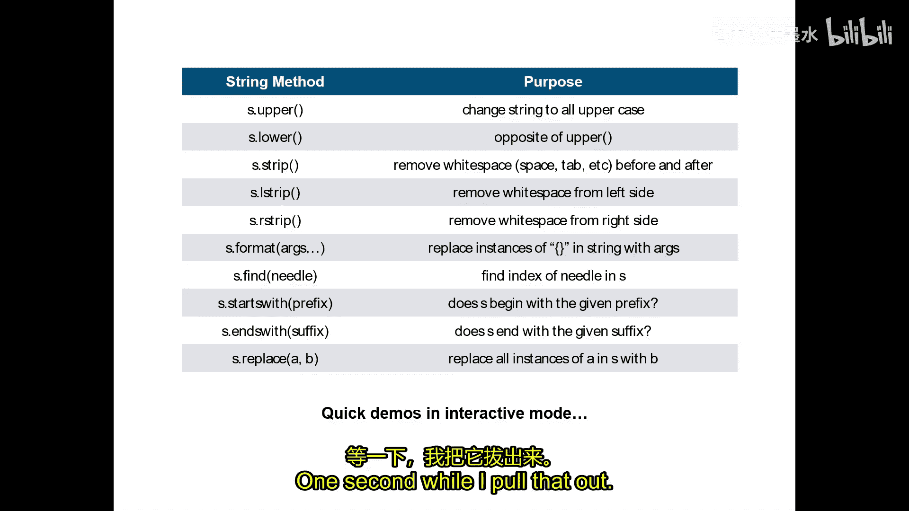
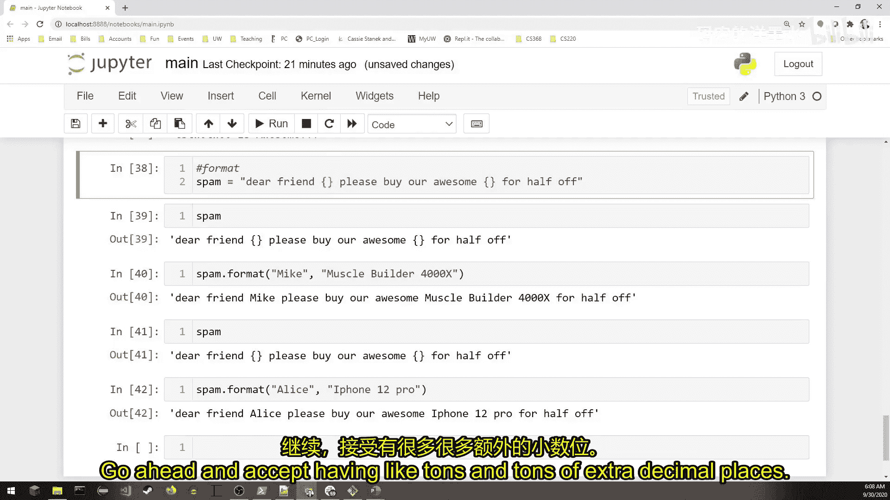
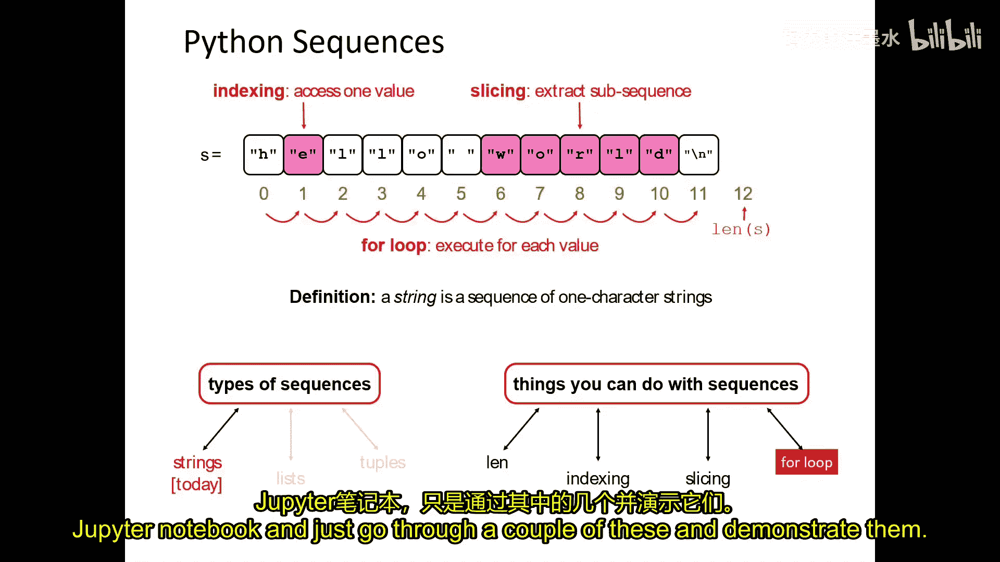
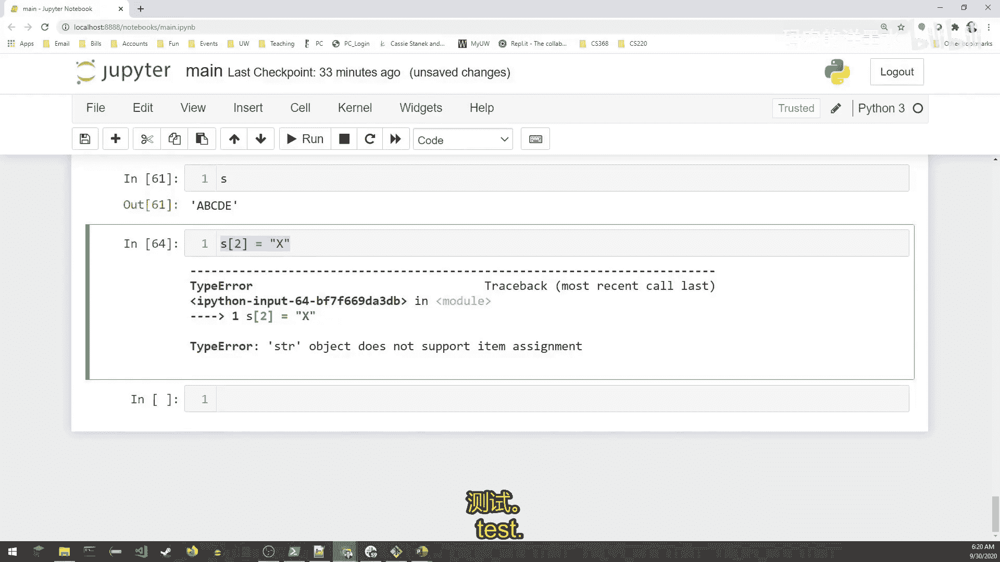
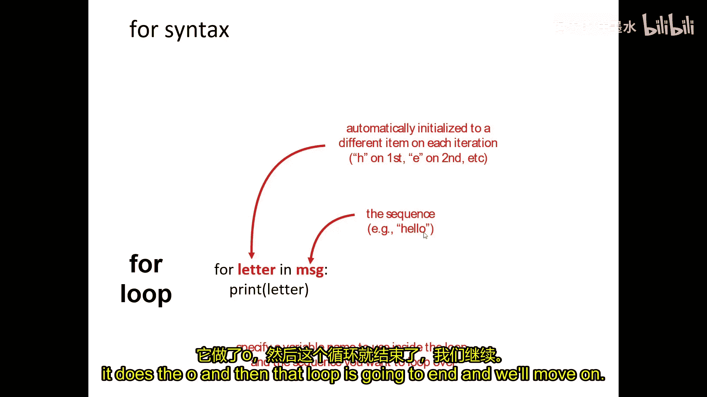
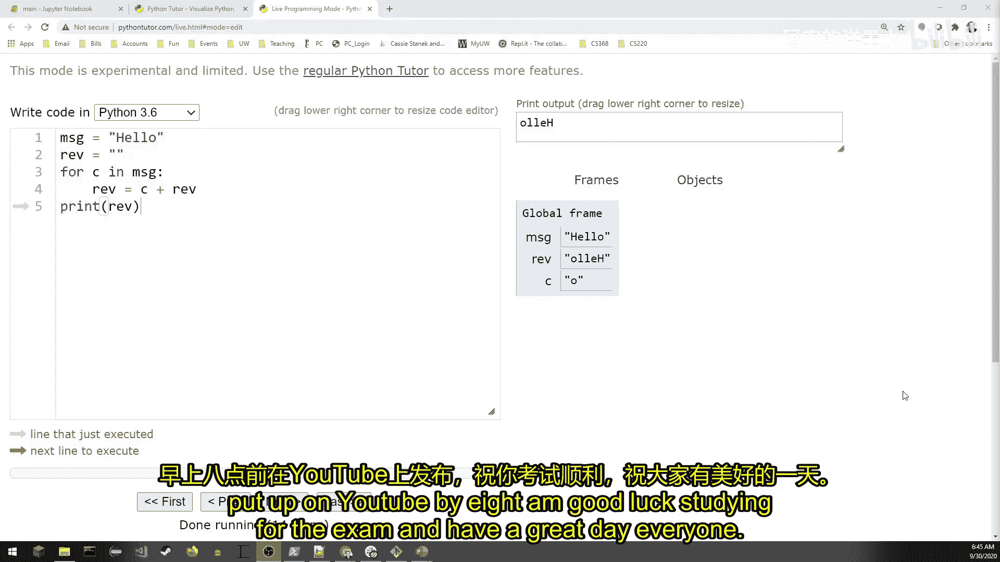

# 011：字符串与For循环 🐍

在本节课中，我们将要学习字符串的更多操作以及一种新的循环结构——`for`循环。我们将探讨字符串的比较、常用方法、序列的概念，以及如何使用`for`循环来遍历序列中的元素。

---

## 字符串比较 🔍

上一节我们介绍了字符串的基本操作，本节中我们来看看如何比较字符串。Python允许我们使用关系运算符（如 `<`, `>`, `==`）来比较字符串，其规则基于字典序（即字母顺序）。

**核心概念**：字符串比较基于字符的Unicode编码顺序。大写字母的编码小于小写字母的编码。

以下是字符串比较的几个关键点：

1.  **基本字母顺序**：比较时，Python会逐个字符地比较两个字符串，直到找到第一个不同的字符，然后根据这两个字符的编码决定大小。
    *   例如：`"cat" < "dog"` 为 `True`，因为 `'c'` 在 `'d'` 之前。
2.  **大小写敏感**：所有大写字母的编码都小于任何小写字母。
    *   例如：`"Zebra" < "apple"` 为 `True`，因为 `'Z'` 的编码小于 `'a'`。
3.  **数字作为字符**：当数字作为字符串的一部分时，比较的是字符编码，而不是数值大小。比较从第一个字符开始。
    *   例如：`"100" < "15"` 为 `True`，因为首先比较 `'1'` 和 `'1'`（相同），然后比较 `'0'` 和 `'5'`，`'0'` 的编码小于 `'5'`。
4.  **前缀关系**：如果一个字符串是另一个字符串的前缀，则较短的字符串被视为更小。
    *   例如：`"bat" < "batman"` 为 `True`，因为比较完 `"bat"` 后，第一个字符串已结束，空字符被视为小于任何其他字符。

---



## 字符串方法 📚

字符串是Python中的一种序列类型，拥有许多内置的“方法”。方法是与特定数据类型关联的函数。我们使用点号（`.`）来调用它们。

**核心概念**：方法是作用于特定对象（如字符串）的函数，调用格式为 `对象.方法名(参数)`。

以下是一些常用的字符串方法：

*   **`.upper()` 和 `.lower()`**: 将字符串中的所有字母转换为大写或小写。
    ```python
    msg = "Hello"
    print(msg.upper())  # 输出: HELLO
    print(msg.lower())  # 输出: hello
    ```
*   **`.strip()`、`.lstrip()`、`.rstrip()`**: 移除字符串首尾的空白字符（如空格、制表符、换行符）。
    ```python
    text = "  Hello World  \n"
    print(text.strip())   # 输出: "Hello World"
    print(text.lstrip())  # 输出: "Hello World  \n"
    print(text.rstrip())  # 输出: "  Hello World"
    ```
*   **`.find(sub)`**: 返回子字符串 `sub` 在字符串中第一次出现的索引（位置），如果未找到则返回 `-1`。索引从0开始。
    ```python
    s = "CS220 is awesome"
    print(s.find("is"))    # 输出: 6
    print(s.find("q"))     # 输出: -1
    ```
*   **`.startswith(prefix)` 和 `.endswith(suffix)`**: 检查字符串是否以指定的前缀或后缀开头或结尾，返回布尔值。
    ```python
    filename = "report.pdf"
    print(filename.endswith(".pdf"))  # 输出: True
    ```
*   **`.replace(old, new)`**: 将字符串中所有的 `old` 子串替换为 `new` 子串。
    ```python
    sentence = "I like apples"
    new_sentence = sentence.replace("apples", "bananas")
    print(new_sentence)  # 输出: "I like bananas"
    ```
*   **`.format()`**: 用于格式化字符串，将花括号 `{}` 占位符替换为提供的参数。
    ```python
    name = "Mike"
    product = "Muscle Builder 4000X"
    message = "Dear {}, please buy our {} for half off!".format(name, product)
    print(message)
    # 输出: Dear Mike, please buy our Muscle Builder 4000X for half off!
    ```

**重要提示**：字符串方法不会修改原始字符串，而是返回一个新的字符串。

---

## 序列操作：索引与切片 🧩

字符串是“序列”的一种。序列是元素的有序集合，每个元素都有一个位置编号，称为“索引”。Python中索引从0开始。



**核心概念**：序列允许通过索引（单个位置）和切片（一个范围）来访问其元素。

1.  **索引**：使用方括号 `[]` 和索引来获取序列中的一个元素。
    ```python
    s = "ABCDE"
    print(s[0])   # 输出: 'A' (第一个字符)
    print(s[2])   # 输出: 'C' (第三个字符)
    print(s[-1])  # 输出: 'E' (最后一个字符，负索引从-1开始)
    # s[5] 会导致 IndexError，因为索引越界。
    ```
2.  **切片**：使用 `[start:end]` 语法获取序列的一个子序列。`start` 索引是包含的，`end` 索引是不包含的。
    ```python
    word = "pizza"
    print(word[1:4])    # 输出: "izz" (索引1,2,3)
    print(word[:2])     # 输出: "pi"  (从开头到索引2，不包含2)
    print(word[3:])     # 输出: "za"  (从索引3到结尾)
    print(word[:])      # 输出: "pizza" (整个字符串的副本)
    print(word[-3:-1])  # 输出: "zz"  (使用负索引)
    ```
    *   切片非常灵活，即使索引超出范围也不会报错，只会返回尽可能多的元素。
    *   这种“含头不含尾”的设计使得分割和组合字符串变得容易，例如 `word[:3] + "..." + word[3:]`。



**注意**：字符串是不可变的，不能通过索引直接修改某个字符，如 `s[2] = 'X'` 会导致错误。必须通过创建新字符串（如使用切片和拼接）来实现修改。

---

## For循环遍历序列 🔄



`for` 循环是专门为遍历序列（如字符串、列表）而设计的迭代结构。它比 `while` 循环更简洁，无需手动管理索引计数器。

**核心概念**：`for` 循环依次将序列中的每个元素赋值给一个变量，然后执行循环体。

**基本语法**：
```python
for 变量 in 序列:
    # 循环体，对每个元素执行的操作
```

**示例：遍历字符串并打印每个字符**
```python
message = "hello"
for letter in message:
    print(letter)
# 输出:
# h
# e
# l
# l
# o
```

在这个例子中：
1.  `for` 是关键字。
2.  `letter` 是循环变量，在每次迭代中自动被赋予序列中的下一个元素。
3.  `in` 是关键字。
4.  `message` 是要遍历的序列（这里是字符串）。
5.  冒号 `:` 和缩进定义了循环体。

**对比 `while` 循环**：使用 `while` 循环实现相同功能需要手动管理索引：
```python
message = "hello"
i = 0
while i < len(message):
    letter = message[i]
    print(letter)
    i += 1
```
`for` 循环隐藏了索引管理的细节，使代码更清晰、更不易出错。

**常见模式：使用 `for` 循环构建新字符串**
一个常见的编程模式是初始化一个空字符串，然后在循环中逐步构建新字符串。
```python
# 示例：反转字符串
original = "hello"
reversed_str = ""  # 1. 初始化空字符串
for char in original:
    reversed_str = char + reversed_str  # 2. 将新字符加到前面
print(reversed_str)  # 输出: "olleh"
```



---

## 总结 📝

本节课中我们一起学习了：
1.  **字符串比较**：基于字典序，需注意大小写和数字作为字符时的比较规则。
2.  **字符串方法**：如 `.upper()`, `.find()`, `.replace()`, `.format()` 等，它们对字符串进行操作并返回新字符串。
3.  **序列操作**：字符串作为序列，支持通过**索引**获取单个元素，通过**切片**获取子串。
4.  **For循环**：一种简洁的迭代结构，专门用于遍历序列中的每个元素，无需手动管理索引，使代码更易读、更安全。



掌握这些知识将使你能够更有效地处理和操作文本数据，并为学习更复杂的数据结构（如下一单元将介绍的列表）打下坚实基础。