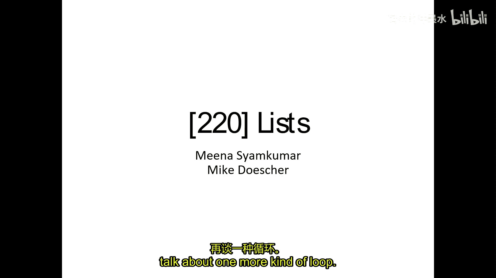
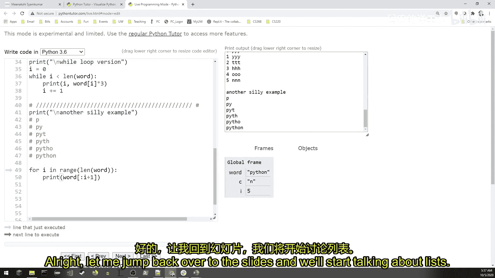
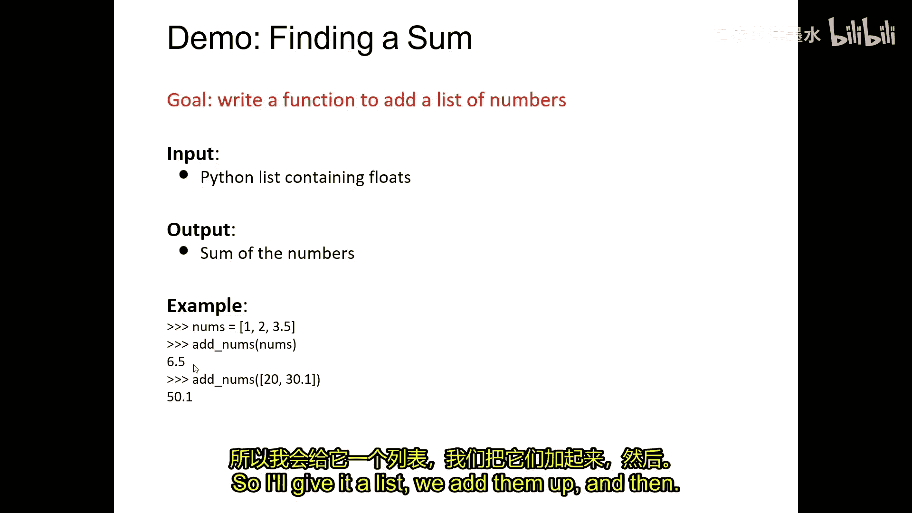
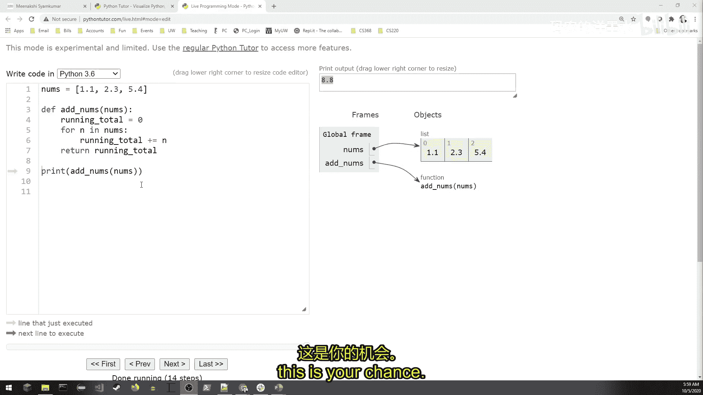
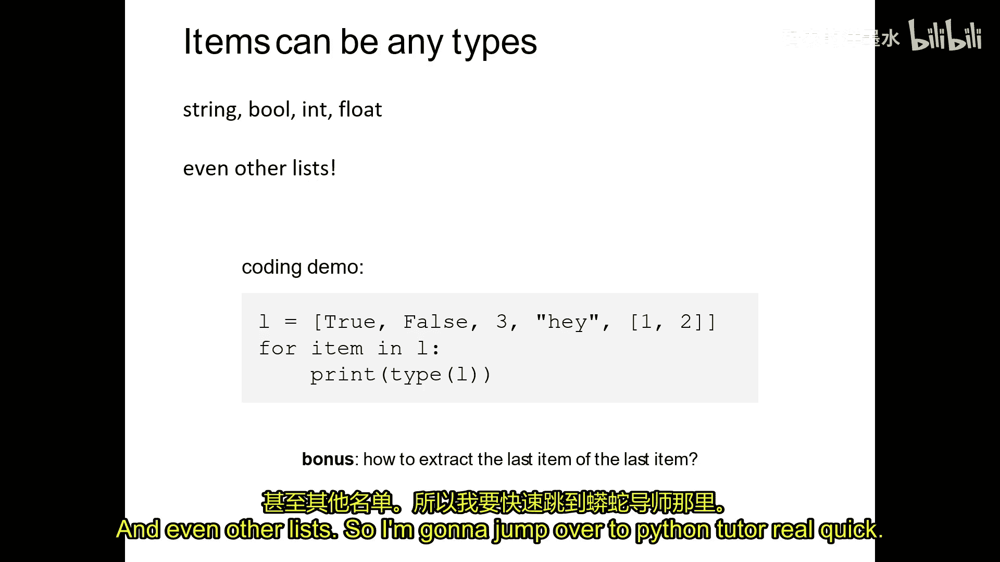
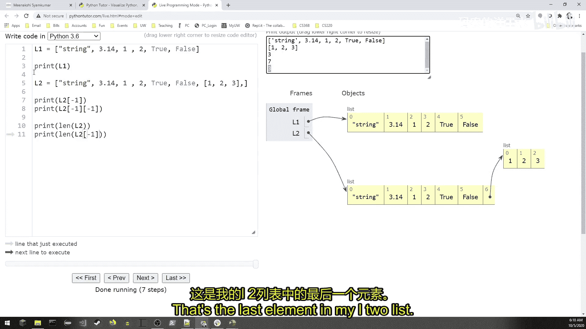
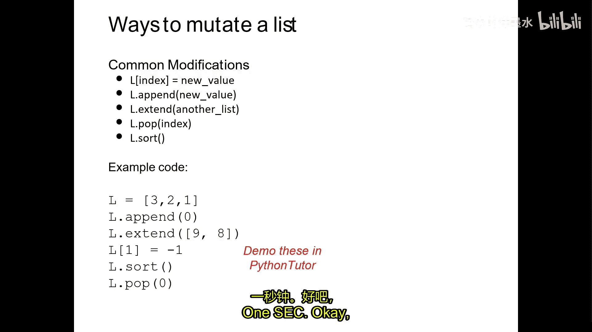
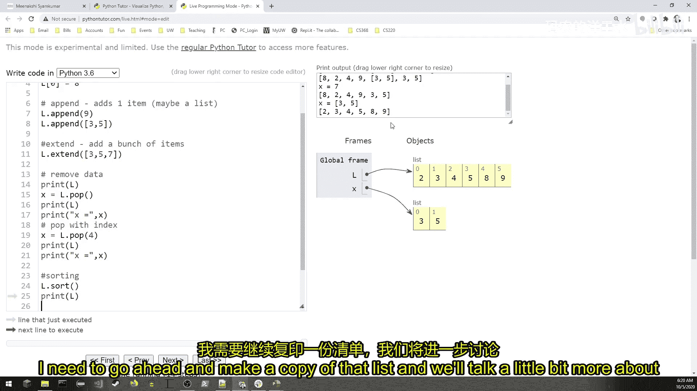
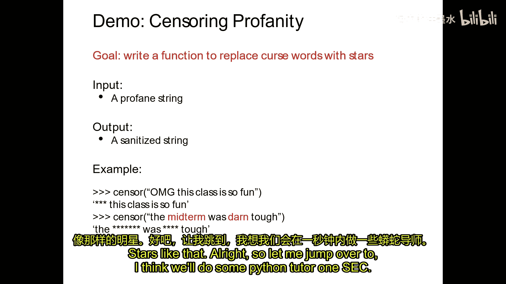
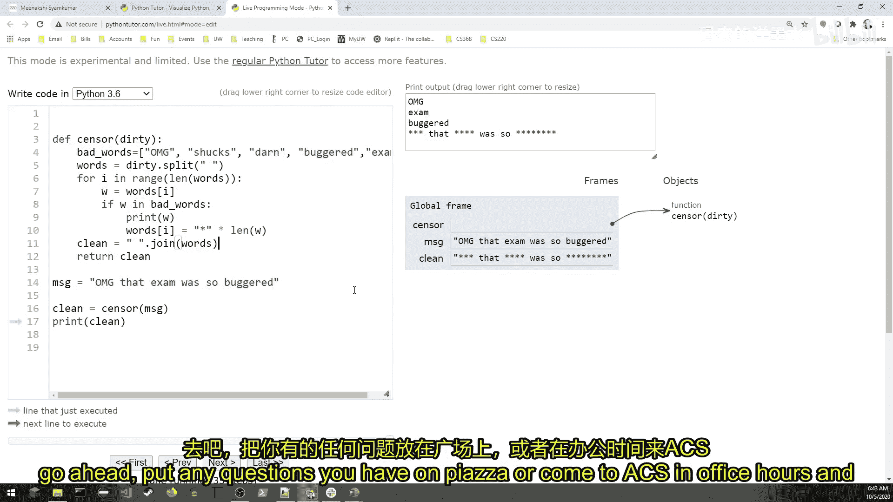

# 012：范围循环与列表 🐍

在本节课中，我们将要学习Python中的两种重要循环结构——范围循环（`for`循环与`range`函数）和列表数据结构。我们将通过对比字符串和列表，理解序列的通用操作，并学习如何创建、访问和修改列表。



---

## 概述

上一节我们介绍了基本的`for`循环，用于遍历序列中的每个元素。本节中，我们将深入探讨`range`函数，它允许我们生成一个数字序列，常用于需要索引的循环场景。同时，我们将正式引入列表（List）这一核心数据结构，它是一种可变、有序的容器，可以存储任意类型的元素。

---

## 范围循环详解

`range`函数用于生成一个整数序列，常与`for`循环结合使用，以便在循环中获取元素的索引。它有三种主要形式：

1.  `range(stop)`：生成从0到`stop-1`的整数。
2.  `range(start, stop)`：生成从`start`到`stop-1`的整数。
3.  `range(start, stop, step)`：生成从`start`到`stop-1`的整数，步长为`step`。

以下是每种形式的示例：

```python
# 形式1: range(stop)
for i in range(6):
    print(i)  # 输出: 0, 1, 2, 3, 4, 5

# 形式2: range(start, stop)
for i in range(2, 6):
    print(i)  # 输出: 2, 3, 4, 5

# 形式3: range(start, stop, step)
for i in range(2, 11, 2):
    print(i)  # 输出: 2, 4, 6, 8, 10
```

当我们需要在遍历序列（如字符串或列表）的同时知道当前元素的索引时，`range`循环非常有用。例如，打印字符串“Python”中每个字符及其索引：

```python
word = "Python"
for i in range(len(word)):
    print(f"索引 {i}: 字符 {word[i]}")
```

---

## 列表基础

列表是Python中最基本的数据结构之一。它是一个可变、有序的序列，可以存储任意类型的元素。

### 创建列表

创建列表使用方括号`[]`，元素之间用逗号分隔。

```python
# 创建一个包含数字的列表
numbers = [22, 11, 33]

# 创建一个包含不同类型元素的列表
mixed_list = ["字符串", 3.14, 42, True, [1, 2, 3]]
```



### 访问列表元素

与字符串类似，列表支持索引和切片操作。

```python
nums = [22, 11, 33]
print(nums[0])   # 输出: 22 (索引从0开始)
print(nums[-1])  # 输出: 33 (负索引表示从末尾开始)
print(nums[1:])  # 输出: [11, 33] (切片操作)
```

### 遍历列表

可以使用`for`循环直接遍历列表中的元素。

```python
for num in nums:
    print(num)
```

如果需要同时获取索引和元素，可以结合`range`和`len`函数。

```python
for i in range(len(nums)):
    print(f"索引 {i}: 值 {nums[i]}")
```

---

## 序列的通用操作

字符串和列表都属于序列（Sequence），因此它们共享许多操作。以下是这些通用操作的对比：

| 操作 | 字符串示例 | 列表示例 | 说明 |
| :--- | :--- | :--- | :--- |
| 长度 | `len("321go")` | `len([99, 11, 77, 55])` | 返回序列中元素的数量。 |
| 连接 | `"321go" + "!!"` | `[99, 11] + [77, 55]` | 将两个序列合并成一个新序列。 |
| 成员检查 | `"g" in "321go"` | `11 in [99, 11, 77]` | 检查元素是否存在于序列中。 |
| 重复 | `"321go" * 2` | `[99, 11] * 2` | 将序列重复指定次数。 |
| 索引 | `"321go"[1]` | `[99, 11, 77][1]` | 通过位置访问单个元素。 |
| 切片 | `"321go"[1:4]` | `[99, 11, 77][1:3]` | 获取序列的一个子序列。 |
| 遍历 | `for c in "321go":` | `for x in [99, 11, 77]:` | 使用`for`循环遍历每个元素。 |

---



## 列表的独有特性：可变性

列表与字符串的一个关键区别是**可变性**。字符串是不可变的，创建后无法修改其中的字符。而列表是可变的，可以修改、添加或删除其中的元素。

### 修改元素（更新）

通过索引直接为列表中的某个位置赋值。

```python
my_list = [6, 2, 8]
my_list[0] = 8  # 将索引0的元素从6改为8
print(my_list)  # 输出: [8, 2, 8]
```

### 添加元素



*   **`append(item)`**：在列表末尾添加一个元素。
*   **`extend(iterable)`**：在列表末尾添加另一个可迭代对象中的所有元素。

```python
my_list = [4, 2]
my_list.append(9)        # 添加单个元素
print(my_list)           # 输出: [4, 2, 9]

my_list.extend([3, 5])   # 添加多个元素
print(my_list)           # 输出: [4, 2, 9, 3, 5]
```

### 删除元素



*   **`pop()`**：移除并返回列表的最后一个元素。
*   **`pop(index)`**：移除并返回指定索引位置的元素。

```python
my_list = [4, 2, 9, 3, 5]
last_item = my_list.pop()      # 移除最后一个元素5
print(last_item)               # 输出: 5
print(my_list)                 # 输出: [4, 2, 9, 3]

second_item = my_list.pop(1)   # 移除索引1的元素2
print(second_item)             # 输出: 2
print(my_list)                 # 输出: [4, 9, 3]
```

### 排序

*   **`sort()`**：对列表进行原地排序（修改原列表）。



```python
my_list = [9, 2, 5, 8, 3]
my_list.sort()
print(my_list)  # 输出: [2, 3, 5, 8, 9]
```

---

## 字符串与列表的转换



在实际编程中，经常需要在字符串和列表之间进行转换。两个核心方法是`split()`和`join()`。

### 字符串 -> 列表：`split()`

`split()`是一个字符串方法，它根据指定的分隔符将字符串分割成一个列表。

```python
sentence = "a quick brown fox"
word_list = sentence.split(" ")  # 以空格为分隔符
print(word_list)  # 输出: ['a', 'quick', 'brown', 'fox']
```



### 列表 -> 字符串：`join()`

`join()`也是一个字符串方法，它使用指定的字符串作为连接符，将一个字符串列表连接成一个单独的字符串。

```python
letters = ['M', 'I', 'S', 'S', 'I', 'S', 'S', 'I', 'P', 'P', 'I']
separator = ''  # 使用空字符串连接
word = separator.join(letters)
print(word)  # 输出: 'MISSISSIPPI'
```

---



## 综合示例：文本审查器

让我们运用所学知识，编写一个简单的文本审查函数。该函数将输入字符串中的不雅词汇替换为星号`*`。

```python
def censor(dirty_string):
    """将字符串中的不雅词汇替换为星号。"""
    # 定义不雅词汇列表
    bad_words = ["OMG", "exam", "buggered"]

    # 将字符串分割成单词列表
    words = dirty_string.split()

    # 遍历单词列表（使用range循环以获取索引）
    for i in range(len(words)):
        word = words[i]
        # 如果单词在不雅词汇列表中，则替换为等长的星号
        if word in bad_words:
            words[i] = '*' * len(word)

    # 将处理后的单词列表重新连接成字符串
    clean_string = ' '.join(words)
    return clean_string

# 测试函数
message = "OMG that exam was so buggered!"
clean_message = censor(message)
print(clean_message)  # 输出: *** that **** was so *********
```

在这个例子中，我们：
1.  使用`split()`将句子拆分成单词列表。
2.  使用`range(len(words))`循环来获取每个单词的索引。
3.  检查每个单词是否在`bad_words`列表中。
4.  如果是，则使用字符串乘法`'*' * len(word)`生成等长的星号进行替换。
5.  最后，使用`' '.join(words)`将列表重新组合成字符串。

---

## 总结

本节课中我们一起学习了Python中两个强大的工具：范围循环和列表。

*   **范围循环**：通过`range()`函数，我们可以生成数字序列，这在需要索引的循环中至关重要。
*   **列表**：作为一种可变、有序的序列，列表可以存储各种类型的数据。我们学习了如何创建、访问、修改列表，以及如何利用其可变性进行添加、删除和排序操作。
*   **序列通用操作**：我们对比了字符串和列表，理解了它们共享的索引、切片、遍历等特性。
*   **转换与综合应用**：掌握了使用`split()`和`join()`在字符串与列表间转换的方法，并通过一个文本审查器的例子，将循环、列表操作和字符串方法结合起来解决实际问题。



理解列表和循环是进行有效数据编程的基础。在接下来的课程中，我们将探索更复杂的数据结构，如字典，并利用它们处理更丰富的数据集。