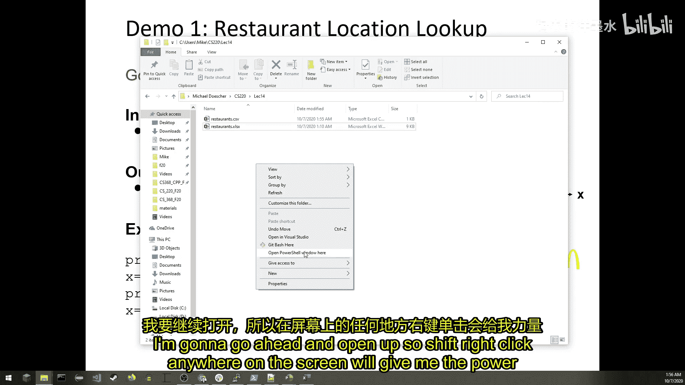
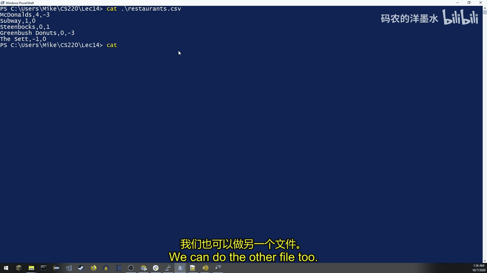
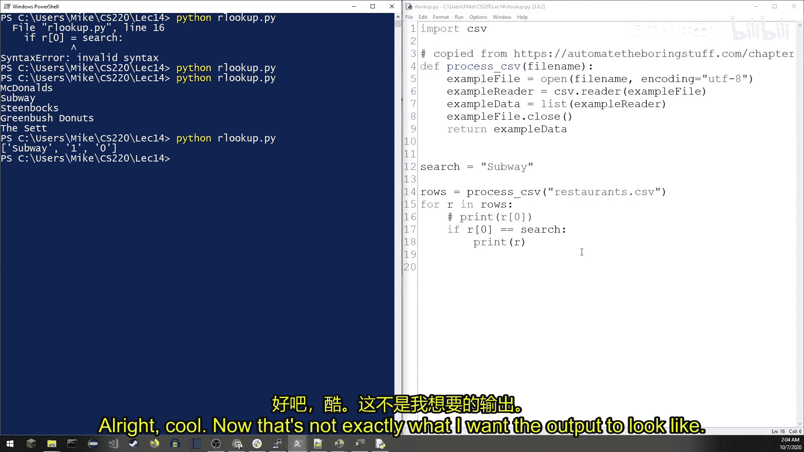
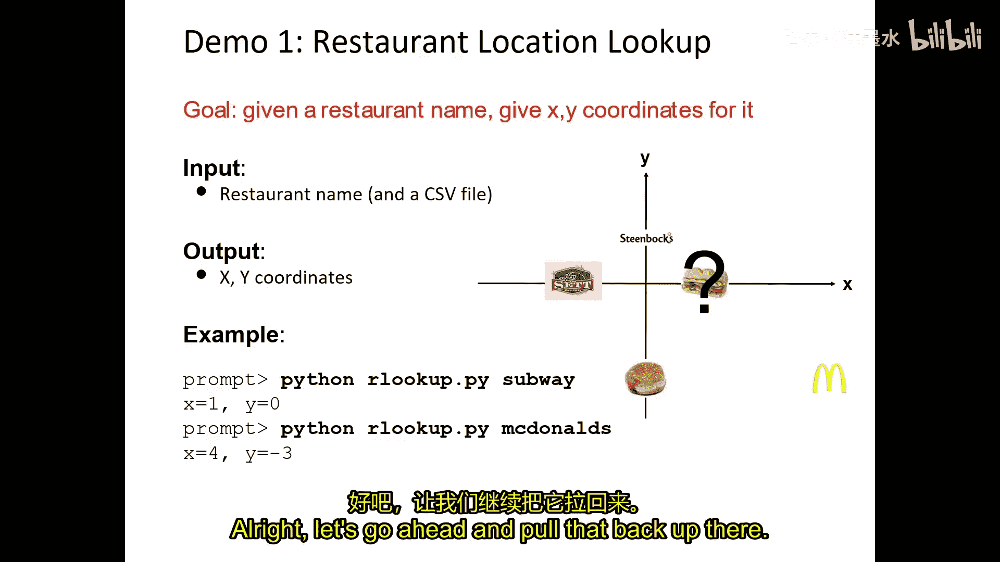
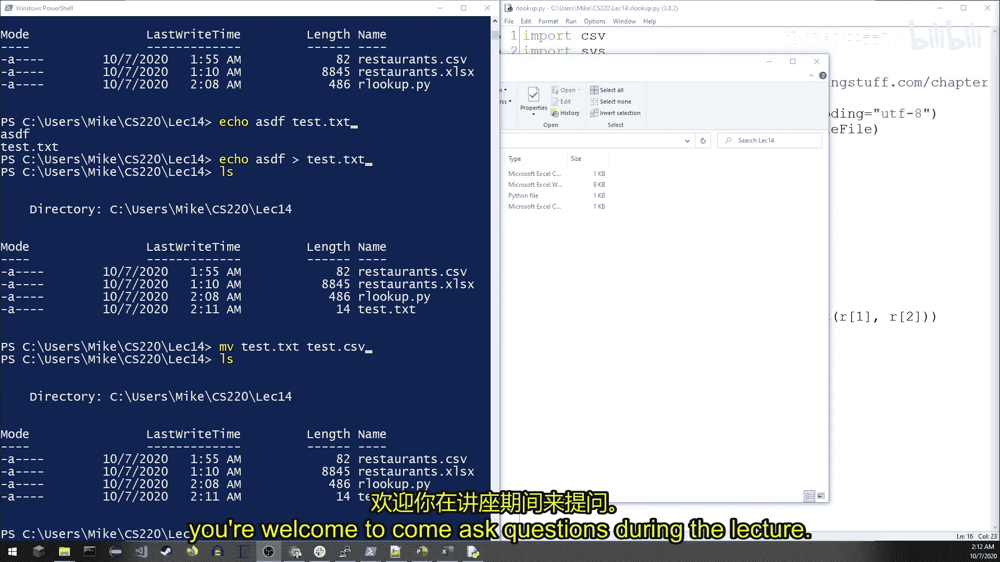

# 013：表格数据与CSV文件 📊

在本节课中，我们将要学习如何处理表格数据，特别是CSV文件。我们将从回顾列表和计算中位数开始，然后深入探讨如何将Excel电子表格转换为CSV格式，并使用Python的`csv`模块读取和处理这些数据。最后，我们将通过一个查找餐厅坐标的示例程序，学习如何结合命令行参数来使用CSV数据。

---

## 回顾：计算中位数

上一节我们介绍了列表的基本操作，本节中我们来看看如何使用列表计算一组数字的中位数。中位数是将所有数值排序后位于中间的值。如果列表有奇数个元素，中位数就是中间的那个数；如果有偶数个元素，中位数则是中间两个数的平均值。

首先，我们定义一个函数来计算中位数。

```python
def median(items):
    items.sort()
    length = len(items)
    middle_index = length // 2

    if length % 2 == 1:
        # 奇数个元素，返回中间值
        return items[middle_index]
    else:
        # 偶数个元素，返回中间两个值的平均值
        first = items[middle_index - 1]
        second = items[middle_index]
        return (first + second) / 2
```

以下是测试该函数的示例：

```python
# 测试奇数个元素
nums = [-2, -1, 3, 20, 30]
print(median(nums))  # 输出应为 3

# 测试偶数个元素
nums_even = [1, 2, 3, 4]
print(median(nums_even))  # 输出应为 2.5
```

这个函数首先对列表进行排序，然后根据元素数量是奇数还是偶数来计算中位数。注意，对于空列表或非数值列表（如字符串），此函数可能会出错，在实际应用中需要额外处理这些情况。

---

## 表格数据与CSV文件

现在，让我们转向今天的核心主题：表格数据。表格数据通常以行和列的形式组织，就像电子表格一样。在编程中，我们经常使用CSV（逗号分隔值）文件来存储和交换表格数据。

### 什么是CSV文件？

CSV文件是一种纯文本文件，用逗号分隔每个单元格（列），用换行符分隔每一行。它比Excel等二进制格式更简单、更通用，因为任何文本编辑器都能打开它，并且Python可以轻松读取。

CSV文件的特点包括：
*   每行代表表格中的一行数据。
*   每行中的单元格由逗号分隔。
*   第一行通常是标题行，描述每一列的含义。
*   所有数据（包括数字）在文件中都以字符串形式存储。

### 从Excel到CSV

通常，数据可能最初存在于Excel（`.xlsx`）文件中。我们可以将其另存为CSV格式，以便在Python中处理。

操作步骤如下：
1.  在Excel中打开文件。
2.  点击“文件” -> “另存为”。
3.  在“保存类型”中选择“CSV (逗号分隔) (*.csv)”。
4.  保存文件。请注意，此过程会丢失所有格式（如颜色、字体）和公式，仅保留数据。

---

## 使用Python读取CSV文件

为了在Python中读取CSV文件，我们将使用内置的`csv`模块。下面的代码定义了一个通用函数`process_csv`，它可以读取任何CSV文件并将其内容转换为“列表的列表”结构。

```python
import csv

def process_csv(filename):
    example_file = open(filename, encoding='utf-8')
    example_reader = csv.reader(example_file)
    example_data = list(example_reader)
    example_file.close()
    return example_data

# 代码来源: Automate the Boring Stuff, Chapter 14 (第一版) / Chapter 16 (第二版)
```

**如何使用这个函数：**
调用`process_csv('文件名.csv')`会返回一个列表。这个外层列表的每个元素也是一个列表，代表CSV文件中的一行。例如，`data[0]`是标题行，`data[1]`是第一行数据。

**访问特定数据：**
如果`rows`是`process_csv`返回的列表，那么：
*   `rows[1][0]` 访问第2行，第1列（索引从0开始）。
*   `rows[0][-1]` 访问第1行（标题行）的最后一列。

---

## 实战示例：餐厅坐标查找程序 🍽️

我们将创建一个程序，读取包含餐厅名称及其坐标的CSV文件，然后根据用户从命令行输入的名称，输出该餐厅的坐标。

### 第一步：准备数据

我们有一个`restaurants.csv`文件，内容格式如下：
```
McDonald's,4,-3
Subway,1,0
The Sett,-1,0
Greenbush Donuts,0,2
```

### 第二步：编写程序 (`rlookup.py`)

以下是完整的程序代码，它结合了CSV处理和命令行参数。

```python
import csv
import sys





# --- 粘贴 process_csv 函数 ---
def process_csv(filename):
    example_file = open(filename, encoding='utf-8')
    example_reader = csv.reader(example_file)
    example_data = list(example_reader)
    example_file.close()
    return example_data
# --- 函数结束 ---

def main():
    # 1. 读取CSV数据
    rows = process_csv('restaurants.csv')

    # 2. 获取命令行参数
    # sys.argv[0] 是程序名 'rlookup.py'，sys.argv[1] 是用户输入的餐厅名
    if len(sys.argv) < 2:
        print("请提供餐厅名称作为参数。")
        return

    search_term = sys.argv[1]

    # 3. 遍历数据行，查找匹配的餐厅
    for r in rows:
        if r[0] == search_term:
            # 4. 找到后，格式化输出坐标
            print(f"x = {r[1]}, y = {r[2]}")
            return

    # 5. 如果循环结束都没找到
    print(f"未找到名为 '{search_term}' 的餐厅。")

if __name__ == "__main__":
    main()
```

### 第三步：从命令行运行程序

打开终端（Windows PowerShell 或 Mac Terminal），导航到程序所在目录，然后运行：



```bash
python rlookup.py "Subway"
```
输出应为：
```
x = 1, y = 0
```



**关键点说明：**
*   `import sys`：导入系统模块，用于访问命令行参数`sys.argv`。
*   `sys.argv`：这是一个列表，包含所有命令行参数。第一个元素`sys.argv[0]`是脚本名称。
*   **参数包含空格时**：如果餐厅名包含空格（如“The Sett”），需要在命令行中用引号括起来。

### 常见问题与解决

*   **文件扩展名问题**：在Windows上下载CSV文件时，有时会自动保存为`.txt`。你可以在文件资源管理器中显示文件扩展名，并用`ren`命令重命名：
    ```bash
    ren restaurants.txt restaurants.csv
    ```
*   **编码问题**：`process_csv`函数中指定了`encoding='utf-8'`，这有助于在不同操作系统上正确读取文件。

---

## 总结

本节课中我们一起学习了：
1.  **中位数的计算**：通过列表排序和索引操作，编写了处理奇偶数量元素的函数。
2.  **CSV文件基础**：了解了CSV作为纯文本表格格式的优点和结构。
3.  **读取CSV文件**：利用`csv`模块和`process_csv`函数，将CSV数据转换为Python的“列表的列表”结构。
4.  **综合应用**：创建了一个命令行程序，通过结合CSV读取和命令行参数`sys.argv`，实现了根据名称查找餐厅坐标的功能。



掌握这些技能是进行数据分析和处理的基础。在接下来的课程和项目中，你会频繁地使用这些技术来操作各种表格数据集。