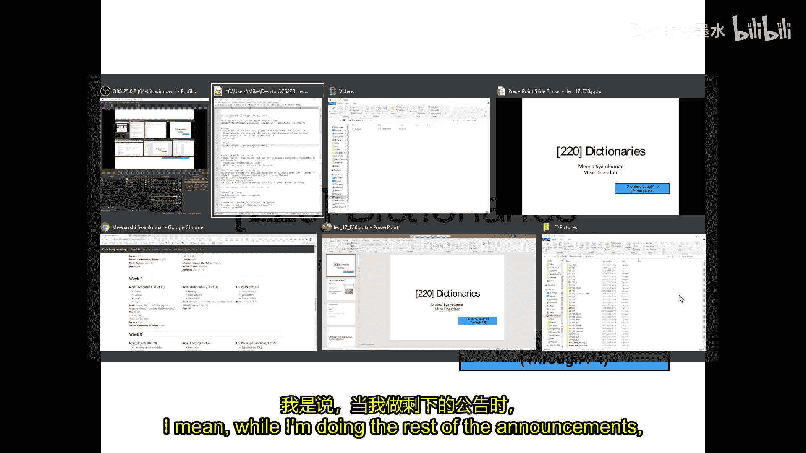
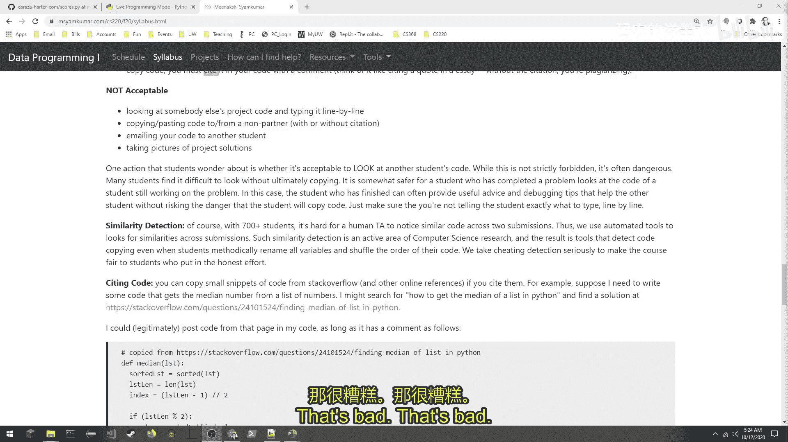
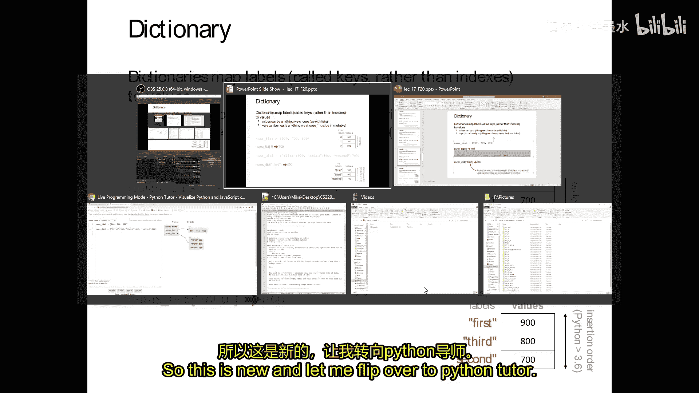
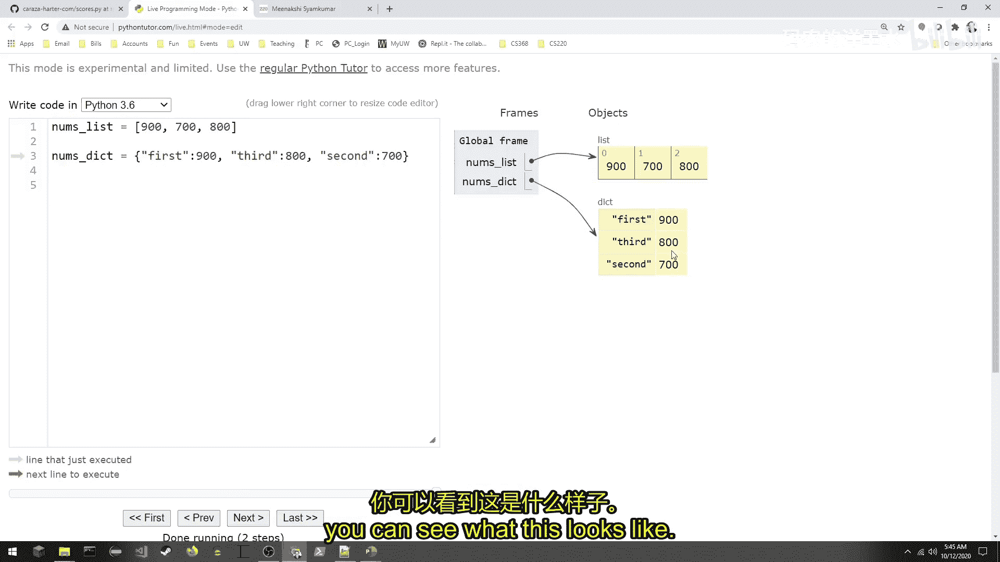
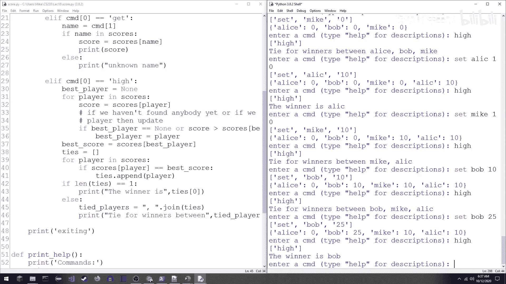

# 014：字典



在本节课中，我们将要学习Python中一个非常重要的数据结构——字典。我们将了解字典的基本概念、如何创建和使用字典，以及它与列表等其他数据结构的区别。通过一个具体的编程示例，我们将看到字典如何使代码变得更简洁、更强大。

---

## 字典简介



上一节我们介绍了数据结构的通用概念，本节中我们来看看字典这一具体的数据结构。

字典是一种映射类型的数据结构，它将一个唯一的“键”与一个“值”关联起来。你可以把它想象成一本真实的字典：单词（键）对应着它的定义（值）。

在Python中，字典使用花括号 `{}` 定义，键和值之间用冒号 `:` 分隔。

**核心概念公式**：
```
字典 = {键1: 值1, 键2: 值2, ...}
```

---

## 字典的创建与基本操作

与列表类似，字典也有创建、更新、访问和删除等基本操作。

### 创建字典

以下是创建字典的几种方式：

*   使用花括号直接创建：`my_dict = {'name': 'Alice', 'score': 95}`
*   使用 `dict()` 函数创建空字典：`empty_dict = dict()`
*   仅使用花括号创建空字典（默认行为）：`also_empty_dict = {}`

### 访问与更新字典元素





访问字典中的值，需要使用方括号 `[]` 并提供对应的键。

```python
scores = {'Alice': 95, 'Bob': 87}
alice_score = scores['Alice']  # 获取Alice的分数，结果为95
```

更新字典中已有的值，语法与列表赋值类似。

```python
scores['Bob'] = 90  # 将Bob的分数更新为90
```

### 向字典插入新元素


与列表需要使用 `.append()` 方法不同，字典可以直接通过赋值来添加新的键值对。

```python
scores['Charlie'] = 88  # 插入一个新的键值对
```

### 从字典中删除元素

使用 `.pop()` 方法并指定要删除的键，可以移除字典中的元素，该方法会返回被删除的值。

```python
removed_score = scores.pop('Bob')  # 删除键为'Bob'的项，并返回其值87
```

---

## 字典与列表、集合的对比

为了更清晰地理解不同数据结构的特点，我们可以从值、关系和操作三个方面进行对比。

以下是三种数据结构的简要对比：

*   **列表 (List)**:
    *   **值**: 可以是任意类型，允许重复。
    *   **关系**: 有序，通过整数索引（0, 1, 2...）访问。
    *   **操作**: 索引、切片、`.append()`、`.pop()`、`len()`、排序等。
*   **集合 (Set)**:
    *   **值**: 可以是任意**不可变**类型，元素**唯一**。
    *   **关系**: **无序**，没有索引。
    *   **操作**: `in`（成员检查）、并集、交集等。
*   **字典 (Dict)**:
    *   **值**: 值可以是任意类型。**键**必须是**不可变**类型（如字符串、数字、元组）。
    *   **关系**: 在Python 3.7+中，**保持插入顺序**。通过**键**而非数字索引访问。
    *   **操作**: 通过键访问 `dict[key]`、`.pop(key)`、`.keys()`、`.values()` 等。

---

## 实战演练：重构计分程序

现在，让我们通过一个实际例子来巩固对字典的理解。我们将重构一个简单的玩家计分程序，使其从使用多个独立变量升级为使用一个字典来管理所有玩家分数。

原始程序为每个玩家（如Alice、Bob）定义了单独的变量，这限制了程序的扩展性。使用字典后，我们可以动态地添加任意数量的玩家。

### 重构步骤

1.  **创建分数字典**： 删除独立的玩家变量，创建一个字典来存储所有玩家的分数。
    ```python
    # 替换前：alice_score = 0; bob_score = 0
    # 替换后：
    scores = {'alice': 0, 'bob': 0}
    ```

2.  **更新“设置分数”逻辑**： 将硬编码的变量赋值改为对字典的赋值。
    ```python
    # 替换前：if name == ‘alice‘: alice_score = score
    # 替换后：
    scores[name] = score  # name是用户输入的名称
    ```

3.  **更新“获取分数”逻辑**： 将硬编码的变量读取改为从字典中查找，并处理玩家不存在的情况。
    ```python
    if name in scores:  # 先检查键是否存在
        print(scores[name])
    else:
        print(“未知玩家”)
    ```

4.  **重构“查找最高分”逻辑**： 不再比较两个固定变量，而是遍历整个字典来寻找分数最高的玩家。这是一个常见的编程模式。
    ```python
    best_score = -1
    best_player = None
    for player, score in scores.items():
        if score > best_score:
            best_score = score
            best_player = player
    print(f“获胜者是：{best_player}”)
    ```

5.  **处理并列最高分**： 上述简单循环只找出一位获胜者。为了找出所有并列最高分的玩家，可以采用“两轮遍历”策略：第一轮找出最高分，第二轮找出所有得此分数的玩家。
    ```python
    # 第一轮：找出最高分
    highest_score = max(scores.values())
    # 第二轮：找出所有得最高分的玩家
    winners = [player for player, score in scores.items() if score == highest_score]
    if len(winners) == 1:
        print(f“获胜者是：{winners[0]}”)
    else:
        winners_str = “， ”.join(winners)
        print(f“并列获胜者：{winners_str}”)
    ```

通过以上步骤，我们成功将一个僵化的程序转变为一个灵活、可扩展的程序，能够处理任意数量和名称的玩家。

---

## 总结

本节课中我们一起学习了Python字典。我们了解了字典是一种键值对映射的数据结构，掌握了其创建、访问、更新和删除的基本操作。通过对比列表和集合，我们明确了字典在存储需要通过特定标签（键）来快速查找数据的场景下的优势。最后，通过实战重构一个计分程序，我们亲身体验了字典如何使代码更简洁、更强大。



记住，当你需要将一组数据与特定的、有意义的标签关联起来，并需要快速根据标签查找数据时，字典通常是你的最佳选择。