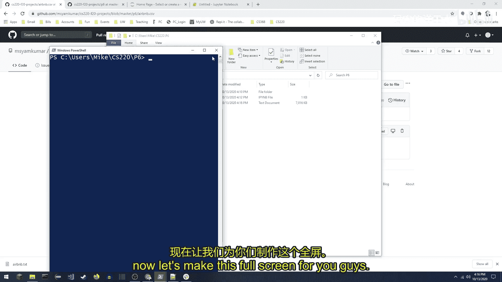
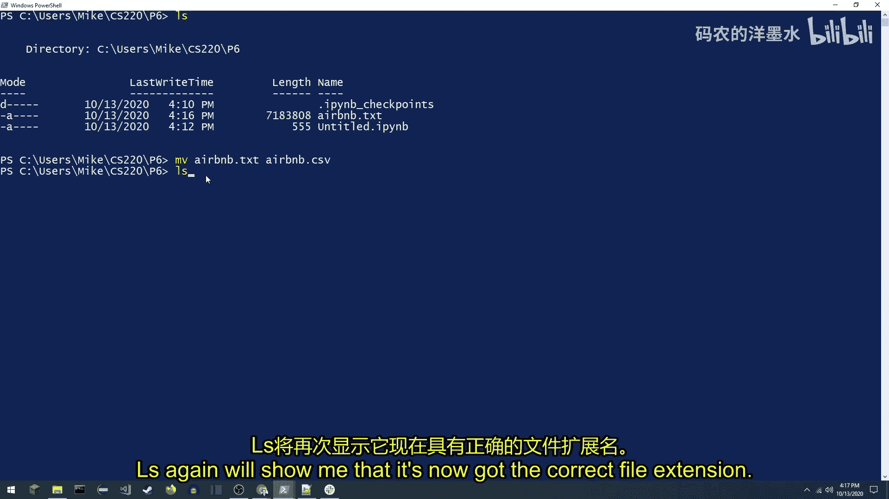
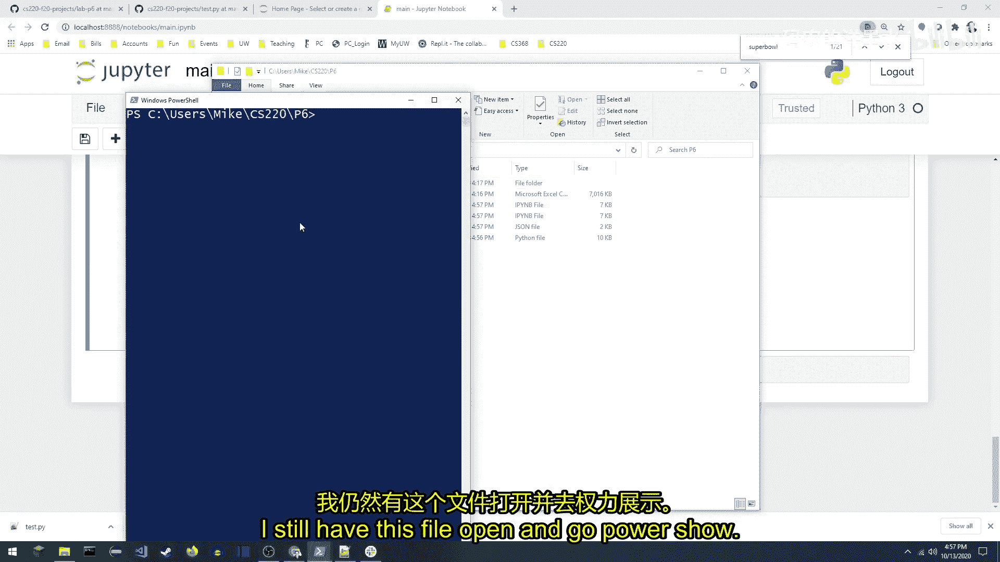
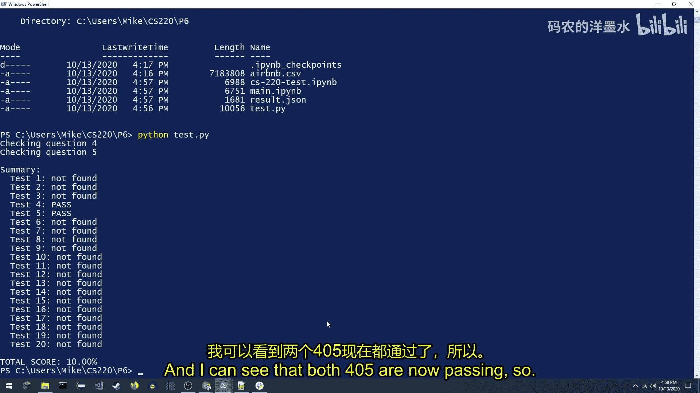
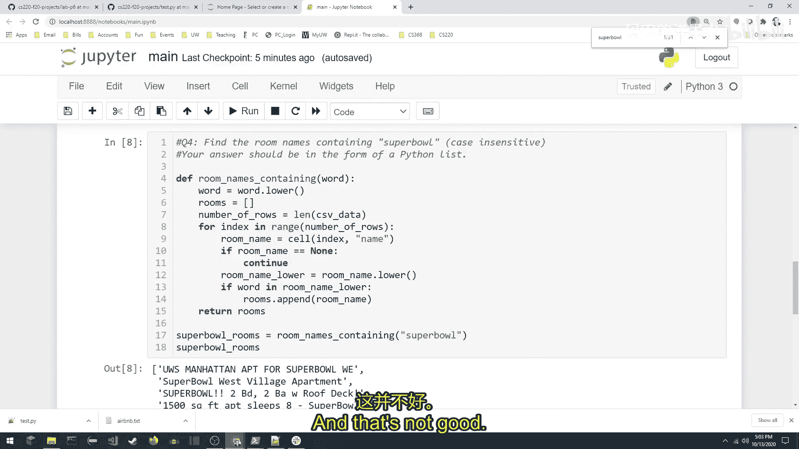

# 015：项目2策略指南

在本教程中，我们将学习如何完成项目2（P6）中的问题4。我们将从下载数据文件开始，逐步讲解如何导入数据、处理数据、编写辅助函数，并最终使用循环和字符串操作来解决问题。本教程旨在帮助初学者理解每个步骤，并提供实用的调试策略。





## 下载与准备数据文件

首先，我们需要下载项目所需的数据文件。数据文件是一个CSV格式的文件，但有时浏览器会错误地将其保存为文本文件（.txt）。我们需要确保文件扩展名正确。

以下是下载和重命名文件的步骤：
1.  在浏览器中右键点击数据文件链接，选择“链接另存为”。
2.  将文件保存到你的工作目录（例如 `lab P6` 文件夹）。
3.  如果文件被保存为 `.txt` 格式，你需要手动将其重命名为 `.csv` 格式。可以通过命令行（如PowerShell）或文件资源管理器完成此操作。

在PowerShell中，你可以使用 `mv` 命令来重命名文件，例如：`mv Airbnb.txt Airbnb.csv`。

## 在Jupyter Notebook中导入数据

成功下载并重命名文件后，下一步是在Jupyter Notebook中导入数据。我们将使用一个辅助函数来读取CSV文件。

```python
def process_csv(filename):
    with open(filename, 'r', encoding='utf-8') as f:
        reader = csv.reader(f)
        data = list(reader)
    header = data[0]  # 第一行是表头
    data = data[1:]   # 其余行是数据
    return header, data

# 使用函数读取数据
csv_header, csv_data = process_csv('Airbnb.csv')
```

运行上述代码后，`csv_header` 变量将包含列名列表，`csv_data` 变量将包含所有数据行（一个列表的列表）。你可以打印 `csv_header` 来查看所有列的名称。

## 编写 `cell` 辅助函数

为了更方便地从数据表中提取特定单元格的值，我们需要编写一个 `cell` 函数。这个函数接收行索引和列名，返回对应的值，并根据列名进行适当的数据类型转换。

```python
def cell(row_idx, col_name):
    # 根据列名找到其在表头中的索引
    col_idx = csv_header.index(col_name)
    # 获取原始值（字符串格式）
    val = csv_data[row_idx][col_idx]

    # 如果原始值是空字符串，返回 None
    if val == "":
        return None

    # 根据列名进行类型转换
    if col_name == "price":
        return int(val)
    # 你可以根据需要添加其他列的类型转换，例如：
    # elif col_name == "review_rate_number":
    #     return float(val)
    # 对于已经是字符串的列，无需转换

    # 默认返回字符串值
    return val
```

这个函数是后续所有数据处理的基础。常见的错误包括忘记处理空字符串（返回 `None`）或遗漏最后的 `return val` 语句。

## 理解循环：遍历数据的三种方式

在处理表格数据时，我们经常需要遍历所有行。主要有三种循环方式：

1.  **直接遍历数据项（For-each循环）**：适用于只需要值，不需要索引的情况。
    ```python
    for row in csv_data[:5]:  # 只遍历前5行作为示例
        print(row)
    ```

2.  **使用 `range` 的索引循环**：这是本项目中最常用的方式，因为它提供了行索引，方便我们使用 `cell` 函数。
    ```python
    num_rows = len(csv_data)
    for idx in range(num_rows):
        # 使用 idx 来获取特定行的数据
        room_name = cell(idx, "name")
        print(idx, room_name)
    ```

3.  **`while` 循环**：最灵活但需要手动管理索引。
    ```python
    idx = 0
    num_rows = len(csv_data)
    while idx < num_rows:
        row = csv_data[idx]
        # 处理 row
        idx += 1  # 不要忘记递增索引
    ```

对于本项目，**第二种方式（使用 `range` 的索引循环）** 是最佳选择。

## 解决问题4：查找包含特定关键词的房间名

现在，我们应用所学知识来解决具体问题。问题4要求：**查找所有房间名（name）中包含“Super Bowl”的房间名列表，且搜索不区分大小写。**

我们的解决思路是：遍历所有数据行，使用 `cell` 函数获取每个房间名，检查小写后的房间名是否包含小写后的关键词“super bowl”，如果包含，则将该房间名加入结果列表。

以下是实现代码：

```python
def find_rooms_with_keyword(keyword):
    result_list = []  # 初始化一个空列表来存放结果
    num_rows = len(csv_data)
    search_term = keyword.lower()  # 将搜索词转换为小写

    for idx in range(num_rows):
        # 1. 获取房间名
        room_name = cell(idx, "name")

        # 2. 跳过没有房间名的行（cell函数返回None）
        if room_name is None:
            continue

        # 3. 将房间名转换为小写，并进行包含性检查
        if search_term in room_name.lower():
            # 4. 将原始的（保持大小写的）房间名添加到结果列表
            result_list.append(room_name)

    return result_list

# 调用函数解决第4题
q4_answer = find_rooms_with_keyword("Super Bowl")
q4_answer
```

代码解析：
*   `result_list = []`：创建一个空列表，用于存储符合条件的房间名。
*   `for idx in range(num_rows):`：使用索引循环遍历所有数据行。
*   `room_name = cell(idx, "name")`：使用 `cell` 函数获取当前行的房间名。
*   `if room_name is None: continue`：这是一个**关键步骤**。如果 `cell` 函数返回 `None`（表示数据缺失），则跳过当前行。
*   `if search_term in room_name.lower():`：检查小写后的关键词是否出现在小写后的房间名中。这是实现不区分大小写搜索的方法。
*   `result_list.append(room_name)`：将符合条件的原始房间名（保留原始大小写）添加到结果列表。
*   最后，函数返回结果列表。在Jupyter中，将变量 `q4_answer` 单独放在一行，它的值会自动输出，供评分系统检查。

## 调试策略与代码复用

在编写代码时，采用增量开发和调试策略非常重要。

*   **增量开发**：不要一次性写完所有代码。先写一两行，打印中间结果，确保符合预期后再添加新功能。例如，可以先写循环只打印前5行的房间名。
*   **使用“脚手架”打印语句**：在关键位置插入 `print` 语句，输出变量状态，帮助定位错误。调试完成后记得移除它们。
*   **函数化以复用代码**：正如我们在 `find_rooms_with_keyword` 函数中所做的那样，将通用逻辑封装成函数。问题5和问题6同样需要查找包含不同关键词的房间名，只需用不同的参数调用此函数即可，避免了代码重复和潜在的错误。

```python
# 解决问题5：查找包含“dream room”的房间名
q5_answer = find_rooms_with_keyword("dream room")
q5_answer





# 解决问题6：查找包含“free wifi”的房间名
q6_answer = find_rooms_with_keyword("free wifi")
q6_answer
```

## 总结与学习建议

本节课中我们一起学习了完成项目2问题4的完整流程。

我们首先学习了如何下载和准备CSV数据文件。接着，在Jupyter Notebook中导入数据，并编写了关键的 `cell` 辅助函数来提取和转换数据。我们详细分析了遍历数据表的三种循环方式，并确定了使用 `range` 的索引循环是本项目的最佳实践。最后，我们应用这些知识，通过编写一个可复用的函数解决了查找特定关键词房间名的问题，并介绍了有效的调试策略。

为了在课程中取得好成绩，建议你：
1.  **每日学习**：跟上课程进度，理解每个概念。
2.  **提前复习薄弱环节**：如果对字符串操作、循环或列表不熟悉，现在花10分钟复习，远比考试前夜临时抱佛脚有效率。
3.  **理解而非死记**：掌握 `cell` 函数和循环模式的工作原理，你就能应对各种数据提取问题。



通过本教程，希望你能更自信地处理本项目及未来的数据编程任务。