# 016：嵌套字典


在本节课中，我们将深入学习字典，特别是如何将不同的数据结构组合在一起，例如将列表放入字典中，或者创建字典的列表。我们将探讨更多字典操作，并介绍嵌套数据结构的概念及其常见应用场景。

---

## 概述

上一节我们介绍了字典的基本操作，包括创建、索引和删除数据。本节中，我们将进一步探索字典的高级功能，如使用 `len`、`in` 关键字和 `for` 循环遍历字典，以及 `keys`、`values`、`get` 和 `pop` 方法。核心内容将聚焦于嵌套数据结构，例如字典的列表或列表的字典，并演示其在数据分桶（Bucketing）中的实际应用。

---

## 更多字典操作

除了基本的创建、索引和删除，字典还支持其他有用的操作。以下是几个关键功能：

### 长度、成员检查和遍历

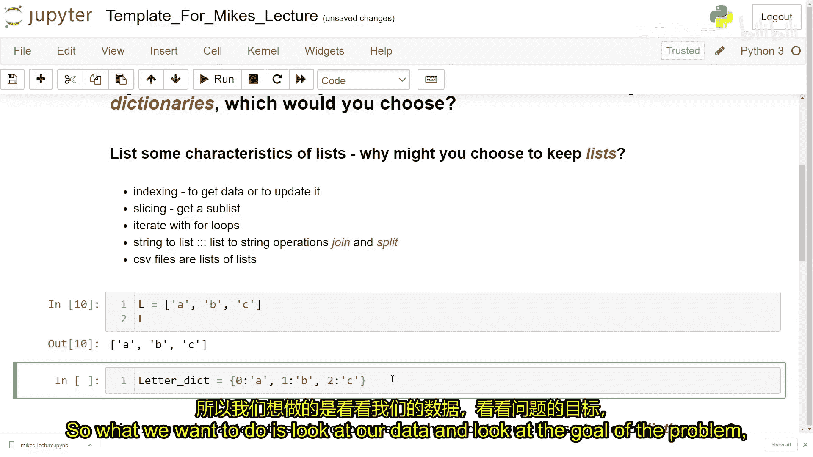

与列表类似，字典也支持 `len` 函数、`in` 关键字和 `for` 循环。但需要注意的是，`in` 关键字检查的是键（Key）而非值（Value）。

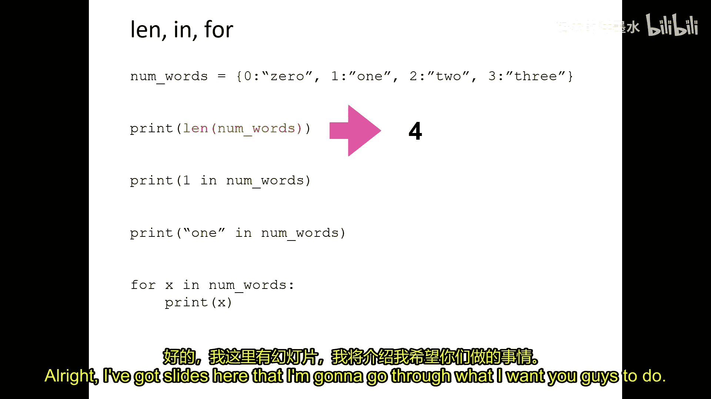

**示例代码：**
```python
num_words = {0: "zero", 1: "one", 2: "two", 3: "three"}
print(len(num_words))          # 输出: 4
print(1 in num_words)          # 输出: True
print("one" in num_words)      # 输出: False
for key in num_words:
    print(key, num_words[key]) # 依次输出键值对
```

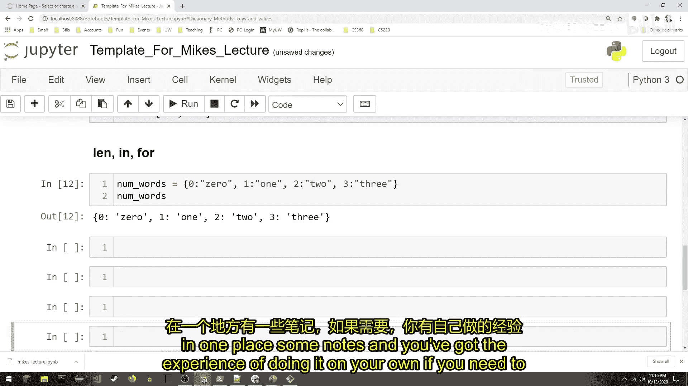

### 提取键和值

使用 `keys()` 和 `values()` 方法可以分别获取字典中所有的键和值。这些方法返回的是特殊视图对象，可以转换为列表以便进一步操作。

**示例代码：**
```python
num_words = {0: "zero", 1: "one", 2: "two", 3: "three"}
keys_list = list(num_words.keys())    # 转换为列表: [0, 1, 2, 3]
values_list = list(num_words.values()) # 转换为列表: ["zero", "one", "two", "three"]
```

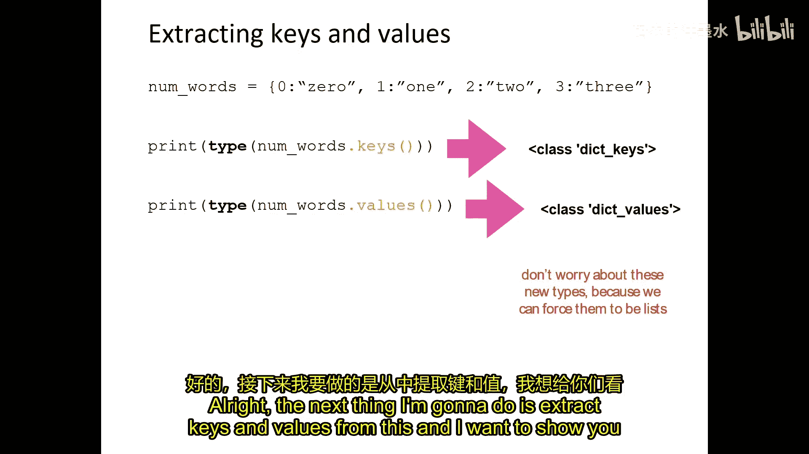

### 使用默认值的 `get` 和 `pop`

当尝试访问字典中不存在的键时，直接索引会导致 `KeyError`。`get` 和 `pop` 方法允许指定默认值，避免程序崩溃。

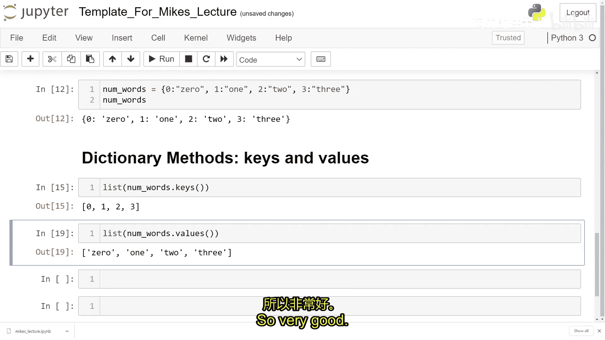

**示例代码：**
```python
suffix = {1: "st", 2: "nd", 3: "rd"}
print(suffix.get(4, "th"))  # 输出: "th"
print(suffix.pop(0, "th"))  # 输出: "th"，字典不变
```

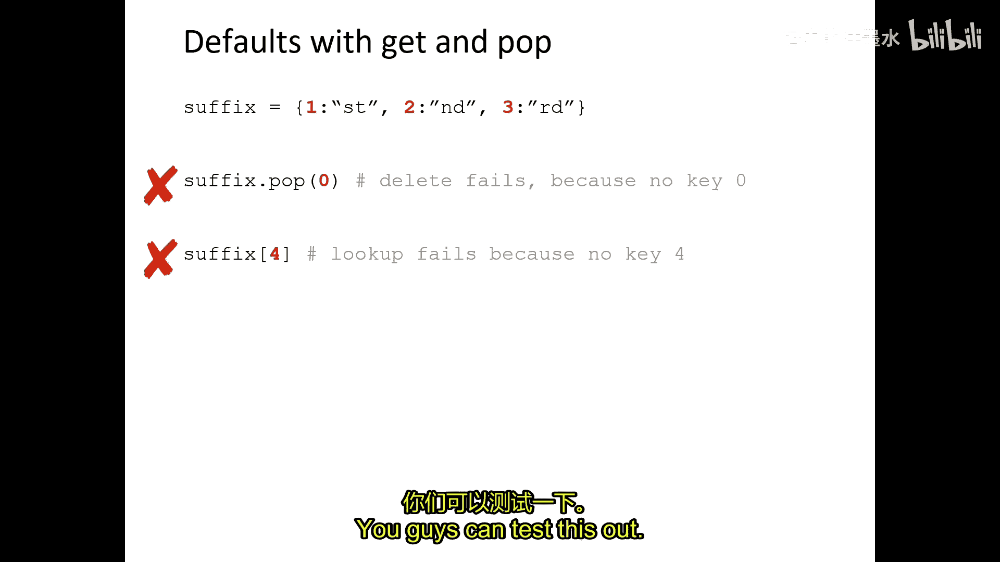

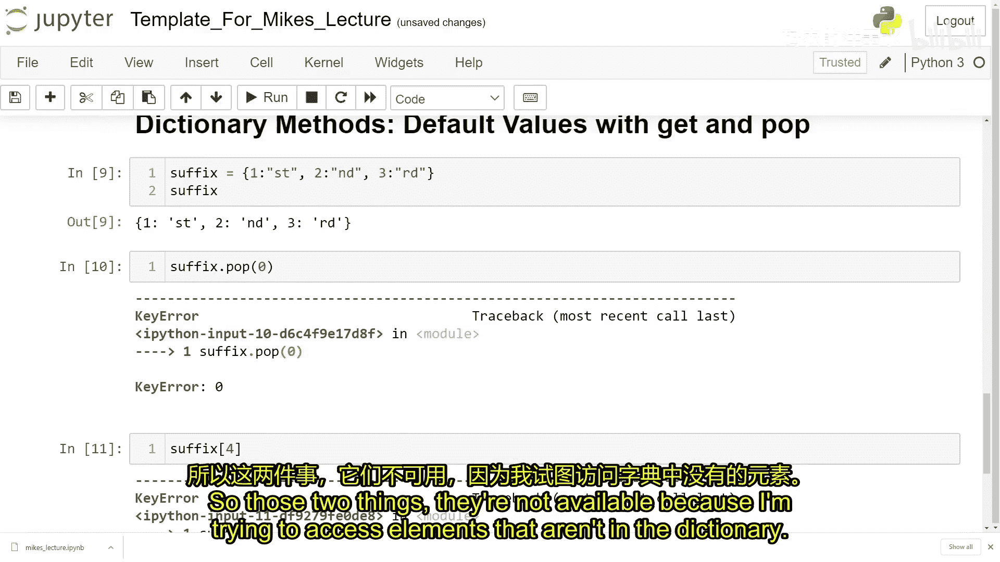

---

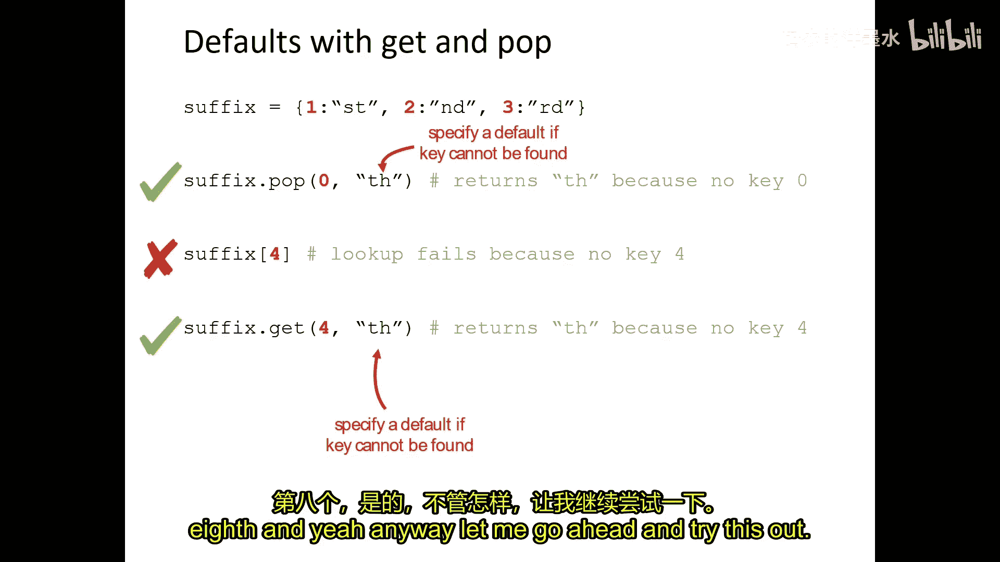

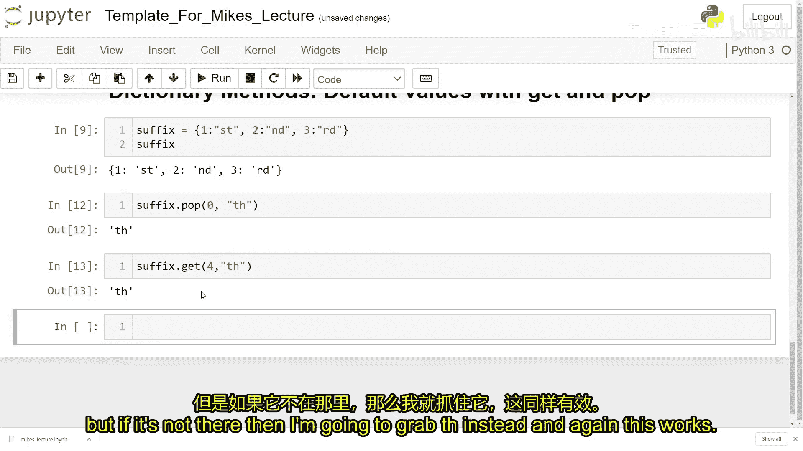

## 嵌套数据结构

嵌套数据结构是指在一个数据结构中包含另一个数据结构，例如列表的字典或字典的列表。这种组合方式能更灵活地组织和处理复杂数据。

### 字典的列表

一个常见用例是将CSV文件转换为字典的列表，其中每个字典代表一行数据，键是列标题，值是对应的数据。

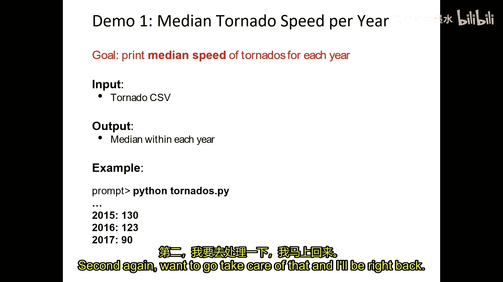

**示例代码：**
```python
import csv

def csv_to_dict_list(filename):
    with open(filename, 'r') as file:
        reader = csv.DictReader(file)
        return [row for row in reader]

data = csv_to_dict_list('tornadoes.csv')
print(data[0]['location'])  # 访问第一行数据的'location'字段
```

### 列表的字典（数据分桶）

数据分桶（Bucketing）是将数据按某个键（如年份）分组存储的过程。每个键对应一个列表，列表中包含所有符合该键的数据行。

**示例代码：**
```python
def bucketize(data, key_column):
    buckets = {}
    for row in data:
        key = row[key_column]
        if key not in buckets:
            buckets[key] = []
        buckets[key].append(row)
    return buckets

# 假设data是字典的列表
buckets = bucketize(data, 'year')
print(buckets['2019'])  # 输出2019年的所有数据行
```

---

## 常见应用场景

嵌套数据结构在数据处理中非常实用，以下是一些典型应用：

### 数据分桶与分析

通过分桶，可以轻松对数据进行分组统计。例如，计算每年龙卷风的平均速度：

**示例代码：**
```python
def average_speed(rows):
    total = 0
    for row in rows:
        total += int(row['speed'])
    return total / len(rows)

averages = {}
for year, rows in buckets.items():
    averages[year] = average_speed(rows)

# 按年份排序输出
for year in sorted(averages.keys()):
    print(f"{year}: {averages[year]}")
```

### 灵活的数据表示

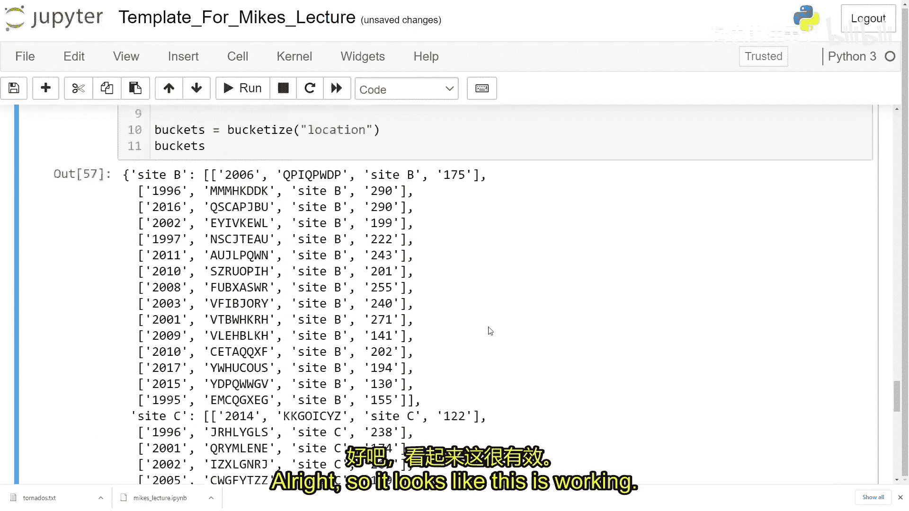

使用字典的列表可以避免硬编码列索引，使代码更易读和维护。例如，直接通过列名访问数据，而无需记住列的位置。

**示例代码：**
```python
# 直接通过键名访问，无需知道列索引
speed = data[0]['speed']
location = data[0]['location']
```

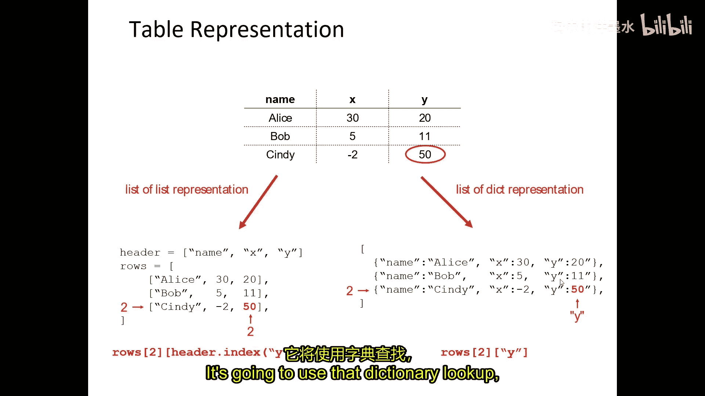

---

## 总结

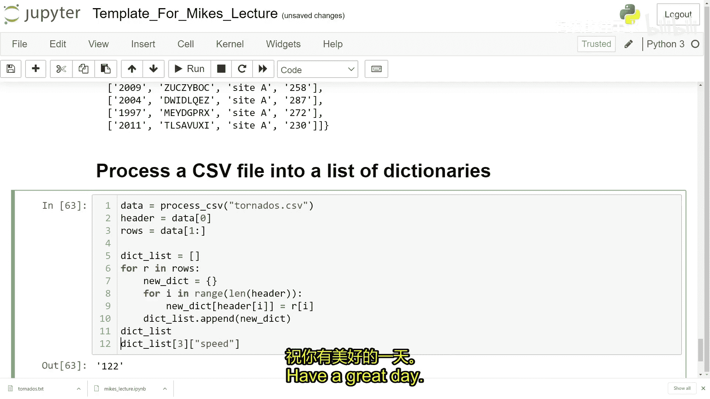

本节课我们一起学习了字典的高级操作，包括使用 `len`、`in` 和 `for` 循环，以及 `keys`、`values`、`get` 和 `pop` 方法。重点介绍了嵌套数据结构的概念，如字典的列表和列表的字典，并演示了数据分桶的实际应用。掌握这些技巧将帮助你更有效地组织和处理复杂数据集。