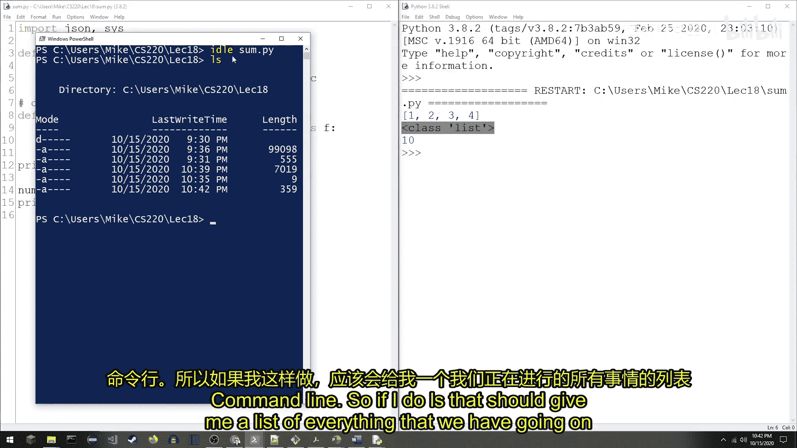
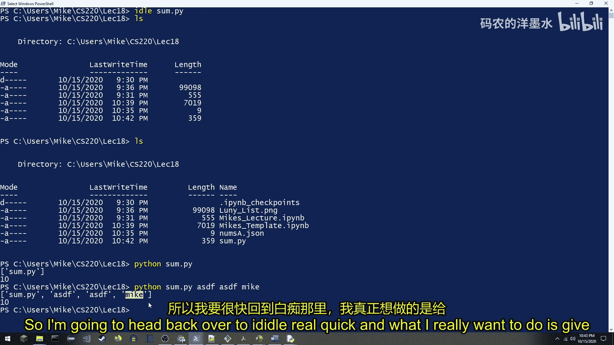
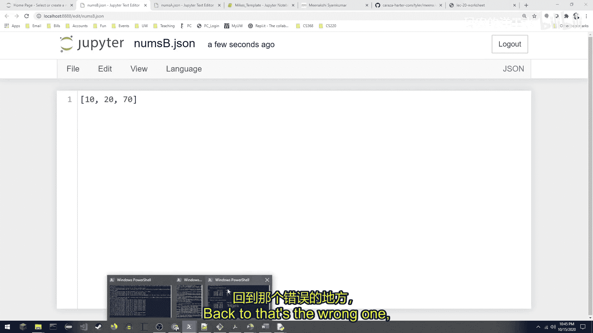
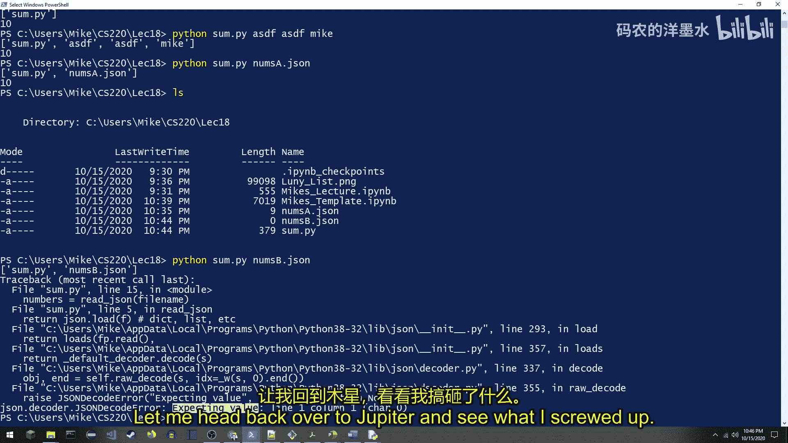
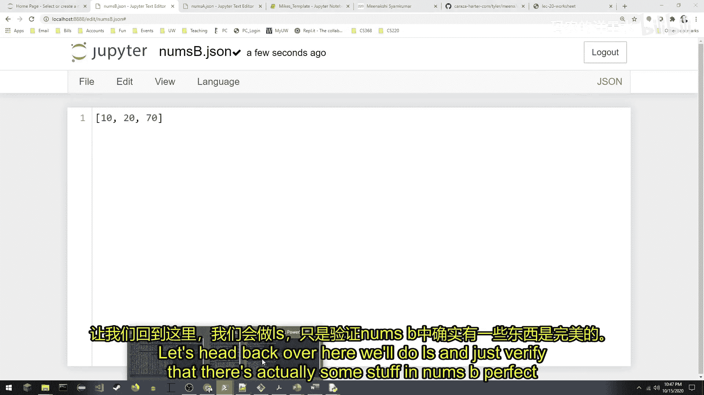
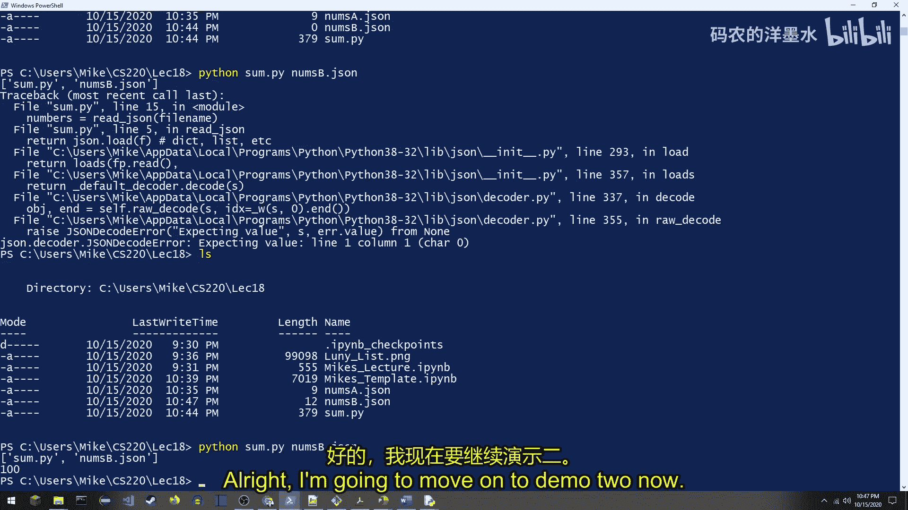
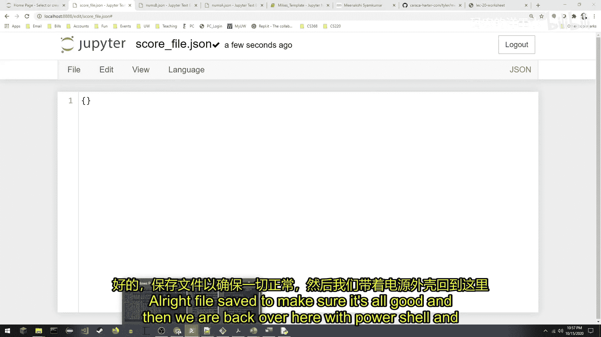
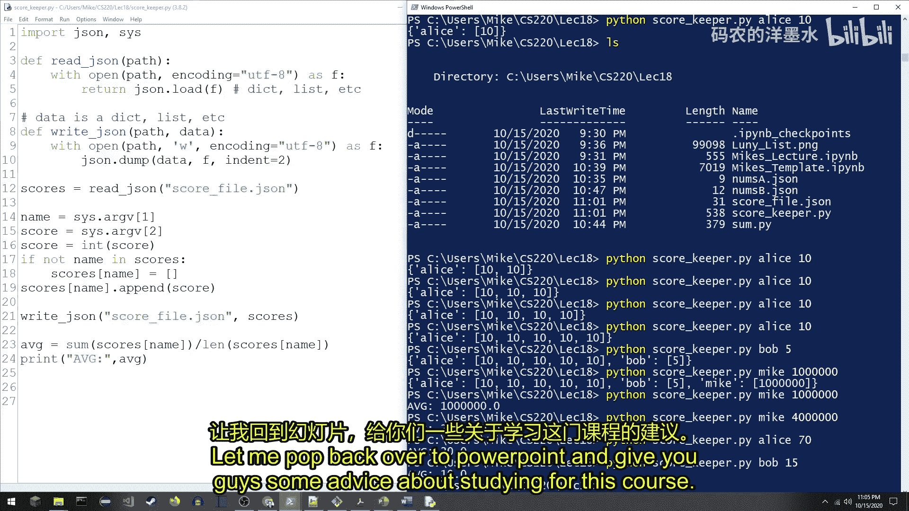
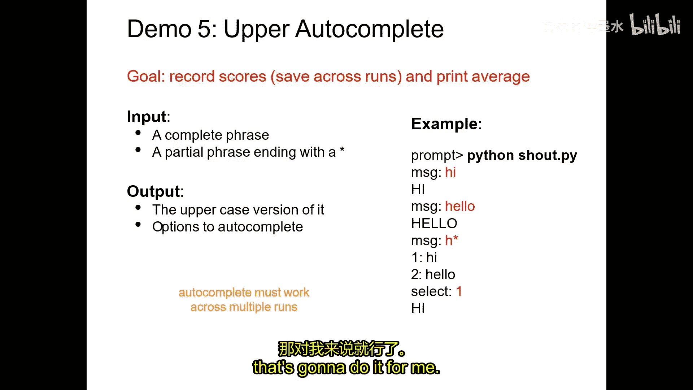

# 017：JSON文件处理 📄

在本节课中，我们将学习JSON文件格式。这是一种类似于CSV的数据存储方式，但更适合处理非表格化的复杂数据结构，例如嵌套的字典和列表。

---

## 回顾与准备

上一节我们介绍了复杂数据结构的追踪。本节中，我们来看看如何将这类结构持久化保存到文件中。

首先，我们需要从课程网页下载相关文件，包括PDF幻灯片和练习工作表。我们将使用幻灯片中的代码片段来读写JSON文件。

在代码目录中，我们有一个模板文件。跟随课程，我们将逐步填充它。此外，我们还需要一张名为“loony_list”的图片，用于辅助理解一个复杂的数据结构练习题。请确保所有文件都在同一目录下。

---

## 第一部分：复杂数据结构追踪练习 🧩

让我们从一个练习题开始，以巩固对嵌套数据结构的理解。以下是题目中的初始代码：

```python
webster = {
    "A": ["apple", "ant", "algorithm"],
    "B": ["bike", "debug"],
    "Z": {"name": "zebra", "kind": "mammal"}
}
loony_list = [8, 9, webster]
loony_list.append(loony_list)
webster["L"] = loony_list

def find(everything):
    final_letter = everything[2]["Z"]
    return final_letter
```

这个数据结构包含了字典、列表以及自引用，看起来有些复杂。我们的目标是手动追踪代码，预测特定索引操作的结果，而不是直接运行代码。

例如，要预测 `loony_list[1]` 的值，我们追踪 `loony_list` 这个列表，其索引1的位置是整数 `9`。

以下是几个需要预测的表达式，请尝试自己推理：

*   `loony_list[1]`
*   `webster["A"][-1]`
*   `final_letter["name"][-1]` （注意：`final_letter` 仅在函数内有效）
*   `loony_list[3][-1][3][-1][3][-1][0]`

对于最后一个表达式，由于自引用，我们会不断循环进入同一个列表，最终索引 `[0]` 会指向第一个元素 `8`。

通过这样的练习，我们可以加深对Python中列表索引和字典键值访问的理解，即使面对嵌套结构也能游刃有余。

---

## 第二部分：认识JSON格式 🔍

上一节我们练习了操作复杂的数据结构。本节中我们来看看，如何将这类结构保存到文件中。

### 为何需要JSON？

我们之前使用CSV文件存储“列表的列表”，这非常适合表格数据（例如带有姓名、X坐标、Y坐标的游戏玩家数据）。

但是，并非所有数据都如此规整。考虑以下数据结构：

```python
players = {
    "Alice": {"age": 40, "scores": [10, 20, 19]},
    "Bob": {"age": 45, "scores": [15, 23, 17, 15]}
}
```

这是一个“字典的字典”，其中值还包含了列表。如果硬要用CSV存储，会遇到列数不一致等问题（Alice有3个分数，Bob有4个）。此时，JSON格式就成了更好的选择。

### JSON格式简介

JSON（JavaScript Object Notation）是一种轻量级的数据交换格式。它与Python的字典和列表结构非常相似：

*   使用花括号 `{}` 表示对象（对应Python字典）。
*   使用冒号 `:` 分隔键值对。
*   使用方括号 `[]` 表示数组（对应Python列表）。
*   字符串必须使用双引号 `""`。
*   支持数字、布尔值（`true`/`false`）、`null`。

上面 `players` 字典对应的JSON文件内容如下：
```json
{
  "Alice": {
    "age": 40,
    "scores": [10, 20, 19]
  },
  "Bob": {
    "age": 45,
    "scores": [15, 23, 17, 15]
  }
}
```

### JSON与Python的细微差别

需要注意以下几点：
1.  布尔值：Python是 `True`/`False`，JSON是 `true`/`false`。
2.  空值：Python是 `None`，JSON是 `null`。
3.  字符串：JSON只允许双引号，Python单双引号皆可。
4.  末尾逗号：Python允许列表或字典末尾有逗号，JSON不允许。
5.  键的类型：Python字典键可以是多种不可变类型，JSON对象的键只能是字符串。

### 读写JSON文件

将JSON文件读入Python数据结构的解析过程，以及将Python数据结构写入JSON文件的序列化过程，都有现成的模块可以完成。



我们需要导入 `json` 模块，并使用以下两个函数：



**读取JSON文件函数：**
```python
import json



def read_json_file(path):
    with open(path, 'r', encoding='utf-8') as f:
        return json.load(f)
```
这个函数接收文件路径，返回Python数据（可能是列表、字典等）。



**写入JSON文件函数：**
```python
def write_json_file(path, data):
    with open(path, 'w', encoding='utf-8') as f:
        json.dump(data, f)
```
这个函数接收文件路径和要保存的Python数据，将其写入文件。





---

## 第三部分：实战演示——求和的分数记录器 🚀

上一节我们了解了JSON的理论和基本操作。本节中我们通过两个实际案例来应用这些知识。

### 演示1：从JSON文件读取数字并求和

**目标：** 编写一个程序，从命令行接收一个JSON文件名，该文件包含一个数字列表，程序计算并输出这些数字的总和。

**步骤：**
1.  创建一个包含数字列表的JSON文件，例如 `nums_a.json`：`[1, 2, 3, 4]`。
2.  在Python程序中，使用 `sys.argv` 获取命令行参数，其中第一个参数（索引1）就是文件名。
3.  使用 `read_json_file` 函数读取数据。
4.  使用Python内置的 `sum()` 函数计算列表总和并打印。



核心代码逻辑如下：
```python
import sys
filename = sys.argv[1]  # 获取命令行传入的文件名
numbers = read_json_file(filename)
total = sum(numbers)
print(total)
```

### 演示2：分数记录器

**目标：** 编写一个程序，记录不同玩家的游戏分数。每次运行程序时，输入玩家姓名和本次得分，程序会更新该玩家的历史分数列表，并计算输出其平均分。数据在程序多次运行间持久化保存。

**设计思路：**
*   **数据结构：** 使用一个字典，键是玩家姓名，值是该玩家的分数列表。
    ```python
    scores = {
        "Alice": [10, 20, 15],
        "Bob": [12, 18]
    }
    ```
*   **持久化：** 将这个字典保存为JSON文件（如 `scores.json`）。
*   **程序流程：**
    1.  程序启动时，从 `scores.json` 读取历史数据。
    2.  从命令行参数获取本次输入的玩家姓名和分数。
    3.  检查该玩家是否已存在于字典中。如果不存在，为其创建一个空列表。
    4.  将本次分数追加到该玩家的分数列表中。
    5.  计算该玩家当前的平均分（总和除以分数个数）并打印。
    6.  将更新后的字典写回 `scores.json` 文件。

关键代码片段包括命令行参数处理和字典的惰性初始化：
```python
import sys
# 读取历史数据
scores = read_json_file(“scores.json”)
# 获取本次输入
name = sys.argv[1]
score = int(sys.argv[2])
# 如果玩家不存在，初始化其分数列表
if name not in scores:
    scores[name] = []
# 追加分数并计算平均分
scores[name].append(score)
average = sum(scores[name]) / len(scores[name])
print(f”{name}’s average: {average}”)
# 保存数据
write_json_file(“scores.json”, scores)
```

通过这个例子，我们综合运用了JSON读写、命令行参数处理以及字典的复杂操作。

---

## 更多练习建议 💪



为了熟练掌握JSON文件处理，建议尝试完成以下扩展练习：
1.  **球员信息查询器：** 基于一个存储球员信息（ID、姓名、年龄等）的JSON文件，编写程序通过命令行输入球员ID和字段名，查询并输出对应信息。
2.  **质数缓存计算器：** 编写程序计算某数字范围内的所有质数。将已发现的质数列表保存为JSON文件。再次计算时，先读取文件中的历史质数，只计算新的部分，从而提升效率。
3.  **自动补全大写转换器：** 编写一个“喊话”程序，能将输入短语转为大写并记录。当输入以星号`*`结尾时，程序能根据历史记录提供可能的补全选项。

完成这些练习将极大地巩固你对JSON和Python数据管理的理解。

---



本节课中我们一起学习了JSON文件格式，理解了它相对于CSV在处理嵌套数据结构时的优势，掌握了使用 `json` 模块读写JSON文件的方法，并通过实战演示将数据持久化与命令行程序结合起来。这些技能对于管理复杂程序的数据至关重要。