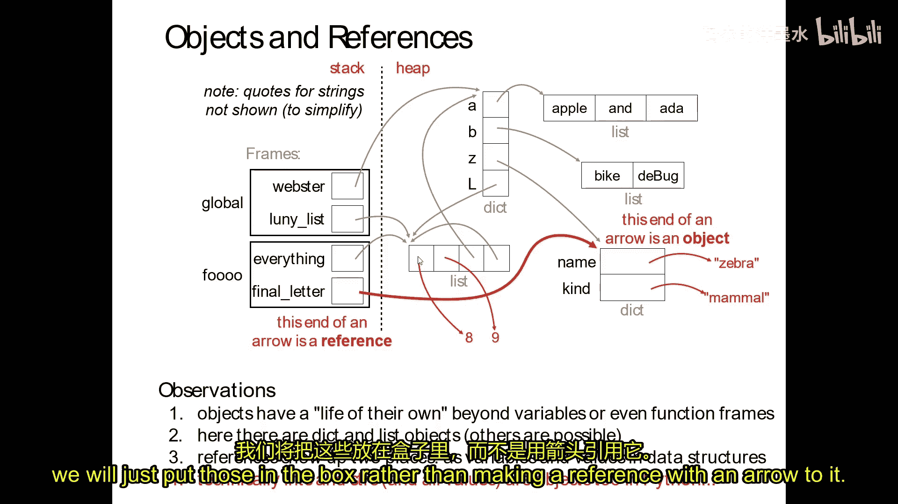
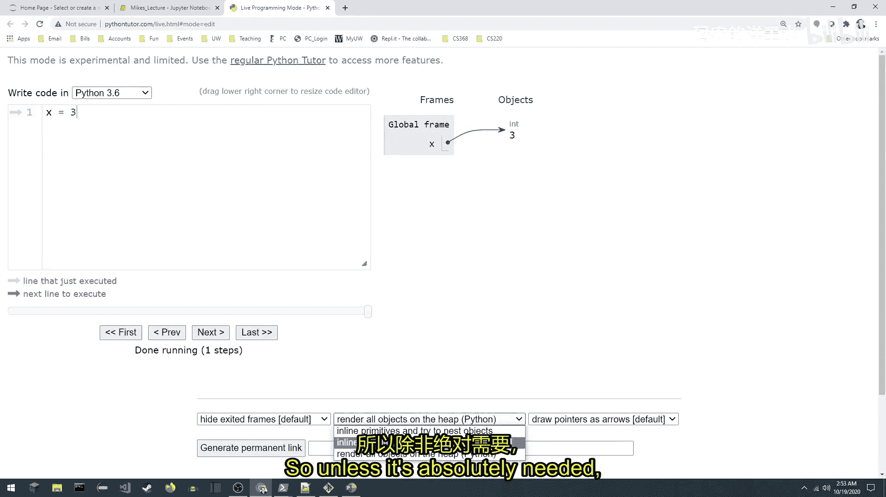
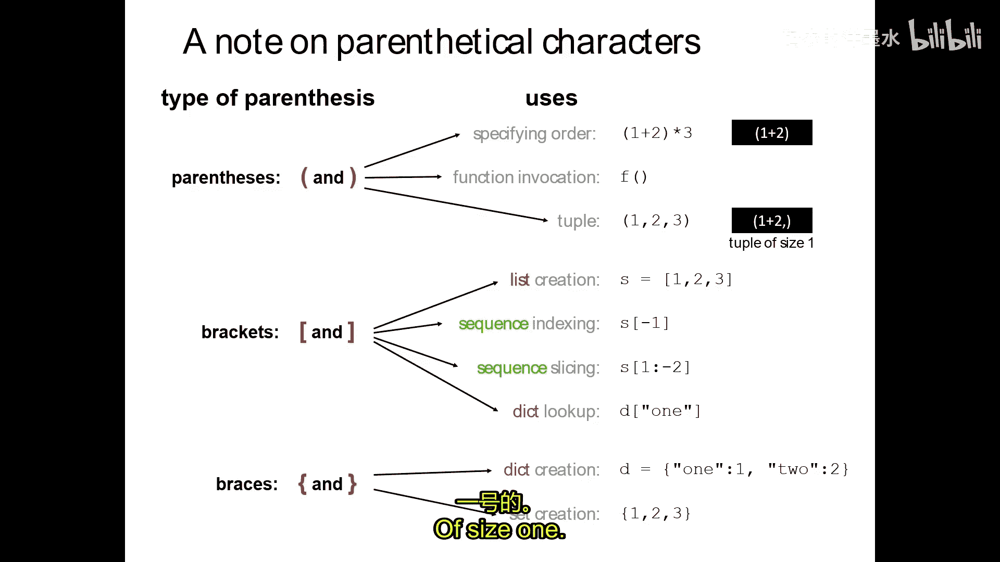
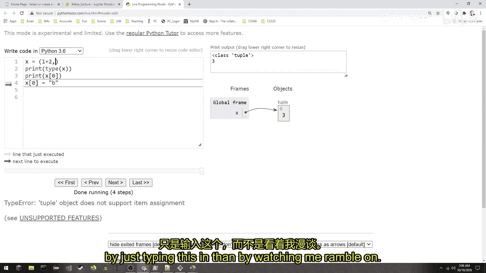
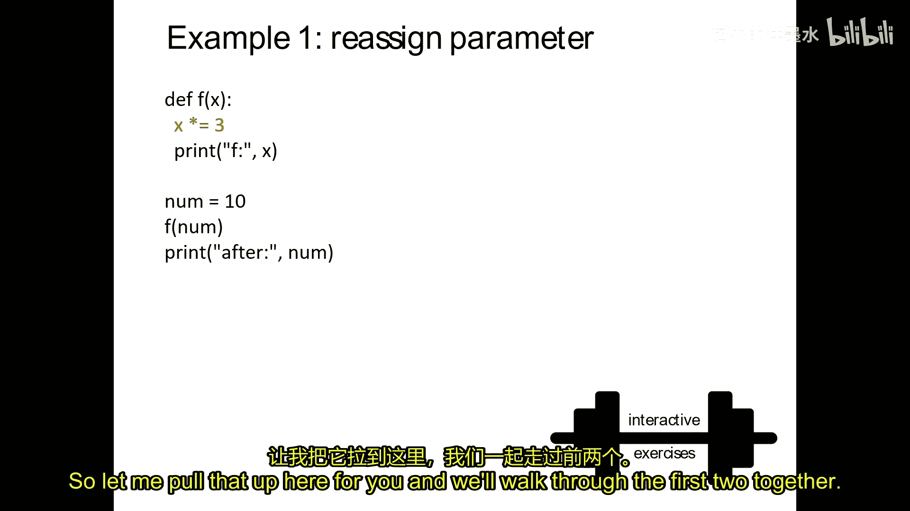
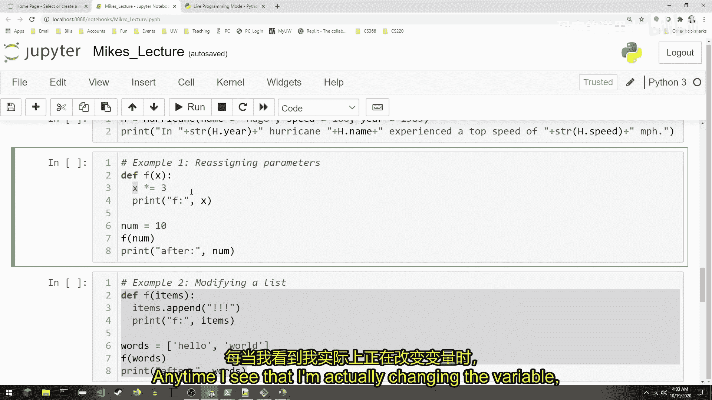
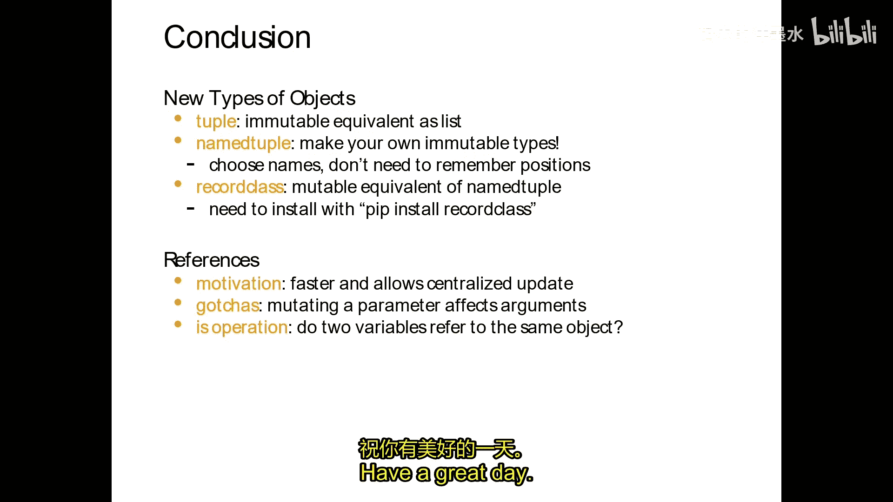

# 018：对象与引用 🧠

在本节课中，我们将要学习Python中对象与引用的核心概念。我们将探讨Python的内存模型，理解变量如何引用数据，并介绍三种新的数据类型：元组（tuple）、具名元组（namedtuple）和记录类（recordclass）。掌握这些知识将帮助我们编写更健壮、更易读且更高效的代码。

---

## 内存模型：栈与堆 🧱

上一节我们介绍了Python中变量与数据的基本关系。本节中，我们来看看Python内部是如何组织内存的。

Python内存主要分为两个部分：**栈**和**堆**。

*   **栈**：用于存储变量。变量本质上是**引用**，它们指向堆中的数据。当函数被调用时，其局部变量会被“压入”栈中；函数结束时，这些变量会被“弹出”并销毁。
*   **堆**：用于存储**对象**，即实际的数据，如数字、字符串、列表、字典等。对象可以独立于变量存在，只要还有引用指向它，它就会一直存在。当没有任何引用指向一个对象时，Python的垃圾回收机制会自动将其从内存中清除。

一个变量（引用）指向一个对象。重要的是，一个对象可以被多个引用同时指向。例如：

```python
a = [1, 2, 3]
b = a  # b 和 a 现在指向同一个列表对象
```

在这个例子中，`a` 和 `b` 是两个不同的引用（变量），但它们都指向堆中同一个列表对象 `[1, 2, 3]`。

---

## 可变性与不可变性 ⚖️

理解可变性（mutability）与不可变性（immutability）是避免常见错误的关键。

*   **不可变对象**：一旦创建，其内容就不能被修改。尝试修改会创建一个新对象。例如：**整数（int）、浮点数（float）、字符串（str）、元组（tuple）**。
*   **可变对象**：创建后，其内容可以被修改。例如：**列表（list）、字典（dict）、集合（set）、记录类（recordclass）**。



区分“修改变量”和“修改对象”非常重要：
*   **修改变量**：使用赋值操作符 `=`。这会改变变量（引用）指向的对象。
    ```python
    x = 5
    x = 10  # 变量 x 现在指向新的整数对象 10
    ```
*   **修改对象**：使用对象的方法或索引操作来改变对象内部的数据。
    ```python
    my_list = [1, 2]
    my_list.append(3)  # 修改了 my_list 指向的列表对象，现在它是 [1, 2, 3]
    my_list[0] = 99    # 修改了列表的第一个元素
    ```



**一个关键例子**：
```python
s = “hello”
l = [‘a‘, ‘b‘, ‘c‘]

# 以下操作总会失败，因为字符串是不可变的
# s[-1] = ‘.‘  # TypeError: ‘str‘ object does not support item assignment

# 以下操作可能失败，取决于字符串长度和列表长度
# 如果 len(s) 超出了列表 l 的索引范围，就会失败
# l[len(s)] = ‘.‘  # IndexError: list assignment index out of range
```

---

## 新数据类型1：元组（Tuple） 📦

元组是一种与列表非常相似的序列类型，但它是**不可变**的。

**创建元组**：使用圆括号 `()`。
```python
my_tuple = (200, 300, 400)
```



**与列表的对比**：
```python
my_list = [200, 300, 400]
my_tuple = (200, 300, 400)

# 都可以通过索引访问
x = my_list[1]   # x = 300
y = my_tuple[1]  # y = 300



# 列表可以修改
my_list[0] = 99   # 成功，my_list 变为 [99, 300, 400]

# 元组不能修改
# my_tuple[0] = 99  # TypeError: ‘tuple‘ object does not support item assignment
```

**为什么使用元组？**
1.  **数据安全**：防止意外修改不应改变的数据（如历史记录、配置常量）。
2.  **字典键**：由于字典的键必须是不可变的，因此**元组可以作为字典的键，而列表不能**。
    ```python
    # 列表作为键会报错
    # location_dict = {[2, 4]: “Psychology Building“}  # TypeError: unhashable type: ‘list‘

    # 元组作为键是可行的
    location_dict = {(2, 4): “Psychology Building“}
    print(location_dict[(2, 4)])  # 输出：Psychology Building
    ```

**注意**：创建单个元素的元组时，必须在元素后加一个逗号，以区分于普通的括号运算。
```python
single_tuple = (42,)   # 这是一个元组
not_a_tuple = (42)     # 这只是一个整数 42
```

---

## 新数据类型2：具名元组（Namedtuple） 🏷️

具名元组是 `collections` 模块提供的一个工厂函数，用于创建**自定义的、不可变的**数据类型。它结合了元组的不可变性和字典的“键值对”可读性。

**创建和使用具名元组**：
```python
from collections import namedtuple

# 1. 创建一个新的类型，名为 ‘Person‘，它有三个属性
Person = namedtuple(‘Person‘, [‘first_name‘, ‘last_name‘, ‘age‘])

# 2. 创建这个类型的对象（实例）
alice = Person(first_name=‘Alice‘, last_name=‘Anderson‘, age=30)
bob = Person(‘Bob‘, ‘Baker‘, 25)  # 也可以使用位置参数

# 3. 访问属性：使用点号，而不是索引或键，代码可读性更高
print(f“Hello, {alice.first_name} {alice.last_name}“)  # 输出：Hello, Alice Anderson
print(bob.age)  # 输出：25
```

**具名元组的优点**：
*   **代码清晰**：通过属性名访问数据，无需记住数据在元组中的位置（如 `person[0]` 是名字吗？）。
*   **轻量级**：比完整的类更简洁。
*   **不可变**：数据安全，且可作为字典的键。

---

## 新数据类型3：记录类（Recordclass） 📝

记录类是 `recordclass` 库提供的一个数据结构，它是**具名元组的可变版本**。你需要先安装它：`pip install recordclass`。

**创建和使用记录类**：
```python
from recordclass import recordclass

# 1. 创建一个新的可变类型，名为 ‘Person‘
Person = recordclass(‘Person‘, [‘first_name‘, ‘last_name‘, ‘age‘])

# 2. 创建对象
alice = Person(first_name=‘Alice‘, last_name=‘Anderson‘, age=30)

# 3. 访问属性（和具名元组一样）
print(alice.age)  # 输出：30

# 4. 关键区别：可以修改属性！
alice.age = 31  # Alice 过生日了
print(alice.age)  # 输出：31
```

**记录类的适用场景**：当你需要类似具名元组的结构清晰的数据类型，但又需要能够更新其中的数据时。

---

## 引用与“is”运算符 🔗

由于多个引用可以指向同一个对象，Python 提供了 `is` 运算符来检查两个引用是否指向**内存中的同一个对象**。这与 `==` 运算符不同，`==` 检查的是两个对象的**值**是否相等。

```python
list_a = [1, 2, 3]
list_b = [1, 2, 3]  # 创建了一个值相同的新列表对象
list_c = list_a      # list_c 指向 list_a 所指向的同一个对象

print(list_a == list_b)  # True，值相等
print(list_a is list_b)  # False，不是同一个对象

print(list_a is list_c)  # True，指向同一个对象



# 修改 list_a 会影响 list_c
list_a.append(4)
print(list_c)  # 输出：[1, 2, 3, 4]
```

**`is` 的常见用途**：检查一个变量是否为 `None`。
```python
if my_var is None:
    # 做点什么
```

**注意**：Python 会对一些小整数和短字符串进行内部优化（驻留），使得它们可能是同一个对象，但这不应作为依赖的逻辑。

---

## 函数参数传递与副作用 ⚠️

在Python中，函数参数的传递本质上是**传递引用**。这意味着，如果你向函数传递了一个可变对象（如列表），并在函数内部修改了它，那么这个修改会影响到函数外部的原始对象。

```python
def add_exclamation(items):
    items.append(“!“)  # 这会修改传入的列表对象本身



my_words = [“hello“, “world“]
add_exclamation(my_words)
print(my_words)  # 输出：[‘hello‘, ‘world‘, ‘!‘] 原始列表被改变了！
```

这种行为有时是我们期望的（“中心化更新”），但有时会导致意想不到的**副作用**和难以调试的bug。

**如何避免意外的副作用？**
*   在函数内部对传入的可变对象进行**复制**。
    ```python
    def safe_add_exclamation(items):
        new_list = items.copy()  # 或者 list(items)
        new_list.append(“!“)
        return new_list
    ```
*   明确文档说明函数是否会修改传入的参数。

---

## 总结 🎯

本节课中我们一起学习了：
1.  **Python内存模型**：理解了栈（存储变量/引用）和堆（存储对象）的区别，以及引用与对象的关系。
2.  **可变性与不可变性**：学会了区分哪些数据类型可以原地修改，哪些不能。这是写出正确代码的基础。
3.  **三种新的数据结构**：
    *   **元组（tuple）**：不可变的序列，用于保护数据和作为字典键。
    *   **具名元组（namedtuple）**：创建具有命名属性的不可变数据类型，提升代码可读性。
    *   **记录类（recordclass）**：创建具有命名属性的可变数据类型，兼具清晰的结构和修改的灵活性。
4.  **引用比较**：掌握了 `is` 与 `==` 的区别，用于判断两个变量是否指向同一对象。
5.  **函数参数传递的副作用**：认识到向函数传递可变对象时，在函数内部修改它会影响到外部原始数据，并学会了如何谨慎处理。



理解对象和引用是成为高级Python程序员的关键一步。它帮助你预测代码行为，避免隐蔽的bug，并设计出更优雅的数据结构。