# 019：对象、引用与数据复制 🧠

在本节课中，我们将深入复习Python中的对象与引用概念，这是理解Python数据模型的核心。随后，我们将探讨如何复制数据结构，包括浅拷贝与深拷贝的区别及其应用场景。

## 概述：对象与引用的核心概念

在Python中，一切皆为对象。变量并不直接“存储”对象，而是存储指向对象的**引用**。理解这一点是避免常见编程错误的关键。

### 变量与对象的关系

变量包含对对象的引用。例如，当执行 `x = [1, 2, 3]` 时，变量 `x` 存储的是一个指向列表对象 `[1, 2, 3]` 的引用（可以想象为一个箭头）。

### 可变与不可变对象

*   **可变对象**：创建后内容可以改变，例如列表（`list`）、字典（`dict`）、记录类（`recordclass`）。
*   **不可变对象**：创建后内容不可改变，例如整数（`int`）、字符串（`str`）、元组（`tuple`）。

### 对象存储位置

*   **变量**：存在于**栈帧**中，生命周期与函数调用相关。
*   **对象**：存在于**堆**中，可以被多个变量引用。

## 复习练习：测试你的理解

以下是几个快速问题，帮助你巩固对核心概念的理解。

**问题A：变量真正包含什么？**
1.  对象本身。
2.  对对象的引用。

**问题B：如何标注类型层次结构中的空白？**
（假设图示左边是基类，右边是子类）
1.  左边填 `namedtuple`，右边填 `tuple`。
2.  左边填 `tuple`，右边填 `namedtuple`。

**问题C：以下哪项实际存在于栈帧中？**
1.  对象。
2.  变量。

**答案与解析：**
*   **问题A**：答案是 **2**。变量存储的是指向对象的引用（地址）。
*   **问题B**：答案是 **1**。`namedtuple` 是 `tuple` 的子类，它允许我们创建带有命名字段的自定义类型。
*   **问题C**：答案是 **2**。变量存在于栈帧中，而对象存在于堆内存中。

## 数据结构的可变性与特性

上一节我们回顾了基本概念，本节中我们来看看不同数据结构的特性对比。以下是常见数据结构的属性比较表：

| 特性                 | 列表 (`list`) | 元组 (`tuple`) | 命名元组 (`namedtuple`) | 记录类 (`recordclass`) |
| :------------------- | :------------ | :------------- | :---------------------- | :-------------------- |
| **是否可变**         | True          | False          | False                   | True                  |
| **是否预安装**       | True          | True           | True (需 `import`)      | False (需 `pip install`) |
| **是否内置**         | True          | True           | False                   | False                 |
| **是否可创建新类型** | False         | False          | True                    | True                  |
| **是否可命名字段**   | False         | False          | True                    | True                  |

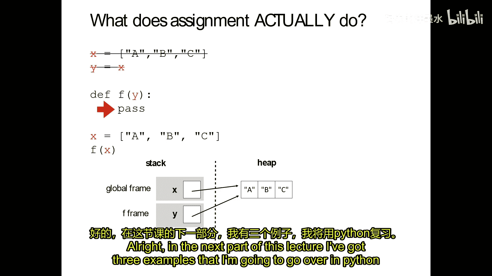

**关键点解析：**
*   **预安装**：指是否随Python标准库一起提供，无需额外安装。
*   **内置**：指是否为语言关键字或可直接使用的内置类型，无需导入。
*   **创建新类型**：指能否作为“工厂”定义全新的数据类型（如 `Person`、`HurricaneData`）。
*   **命名字段**：指能否为数据的每个部分赋予一个名称（如 `.name`），而非仅使用数字索引。

## 赋值与参数传递的本质

理解了数据结构特性后，我们需要明确赋值操作的真正行为。一个常见的误解是赋值会创建数据的独立副本。

### 引用赋值

代码 `y = x` 不会创建 `x` 所指对象的新副本。它只是让变量 `y` 指向 `x` 当前所指的**同一个对象**。

```python
x = [‘A‘, ‘B‘, ‘C‘]  # 创建一个列表对象，x指向它
y = x                 # y 指向 x 所指的同一个列表对象
y.append(‘D‘)         # 通过 y 修改列表
print(x)              # 输出：[‘A‘, ‘B‘, ‘C‘, ‘D‘]，x“看到”了变化
```

**图示说明：**
执行 `y = x` 后，内存中存在一个列表对象，但有两个变量（`x` 和 `y`）引用它。通过任何一个变量修改对象，另一个变量访问时都会看到修改后的结果。

### 函数参数传递

函数参数传递遵循相同的引用赋值规则。

```python
def append_number(some_list):
    some_list.append(42)

my_list = [1, 2, 3]
append_number(my_list)
print(my_list)  # 输出：[1, 2, 3, 42]
```

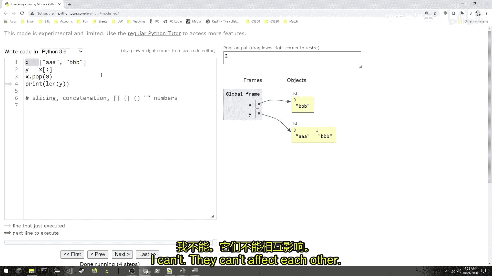

**过程解析：**
1.  调用 `append_number(my_list)` 时，形参 `some_list` 被赋值为实参 `my_list` 的引用。
2.  因此，`some_list` 和 `my_list` 指向同一个列表对象。
3.  在函数内部通过 `some_list` 修改列表，函数外部的 `my_list` 也会反映这个变化。


**重要结论：** 在Python中，赋值 (`=`) 和参数传递创建的都是**引用副本**，而非对象副本。

## 对象的可见性与创建

既然赋值不创建新对象，那么何时才会创建新对象呢？本节我们来看看哪些操作会真正在堆上创建新对象。

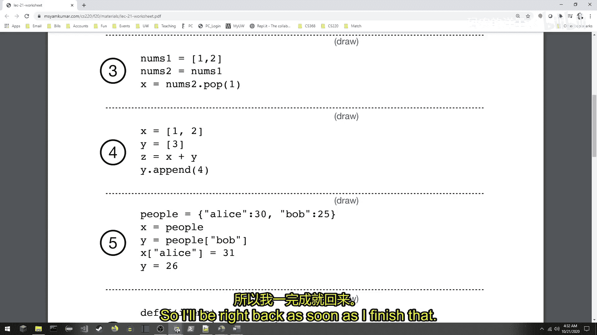

**会创建新对象的操作（产生独立数据）：**
*   **字面量创建**：`[]`, `{}`, `()`, `""`, `123`
*   **构造函数**：`list()`, `dict()`, `tuple()`
*   **切片操作**：`list_copy = original_list[:]`
*   **连接操作**：`new_list = list1 + list2`
*   **某些方法返回新对象**：如 `some_string.upper()`

**不会创建新对象的操作（操作现有对象）：**
*   **引用赋值**：`y = x`
*   **原地修改方法**：`list.append()`, `list.pop()`, `dict.update()`

**示例分析：**
```python
x = [‘A‘, ‘A‘, ‘B‘, ‘B‘, ‘B‘]
y = x[:]        # 切片操作：创建新列表对象，y指向它
x.pop(0)        # 通过 x 修改原列表
print(len(y))   # 输出：5，y 所指的列表未受影响
```
本例中，切片 `x[:]` 创建了一个包含相同元素的新列表对象，因此后续对 `x` 的修改不会影响 `y`。

## 动手练习：绘制引用图

理论学习后，最好的巩固方式是动手画图。以下是几个练习题，请尝试在纸上画出变量、引用和对象的关系图。

**练习题2（示例）：**
```python
x = [1, 2, 3]
y = [1, 2, 3]
z = x
z.append(4)
```
**答案图示：**
*   `x` --> 列表对象 `[1, 2, 3, 4]`
*   `y` --> **另一个**列表对象 `[1, 2, 3]`
*   `z` --> 与 `x` 指向**同一个**列表对象 `[1, 2, 3, 4]`

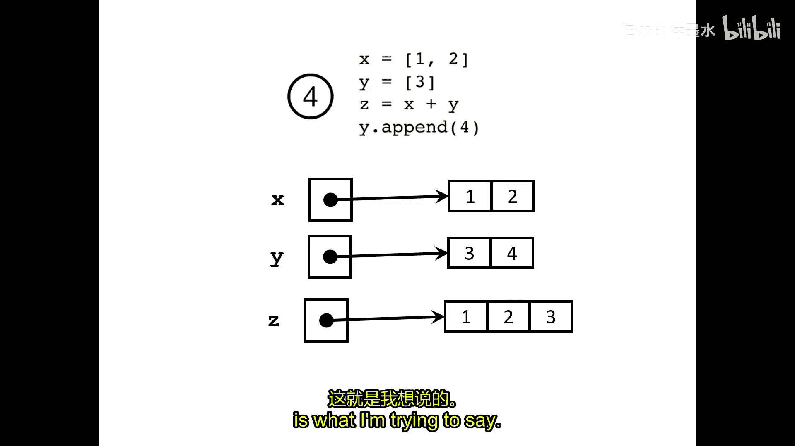

**练习题3：**
```python
nums1 = [1, 2]
nums2 = nums1
x = nums2.pop()
```
**关键点：** `nums2.pop()` 返回被移除的元素 `2` 并赋值给 `x`，同时原地修改 `nums1` 和 `nums2` 共同指向的列表。

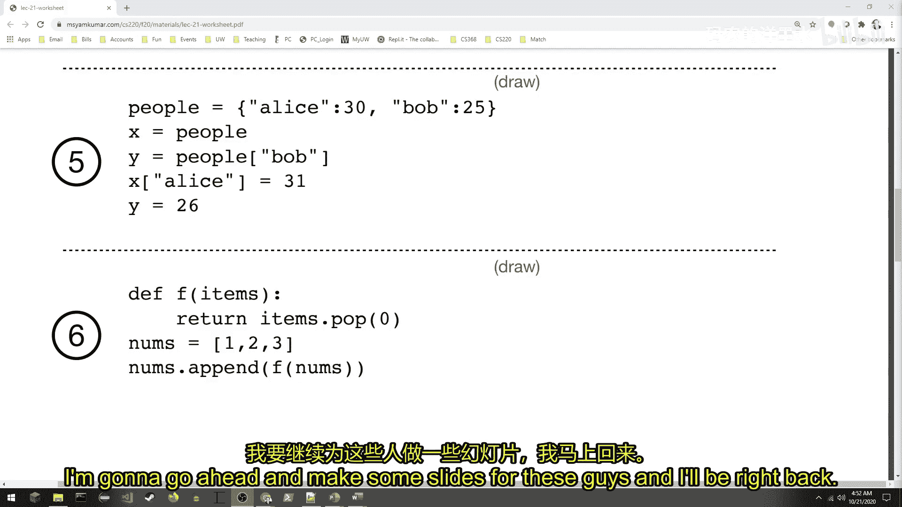

**练习题4：**
```python
x = [1, 2]
y = [3]
z = x + y
y.append(4)
```
**关键点：** `x + y` 是连接操作，会创建包含 `[1, 2, 3]` 的**新列表**。后续对 `y` 的修改不影响 `z`。

**练习题5（涉及字典）：**
```python
people = {‘Alice‘: 30, ‘Bob‘: 25}
x = people
y = people[‘Bob‘]
x[‘Alice‘] = 31
y = 26
```
**关键点：** 字典的值（如整数25）也是独立对象。`y = people[‘Bob‘]` 让 `y` 引用整数 `25`。后来 `y = 26` 是让 `y` 引用一个新的整数对象 `26`，这与字典中的值 `25` 无关。

**练习题6（涉及函数调用）：**
```python
def f(items):
    return items.pop(0)

nums = [1, 2, 3]
nums.append(f(nums))
```
**逐步分析：**
1.  调用 `f(nums)`，形参 `items` 引用实参 `nums` 所指的同一列表 `[1, 2, 3]`。
2.  `items.pop(0)` 移除并返回列表的第一个元素 `1`，列表变为 `[2, 3]`。
3.  函数返回 `1`。
4.  `nums.append(1)` 将 `1` 追加到列表末尾，列表最终变为 `[2, 3, 1]`。

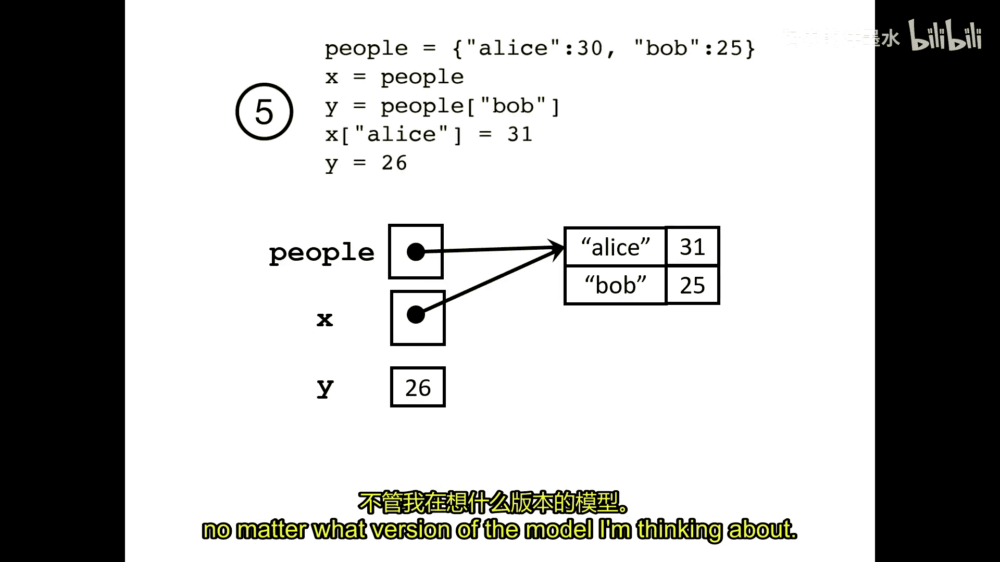

## 记录类（Record Class）示例

我们之前介绍了 `namedtuple`，现在看看它的可变版本——记录类。它结合了定义新类型和可变性的优点。

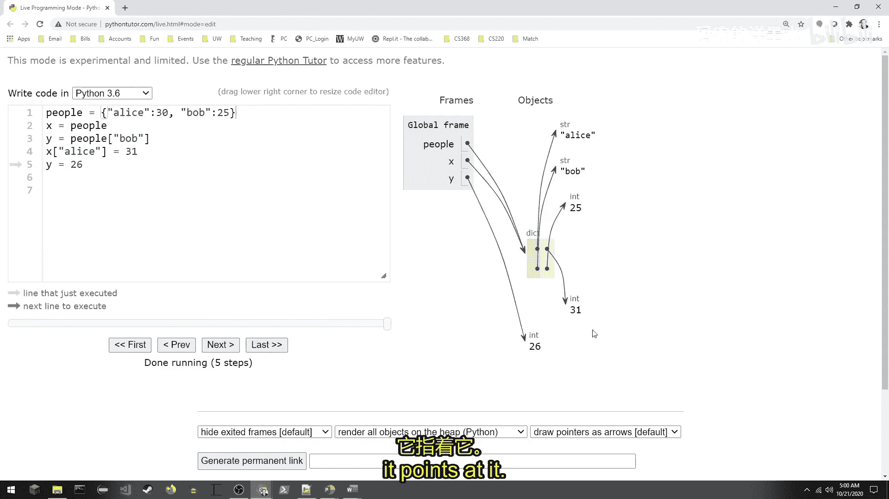

```python
from recordclass import recordclass

# 1. 创建新的数据类型 Person
Person = recordclass(‘Person‘, [‘name‘, ‘score‘, ‘age‘])

# 2. 创建该类型的对象（实例）
alice = Person(‘Alice‘, 10, 30)
bob = Person(‘Bob‘, 25, 28)

# 3. 将对象放入其他数据结构
team = [alice, bob]  # 列表存储的是对象的引用
players = {‘A‘: alice, ‘B‘: bob}  # 字典值存储的也是对象的引用

# 4. 通过任一引用修改对象
alice.score += 5
print(team[0].score)      # 输出：15
print(players[‘A‘].score) # 输出：15
```
**核心概念：** `team` 和 `players` 中存储的并非 `alice` 变量本身，而是该变量所引用的 `Person` 对象的引用。因此，通过 `alice`、`team[0]` 或 `players[‘A‘]` 中任何一个访问并修改对象，所有其他引用都会看到变化。

## 对象的复用（驻留）

Python有时会出于性能考虑，让不同的引用指向同一个不可变对象，这称为“驻留”。

```python
# 小整数通常会被驻留
x = 2 ** 4  # 16
y = 2 ** 4  # 16
z = y
print(x is y)  # 可能输出 True，因为16是小整数，Python复用对象

# 大整数可能不会驻留
x = 2 ** 100
y = 2 ** 100
z = y
print(x == y)  # True，值相等
print(x is y)  # False，可能是两个不同的对象（取决于Python实现和优化）
```
**注意：** 驻留是解释器的内部优化行为，不应在编程中依赖 `is` 进行值比较，而应始终使用 `==`。

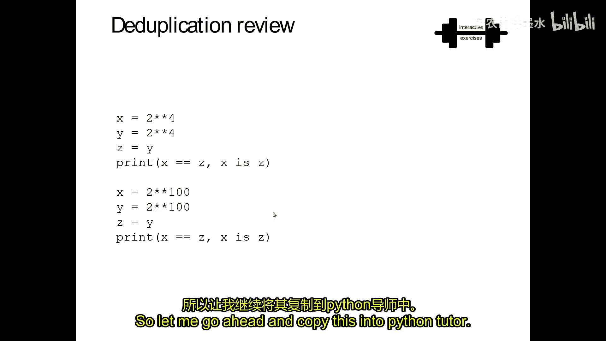

## 数据复制：浅拷贝与深拷贝

复习完对象与引用后，我们进入本节课的新主题：如何真正复制数据。根据不同的需求，我们有三种主要的复制方式。

### 1. 引用复制（Reference Copy）
即普通的赋值操作，只复制引用，不复制对象。这是最快但“最危险”的方式，因为所有引用共享同一份数据。
```python
import copy
original = [{‘name‘: ‘A‘, ‘score‘: 88}, {‘name‘: ‘B‘, ‘score‘: 111}]
reference_copy = original  # 仅复制引用
```

### 2. 浅拷贝（Shallow Copy）
创建**新对象**，但仅复制第一层引用。如果元素是可变对象（如列表中的字典），则拷贝的是这些元素的引用，而非元素本身。
```python
import copy
original = [{‘name‘: ‘A‘, ‘score‘: 88}, {‘name‘: ‘B‘, ‘score‘: 111}]
shallow_copy = copy.copy(original)  # 或 original[:] 对于列表
# shallow_copy 是一个新列表，但它的两个元素指向与原列表相同的两个字典
```

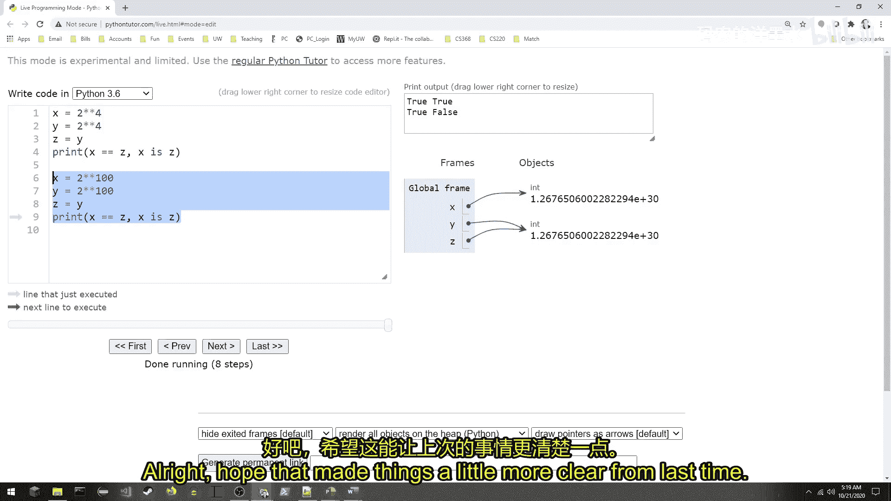

### 3. 深拷贝（Deep Copy）
创建**新对象**，并递归地复制所有嵌套的可变对象。生成一个完全独立的副本。
```python
import copy
original = [{‘name‘: ‘A‘, ‘score‘: 88}, {‘name‘: ‘B‘, ‘score‘: 111}]
deep_copy = copy.deepcopy(original)
# deep_copy 是一个新列表，它的两个元素也是全新的字典对象
```

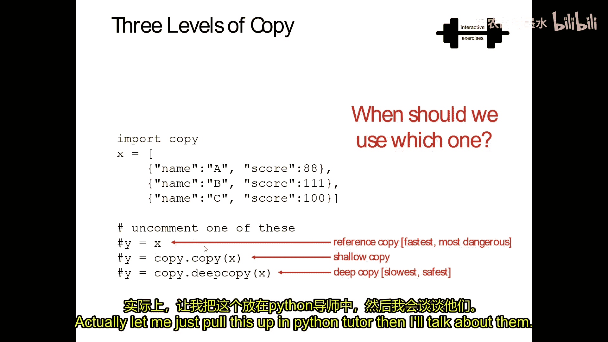

**深度（Depth）概念：** 指从顶层变量访问到目标数据需要经过的引用层级。深拷贝会复制所有深度的数据。

## 如何实现自定义深度的拷贝？

浅拷贝只复制第一层，深拷贝复制所有层。如果想精确复制到第N层，可以组合使用浅拷贝和循环。

```python
import copy

original = [{‘name‘: ‘A‘, ‘score‘: 88}, {‘name‘: ‘B‘, ‘score‘: 111}]

# 目标：复制列表（第一层）和其中的字典（第二层），但不复制字典内的字符串（第三层，不可变，无需复制）
# 这相当于“深度为2”的拷贝

# 1. 浅拷贝第一层（列表）
custom_copy = copy.copy(original)

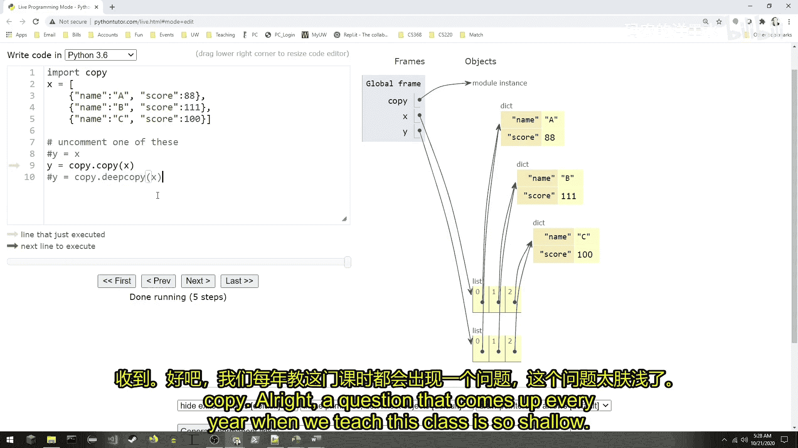

# 2. 遍历列表，深拷贝第二层（每个字典）
for i in range(len(original)):
    custom_copy[i] = copy.deepcopy(original[i])
```
经过上述操作，`custom_copy` 是一个新列表，其中的每个字典也是新字典，但字典内的字符串（如 `‘A‘`）可能仍与原始对象共享（因为字符串不可变，共享是安全且高效的）。

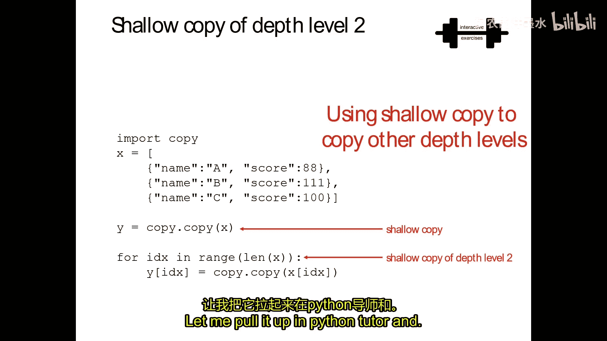

## 拷贝方式的选择与应用场景

选择哪种拷贝方式取决于你的具体操作和对数据独立性的要求。

### 场景一：仅读取数据 -> 使用引用复制
**任务：** 查找最高分，不修改数据。
```python
def max_score(people_list):
    highest = None
    for person in people_list:  # people_list 是原始数据的引用
        if highest is None or person[‘score‘] > highest:
            highest = person[‘score‘]
    return highest

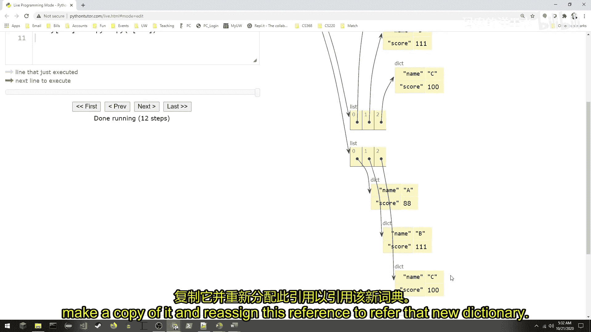

players = [{‘name‘: ‘A‘, ‘score‘: 88}, ...]
highest = max_score(players)  # 传递引用，高效安全
```
**理由：** 函数只读取数据，不修改。引用复制速度快，内存占用低。

### 场景二：需排序或临时重排 -> 使用浅拷贝
**任务：** 计算中位数分数，需要排序，但想保持原列表顺序。
```python
def median_score(people_list):
    import copy
    people_sorted = copy.copy(people_list)  # 浅拷贝：新列表，旧字典引用
    people_sorted.sort(key=lambda p: p[‘score‘])  # 排序新列表，不影响原列表
    middle_index = len(people_sorted) // 2
    return people_sorted[middle_index][‘score‘]
```
**理由：** 我们需要改变列表元素的顺序，但不改变字典内容。浅拷贝创建了新列表，排序操作不会影响原始列表的顺序。

### 场景三：需保存历史快照并独立修改 -> 使用深拷贝
**任务：** 保存游戏上半场分数快照，然后继续比赛更新分数。
```python
import copy

# 上半场结束时的数据
players_first_half = [{‘name‘: ‘A‘, ‘score‘: 88}, ...]

# 深拷贝保存快照
snapshot = copy.deepcopy(players_first_half)

# 继续比赛，更新分数
players_first_half[0][‘score‘] += 10  # A球员在下半场得了10分

# 分析上下半场表现
print(f“Player A‘s score changed by: {players_first_half[0][‘score‘] - snapshot[0][‘score‘]}“)
# 输出：Player A‘s score changed by: 10
```
**理由：** 我们需要一份完全独立的数据副本。后续对比赛数据的任何修改都不应影响已保存的快照，只有深拷贝能保证这种独立性。

## 总结

本节课中我们一起学习了：
1.  **对象与引用**：Python变量存储的是对象的引用（指针）。赋值和参数传递传递的是引用副本。
2.  **可变与不可变**：理解哪些类型可以原地修改，哪些不能，这对理解程序行为至关重要。
3.  **可视化思维**：通过画图（变量框、引用箭头、对象圈）来理解复杂的数据关系。
4.  **数据复制三剑客**：
    *   **引用复制** (`=`): 共享数据，修改互通。
    *   **浅拷贝** (`copy.copy()` 或 `list[:]`): 复制容器，但共享内部元素。适用于需要独立容器结构但可共享内部数据的场景。
    *   **深拷贝** (`copy.deepcopy()`): 完全独立克隆。适用于需要完全隔离数据版本的场景。
5.  **如何选择**：根据是否修改数据、修改哪一层数据以及对性能的要求，选择合适的拷贝策略。


掌握这些概念是成为熟练Python程序员的关键一步，它能帮助你避免许多难以调试的共享数据错误，并写出更高效、更可靠的代码。