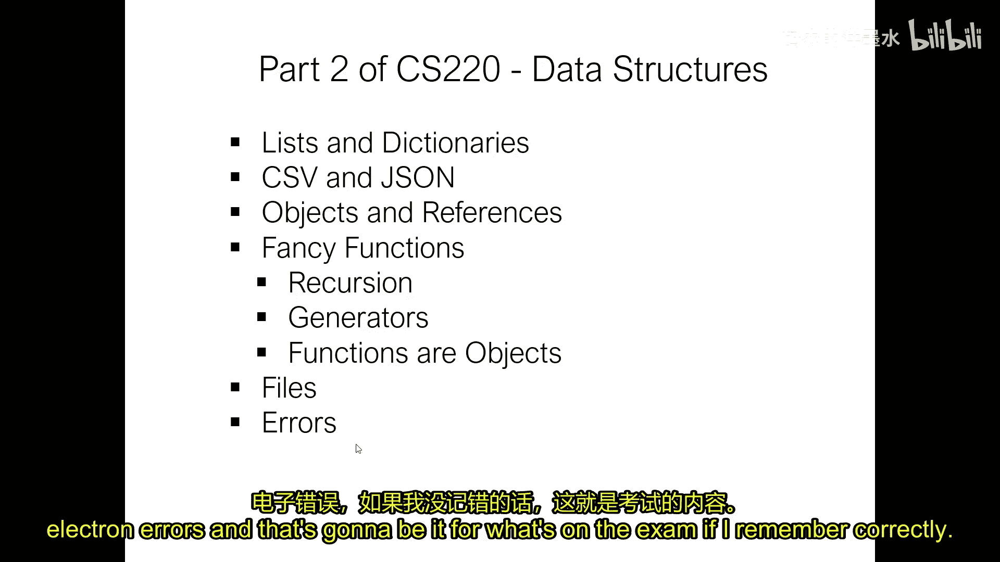
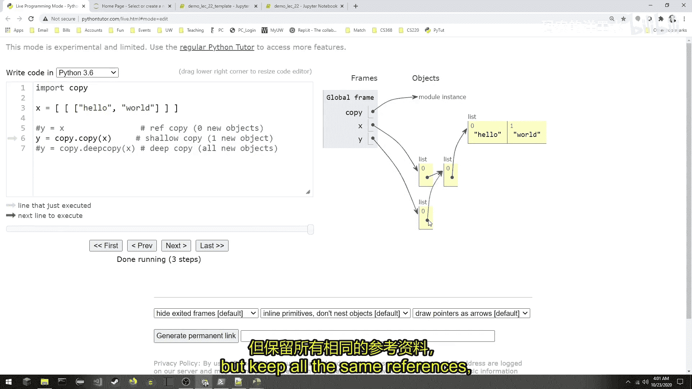
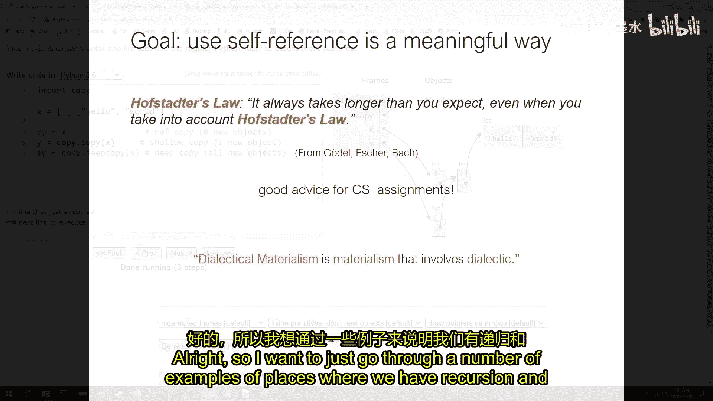
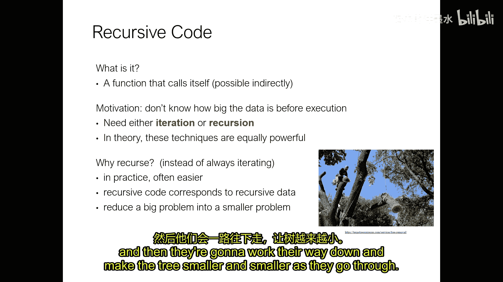
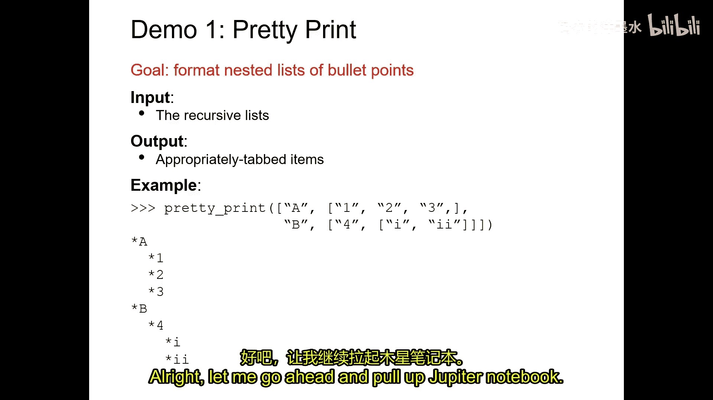
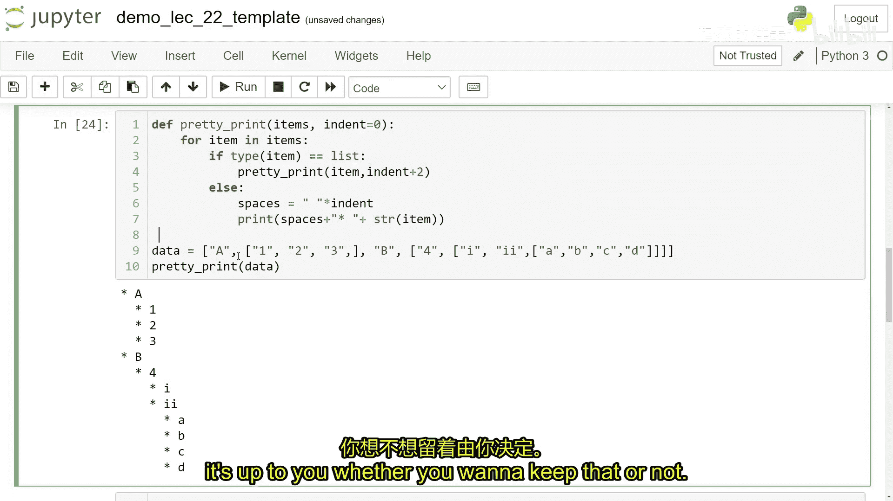
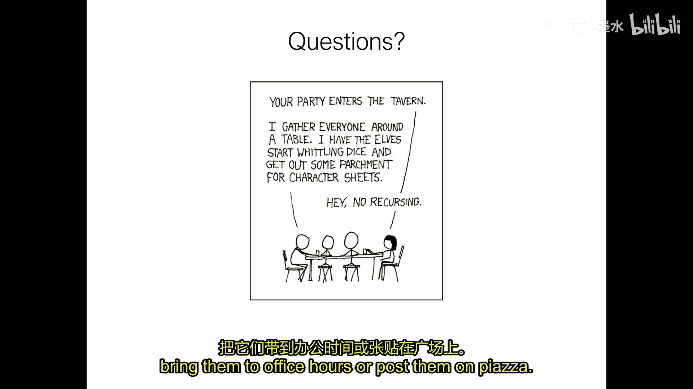

# 020：递归

在本节课中，我们将要学习递归这一核心编程概念。递归是指一个事物直接或间接地引用自身。我们将探讨递归的定义、递归数据结构，并重点学习如何编写递归函数来解决问题。

---

## 课程回顾与定位

上一节我们讨论了对象与引用。本节中，我们来看看递归。

在课程的前五周，我们学习了编程基础，包括控制流（如 `if` 语句、`while` 和 `for` 循环）。第二部分是关于数据结构，我们介绍了列表和字典，以及集合和元组。之后，我们学习了数据文件（CSV和JSON格式）以及对象与引用的概念。接下来，我们将学习三个关于函数的专题：今天的递归、周一的生成器以及周三的“函数即对象”。这些是考试的重点内容。



---

## 什么是递归？

递归的核心是自我引用。递归定义在字典中会包含被定义的词本身（这通常不是好做法）。递归数据结构包含相同类型的其他数据结构（例如列表的列表）。递归函数则是会调用自身的函数。

递归可以非常强大，但理解其工作原理需要一些技巧。

---





## 复制操作回顾

在深入递归之前，我们先快速回顾一下复制操作，这对于理解递归函数中的数据传递很重要。

以下是三种复制方式的示例：

```python
import copy

x = [[[‘Hello‘, ‘World‘]]]
```

*   **引用复制**：创建新变量，指向同一对象。
    ```python
    y = x  # 不创建新对象
    ```
*   **深拷贝**：创建全新副本，递归复制所有嵌套对象。
    ```python
    y = copy.deepcopy(x)  # 创建所有嵌套对象的新副本
    ```
*   **浅拷贝**：仅复制第一层，嵌套对象仍被共享。
    ```python
    y = copy.copy(x)  # 仅创建最外层列表的新副本
    ```

浅拷贝在某些场景下有用，例如当你想重新排列列表但保持内部字符串不变时。

---

## 递归定义与结构

递归定义在数学和编程中很常见，但需要有意义，避免无限循环。

**示例：正偶数定义**
*   **基础情况**：2是正偶数。
*   **递归情况**：如果 `x` 是正偶数，那么 `x + 2` 也是正偶数。

**递归数据结构示例**
列表中可以包含其他列表，形成递归结构。
```python
rows = [[‘A‘, [1]], [‘B‘, [3, 4, 5]], [‘C‘, [7, 8]]]
```

自然界和计算机系统中也存在递归结构：
*   **树**：树枝可以分出更多树枝（递归情况），也可以终止于树叶（基础情况）。
*   **文件系统**：目录可以包含文件和更多目录。
*   **JSON格式**：字典中的值可以是另一个字典。

**关键点**：递归允许结构**任意大**，但必须是**有限**的，这样才能解决问题。我们需要一个**基础情况**来终止递归过程。



---


## 递归函数

递归函数是直接或间接调用自身的函数。

**直接递归示例**
```python
def f():
    # 一些代码
    f()  # 调用自身
    # 更多代码
```

**间接递归示例**
```python
def g():
    # 一些代码
    h()

def h():
    # 一些代码
    g()
```

**为什么使用递归？**
1.  处理大小未知的数据集。
2.  将大问题分解为更小的相似问题。
3.  递归和迭代在能力上等价，但某些问题用递归解决更直观。

---

## 编写递归函数：四步法

我们将以计算阶乘为例，演示编写递归函数的系统方法。

**1. 列举示例**
从简单情况开始：
*   1! = 1
*   2! = 1 × 2
*   3! = 1 × 2 × 3
*   4! = 1 × 2 × 3 × 4

**2. 寻找自引用模式**
观察规律：
*   4! = 3! × 4
*   3! = 2! × 3
*   2! = 1! × 2

**3. 归纳递归定义**
*   **基础情况**：`1! = 1`
*   **递归情况**：`n! = (n-1)! × n` （当 n > 1 时）

**4. 转化为Python代码**
```python
def factorial(n):
    if n == 1:          # 基础情况
        return 1
    else:               # 递归情况
        p = factorial(n - 1)  # 函数调用自身，问题规模减小
        return p * n
```
递归调用必须向基础情况推进（此处 `n` 不断减小至1）。

---

## 递归执行与调用栈

当递归函数调用自身时，每次调用都会创建一个新的**栈帧**，用于存储该次调用的参数和局部变量。栈帧遵循后进先出（LIFO）原则。

以 `factorial(3)` 为例：
1.  调用 `factorial(3)`，创建栈帧 `n=3`。
2.  执行 `p = factorial(2)`，创建新栈帧 `n=2`，暂停当前帧。
3.  执行 `p = factorial(1)`，创建新栈帧 `n=1`，暂停前一帧。
4.  `factorial(1)` 满足基础情况，返回 `1`，其栈帧被销毁。
5.  控制权回到 `factorial(2)` 的栈帧，计算 `p * n = 1 * 2 = 2`，返回 `2`，栈帧销毁。
6.  控制权回到 `factorial(3)` 的栈帧，计算 `p * n = 2 * 3 = 6`，返回 `6`，栈帧销毁。

---

## 常见递归错误

1.  **缺少基础情况或基础情况无法到达**：导致无限递归，最终耗尽内存（栈溢出）。
    ```python
    def factorial_no_base(n):
        # 缺少 if n == 1 的判断
        return n * factorial_no_base(n - 1)  # 无限调用！
    ```
2.  **递归未向基础情况推进**：例如对负数调用阶乘函数，`n` 会越来越小，永远达不到1。

**重要建议**：**先编写基础情况**，确保递归有终止条件。



---

## 实战示例：美化打印嵌套列表

我们将编写一个 `pretty_print` 函数，以清晰的缩进格式打印任意深度的嵌套列表。

**目标输出格式**
```
* A
*   * 1
*   * 2
* B
*   * 4
*       * i
*       * ii
*       * iii
*       * iv
```

**代码实现与讲解**

```python
def pretty_print(items, indent=0):
    """
    递归地打印嵌套列表，每层增加缩进。
    items: 要打印的列表（可能包含嵌套列表）。
    indent: 当前缩进级别（空格数）。
    """
    for item in items:
        if isinstance(item, list):
            # 递归情况：遇到子列表，增加缩进后递归调用
            pretty_print(item, indent + 2)
        else:
            # 基础情况：打印非列表项，加上当前缩进和星号
            spaces = ‘ ‘ * indent
            print(f‘{spaces}* {item}‘)

# 测试数据
data = [
    ‘A‘,
    [1, 2],
    ‘B‘,
    [4, [‘i‘, ‘ii‘, ‘iii‘, ‘iv‘]]
]

pretty_print(data)
```

**代码解析**
*   `indent=0` 是默认参数，首次调用时缩进为0。
*   `isinstance(item, list)` 检查当前项是否为列表。
*   **基础情况**：如果是字符串等非列表项，直接按格式打印。
*   **递归情况**：如果是列表，则以更大的缩进（`indent + 2`）递归调用自身来处理这个子列表。
*   递归确保了无论列表嵌套多深，都能正确缩进打印。

---

## 练习：递归列表搜索

尝试编写一个函数 `contains(number, data_structure)`，检查给定的数字是否存在于一个任意深度的嵌套列表结构中。

**思路提示**
1.  遍历当前列表的每个元素。
2.  **基础情况**：如果元素等于目标数字，返回 `True`。
3.  **递归情况**：如果元素是子列表，递归调用 `contains` 在该子列表中搜索。
4.  如果遍历完所有元素都没找到，返回 `False`。



---

## 总结



本节课中我们一起学习了递归的核心概念。我们了解了递归的定义和递归数据结构，并通过四步法系统地学习了如何编写递归函数。我们以阶乘计算为例，剖析了递归的执行过程与调用栈的工作原理，并指出了常见的错误。最后，我们通过“美化打印嵌套列表”的实战示例，巩固了递归函数的编写技巧。递归是一种强大的工具，它将复杂问题分解为相似的子问题，是处理嵌套或分层数据的有效方法。