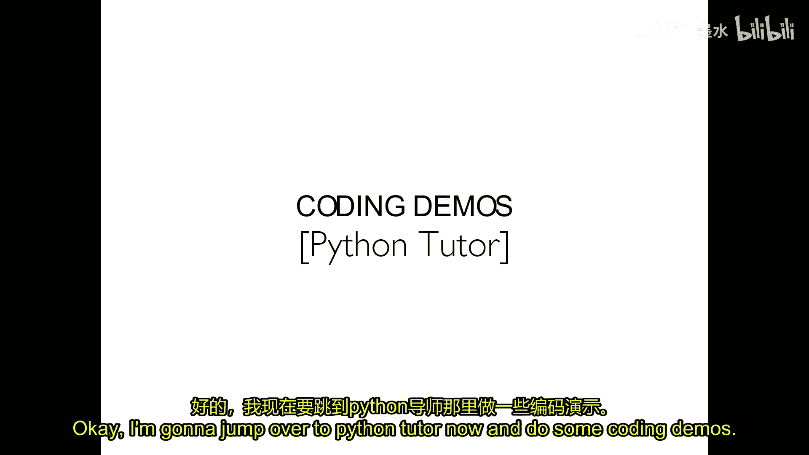
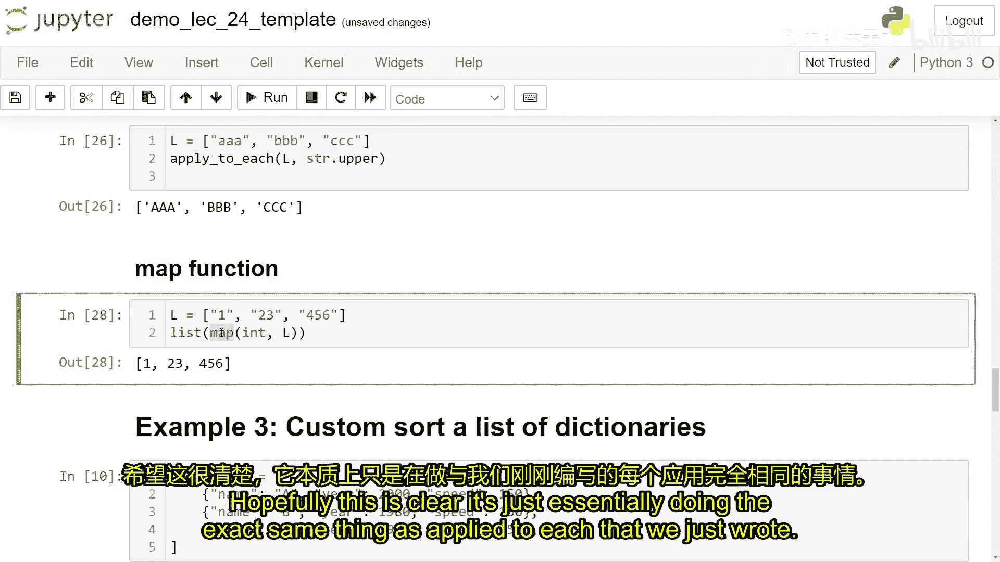
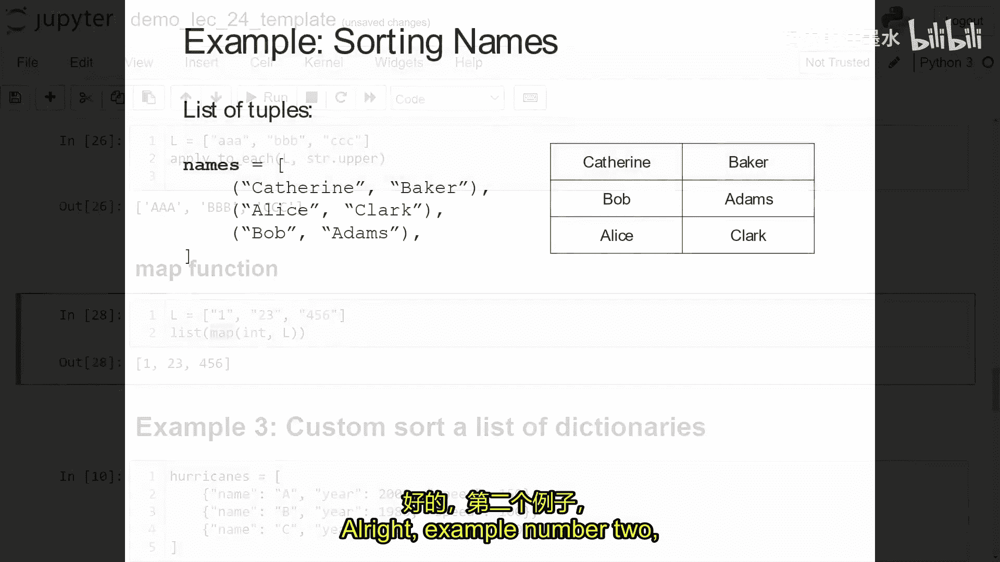
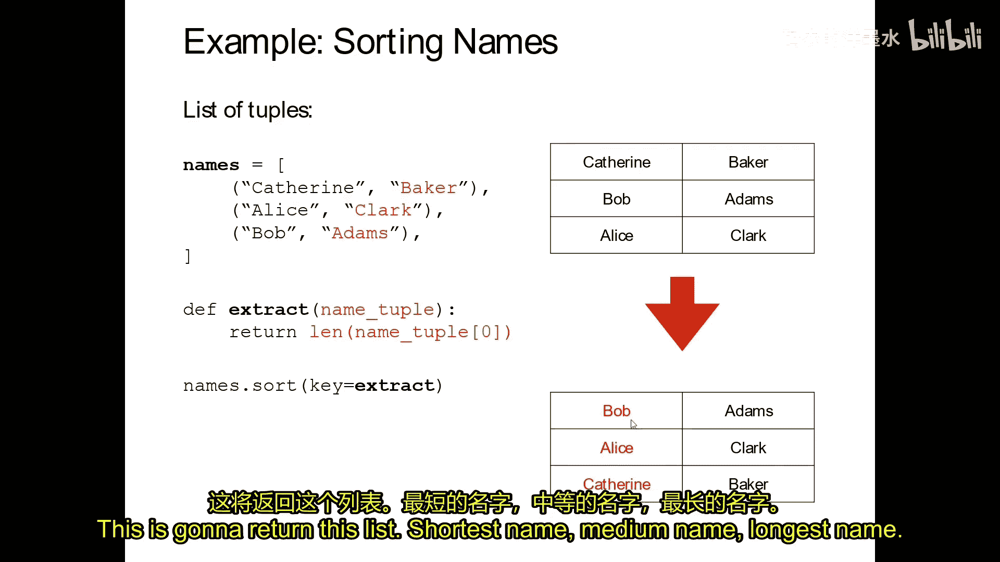
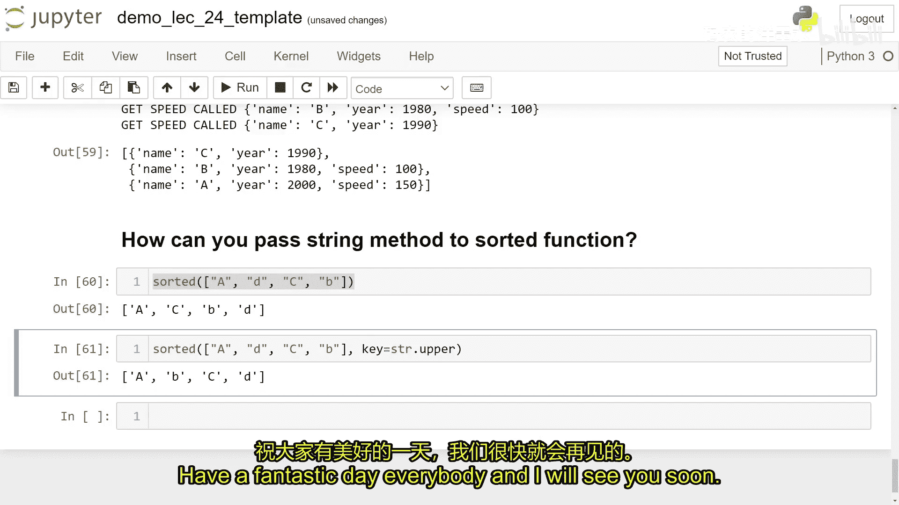

# 021：函数引用

在本节课中，我们将要学习函数作为对象的概念。我们将探讨如何将函数赋值给变量、将函数作为参数传递给其他函数，以及如何将函数存储在列表和字典中。这些高级技巧能够极大地提升代码的灵活性和效率。

## 概述

在Python中，函数不仅仅是可执行的代码块，它们本身也是对象。这意味着我们可以像处理其他数据（如整数、字符串、列表）一样处理函数。理解这一点是掌握Python高级编程技巧的关键。

## 函数作为对象

上一节我们介绍了函数的基本概念，本节中我们来看看函数作为对象的含义。这意味着变量可以引用函数对象，就像它们引用列表或字符串一样。

### 变量引用函数

我们可以创建一个变量，让它指向一个函数。这类似于让一个变量指向一个列表。

```python
def say_hi():
    return "hi"



F = say_hi  # 变量F现在引用了函数say_hi
G = F       # 变量G也引用了同一个函数对象
```

在这段代码中，`F = say_hi` 这一行并没有调用函数，而是创建了一个名为 `F` 的变量，它指向 `say_hi` 这个函数对象。`G = F` 则让 `G` 也指向同一个函数对象。`F` 和 `G` 是同一个函数对象的别名。

### 调用引用的函数

当我们想执行这个函数时，需要使用括号 `()`。

```python
z = F()  # 调用F引用的函数，返回值"hi"被赋给z
z = G()  # 同样，调用G引用的函数
```

`F()` 和 `G()` 都会执行相同的函数代码并返回结果。关键在于，带括号是调用函数，不带括号是引用函数对象本身。

## 将函数放入数据结构

既然函数是对象，我们就可以将它们放入列表或字典等数据结构中。

以下是创建函数列表的示例：

```python
def say_hi():
    print("Hello there")

def say_goodbye():
    print("Wash your hands and stay well")

function_list = [say_hi, say_hi, say_goodbye, say_goodbye]
```

在这个列表中，我们存储了对函数对象的引用。我们可以遍历这个列表并调用其中的每个函数。

```python
for func in function_list:
    func()  # 依次调用列表中的每个函数
```

这种方法允许我们动态地管理和调用一组函数。

## 函数作为参数

参数本质上是特殊的变量，因此我们也可以将函数作为参数传递给另一个函数。这为实现通用性强的代码提供了可能。

### 创建通用函数

假设我们想多次调用某个函数，可以编写一个通用函数来处理这个任务。

```python
def call_n_times(func, n):
    """调用传入的函数n次"""
    for i in range(n):
        func()

# 使用示例
call_n_times(say_hi, 2)
call_n_times(say_goodbye, 3)
```

在这里，`call_n_times` 函数接受一个函数对象 `func` 和一个整数 `n` 作为参数。它会在循环中调用 `func` 共 `n` 次。通过传递不同的函数，我们可以复用同一段逻辑。

## 实用案例：处理列表中的每个元素

一个常见的编程任务是：对列表中的每个元素应用某个转换函数。我们可以编写一个通用函数来完成这个任务。

### 实现 `apply_to_each` 函数

```python
def apply_to_each(input_list, func):
    """对输入列表中的每个元素应用函数func，并返回新列表"""
    output_list = []
    for value in input_list:
        transformed_value = func(value)  # 调用传入的函数处理每个元素
        output_list.append(transformed_value)
    return output_list
```

这个函数遍历 `input_list`，对每个元素调用参数 `func` 指定的函数，并将结果收集到 `output_list` 中返回。

### 应用示例

我们可以用这个通用函数处理各种数据。

1.  **将字符串列表转换为整数列表：**
    ```python
    str_list = ["1", "234", "56"]
    int_list = apply_to_each(str_list, int)  # 使用内置的int函数
    print(int_list)  # 输出: [1, 234, 56]
    ```

2.  **移除字符串中的美元符号：**
    ```python
    def strip_dollar(s):
        if s.startswith("$"):
            return s[1:]  # 返回去掉第一个字符（$）的字符串
        else:
            return s

    money_list = ["$123", "$456", "789"]
    cleaned_list = apply_to_each(money_list, strip_dollar)
    print(cleaned_list)  # 输出: ['123', '456', '789']
    ```

3.  **将字符串列表转换为大写：**
    ```python
    lower_list = ["aaa", "bbb", "ccc"]
    # 注意：需要使用 str.upper，而不是直接写 upper
    upper_list = apply_to_each(lower_list, str.upper)
    print(upper_list)  # 输出: ['AAA', 'BBB', 'CCC']
    ```

### 使用内置的 `map` 函数

Python 内置了 `map` 函数，其功能与我们的 `apply_to_each` 类似，但返回一个“生成器”。我们可以用 `list()` 将其转换为列表。

```python
str_list = ["1", "234", "56"]
int_list = list(map(int, str_list))
print(int_list)  # 输出: [1, 234, 56]
```

`map(func, iterable)` 会对可迭代对象中的每个元素应用函数 `func`。



## 实用案例：自定义排序



列表的 `.sort()` 方法和内置的 `sorted()` 函数都接受一个 `key` 参数。这个参数需要传入一个函数，该函数用于从每个元素中提取用于比较的“键”。

### 按特定规则排序元组列表

假设我们有一个（名， 姓）的元组列表，想按姓氏排序。



```python
names = [("Catherine", "Baker"), ("Alice", "Clark"), ("Bob", "Adams")]

def get_last_name(name_tuple):
    return name_tuple[1]  # 返回姓氏

# 按姓氏排序
sorted_by_last = sorted(names, key=get_last_name)
print(sorted_by_last)  # 输出: [('Bob', 'Adams'), ('Catherine', 'Baker'), ('Alice', 'Clark')]
```

`sorted()` 函数会为列表中的每个元素调用 `key` 函数（这里是 `get_last_name`），然后用返回的值进行排序比较。

### 按字典中的值排序

对于更复杂的数据结构，如字典列表，同样适用。

```python
hurricanes = [
    {"name": "A", "year": 2000, "speed": 150},
    {"name": "B", "year": 1980, "speed": 100},
    {"name": "C", "year": 1990, "speed": 250}
]

def get_year(hurricane_dict):
    return hurricane_dict["year"]

def get_speed(hurricane_dict):
    # 使用.get()方法提供默认值，防止键不存在时报错
    return hurricane_dict.get("speed", 0)

# 按年份排序
sorted_by_year = sorted(hurricanes, key=get_year)
print(sorted_by_year)
# 输出: [{'name': 'B', ...}, {'name': 'C', ...}, {'name': 'A', ...}]

# 按速度降序排序
sorted_by_speed_desc = sorted(hurricanes, key=get_speed, reverse=True)
print(sorted_by_speed_desc)
# 输出: [{'name': 'C', ...}, {'name': 'A', ...}, {'name': 'B', ...}]
```

### 排序时忽略大小写

对字符串列表进行不区分大小写的排序。

```python
letters = ["D", "b", "C", "a"]
# 使用 str.lower 作为key函数，将所有字母转换为小写后再比较
sorted_letters = sorted(letters, key=str.lower)
print(sorted_letters)  # 输出: ['a', 'b', 'C', 'D']
```

通过传递 `str.lower` 函数，排序时比较的是每个字符串的小写版本，从而实现了不区分大小写的排序。

## 总结



本节课中我们一起学习了Python中“函数作为对象”这一强大概念。我们掌握了如何将函数赋值给变量、将函数存储在数据结构中、以及将函数作为参数传递给其他函数。通过 `apply_to_each` 和自定义排序 `key` 函数等实用案例，我们看到了这些技巧如何让代码变得更通用、更简洁、更易于维护。理解并运用这些概念，是迈向Python高级编程的重要一步。