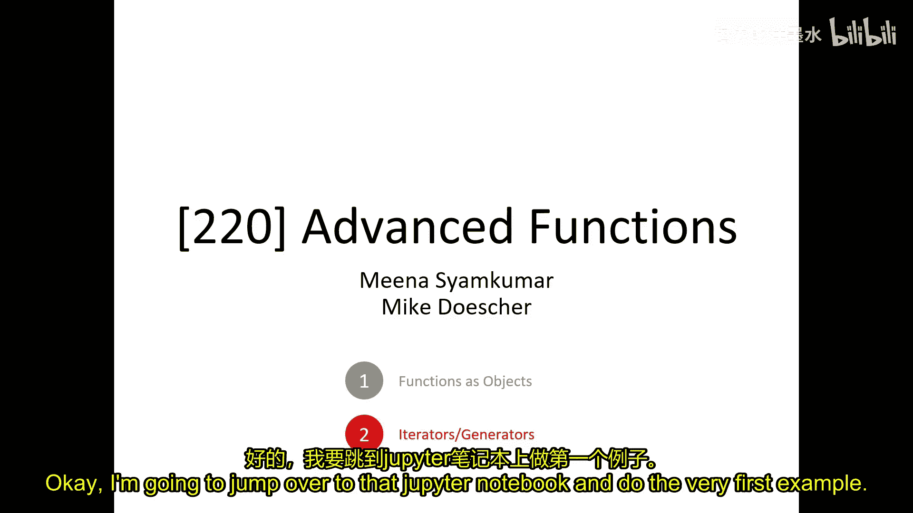
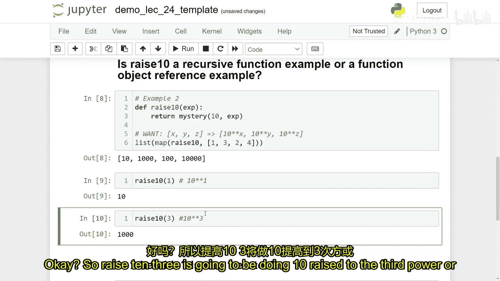
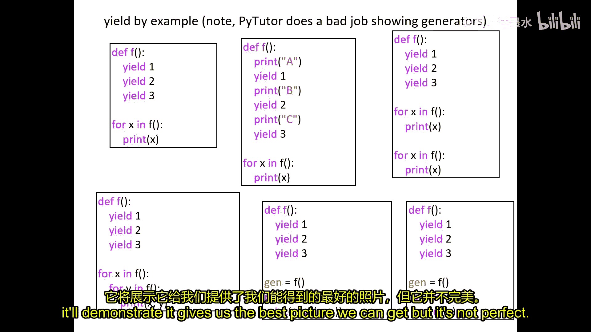
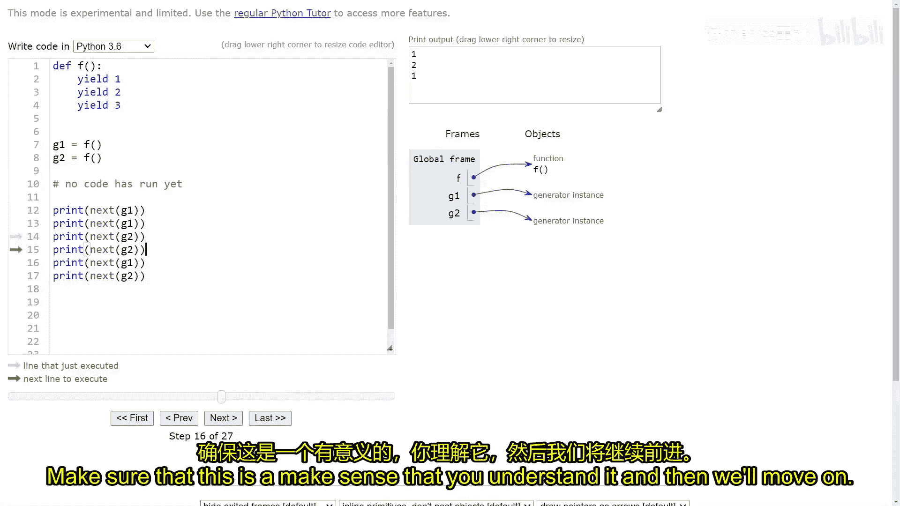
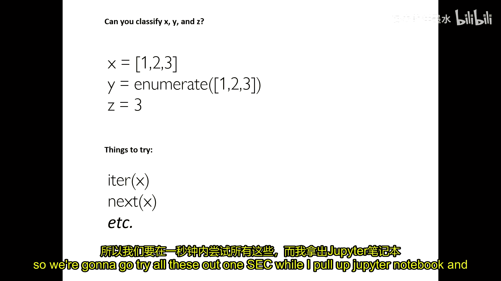
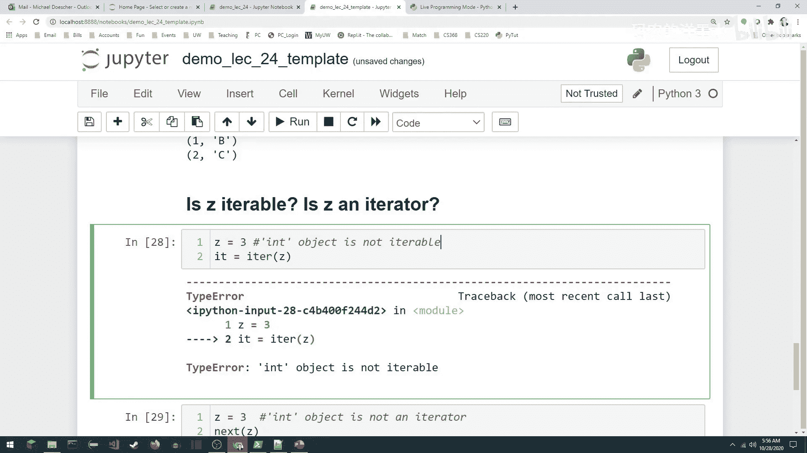

# 022：生成器



在本节课中，我们将要学习Python中一个强大的概念——生成器。我们将从回顾递归函数和函数对象开始，然后深入探讨生成器的定义、工作原理及其与迭代器和可迭代对象的关系。通过简单的例子，我们将理解`yield`关键字如何改变函数的行为，并学习如何有效地使用生成器来处理数据流。

## 回顾：递归与函数对象

上一节我们介绍了递归函数和函数对象。本节中我们来看看两个具体的例子，以巩固对这些概念的理解。

**示例1：递归函数**
```python
def mystery(x, y):
    if y == 1:
        return x
    return x * mystery(x, y-1)
```
这个函数通过递归调用自身来计算`x`的`y`次幂。例如，`mystery(2, 3)`会返回`8`。

**示例2：函数对象**
```python
def raise_10(x):
    return mystery(10, x)

result = list(map(raise_10, [1, 2, 3]))
```
这里，`raise_10`是一个函数对象，它被传递给`map`函数，用于将列表`[1, 2, 3]`中的每个元素转换为`10`的相应次幂。



## 生成器简介

现在，让我们转向今天的新主题——生成器。生成器是一种特殊的函数，它使用`yield`关键字来返回值，并且可以在多次调用之间保持其状态。

### 生成器与普通函数的区别

普通函数会一次性执行所有代码并返回结果。例如，下面的函数会生成一个包含数字0到9的列表：

```python
def get_one_digit_nums():
    print("start")
    nums = []
    i = 0
    while i < 10:
        nums.append(i)
        i += 1
    return nums

for x in get_one_digit_nums():
    print(x)
```
这段代码会先打印一次“start”，然后一次性生成整个列表，最后再遍历打印每个数字。

然而，生成器函数则不同。它使用`yield`来“惰性”地产生值，每次只生成一个，并在产生值后暂停执行，直到下一次被请求。

### 生成器的工作原理



以下是一个简单的生成器示例：

```python
def simple_generator():
    yield 1
    yield 2
    yield 3

for value in simple_generator():
    print(value)
```
这个生成器会依次产生值1、2和3。每次循环迭代时，它都会从上次暂停的地方继续执行。

### 使用`next()`函数

我们可以使用`next()`函数手动从生成器中获取值：

```python
gen = simple_generator()
print(next(gen))  # 输出 1
print(next(gen))  # 输出 2
print(next(gen))  # 输出 3
```
当生成器没有更多值可产生时，它会引发`StopIteration`异常。

### 生成器的状态保持

生成器能够记住每次`yield`之后的状态，包括局部变量和执行位置。这使得生成器非常适合处理无限序列或大型数据流。

## 迭代器与可迭代对象

在深入理解生成器之前，我们需要明确两个相关概念：迭代器和可迭代对象。

### 可迭代对象

可迭代对象是任何可以放在`for`循环中的对象。例如，列表、字符串、元组和`range`对象都是可迭代的。

```python
my_list = [1, 2, 3]
for item in my_list:
    print(item)
```

### 迭代器

迭代器是一个具有`next()`方法的对象，用于逐个访问可迭代对象中的元素。我们可以使用`iter()`函数从可迭代对象创建迭代器。

```python
my_list = [1, 2, 3]
it = iter(my_list)
print(next(it))  # 输出 1
print(next(it))  # 输出 2
print(next(it))  # 输出 3
```



### 生成器作为迭代器

生成器对象本身就是迭代器，因为它们实现了`next()`方法。因此，生成器可以直接用在`for`循环中，也可以手动调用`next()`。

## 实际示例与测试

让我们通过一些例子来测试不同类型的对象是可迭代的还是迭代器。

**示例1：列表**
```python
x = [1, 2, 3]
# 测试是否为可迭代对象
it = iter(x)  # 成功，列表是可迭代的
print(next(it))  # 输出 1
# 测试是否为迭代器
next(x)  # 失败，列表不是迭代器
```

**示例2：enumerate对象**
```python
y = enumerate([1, 2, 3])
# 测试是否为可迭代对象
it = iter(y)  # 成功
# 测试是否为迭代器
print(next(y))  # 输出 (0, 1)，成功，enumerate对象既是可迭代的也是迭代器
```

**示例3：整数**
```python
z = 3
iter(z)  # 失败，整数不是可迭代对象
next(z)  # 失败，整数不是迭代器
```



## 总结

本节课中我们一起学习了生成器的核心概念。我们了解到：

1.  **生成器**是包含`yield`关键字的函数，它们可以“惰性”地产生值，并在多次调用之间保持状态。
2.  生成器对象是**迭代器**，因此可以直接用在`for`循环中或使用`next()`函数获取值。
3.  **可迭代对象**是任何可以用于`for`循环的对象（如列表、字符串），而**迭代器**是具有`next()`方法的对象，用于逐个访问可迭代对象的元素。
4.  通过`iter()`函数可以从可迭代对象创建迭代器。



生成器是处理大型数据集或无限序列的强大工具，因为它们不需要一次性将所有数据加载到内存中。在接下来的课程中，我们将看到生成器在文件处理等实际场景中的应用。