# 023：错误处理 🐛

在本节课中，我们将要学习Python中的错误处理。我们将探讨如何通过`assert`语句让程序在遇到逻辑错误时主动“崩溃”，以及如何使用`try...except`结构来优雅地处理运行时异常，使程序在遇到预期内的错误时能够继续运行。

## 概述

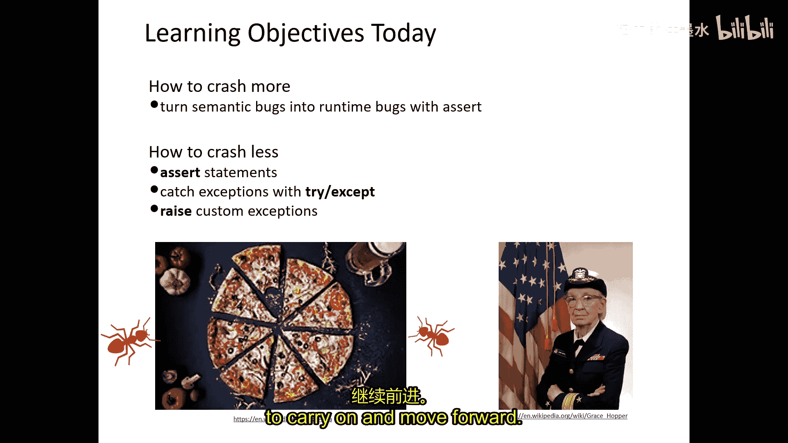

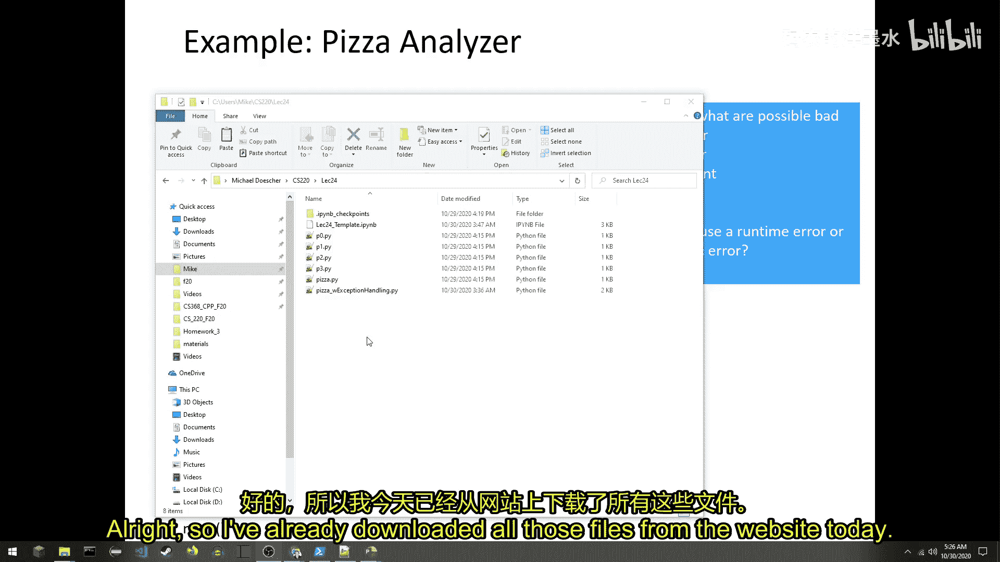

程序错误主要分为两类：运行时错误和语义错误。运行时错误会导致程序立即停止（崩溃），而语义错误则会让程序产生看似合理但实际错误的结果。本节课的目标是学习如何将危险的语义错误转化为更容易调试的运行时错误，以及如何捕获和处理预期的异常，提升程序的健壮性。

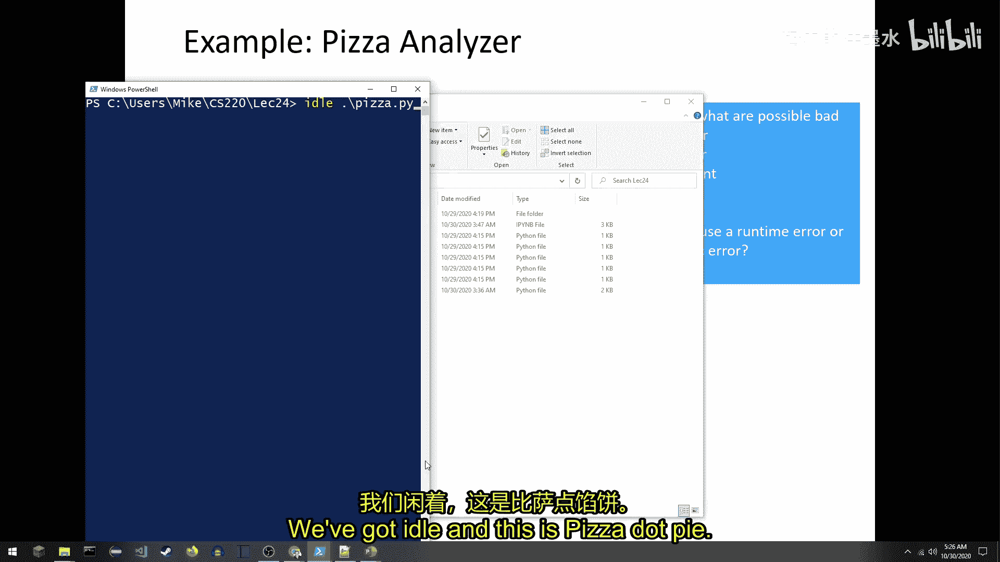

---

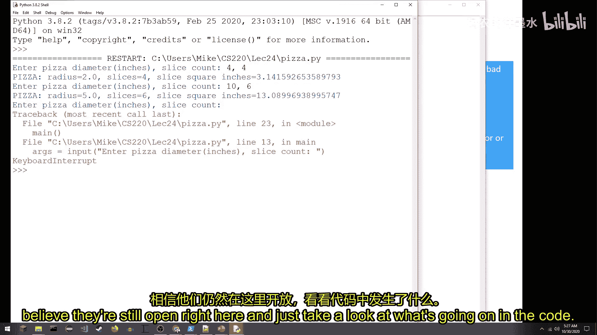

## 引入示例：披萨分析程序 🍕

我们将通过一个“披萨分析程序”来演示错误处理。这个程序会询问用户披萨的直径（英寸）和切片数量，然后计算每片披萨的面积。

首先，我们来看看程序的核心代码结构：

```python
import math

def pizza_size(radius):
    return math.pi * radius ** 2

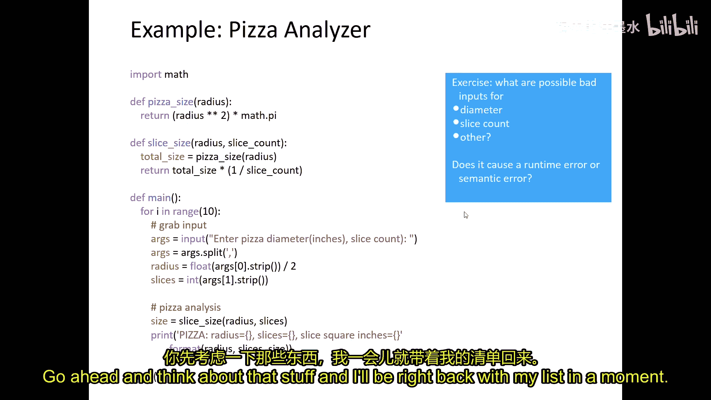

def slice_size(radius, slice_count):
    total_size = pizza_size(radius)
    return total_size * (1 / slice_count)

def main():
    for i in range(10):
        # 获取用户输入
        user_input = input(“输入披萨直径（英寸）和切片数量，用逗号分隔：”)
        # ... 处理输入和计算的代码
        # 输出结果
        print(“每片披萨的面积是：{:.2f} 平方英寸”.format(size))

if __name__ == “__main__”:
    main()
```

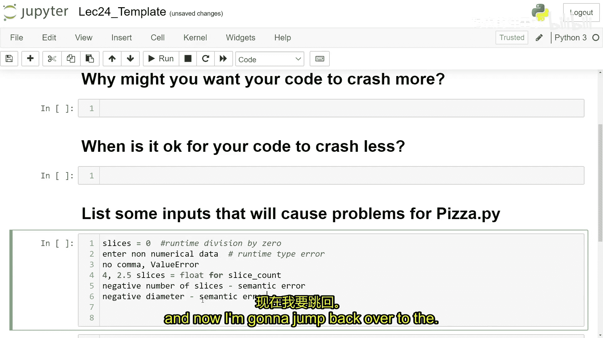

上一节我们介绍了程序的基本功能，本节中我们来看看用户可能输入哪些“坏数据”导致程序出错。

以下是用户可能输入的一些“坏数据”示例：
*   **切片数量为0**：这会导致`1 / slice_count`时发生除零错误（运行时错误）。
*   **输入非数字字符**：例如输入`a, b`，在将字符串转换为浮点数或整数时会引发`ValueError`。
*   **遗漏逗号**：例如输入`10 4`，程序在尝试分割字符串并访问第二个元素时会引发`IndexError`。
*   **切片数量为浮点数**：例如输入`10, 2.5`，在转换为整数时会引发`ValueError`。
*   **切片数量为负数**：例如输入`10, -4`。程序能正常运行并给出一个负的面积，这是一个**语义错误**。
*   **直径为负数**：例如输入`-10, 6`。由于半径被平方，程序会输出一个正数面积，这同样是一个具有欺骗性的**语义错误**。

---

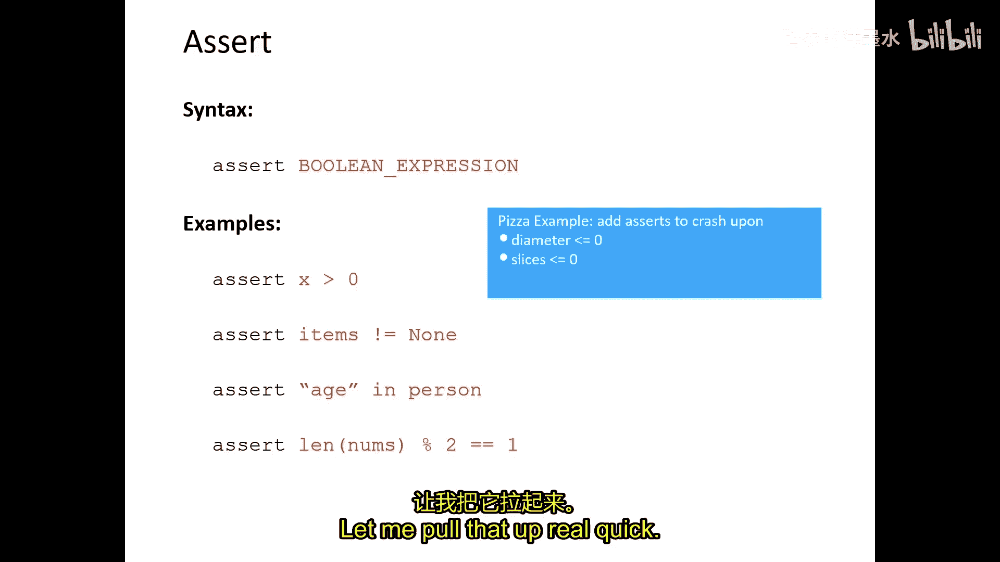

## 让程序“崩溃”更多：使用 `assert` 语句 💥

我们更希望像“负直径”或“负切片数”这样的语义错误能直接导致程序崩溃，而不是产生错误答案。Python的`assert`（断言）语句可以帮助我们做到这一点。

`assert`语句的语法非常简单：`assert 布尔表达式`。如果表达式为`True`，程序继续执行；如果为`False`，程序会立即崩溃并抛出`AssertionError`。

以下是一些`assert`语句的例子：
*   `assert x > 0`：确保变量`x`是正数。
*   `assert items is not None`：确保`items`不是空值。
*   `assert len(nums) % 2 == 1`：确保列表`nums`的长度是奇数。

现在，让我们将断言添加到披萨程序中，在计算前检查输入的有效性：

```python
# 在slice_size函数中或计算前添加
radius = diameter / 2
assert radius > 0, “披萨直径必须为正数”
assert slices > 0, “切片数量必须为正整数”
```

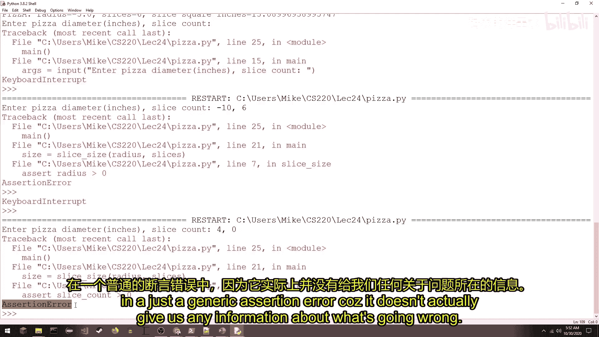

添加后，当输入负直径或非正切片数时，程序会主动崩溃并显示我们指定的错误信息，从而将语义错误转化为了运行时错误。

---

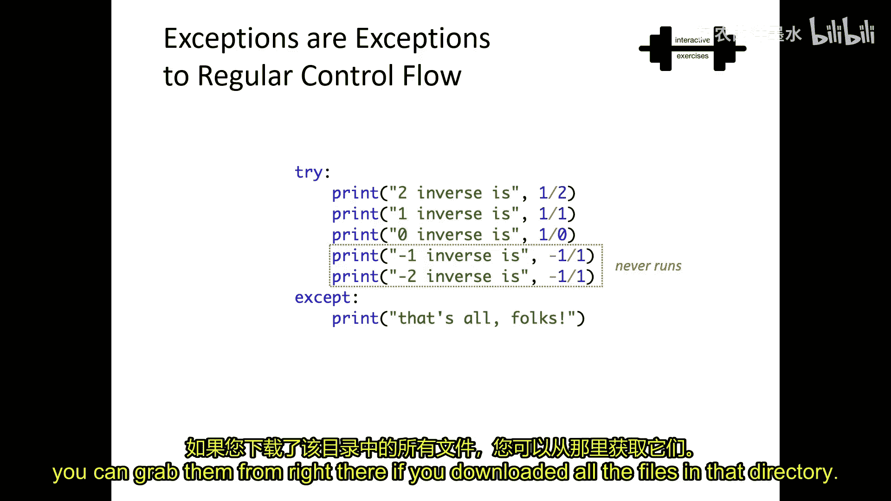

## 让程序“崩溃”更少：使用 `try...except` 结构 🛡️

并非所有错误都需要让整个程序停止。对于用户输入错误这类预期内的问题，我们更希望提示用户重新输入。这时可以使用`try...except`结构来捕获并处理异常。

`try...except`的基本结构如下：
```python
try:
    # 尝试执行的代码块
    可能出错的代码
except:
    # 如果try块中发生任何异常，则执行此代码块
    处理异常的代码
```

Python会先执行`try`块中的代码。如果一切正常，则跳过`except`块。如果`try`块中发生异常，程序会立即跳转到对应的`except`块执行，而不会让整个程序崩溃。

上一节我们学习了如何让程序主动崩溃，本节中我们来看看如何有选择地防止崩溃，让程序从错误中恢复。

### 捕获特定类型的异常

使用`except Exception:`会捕获所有异常，这可能过于宽泛，甚至会捕获我们无法处理的错误（如`KeyboardInterrupt`，即Ctrl+C）。最佳实践是只捕获我们预期并能处理的特定异常类型。

我们可以通过元组指定要捕获的异常类型：
```python
try:
    # 尝试执行的代码
except (ValueError, IndexError) as e:
    # 只处理ValueError和IndexError
    print(f“输入错误：{e}”)
```

在披萨程序中，我们可以这样改进输入处理部分：

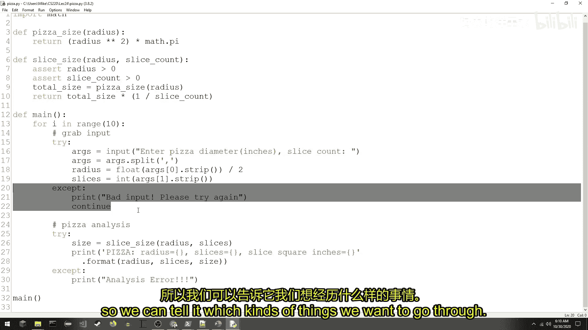

```python
try:
    args = user_input.split(“,”)
    diameter = float(args[0].strip())
    slices = int(args[1].strip())
except (ValueError, IndexError) as e:
    print(f“输入格式错误，请确保输入‘直径,切片数’，例如‘10,6’。错误详情：{e}”)
    continue # 跳过本次循环，让用户重新输入
```

这样，程序只会捕获因用户输入格式问题引发的`ValueError`（如非数字转换）和`IndexError`（如缺少逗号），而其他类型的错误（如我们代码本身的bug）则会导致程序正常崩溃，便于我们调试。

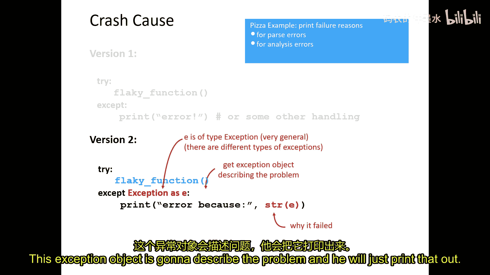

---

## 主动抛出异常：`raise` 语句 🎯

除了使用`assert`，我们还可以使用`raise`语句主动抛出（引发）一个指定类型的异常，并附带自定义的错误信息。这比通用的`AssertionError`能提供更精确的错误上下文。

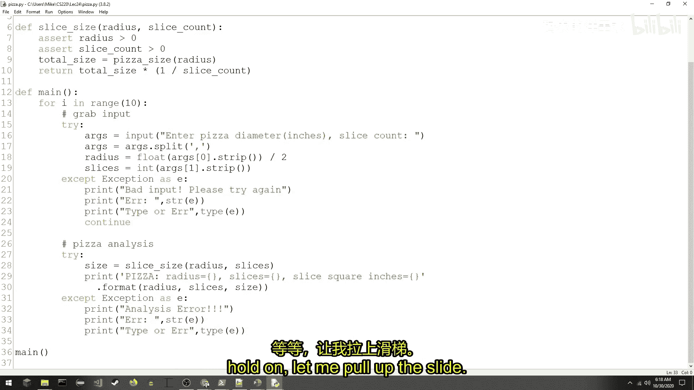

`raise`语句的语法是：`raise 异常类型(“错误信息”)`。

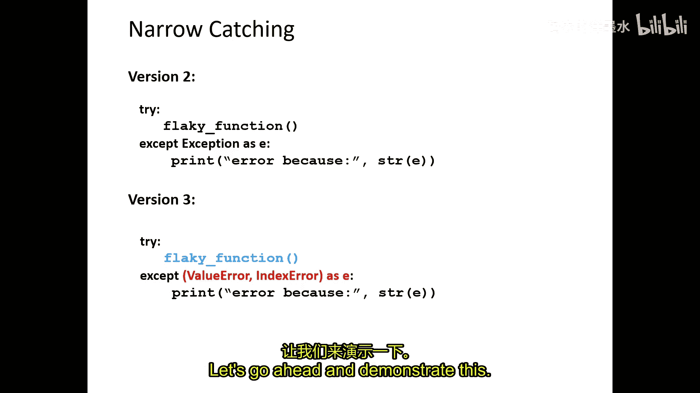

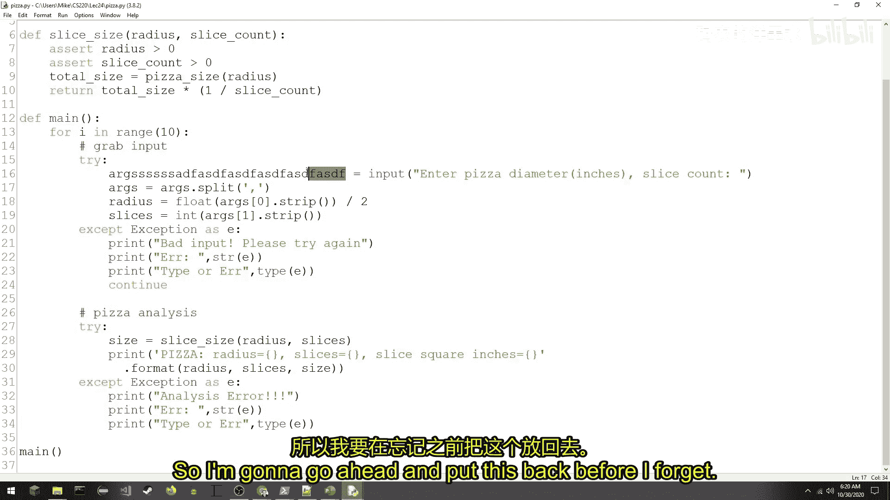

例如，在披萨程序中替换`assert`：
```python
# 替换 assert radius > 0
if radius <= 0:
    raise ValueError(“披萨直径必须为正数”)
# 替换 assert slices > 0
if slices <= 0:
    raise ValueError(“切片数量必须为正整数”)
```

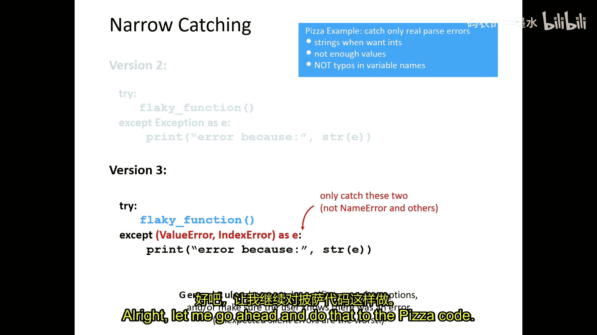

然后，我们可以在调用此函数的地方，用更具体的`except ValueError:`来捕获这个异常并进行相应处理。

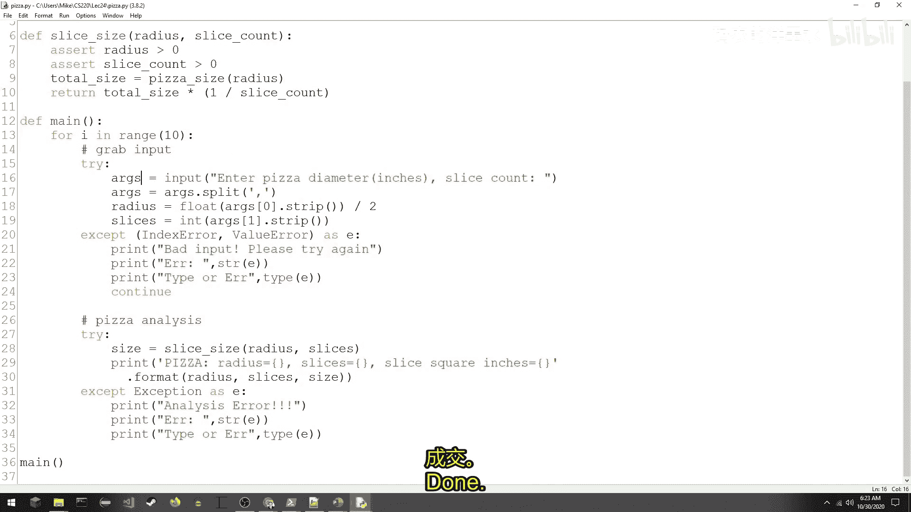

---

## Python异常层次结构 📊

Python内置了许多异常类型，它们形成了一个层次结构。最顶层的基类是`BaseException`，其下包括`SystemExit`、`KeyboardInterrupt`等。我们通常处理的`Exception`类是所有内置、非系统退出类异常的基类。

了解这个层次结构有助于我们更精确地捕获异常。例如：
*   `LookupError`是`IndexError`（列表索引越界）和`KeyError`（字典键不存在）的父类。
*   捕获`Exception`比只写`except:`更具体，因为它不会捕获`KeyboardInterrupt`。
*   最佳实践是捕获最具体的异常类型（如`ValueError`），避免隐藏意料之外的错误。

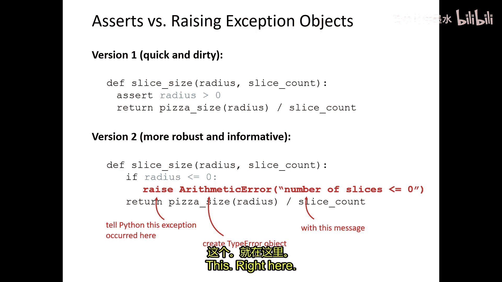

---

## 总结

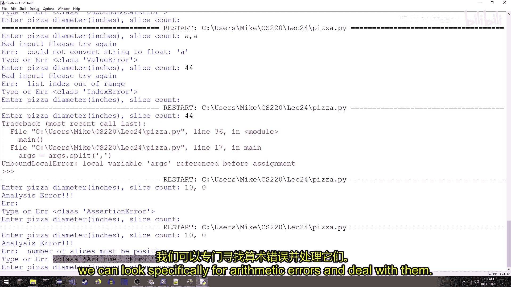

本节课中我们一起学习了Python错误处理的核心概念：
1.  **使用`assert`**：在开发阶段主动检查程序状态，将潜在的语义错误转化为运行时错误，使问题更容易暴露。
2.  **使用`try...except`**：捕获并处理预期内的运行时异常（如用户输入错误），防止程序不必要的崩溃，提升用户体验。
3.  **使用`raise`**：主动抛出特定类型的异常，提供清晰的错误信息，便于上层代码进行针对性处理。
4.  **异常处理原则**：始终追求**特异性**，只捕获你能处理的异常；并且**总要输出信息**，记录异常的发生，避免 silently failing（静默失败）。

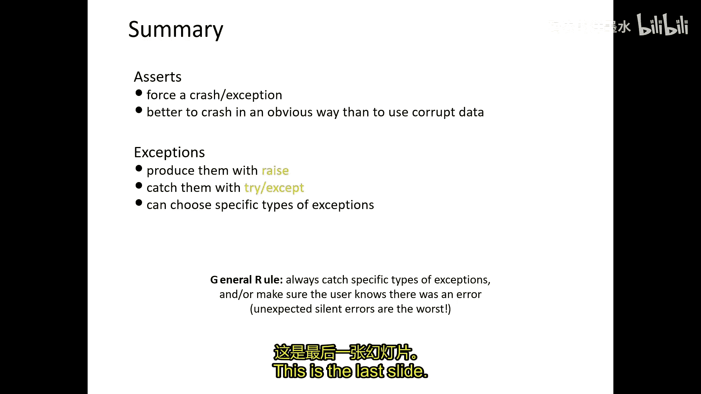

通过合理运用这些技术，你可以编写出既健壮（不易崩溃）又易于调试（错误信息明确）的Python程序。