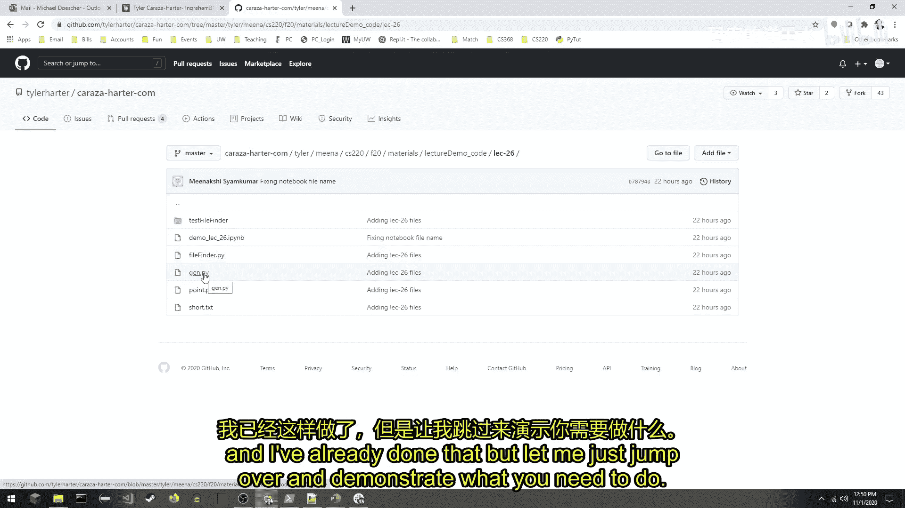
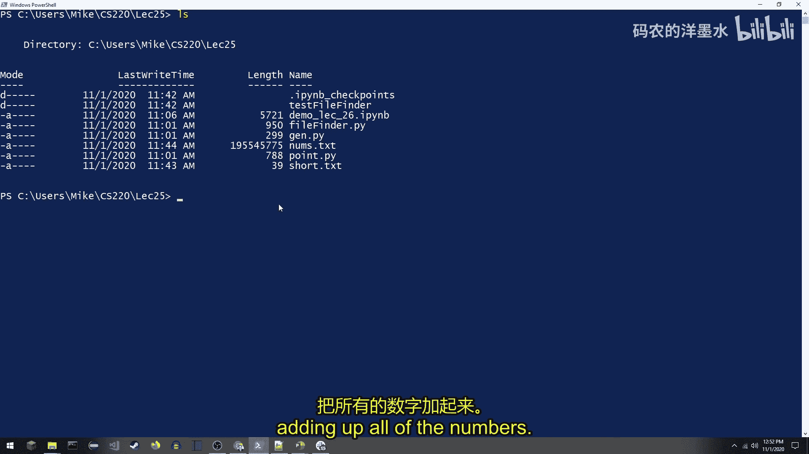
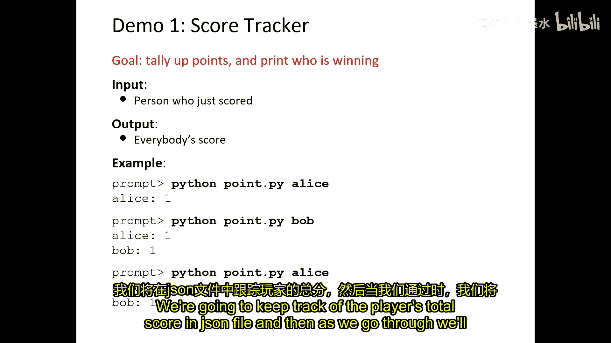
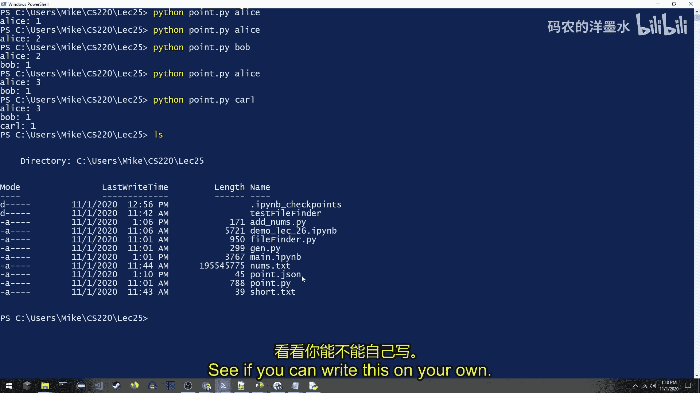
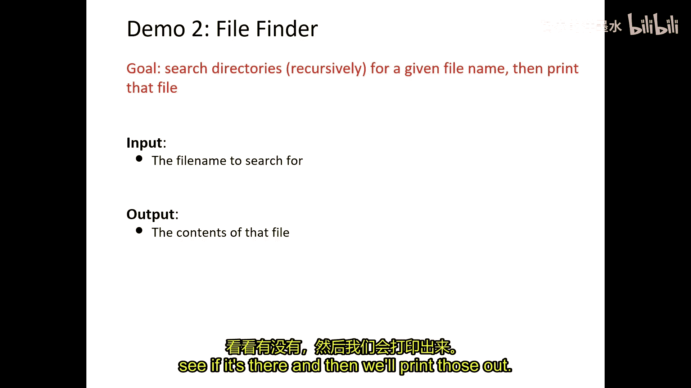
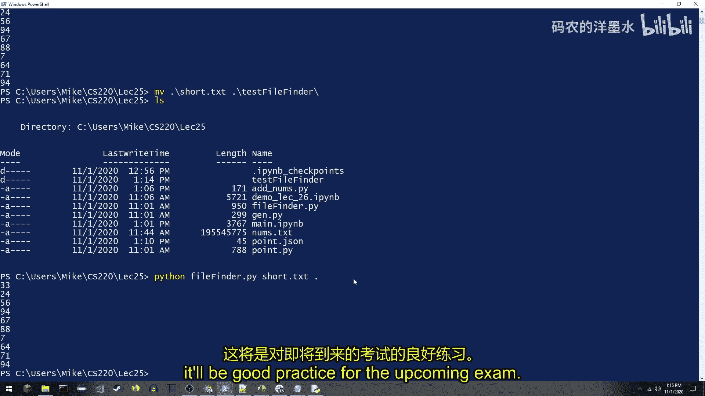

# 024：文件处理 📂

在本节课中，我们将要学习如何在Python中处理文件。文件是存储数据的重要方式，无论是读取现有数据还是保存程序生成的结果，文件操作都是编程中的核心技能。我们将从基础的文件读写开始，逐步深入到目录操作、异常处理以及文件编码等高级主题。

---

## 文件基础与协议

首先，我们需要理解文件对象。在Python中，文件对象是一种迭代器，这意味着我们可以对其使用`next()`函数来逐行读取数据。

获取文件对象的方法是调用内置的`open()`函数。这个函数需要一个参数：文件路径（一个字符串），并返回一个文件对象。

```python
f = open('file.txt')
```

文件路径可以是相对路径或绝对路径。相对路径是相对于当前运行Python脚本的目录。

一旦我们获得了文件对象，通常会对它做两件事：读取数据或写入数据。完成操作后，必须调用`close()`方法来关闭文件，以释放系统资源并确保数据被正确保存。

处理文件遵循一个简单的三步协议：
1.  调用`open()`函数打开文件。
2.  使用文件对象进行读取或写入。
3.  调用`close()`方法关闭文件。

---

## 读取文件 📖

上一节我们介绍了文件的基本协议，本节中我们来看看如何从文件中读取数据。

读取文件最简单的方法是使用文件对象的`read()`方法，它会将整个文件的内容作为一个字符串返回。

```python
f = open('file.txt')
content = f.read()
f.close()
```

需要注意的是，`read()`方法在第一次调用后会“消耗”文件内容。再次调用`read()`将返回空字符串，因为文件指针已经移到了末尾。如果需要重新读取，必须先关闭文件再重新打开。

由于文件对象是迭代器，我们还可以使用其他更灵活的方式来读取：

以下是几种常见的读取模式：
*   **使用`next()`函数**：逐行获取数据。
    ```python
    f = open('file.txt')
    first_line = next(f)
    f.close()
    ```
*   **使用`for`循环迭代**：这是逐行处理文件的推荐方式。
    ```python
    f = open('file.txt')
    for line in f:
        print(line)
    f.close()
    ```
*   **转换为列表**：将文件的所有行一次性读入一个列表。
    ```python
    f = open('file.txt')
    lines = list(f)
    f.close()
    ```

---

## 写入文件 ✍️

学会了读取文件后，接下来我们学习如何将数据写入文件。

要写入文件，需要在调用`open()`函数时指定模式参数`mode='w'`（写模式）。默认模式是`'r'`（读模式）。

```python
f = open('output.txt', 'w')
```

**重要提示**：以写模式（`'w'`）打开一个已存在的文件会**立即清空该文件的所有内容**。如果文件不存在，则会创建一个新文件。

写入数据使用文件对象的`write()`方法。与`print()`函数不同，`write()`方法不会自动在字符串末尾添加换行符，需要手动添加`\n`。

```python
f.write('Hello world\n')
f.write('This is a new line.\n')
f.close()
```

如果希望向现有文件追加内容而不覆盖原有数据，可以使用追加模式`'a'`。

```python
f = open('output.txt', 'a')
f.write('This line is appended.\n')
f.close()
```

在实践中，有两种常见的写入模式：
*   **一次性写入**：在内存中构建完整的字符串，然后一次性写入文件。适用于数据量不大的情况。
*   **增量写入**：在程序运行过程中不断打开文件并写入数据。适用于生成日志文件或处理可能中断的长时运行任务，可以避免数据丢失。

---

## 使用OS模块管理文件和目录 🗂️

在文件操作中，经常需要与目录交互，例如列出文件、检查路径是否存在等。Python的`os`模块提供了这些功能。

首先需要导入`os`模块。

```python
import os
```

以下是`os`模块中一些最常用的函数：

*   **`os.listdir(path)`**：列出指定目录下的所有文件和子目录名称。参数`'.'`表示当前目录，`'..'`表示上级目录。
    ```python
    files = os.listdir('.')  # 列出当前目录内容
    ```
*   **`os.mkdir(name)`**：在当前目录下创建一个新目录。
    ```python
    os.mkdir('new_folder')
    ```
*   **`os.path.exists(path)`**：检查指定的路径（文件或目录）是否存在。
    ```python
    if os.path.exists('myfile.txt'):
        print("File exists.")
    ```
*   **`os.path.isfile(path)`**：检查指定路径是否是一个文件。
*   **`os.path.isdir(path)`**：检查指定路径是否是一个目录。
*   **`os.path.join(...)`**：**这是最重要的函数之一**。它用于拼接路径，并自动根据当前操作系统（Windows使用`\`，Linux/Mac使用`/`）选择正确的路径分隔符，从而保证代码的跨平台可移植性。
    ```python
    # 可移植的路径拼接方式
    file_path = os.path.join('data', 'subfolder', 'file.txt')
    f = open(file_path)
    ```
    **警告**：请务必使用`os.path.join()`来拼接路径，而不是手动使用`/`或`\`。手动拼接的路径在跨平台（例如，将代码从Windows提交到Linux测试环境）时会导致文件找不到的错误。

---

## 文件操作中的异常处理 ⚠️

文件操作极易引发异常，因为许多错误（如磁盘空间不足、文件被其他程序删除、权限不足等）无法在操作前被完全预测。因此，使用`try...except`语句来处理文件异常是必要的。

一个常见的异常场景是尝试创建一个已存在的目录。

```python
import os
os.mkdir('my_dir')  # 第一次运行成功
os.mkdir('my_dir')  # 第二次运行会引发 FileExistsError
```

为了避免程序因目录已存在而崩溃，我们可以捕获特定的异常：



```python
import os
try:
    os.mkdir('my_dir')
except FileExistsError:
    pass  # 如果目录已存在，则忽略这个错误，继续执行
```



在异常处理中，最好只捕获你预期中会发生的特定异常（如`FileExistsError`），而不是使用空的`except:`语句捕获所有异常，后者会隐藏其他潜在的程序错误。

---

## 文件编码 🔤

计算机以二进制（0和1）存储数据，而人类阅读文本文件。编码（Encoding）就是字符（如‘A’，‘中’）与二进制数据之间相互转换的规则。

不同的编码标准（如UTF-8， GBK， CP1252）使用不同的规则。关键原则是：**必须使用相同的编码来写入和读取文件**，否则会导致乱码或解码错误。

在Python中，可以在`open()`函数中通过`encoding`参数指定编码。现代应用的推荐编码是**UTF-8**，它在Linux、Mac和现代Windows系统上得到广泛支持。

```python
# 使用UTF-8编码写入文件
with open('file.txt', 'w', encoding='utf-8') as f:
    f.write('一些文本')

# 使用相同的UTF-8编码读取文件
with open('file.txt', 'r', encoding='utf-8') as f:
    content = f.read()
```

如果你的程序输出中出现了奇怪的符号（如`���`或`Â`），很可能就是编码不匹配造成的。

---

## 实战演示与总结





本节课中我们一起学习了Python文件处理的核心知识。我们了解了文件操作的基本协议（打开、使用、关闭），掌握了读取和写入文件的不同方法，学会了使用`os`模块管理目录和构建可移植的路径，认识了文件操作中异常处理的重要性，并理解了文件编码的概念。



让我们回顾一个关键的综合技巧：使用`with`语句可以自动管理文件的打开和关闭，即使发生异常也能确保文件被正确关闭，这是更优雅和安全的做法。

```python
# 使用 with 语句，无需手动调用 close()
with open('file.txt', 'r') as f:
    data = f.read()
# 文件在此处会自动关闭
```




通过结合循环、条件判断和异常处理，你可以构建出强大且健壮的程序来处理各种文件任务。记得在接下来的项目和练习中多加实践，熟练掌握这些技能。