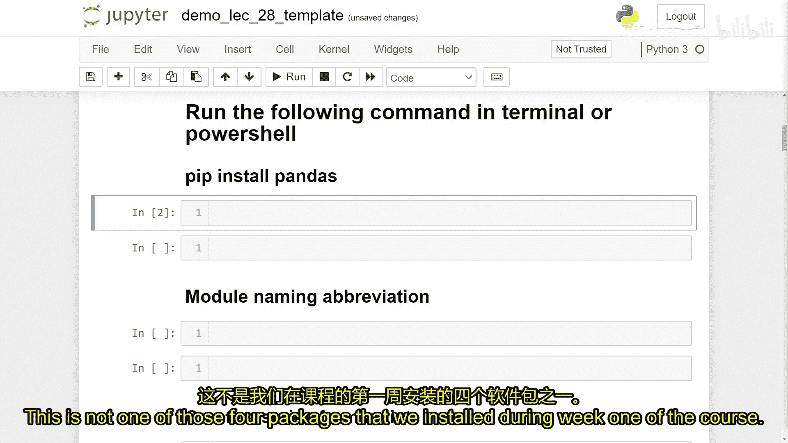
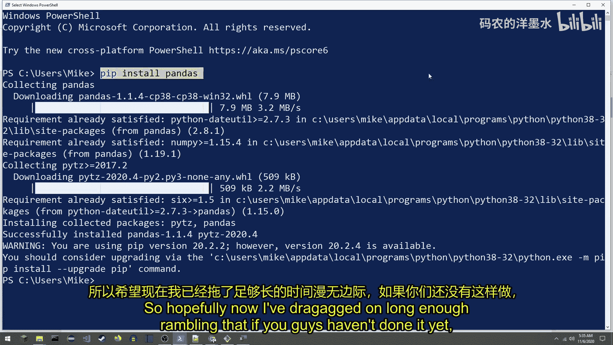
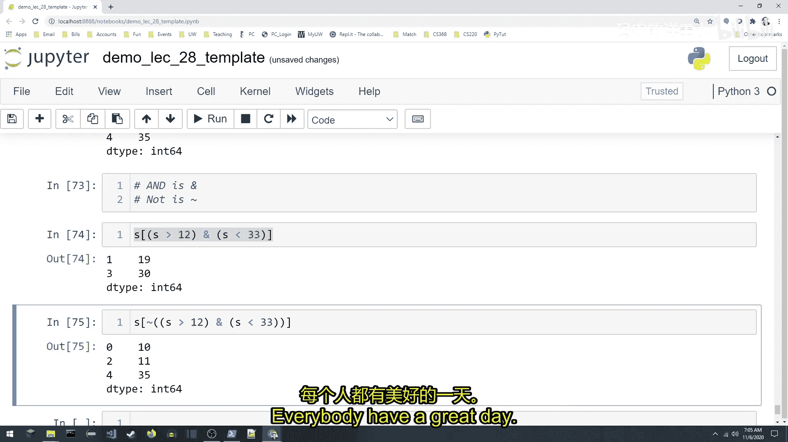

# 025：Pandas入门（第一部分）

在本节课中，我们将开始学习Python数据分析的核心库——Pandas。我们将了解Pandas是什么，它如何作为处理表格数据的强大工具，并学习其基础数据结构Series的创建、索引和基本操作。

---

## 概述

Pandas是一个用于处理表格数据的Python库，可以看作是Excel的编程替代品。它引入了两种新的数据结构：**Series**和**DataFrame**。本节课我们将重点学习**Series**，它是一种介于Python列表和字典之间的混合数据结构，支持强大的数据索引和元素级操作。

---

## 课程回顾与定位

在课程的前五周，我们学习了控制流，包括顺序执行、条件语句、循环和函数。接下来的五周，我们深入探讨了数据结构，特别是列表和字典。现在，我们进入课程的第三部分，专注于数据编程和数据科学。

虽然接下来的主题（如Pandas、数据库、Web编程）相对独立，但它们都依赖于前10周所学的Python基础知识。请确保巩固这些知识。

---

## 什么是Pandas？ 🐼

Pandas是一个Python模块，专门用于处理表格数据。它提供了比使用“列表的列表”更高效、功能更丰富的方式来操作数据。

**核心优势**：与Excel等电子表格软件相比，在Jupyter Notebook中使用Pandas可以让我们清晰地看到所有代码逻辑、逐步开发解决方案，并以表格形式打印结果，整个过程更加透明和可复现。

要使用Pandas，首先需要安装它。在终端或PowerShell中运行以下命令：
```bash
pip install pandas
```
安装完成后，在Python中导入它。通常使用缩写`pd`：
```python
import pandas as pd
```





---

## Pandas Series：混合数据结构

Series是Pandas的基础数据结构之一。你可以把它理解为一个**带有标签的一维数组**，它融合了Python列表和字典的特性。

**重要概念与命名**：
*   **索引**： 类似于字典的**键**。用于通过标签查找数据。
*   **整数位置**： 类似于列表的**索引**。用于通过位置（0, 1, 2...）查找数据。
Pandas的术语可能有些混淆，但掌握这些核心对应关系至关重要。

---

### 从字典创建Series

我们可以从一个Python字典轻松创建Series。字典的键会成为Series的索引，值则成为Series的数据。

```python
import pandas as pd

# 创建一个Python字典
d = {'a': 7, 'b': 8, 'c': 9}
print("Python字典:", d)

# 从字典创建Pandas Series
s = pd.Series(d)
print("Pandas Series:")
print(s)
```
输出结果会以表格形式显示，左侧是索引（‘a‘, ‘b‘, ‘c‘），右侧是对应的值。`dtype: int64`表示数据以64位整数格式存储，这是Pandas底层为追求效率而采用的数据类型。

---

### 从列表创建Series

我们也可以直接从列表创建Series。此时，列表的索引（0, 1, 2...）会自动成为Series的索引。

```python
# 创建一个Python列表
my_list = [100, 200, 300]
print("Python列表:", my_list)

# 从列表创建Pandas Series
s_from_list = pd.Series(my_list)
print("Pandas Series (来自列表):")
print(s_from_list)
```

---

## 访问Series中的数据

由于Series具有“索引”和“整数位置”两套查找系统，因此有多种访问数据的方式。

### 使用`.loc[]`（按索引/标签访问）
`.loc[]`用于通过索引标签进行查找，类似于字典的键。
```python
s = pd.Series([100, 200, 300], index=['x', 'y', 'z'])
print(s.loc['y'])  # 输出: 200
```

### 使用`.iloc[]`（按整数位置访问）
`.iloc[]`用于通过整数位置进行查找，类似于列表的索引。
```python
s = pd.Series([100, 200, 300])
print(s.iloc[1])   # 输出: 200
print(s.iloc[-1])  # 输出: 300 (支持负索引)
```

### 快捷方式（但需注意）
Pandas会尝试自动判断你的意图：
```python
s = pd.Series([100, 200, 300], index=[5, 6, 7])
# 如果索引是整数，使用方括号[]默认按索引查找
print(s[6])  # 输出: 200 (查找索引为6的值)
# 明确使用.iloc按位置查找
print(s.iloc[1])  # 输出: 200 (查找第2个位置的值)
```
**重要提示**：当索引也是整数时，会产生歧义。为了代码清晰，建议始终使用`.loc`或`.iloc`来明确查找方式。**尤其在使用负索引时，必须使用`.iloc`**。

---

### 选择多个值

我们可以一次性选择多个值，返回一个新的Series。

```python
s = pd.Series([10, 20, 30, 40], index=['a', 'b', 'c', 'd'])

# 通过索引标签列表选择
print(s.loc[['a', 'c']])  # 输出索引‘a‘和‘c‘对应的值

# 通过整数位置列表选择
print(s.iloc[[0, 2]])     # 输出第1个和第3个位置的值
```

---

## Series的切片

切片操作与列表类似，但有一个关键区别：Series切片会**保留原始索引**，但会**重新编号整数位置**。

```python
letters_list = ['A', 'B', 'C', 'D']
letters_series = pd.Series(letters_list)

# Python列表切片
list_slice = letters_list[2:]  # 整数位置2到最后
print("列表切片:", list_slice)          # 输出: ['C', 'D']
print("列表切片索引0:", list_slice[0]) # 输出: 'C' (新列表索引从0开始)

# Pandas Series切片
series_slice = letters_series[2:] # 索引2到最后
print("Series切片:")
print(series_slice)               # 输出索引2(‘C‘)和3(‘D‘)的值，但显示索引2和3
print("Series切片.iloc[0]:", series_slice.iloc[0]) # 输出: 'C' (使用.iloc[0]访问新Series的第一个元素)
# print(series_slice.loc[0]) # 这会报错，因为索引中没有0
```

---

## 元素级操作

这是Pandas Series最强大的特性之一，允许我们直接对整个Series进行数学或逻辑运算，而无需编写循环。

### 与标量（单个值）运算
运算会应用到Series中的每一个元素。
```python
s = pd.Series([1, 2, 3])
print(s + 3)   # 输出: [4, 5, 6]
print(s * 2)   # 输出: [2, 4, 6]
print(s / 2)   # 输出: [0.5, 1.0, 1.5]
```
**注意**：这些操作会生成一个新的Series，不会修改原始Series。

### 两个Series之间的运算
运算会按**整数位置**对齐对应元素。
```python
s1 = pd.Series([1, 2, 3])
s2 = pd.Series([4, 5, 6])
print(s1 + s2)  # 输出: [5, 7, 9] (1+4, 2+5, 3+6)
print(s1 * s2)  # 输出: [4, 10, 18]
print(s1 < s2)  # 输出: [True, True, True] (生成布尔型Series)
```

### 索引对齐
当两个Series进行运算时，Pandas会优先按**索引**进行匹配，而不是整数位置。
```python
s1 = pd.Series([10, 20], index=['a', 'b'])
s2 = pd.Series([1, 2], index=['b', 'a']) # 索引顺序不同
print(s1 + s2)
# 输出:
# a    12 (10 + 2)
# b    21 (20 + 1)
# dtype: int64
```
如果索引无法匹配，结果会是`NaN`（Not a Number）。
```python
s1 = pd.Series([1, 2, 3])
s2 = pd.Series([4, 5]) # 长度不同
print(s1 + s2)
# 输出:
# 0    5.0
# 1    7.0
# 2    NaN
# dtype: float64 (自动转换为浮点型以容纳NaN)
```

### 合并Series
使用`pd.concat`函数可以连接多个Series，生成一个更长的Series。
```python
s1 = pd.Series([1, 2, 3])
s2 = pd.Series([4, 5])
combined = pd.concat([s1, s2])
print(combined)
```

---

## 布尔索引：强大的数据筛选工具

布尔索引允许我们根据条件快速筛选数据。其核心思想是：用一个布尔值（True/False）的Series来指示原Series中哪些元素应该被选中。

### 基础用法
```python
s = pd.Series([10, 2, 3, 15])
# 创建一个布尔Series，标记哪些元素大于8
condition_series = s > 8
print(condition_series) # 输出: [True, False, False, True]

# 使用布尔Series进行索引，只选择值为True的元素
filtered = s[condition_series]
print(filtered) # 输出: [10, 15]
```

### 一步到位的链式操作
通常我们将条件创建和筛选合并成一行：
```python
s = pd.Series([10, 2, 3, 15])
# 筛选出大于8的元素
print(s[s > 8])

# 筛选出奇数
print(s[s % 2 == 1]) # 19, 11, 35 (假设s包含这些值)
```

### 组合条件筛选
在Pandas中，逻辑运算符`and`, `or`, `not`被替换为`&`, `|`, `~`，并且**每个条件必须用括号括起来**。
```python
s = pd.Series([10, 19, 11, 30, 35])

# 筛选出小于12 或 大于33的数
print(s[(s < 12) | (s > 33)])

# 筛选出大于12 且 小于33的数
print(s[(s > 12) & (s < 33)])

# 筛选出“不大于12且不小于33”的数（即上面结果的补集）
print(s[~((s > 12) & (s < 33))])
```

---

## 字符串元素级操作

对于包含字符串的Series，我们可以使用`.str`访问器来调用字符串方法，对整个Series进行元素级操作。

```python
words = pd.Series(['Apple', 'boy', 'Cat', 'dog'])
# 将所有单词转换为大写
print(words.str.upper())

# 筛选出原本就是大写的单词
# 原理：比较原始单词和其大写形式是否相等
uppercase_words = words[words == words.str.upper()]
print(uppercase_words)
```

---

## 总结

本节课我们一起学习了Pandas库的基础。我们首先了解了Pandas在数据科学工作流中的定位，然后深入探讨了其核心数据结构**Series**。

我们掌握了：
1.  **创建Series**：从字典和列表创建。
2.  **数据访问**：使用`.loc[]`按索引访问，使用`.iloc[]`按整数位置访问，以及多值选择和切片。
3.  **强大操作**：**元素级运算**（与标量或另一个Series），以及基于**索引对齐**的运算规则。
4.  **核心技巧**：**布尔索引**，这是一种通过逻辑条件快速、高效筛选数据的强大方法。
5.  **扩展应用**：对字符串Series进行元素级操作。



Series是构建Pandas中表格数据对象DataFrame的基石。在下一讲中，我们将学习**DataFrame**，开始真正的表格数据处理之旅。请务必熟悉本节课关于Series索引和操作的概念，它们是理解后续内容的关键。