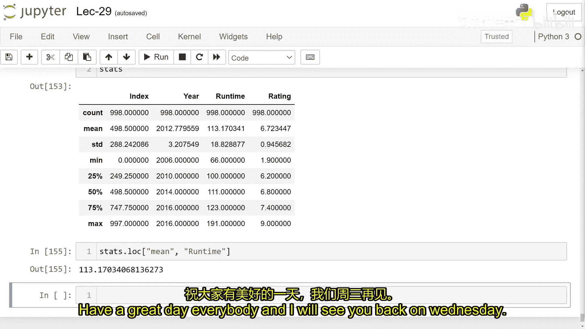

# 026：Pandas 1-2 📊


在本节课中，我们将深入学习Pandas库，这是处理表格数据的强大工具。我们将从回顾Series开始，然后重点介绍Pandas的第二个核心数据结构——DataFrame。我们将学习如何创建、操作和查询DataFrame，并通过一个电影数据集的实际例子来应用这些概念。

---

## 回顾Series 📝

上一节我们介绍了Pandas的Series，它是一种介于列表和字典之间的混合数据结构。本节中，我们通过一些练习来巩固对Series，特别是布尔索引的理解。

以下是几个关于Series操作的练习题及其解析：

**问题1：** 给定一个Series `v = pd.Series([-1, 1, 200, 191, 4])`，`v < 0` 的结果是什么？
*   这个关系运算符会进行逐元素比较，生成一个布尔Series。
*   结果：`0 True, 1 False, 2 False, 3 False, 4 False`。

**问题2：** `v * v == 1` 的结果是什么？
*   首先计算 `v * v`，得到新Series `[1, 1, 40000, 36481, 16]`。
*   然后判断每个元素是否等于1。
*   结果：`0 True, 1 True, 2 False, 3 False, 4 False`。

**问题3：** `v[v > 100]` 的结果是什么？
*   `v > 100` 生成布尔Series `[False, False, True, True, False]`。
*   使用该布尔Series索引原Series `v`，只保留值为`True`对应的行。
*   结果：`2 200, 3 191`。

**问题4：** `v[v % 2 == 0]` 的结果是什么？
*   `v % 2` 计算每个元素除以2的余数。
*   `v % 2 == 0` 判断哪些元素是偶数，生成布尔Series。
*   使用该布尔Series进行索引。
*   结果：`2 200, 4 4`。

**问题5：** `v[(v > 0) & (v < 100)]` 的结果是什么？
*   `(v > 0)` 和 `(v < 100)` 分别生成布尔Series。
*   使用Pandas的按位与运算符 `&` 将两个条件组合。
*   结果：`1 1, 4 4`。

---

## 数据对齐与关系运算符 🔗

在进行Series运算时，数据对齐是一个关键概念。当两个Series的索引不完全相同时，Pandas会尝试根据索引进行对齐。

```python
import pandas as pd
from pandas import Series, DataFrame

x = Series({'a': 10, 'b': 100})
s1 = Series({'a': 20, 'b': 300})
s2 = Series({'b': 20, 'a': 300}) # 索引顺序不同

print(x * s1) # 索引已对齐，正常计算
print(x * s2) # 根据索引‘a’和‘b’对齐，结果与上一行相同
```

然而，直接使用关系运算符（如 `<`, `>`）比较索引未对齐的Series可能会引发错误，因为Pandas为了提高性能，要求比较的Series必须具有完全相同的索引标签。

解决方法有两种：
1.  先对索引进行排序：`x.sort_index() < s2.sort_index()`
2.  使用Series对象的关系方法（如 `.lt()`, `.gt()`），这些方法内部会处理对齐。

以下是常用的关系方法：
```python
x.lt(s2)   # 小于 (less than)
x.gt(s2)   # 大于 (greater than)
x.le(s2)   # 小于等于 (less than or equal)
x.ge(s2)   # 大于等于 (greater than or equal)
x.ne(s2)   # 不等于 (not equal)
x.eq(s2)   # 等于 (equal)
```

---

## 引入DataFrame 🗂️

DataFrame是Pandas中用于表示二维表格数据的核心数据结构。你可以将其视为多个共享相同索引的Series的集合，或者一个由列组成的字典。

有多种方式可以创建DataFrame：

**1. 从字典的列表创建：**
```python
# 键成为列名，每个内层列表是一列的数据
data = {'name': ['Alice', 'Bob', 'Cindy', 'Dan'],
        'score': [4, 5, 6, 7]}
df1 = DataFrame(data)
```

**2. 从列表的列表创建：**
```python
# 每个内层列表代表一行数据
data = [['Alice', 4],
        ['Bob', 5],
        ['Cindy', 6],
        ['Dan', 7]]
df2 = DataFrame(data)
# 此时列名和行索引都是默认的整数
```

**3. 从字典的字典创建：**
```python
# 外层字典的键成为行索引，内层字典的键成为列名
data = {'A': {'name': 'Alice', 'score': 4},
        'B': {'name': 'Bob', 'score': 5},
        'C': {'name': 'Cindy', 'score': 6},
        'D': {'name': 'Dan', 'score': 7}}
df3 = DataFrame(data)
```

**4. 从字典的列表创建：**
```python
# 每个字典代表一行数据，键指定了该数据属于哪一列
data = [{'name': 'Alice', 'score': 4},
        {'name': 'Bob', 'score': 5},
        {'name': 'Cindy', 'score': 6},
        {'name': 'Dan', 'score': 7}]
df4 = DataFrame(data)
```

创建DataFrame后，我们可以使用 `index` 和 `columns` 参数来指定行标签和列名：
```python
df = DataFrame(data, index=['A', 'B', 'C', 'D'], columns=['name', 'score'])
```

---

## 数据查询与切片 🔍

与Series类似，DataFrame也有多种数据访问方式，但需要同时考虑行和列。

**访问整行或整列：**
*   `df.loc[行索引]`： 通过行标签获取整行（返回Series）。
*   `df.iloc[行位置]`： 通过整数位置获取整行（返回Series）。
*   `df[列名]`： 通过列名获取整列（返回Series）。这是最常用的方式，便于进行列级计算，如 `df[‘score’].mean()`。

**访问单个值或赋值：**
需要同时指定行和列。
```python
# 获取‘B’行的‘score’列的值
value = df.loc['B', 'score']
# 将‘D’行的‘score’列的值改为17
df.loc['D', 'score'] = 17
# 使用iloc实现同样效果（最后一行，第1列）
df.iloc[-1, 1] = 17
```

**切片：**
可以获取DataFrame的一个矩形子集。
```python
# 使用iloc切片（左闭右开）
df.iloc[1:3, :] # 获取第1到2行，所有列
# 使用loc切片（双闭区间）
df.loc['B':'C', :] # 获取行标签‘B’到‘C’，所有列
# 使用列表选择特定行
df.loc[['B', 'D'], :] # 获取‘B’行和‘D’行
```
**注意：** 对DataFrame切片得到的是原数据的“视图”，可以直接通过赋值修改原数据，例如 `df.iloc[:, 1] += 100` 会给所有行的‘score’列加100。

---

## 布尔索引 🎯

布尔索引是筛选数据的强大工具。我们可以创建一个布尔Series（True/False值），然后用它来选择DataFrame中对应的行。

```python
# 创建一个布尔Series，标记哪些行的分数大于5
boolean_series = df['score'] > 5
# 使用布尔Series索引DataFrame，只保留分数大于5的行
high_scores_df = df[boolean_series]
```
通常我们会将条件直接写在索引中：
```python
high_scores_df = df[df['score'] > 5]
```

---

## 实战：分析电影数据集 🎬

现在，让我们将这些知识应用到一个真实的电影数据集（IMDB）中。

**1. 从CSV文件读取数据：**
```python
movies_df = pd.read_csv('imdb.csv')
```
**注意：** 如果CSV文件本身包含索引列，用`pd.read_csv`读取时会将其作为普通数据列，并生成新的默认整数索引，导致索引重复。写入CSV时，默认也会写入索引。可以使用 `index=False` 参数避免写入索引：`movies_df.to_csv(‘output.csv’, index=False)`。

**2. 初步查看数据：**
```python
movies_df.head() # 查看前5行
movies_df.tail(3) # 查看后3行
movies_df['rating'].mean() # 计算平均评分
movies_df['runtime'].max() # 找到最长电影时长
```

**3. 复杂查询示例：找出“时长高于平均时长”的电影中“评分最高”的电影。**
我们将问题分解为清晰的步骤：
```python
# 步骤1: 计算平均时长
avg_runtime = movies_df['runtime'].mean()
# 步骤2: 创建布尔Series，标记时长高于平均的电影
long_movies_mask = movies_df['runtime'] > avg_runtime
# 步骤3: 获取所有长电影的子集
long_movies = movies_df[long_movies_mask]
# 步骤4: 在长电影中找到最高评分
highest_rating = long_movies['rating'].max()
# 步骤5: 找出评分为最高评分的电影
top_long_movies = long_movies[long_movies['rating'] == highest_rating]
print(top_long_movies[['title', 'rating', 'runtime']])
```
虽然可以将这些步骤组合成一行代码，但分步编写更易于理解和调试。

**4. 快速获取描述性统计：**
`describe()` 方法可以快速生成数值列的各种统计信息（计数、均值、标准差、最小值、四分位数、最大值）。
```python
stats = movies_df.describe()
# 从统计结果DataFrame中提取特定值，例如平均时长
mean_runtime = stats.loc['mean', 'runtime']
```

---



本节课中我们一起学习了Pandas DataFrame的创建、数据查询、切片、布尔索引等核心操作，并通过一个电影数据分析的实例综合运用了这些技能。DataFrame是数据科学中处理表格数据的基石，熟练掌握它将为后续学习网络爬虫、数据库和绘图等内容打下坚实基础。