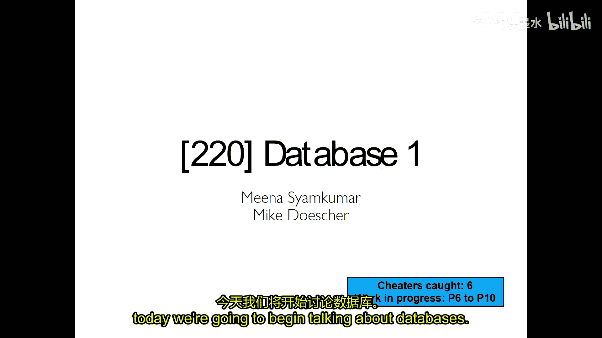
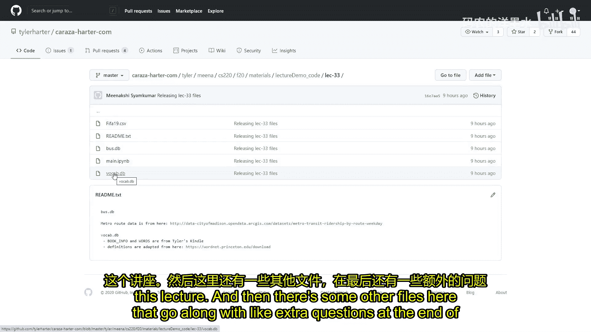
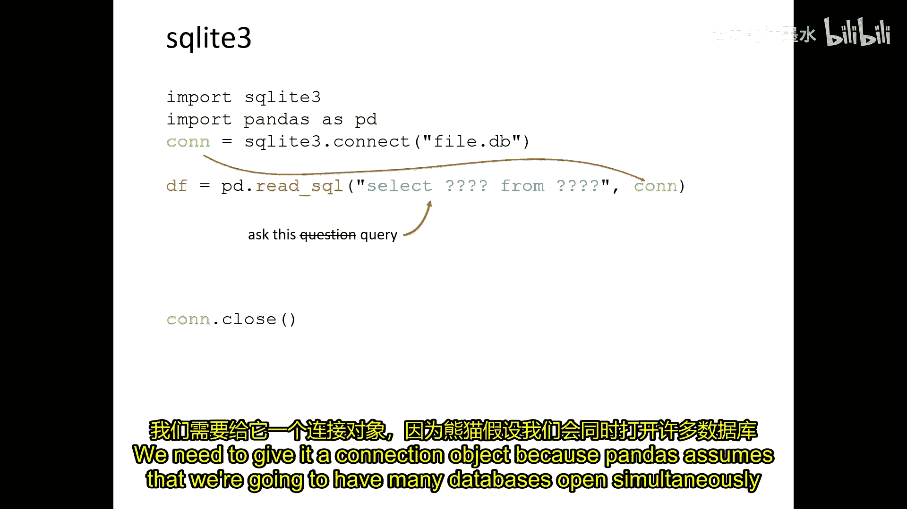
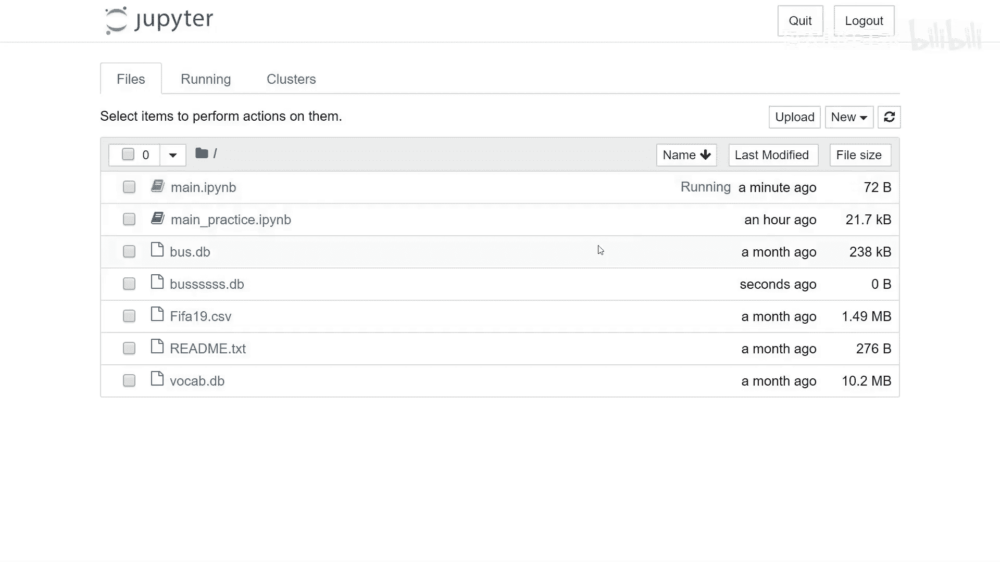
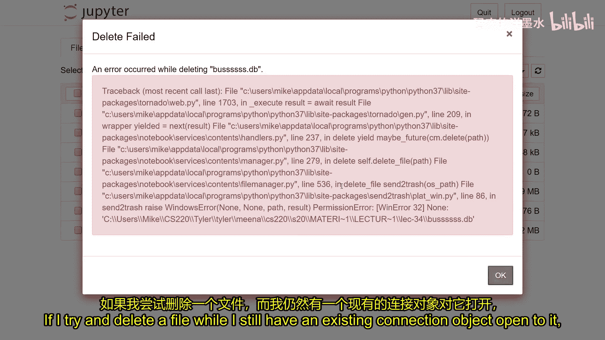
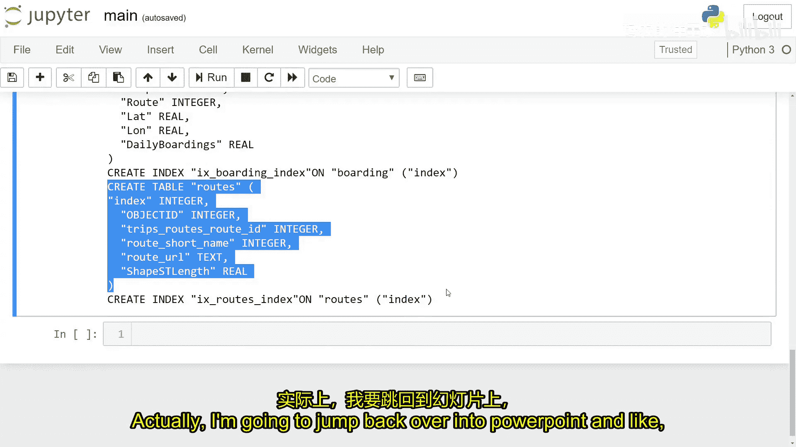
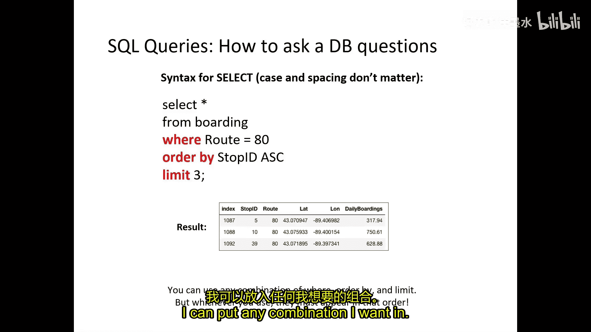
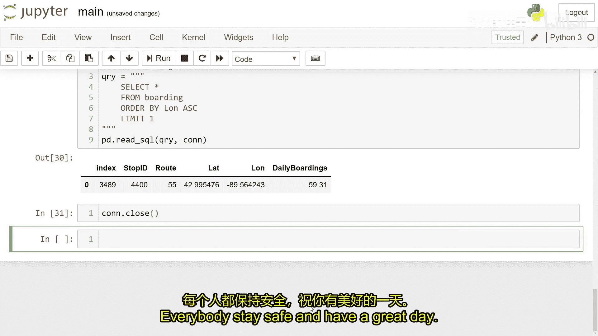

# 027：数据库1-1 🗄️





在本节课中，我们将要学习数据库的基础知识。我们将了解数据库是什么，它与我们之前学过的CSV和JSON文件有何不同，以及如何从数据库中提取数据。我们将使用SQLite3模块和Pandas库来操作数据库，并通过一个实际的麦迪逊公交数据示例来实践。

## 概述

数据库是用于存储大量结构化数据的系统。与CSV文件相比，数据库可以包含多个表，每个表都有明确的列名和严格的数据类型。这使得数据管理更加高效和可靠。本节课，我们将学习如何连接到数据库、查看其结构，并使用SQL查询语言从中提取所需的数据。

## 数据库与CSV/JSON文件的比较

上一节我们介绍了课程目标，本节中我们来看看数据库与CSV、JSON文件的主要区别。

*   **CSV文件**：通常是一个单独的表格。可能包含表头，也可能没有。所有数据都是字符串类型，读取时需要手动转换数据类型。
*   **JSON文件**：支持多种数据类型（字符串、整数、浮点数、布尔值等）。但结构灵活，同一字段在不同条目中可以是不同类型，甚至可能缺失，缺乏严格的一致性。
*   **SQL数据库**：包含多个**命名**的表。每个表的**列都有名称**。每列的数据**类型是预先定义且严格强制**的（例如，整数列不能插入文本），这保证了数据的完整性和一致性。

## 为什么使用数据库？

了解了基本区别后，我们来看看在什么情况下应该选择使用数据库。

1.  **并发访问**：多个程序可以同时安全地读取和写入数据库，而不会导致数据损坏。CSV文件在并发写入时容易产生问题。
2.  **查询便捷**：使用**SQL（结构化查询语言）** 从数据库中提取或汇总数据通常比用Python编写复杂逻辑来处理CSV文件更简单、更高效。例如，找出出演电影最多的演员，在SQL中可能只需一行代码。
3.  **性能优越**：数据库内部使用**索引**等技术来优化数据存储。例如，如果数据已按某列排序，查询该列的条件（如“分数小于23”）会非常快，因为数据库不需要检查每一行。数据库会自动选择最佳方式来快速回答查询。

当然，数据库也有其缺点：它比CSV或JSON文件更复杂。如果数据量很小（例如只有100行），或者问题很简单，使用CSV或JSON文件可能更直接、更合适。

## 常见SQL数据库简介

在开始实践之前，我们先快速了解几种常见的SQL数据库系统。

*   **商业数据库**：如 **Microsoft SQL Server** 和 **Oracle**。功能强大，但通常需要付费。
*   **开源数据库**：如 **MySQL** 和 **PostgreSQL**。免费且功能丰富，非常流行。
*   **SQLite**：这是我们本课程将使用的数据库。它轻量、易用，**许可证非常宽松**，可以自由修改和分发。它已经**内置在Python中**，无需额外安装，并被广泛应用于无数产品（如Android、iOS、Dropbox等）中。

## 数据集介绍：麦迪逊公交数据

我们将使用美国威斯康星州麦迪逊市的公开公交数据集进行演示。该数据库包含两个表：

1.  **`routes`表**：包含公交线路信息，如线路ID、短名称、相关URL等。
2.  **`boarding`表**：包含公交站点信息，如站点ID、所属线路、经纬度坐标，以及最重要的——每个站点**日均上车人数**（这是12天内的平均值）。

我们的目标就是学习如何从这个数据库中提出有意义的问题并获取答案。

## 连接与查看数据库

现在，让我们开始动手操作。首先，我们需要导入必要的模块并连接到数据库文件。

```python
import sqlite3
import pandas as pd
import os

# 1. 确保数据库文件存在
db_path = 'bus.db'
assert os.path.exists(db_path), f"文件 {db_path} 不存在"



# 2. 创建数据库连接对象
conn = sqlite3.connect(db_path)
print(conn)  # 确认连接对象已创建
```

`sqlite3.connect()` 函数类似于用 `open()` 打开文件，它返回一个连接对象。如果指定的文件不存在，SQLite会创建一个新的空数据库文件。完成后，记得使用 `conn.close()` 关闭连接。





连接成功后，我们可以先查看数据库的整体结构，了解其中有哪些表。

```python
# 3. 查看数据库中的所有表（这是一个应记住的固定查询）
query_overview = """
SELECT *
FROM sqlite_master
"""
df_overview = pd.read_sql(query_overview, conn)
print(df_overview)
```

执行上述代码会返回一个表格，其中 `type='table'` 的行就是数据表，`name` 列就是表名（如 `boarding` 和 `routes`）。`sql` 列则显示了创建这些表的原始SQL命令，从中我们可以清楚地看到每个表的列名和数据类型定义，例如：

```sql
CREATE TABLE boarding (
    "index" INTEGER,
    stop_id INTEGER,
    route INTEGER,
    latitude REAL,
    longitude REAL,
    daily_boardings REAL
)
```

这表明 `boarding` 表有6列，`INTEGER` 表示整数类型，`REAL` 表示实数（浮点数）类型。

## 使用SQL查询提取数据



数据库的核心操作是查询。SQL查询的基本结构是：**选择列** -> **从某个表** -> **筛选行** -> **排序** -> **限制数量**。

其语法顺序如下：
```sql
SELECT 列名1, 列名2
FROM 表名
WHERE 条件
ORDER BY 排序列名 ASC|DESC
LIMIT 数量;
```

*   `SELECT`：指定要获取哪些列。使用 `*` 表示选择所有列。
*   `FROM`：指定从哪个表获取数据。
*   `WHERE`：可选，用于筛选满足特定条件的行（例如 `route = 80`）。
*   `ORDER BY`：可选，用于按指定列排序。`ASC` 为升序（默认），`DESC` 为降序。
*   `LIMIT`：可选，限制返回的行数。

**注意**：关键字（如 SELECT, FROM）不区分大小写，但通常大写以示区分。查询语句的顺序是固定的。

### 示例1：查看所有数据

让我们先从 `routes` 表中查看所有数据，但只显示前几行。

```python
query_all_routes = """
SELECT *
FROM routes
"""
df_routes = pd.read_sql(query_all_routes, conn)
print(df_routes.head())  # 使用Pandas的head()方法查看前5行
```

### 示例2：计算总上车人数

现在，我们来回答一个具体问题：麦迪逊每天有多少人乘坐公交车？
我们需要对 `boarding` 表中的 `daily_boardings` 列求和。

```python
query_total_riders = """
SELECT daily_boardings
FROM boarding
"""
df_boardings = pd.read_sql(query_total_riders, conn)
# 将DataFrame中的列转换为Series，然后求和
total_riders = df_boardings['daily_boardings'].sum()
print(f"日均公交上车总人数: {total_riders:.0f}")
```



### 示例3：寻找最西边的公交站点

假设我们想前往最西边，应该乘坐哪条线路的公交车？
这需要找到 `longitude`（经度）最小的站点（西经为负，数值越小越靠西）。

```python
query_westernmost = """
SELECT route, longitude, latitude
FROM boarding
ORDER BY longitude ASC
LIMIT 1
"""
df_westernmost = pd.read_sql(query_westernmost, conn)
print(df_westernmost)
```

这条查询语句的含义是：从 `boarding` 表中选择 `route`、`longitude`、`latitude` 列，按照 `longitude` 升序（从小到大）排列，然后只取第一行（即经度最小的那一行）。

## 总结

本节课中我们一起学习了数据库入门知识。我们了解了数据库相比CSV和JSON文件的优势，包括严格的数据类型、并发处理能力以及高效的查询性能。我们认识了SQLite这一轻量级数据库，并学会了如何使用 `sqlite3` 模块连接数据库。最重要的是，我们掌握了SQL基本查询语句的结构：使用 `SELECT` 和 `FROM` 提取数据，用 `WHERE` 进行筛选，用 `ORDER BY` 排序，并用 `LIMIT` 限制结果数量。通过麦迪逊公交数据的实践，我们计算了总乘车人数并找到了最西边的公交站点。

**不要忘记在程序结束时关闭数据库连接：**
```python
conn.close()
```



在接下来的课程中，我们将学习更强大的数据汇总和分组聚合操作。