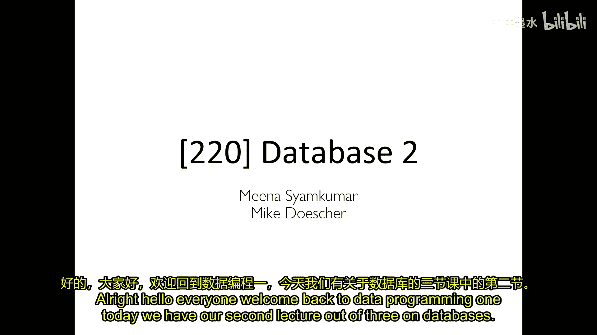
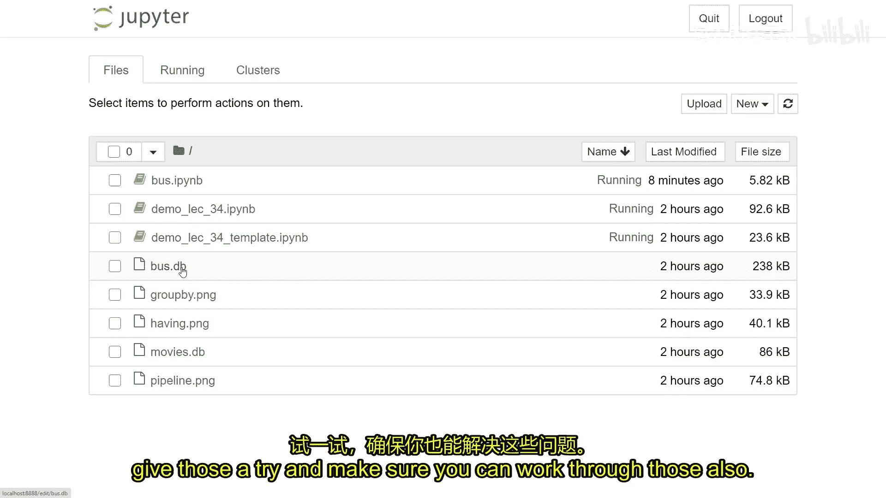
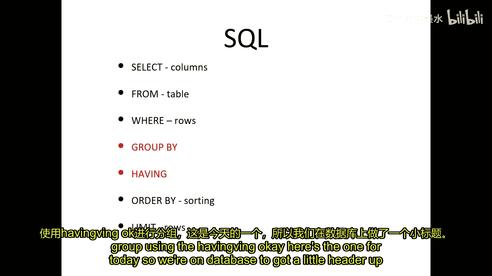
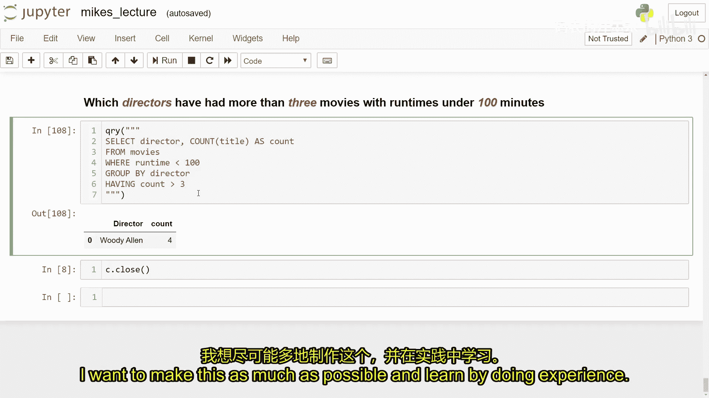

# 028：数据库（二）



在本节课中，我们将继续学习SQL数据库查询，重点介绍如何使用聚合函数（如`COUNT`、`SUM`、`AVG`）以及`GROUP BY`和`HAVING`子句来对数据进行分组和筛选。我们将通过一系列实践问题来巩固这些概念。

## 概述与准备



首先，请确保你已下载课程所需的文件，包括模板、数据库和图像文件。本讲座设计为引导式学习活动，建议你在观看视频的同时，暂停并尝试自己解决问题。

导入必要的库并连接到数据库。

```python
import sqlite3
import pandas as pd

# 连接到数据库
conn = sqlite3.connect('movies.db')
```

查看数据库中的表。

```python
pd.read_sql("SELECT * FROM sqlite_master;", conn)
```

定义一个辅助函数来执行查询并限制返回的行数，便于查看结果。

```python
def query(sql, n=10):
    df = pd.read_sql(sql, conn)
    return df.head(n)
```

现在，让我们开始回顾一些基础查询。

## 基础查询回顾

上一节我们介绍了`SELECT`、`FROM`、`WHERE`、`ORDER BY`和`LIMIT`的基本用法。本节中，我们将通过几个问题来快速回顾。

### 评分最高的电影

要找出评分最高的电影，我们需要选择电影标题并按评分降序排列。

```sql
SELECT title
FROM movies
ORDER BY rating DESC
LIMIT 1;
```

### 执导电影时长最短的导演

这个问题要求我们找出执导电影时长最短的导演，并按运行时长短升序排列。

```sql
SELECT director
FROM movies
ORDER BY runtime ASC
LIMIT 1;
```

### 执导电影收入最高的导演



类似地，我们可以通过按收入降序排列来找到执导电影收入最高的导演。

```sql
SELECT director
FROM movies
ORDER BY revenue DESC
LIMIT 1;
```

### 2016年收入最高的电影

要找到特定年份（如2016年）收入最高的电影，我们需要使用`WHERE`子句来筛选年份。

```sql
SELECT title
FROM movies
WHERE year = 2016
ORDER BY revenue DESC
LIMIT 1;
```

### 评分与收入比率最高的三部电影

有时我们需要基于计算出的新列进行排序。例如，计算评分与收入的比率。

```sql
SELECT title, rating / revenue AS ratio
FROM movies
ORDER BY ratio DESC
LIMIT 3;
```

## 聚合函数

聚合函数用于对一列数据进行汇总，例如计算总数、平均值、最大值或最小值。

### 电影总数

使用`COUNT`函数可以计算表中的行数。

```sql
SELECT COUNT(*)
FROM movies;
```

### 导演总数（去重）

要计算不重复的导演数量，需要使用`COUNT(DISTINCT ...)`。

```sql
SELECT COUNT(DISTINCT director)
FROM movies;
```

### 所有电影的总收入

`SUM`函数用于计算某一列的总和。

```sql
SELECT SUM(revenue)
FROM movies;
```

### 平均评分（两种方法）

计算平均值可以使用`AVG`函数，或者手动计算总和除以数量。

```sql
-- 方法一：使用AVG函数
SELECT AVG(rating)
FROM movies;

-- 方法二：手动计算
SELECT SUM(rating) / COUNT(*)
FROM movies;
```

### 平均收入和平均运行时

可以在一个查询中计算多个聚合值。

```sql
SELECT AVG(revenue), AVG(runtime)
FROM movies;
```

### 特定导演的平均运行时

结合`WHERE`子句，可以计算特定导演的电影平均运行时。

```sql
SELECT AVG(runtime)
FROM movies
WHERE director = 'James Gunn';
```

### 2016年的电影数量

使用`COUNT`和`WHERE`子句可以统计特定年份的电影数量。

```sql
SELECT COUNT(*)
FROM movies
WHERE year = 2016;
```

### 最高收入电影占总收入的百分比

这个问题需要计算最大值与总和的比率。

```sql
SELECT (MAX(revenue) * 100.0 / SUM(revenue)) AS percentage
FROM movies;
```

### 2016年最高收入电影占总收入的百分比

同样，我们可以添加`WHERE`子句来限制计算范围。

```sql
SELECT (MAX(revenue) * 100.0 / SUM(revenue)) AS percentage
FROM movies
WHERE year = 2016;
```

## 数据分组（GROUP BY）

`GROUP BY`子句用于将数据行分组，以便对每个组进行聚合计算。这类似于Python中的“分桶”操作。

### 每年的总收入

要计算每年的总收入，我们需要按年份分组并对收入求和。

```sql
SELECT year, SUM(revenue) AS total_revenue
FROM movies
GROUP BY year;
```

### 每位导演执导的电影数量

按导演分组并计算每位导演的电影数量。

```sql
SELECT director, COUNT(*) AS movie_count
FROM movies
GROUP BY director
ORDER BY movie_count DESC;
```

### 每位导演的平均评分

分组后，可以计算每个组的平均值。

```sql
SELECT director, AVG(rating) AS avg_rating
FROM movies
GROUP BY director;
```

### 每年的不重复导演数量

结合`COUNT(DISTINCT ...)`和`GROUP BY`，可以计算每年有多少位不同的导演执导了电影。

```sql
SELECT year, COUNT(DISTINCT director) AS unique_directors
FROM movies
GROUP BY year;
```

## 筛选分组（HAVING）

`HAVING`子句用于在分组后对组进行筛选，类似于`WHERE`子句对行的筛选。

### 执导超过100万美元收入电影数量最多的导演

首先筛选收入超过100万美元的电影，然后按导演分组，计算数量，最后筛选出数量最多的导演。

```sql
SELECT director, COUNT(*) AS count
FROM movies
WHERE revenue > 100
GROUP BY director
ORDER BY count DESC;
```

### 平均评分最高的三位导演

按导演分组计算平均评分，然后按评分降序排列并限制结果为前三名。

```sql
SELECT director, AVG(rating) AS avg_rating, COUNT(*) AS movie_count
FROM movies
GROUP BY director
ORDER BY avg_rating DESC
LIMIT 3;
```

### 自2010年以来执导超过3部电影的导演

这个问题结合了`WHERE`（筛选年份）和`HAVING`（筛选分组数量）。

```sql
SELECT director, COUNT(*) AS movie_count
FROM movies
WHERE year >= 2010
GROUP BY director
HAVING movie_count > 3;
```

### 执导超过3部运行时少于100分钟电影的导演

类似地，我们可以筛选运行时并分组计数。

```sql
SELECT director, COUNT(*) AS movie_count
FROM movies
WHERE runtime < 100
GROUP BY director
HAVING movie_count > 3;
```

## SQL查询执行顺序

理解SQL子句的执行顺序对于编写复杂查询至关重要。内部执行顺序如下：
1.  **FROM**： 选择数据表。
2.  **WHERE**： 过滤行。
3.  **GROUP BY**： 对行进行分组。
4.  **聚合函数**： 计算每个组的聚合值。
5.  **HAVING**： 过滤组。
6.  **ORDER BY**： 对结果排序。
7.  **LIMIT**： 限制返回的行数。
8.  **SELECT**： 选择要输出的列（实际上在最后阶段处理）。

## 总结

本节课中我们一起学习了SQL中强大的数据汇总和分组功能。我们回顾了如何使用`COUNT`、`SUM`、`AVG`、`MAX`等聚合函数来总结数据。接着，我们深入探讨了`GROUP BY`子句，它允许我们根据特定列对数据进行分组，并对每个组进行独立的聚合计算。最后，我们介绍了`HAVING`子句，它用于在分组后对组进行筛选，类似于`WHERE`子句对行的筛选。



通过结合`WHERE`、`GROUP BY`和`HAVING`，你可以提出并回答关于数据集的复杂问题，例如“哪位导演在特定年份后执导了多部短片？”。请务必尝试课程提供的额外练习（巴士数据库问题）来巩固这些技能。记住，在调试代码时，使用`print`语句、添加注释并简化代码是提高效率的关键策略。