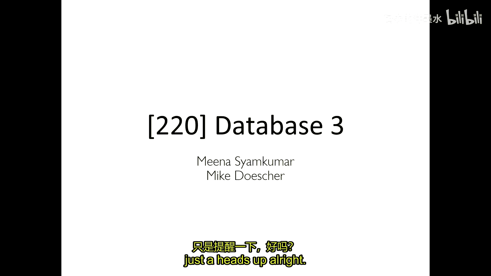
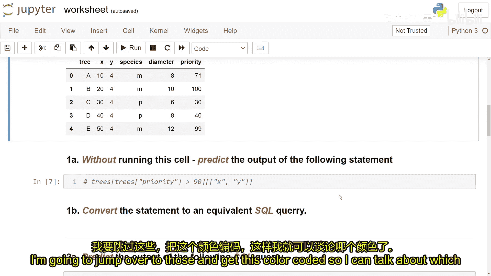
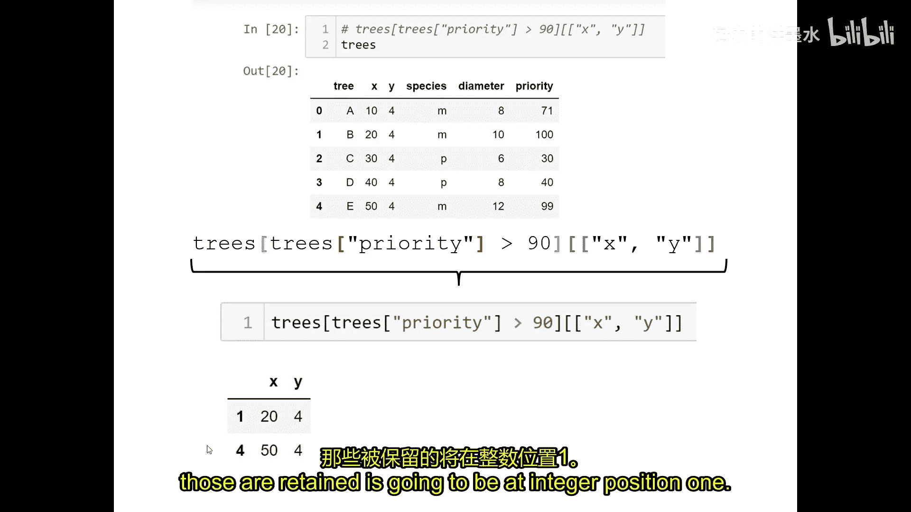
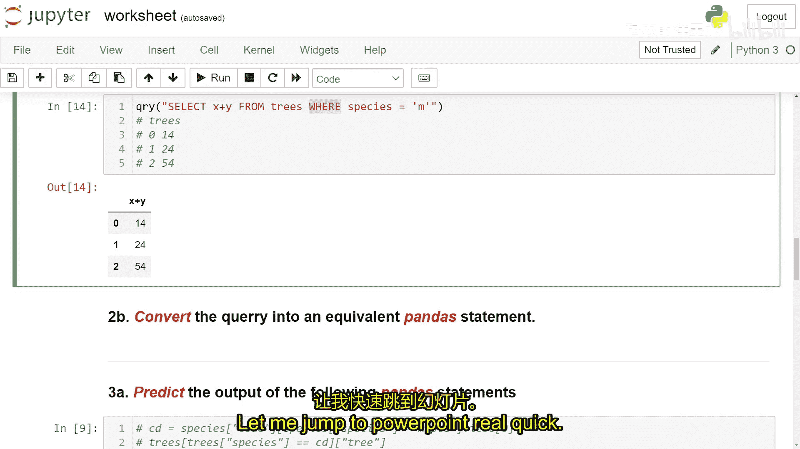
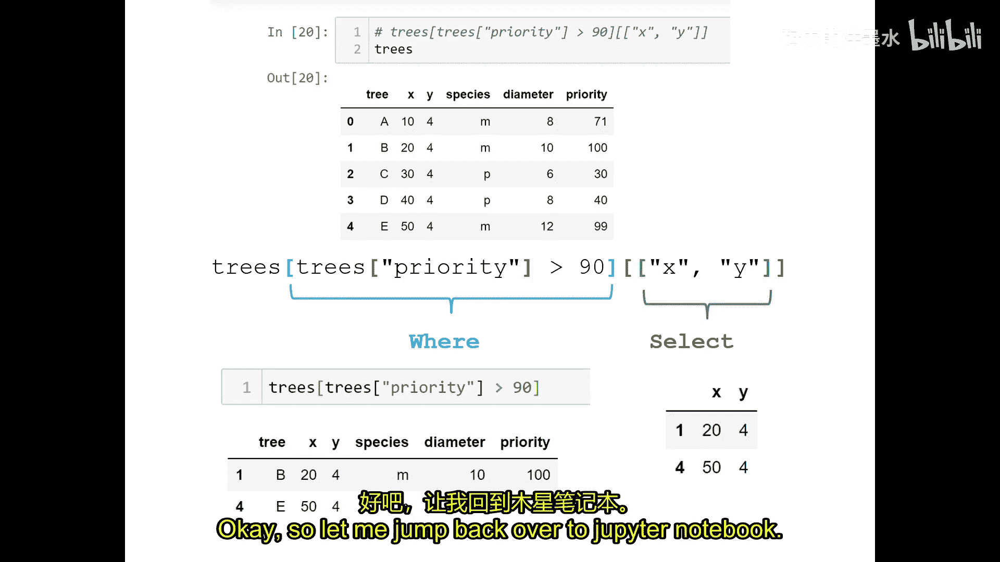
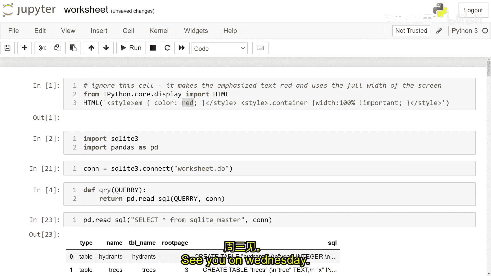

# 029：数据库3

## 概述
在本节课中，我们将学习SQL与pandas之间的连接，以及如何利用两者之间的知识相互促进学习。我们将通过一个工作表练习，掌握将pandas操作转换为SQL查询，以及将SQL查询转换为pandas操作的方法。

---



## 课程结构与数据准备

首先，我们需要导入必要的库并连接到数据库。以下是初始设置步骤。

```python
import pandas as pd
import sqlite3

# 创建数据库连接
conn = sqlite3.connect('worksheet.db')

# 定义一个辅助函数，简化SQL查询的执行
def query(sql):
    return pd.read_sql(sql, conn)
```

运行上述代码后，我们可以开始探索数据库中的表。首先，查看数据库中的所有表。

```python
query("SELECT * FROM sqlite_master WHERE type='table';")
```

数据库包含三个表：`hydrants`（消防栓信息）、`trees`（树木信息）和`species`（树种编码信息）。让我们逐一查看这些表的结构。

```python
# 查看trees表
query("SELECT * FROM trees;")
```

```python
# 查看species表
query("SELECT * FROM species;")
```

---

## 问题1：从pandas到SQL

上一节我们介绍了数据库的基本结构和数据准备。本节中，我们来看看如何将一个pandas操作转换为等价的SQL查询。

### 问题1A：预测pandas语句的输出

以下是第一个pandas语句，我们需要预测其输出。

```python
trees[trees['priority'] > 90][['x', 'y']]
```



**步骤解析：**
1. `trees['priority']` 提取`priority`列，得到一个Series。
2. `trees['priority'] > 90` 对Series进行逐元素比较，生成一个布尔Series。
3. `trees[trees['priority'] > 90]` 使用布尔Series选择符合条件的行。
4. `[['x', 'y']]` 从结果中提取`x`和`y`列。

**预测输出：**
- 保留`priority`大于90的行（索引1和4）。
- 仅显示这些行的`x`和`y`列。

运行代码验证预测：

```python
trees[trees['priority'] > 90][['x', 'y']]
```

### 问题1B：转换为SQL查询

现在，将上述pandas语句转换为SQL查询。

以下是转换后的SQL查询：

```sql
SELECT x, y
FROM trees
WHERE priority > 90;
```

使用`query`函数执行该SQL语句：



```python
query("SELECT x, y FROM trees WHERE priority > 90;")
```

---

## 问题2：从SQL到pandas

上一节我们练习了从pandas到SQL的转换。本节中，我们来看看如何将一个SQL查询转换为等价的pandas操作。

### 问题2A：预测SQL查询的输出

以下是SQL查询，我们需要预测其输出。

```sql
SELECT x + y
FROM trees
WHERE species = 'M';
```

**步骤解析：**
1. `WHERE species = 'M'` 选择`species`列为'M'的行。
2. `SELECT x + y` 计算选中行的`x`和`y`列之和。

**预测输出：**
- 对于`species`为'M'的行（索引0、1、4），计算`x + y`的值。

运行代码验证预测：

```python
query("SELECT x + y FROM trees WHERE species = 'M';")
```

### 问题2B：转换为pandas操作

现在，将上述SQL查询转换为pandas操作。

以下是转换后的pandas代码：

```python
trees[trees['species'] == 'M']['x'] + trees[trees['species'] == 'M']['y']
```



或者，可以分步操作：

```python
# 选择species为'M'的行
filtered_trees = trees[trees['species'] == 'M']
# 计算x和y列之和
result = filtered_trees['x'] + filtered_trees['y']
result
```

---



## 问题3：复杂pandas操作与SQL转换

上一节我们处理了简单的SQL到pandas的转换。本节中，我们来看看一个更复杂的pandas操作及其SQL转换。

### 问题3A：预测复杂pandas语句的输出

以下是复杂的pandas语句，我们需要预测其输出。

```python
cd = species[species['species'] == 'maple']['code'].iloc[0]
trees[trees['species'] == cd]['tree']
```

**步骤解析：**
1. `species[species['species'] == 'maple']['code']` 从`species`表中选择`species`为'maple'的行，并提取`code`列。
2. `.iloc[0]` 获取该列的第一个值（即'M'），并存储在变量`cd`中。
3. `trees[trees['species'] == cd]` 选择`trees`表中`species`列等于`cd`（即'M'）的行。
4. `['tree']` 从结果中提取`tree`列。

**预测输出：**
- 变量`cd`的值为'M'。
- 最终输出为`species`为'M'的行的`tree`列值（即'A'、'B'、'E'）。

运行代码验证预测：

```python
cd = species[species['species'] == 'maple']['code'].iloc[0]
trees[trees['species'] == cd]['tree']
```

### 问题3B：转换为SQL查询

现在，将上述pandas操作转换为SQL查询。

以下是转换后的SQL查询：

```sql
SELECT tree
FROM trees
WHERE species = 'M';
```

使用`query`函数执行该SQL语句：

```python
query("SELECT tree FROM trees WHERE species = 'M';")
```

---

## 问题4：排序操作

上一节我们处理了复杂的数据筛选。本节中，我们来看看如何在SQL和pandas中进行排序操作。

### 问题4A：预测排序SQL查询的输出

以下是SQL查询，我们需要预测其输出。

```sql
SELECT species
FROM trees
ORDER BY priority DESC;
```

**步骤解析：**
1. `ORDER BY priority DESC` 按`priority`列降序排序。
2. `SELECT species` 选择`species`列。

**预测输出：**
- 按`priority`降序排列的`species`列值。

运行代码验证预测：

```python
query("SELECT species FROM trees ORDER BY priority DESC;")
```

### 问题4B：转换为pandas操作

现在，将上述SQL查询转换为pandas操作。

以下是转换后的pandas代码：

```python
trees.sort_values(by='priority', ascending=False)['species']
```

---

## 问题5：限制结果数量

上一节我们介绍了排序操作。本节中，我们来看看如何在SQL和pandas中限制结果数量。

### 问题5A：预测带限制的SQL查询的输出

以下是SQL查询，我们需要预测其输出。

```sql
SELECT tree, priority
FROM trees
ORDER BY priority DESC
LIMIT 1;
```

**步骤解析：**
1. `ORDER BY priority DESC` 按`priority`降序排序。
2. `LIMIT 1` 仅返回第一行。
3. `SELECT tree, priority` 选择`tree`和`priority`列。

**预测输出：**
- 返回`priority`最高的行的`tree`和`priority`值。

运行代码验证预测：

```python
query("SELECT tree, priority FROM trees ORDER BY priority DESC LIMIT 1;")
```

### 问题5B：转换为pandas操作

现在，将上述SQL查询转换为pandas操作。

以下是转换后的pandas代码：

```python
trees.sort_values(by='priority', ascending=False)[['tree', 'priority']].iloc[0]
```

---

## 问题6：聚合函数

上一节我们学习了如何限制结果数量。本节中，我们来看看如何在SQL和pandas中使用聚合函数。

### 问题6A：预测聚合SQL查询的输出

以下是SQL查询，我们需要预测其输出。

```sql
SELECT COUNT(species) AS c1, COUNT(DISTINCT species) AS c2
FROM trees;
```

**步骤解析：**
1. `COUNT(species)` 计算`species`列的总行数。
2. `COUNT(DISTINCT species)` 计算`species`列中不同值的数量。

**预测输出：**
- `c1`为总行数（5）。
- `c2`为不同`species`的数量（2）。

运行代码验证预测：

```python
query("SELECT COUNT(species) AS c1, COUNT(DISTINCT species) AS c2 FROM trees;")
```

### 问题6B：转换为pandas操作

现在，将上述SQL查询转换为pandas操作。

以下是转换后的pandas代码：

```python
c1 = len(trees['species'])
c2 = len(trees['species'].value_counts())
pd.DataFrame({'c1': [c1], 'c2': [c2]})
```

---

## 问题7：分组聚合

上一节我们介绍了基本的聚合函数。本节中，我们来看看如何在SQL和pandas中进行分组聚合操作。

### 问题7A：预测分组聚合SQL查询的输出

以下是SQL查询，我们需要预测其输出。

```sql
SELECT species, COUNT(species) AS count, AVG(diameter) AS size
FROM trees
GROUP BY species
ORDER BY species;
```

**步骤解析：**
1. `GROUP BY species` 按`species`列分组。
2. `COUNT(species)` 计算每组的行数。
3. `AVG(diameter)` 计算每组`diameter`列的平均值。
4. `ORDER BY species` 按`species`列排序。

**预测输出：**
- 对于每个`species`，显示其行数和平均`diameter`。

运行代码验证预测：

```python
query("SELECT species, COUNT(species) AS count, AVG(diameter) AS size FROM trees GROUP BY species ORDER BY species;")
```

### 问题7B：转换为pandas操作

现在，将上述SQL查询转换为pandas操作。

以下是转换后的pandas代码：

```python
trees.groupby('species').agg(count=('species', 'size'), size=('diameter', 'mean')).reset_index()
```

---

## 总结
本节课中，我们一起学习了SQL与pandas之间的转换方法。通过练习，我们掌握了如何将pandas操作转换为SQL查询，以及如何将SQL查询转换为pandas操作。这些技能将帮助我们在数据处理中灵活选择适合的工具，提高工作效率。

最后，记得关闭数据库连接：



```python
conn.close()
```