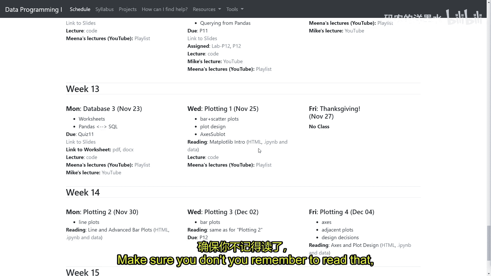
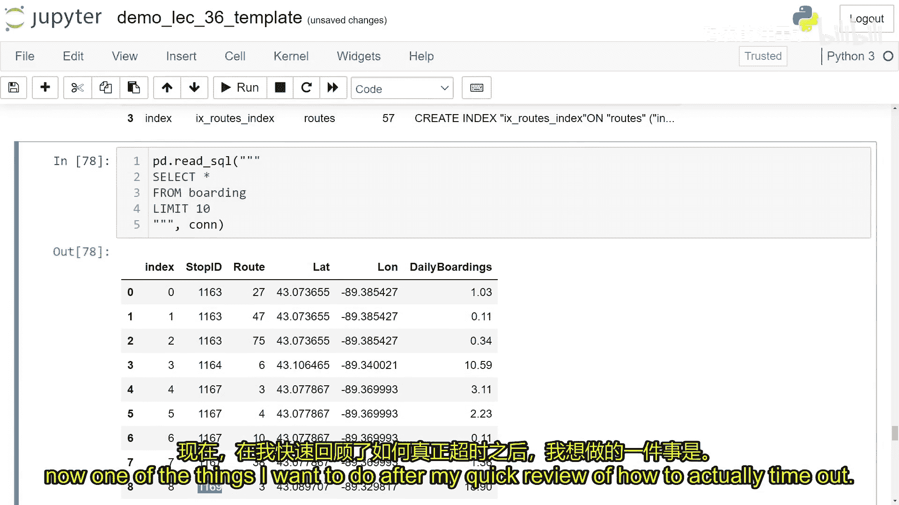
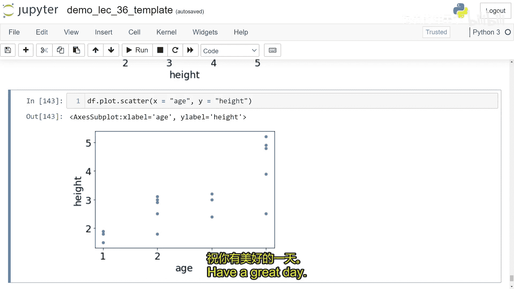

# 030：绘图1-1 🎨




在本节课中，我们将要学习使用Python进行数据可视化的基础知识。我们将重点介绍如何利用Pandas和Matplotlib库来创建饼图、条形图和散点图。通过本教程，你将掌握生成和美化基本图表的核心技能。

---

## 导入必要的库

在开始绘图之前，我们需要导入一些必要的Python库。这些库将帮助我们处理数据和创建图表。


```python
import pandas as pd
import sqlite3
import matplotlib.pyplot as plt
import os
```

---

## 创建饼图 🥧

上一节我们介绍了必要的库，本节中我们来看看如何创建一个简单的饼图。我们将从一个Pandas Series开始。

首先，我们创建一个包含数据的Series。

```python
s = pd.Series([5000000, 3000000, 2000000])
print(s)
```

接下来，我们使用这个Series来创建一个饼图。

```python
s.plot.pie()
```

生成的饼图可能看起来不太理想，例如标签太小且不明确。我们可以通过调整Matplotlib的全局参数来改善。

以下是调整字体大小的方法：

```python
import matplotlib
matplotlib.rcParams['font.size'] = 18
s.plot.pie()
```

为了使标签更有意义，我们可以使用字典来创建Series，从而指定每个扇区的标签。

```python
s = pd.Series({'Police': 5000000, 'Fire': 2000000, 'Schools': 3000000})
print(s)
s.plot.pie()
```

我们还可以在绘图时设置图表的标题。

```python
s.plot.pie(ylabel='City Spending')
```

---

## 创建条形图 📊

虽然饼图可以展示部分与整体的关系，但条形图通常能更清晰地比较不同类别的数值。本节我们将学习如何创建和美化条形图。

使用之前创建的Series，我们可以轻松地生成一个垂直条形图。

```python
s.plot.bar()
```

为了改善可读性，我们可以将数值单位转换为“百万”，并相应地调整Y轴标签。

```python
s_in_millions = s / 1000000
ax = s_in_millions.plot.bar()
ax.set_ylabel('Dollars (in millions)')
ax.set_title('City Spending')
```

有时，水平条形图可能更适合展示数据。以下是创建水平条形图的方法：

```python
ax = s_in_millions.plot.barh()
ax.set_xlabel('Dollars (in millions)')
ax.set_ylabel('Department')
ax.set_title('City Spending by Department')
```

我们可以通过多种方式自定义图表的外观，例如更改颜色、添加网格线或移除不必要的边框。

以下是更改条形颜色的示例：

```python
ax = s_in_millions.plot.barh(color='k')  # 'k' 代表黑色
```

以下是移除图表顶部和右侧边框的示例：

```python
ax.spines['top'].set_visible(False)
ax.spines['right'].set_visible(False)
```

---

## 使用函数标准化图表创建

为了在多个图表中保持一致的样式，我们可以创建一个函数来生成具有预设格式的坐标轴。这在准备用于出版物的图表时特别有用。

以下是一个创建标准化子图的函数示例：

```python
def get_ax(height=3):
    fig, ax = plt.subplots(figsize=(4, height))
    ax.spines['top'].set_visible(False)
    ax.spines['right'].set_visible(False)
    return ax
```

然后，我们可以在创建图表时使用这个函数返回的坐标轴对象。

```python
ax = get_ax(height=4.5)
s_in_millions.plot.bar(ax=ax, color='0.4') # 使用灰度
ax.set_ylabel('Dollars (in millions)')
ax.set_title('Standardized City Spending Chart')
```

---

## 从数据库创建图表 🗃️

数据可视化常常需要从数据库等外部源获取数据。本节我们将学习如何连接SQLite数据库，查询数据，并根据结果创建图表。

首先，我们连接到数据库并查看其中的表。

```python
db_path = 'bus.db'
if not os.path.exists(db_path):
    raise FileNotFoundError(f"Database file not found at {db_path}")
conn = sqlite3.connect(db_path)
```

我们查询数据库，找出每日乘车人数最多的公交线路。

```python
query = """
SELECT route, SUM(daily_boardings) AS total_boardings
FROM boardings
GROUP BY route
ORDER BY total_boardings DESC
"""
df = pd.read_sql(query, conn)
print(df.head())
```



将查询结果转换为Series并绘制前5条线路的条形图。


```python
# 设置'route'列为索引
df.set_index('route', inplace=True)
s_top_routes = df['total_boardings'].head(5)
ax = s_top_routes.plot.bar()
ax.set_ylabel('Total Daily Boardings')
ax.set_title('Top 5 Bus Routes by Ridership')
```

为了更全面地展示数据，我们可以添加一个“其他”类别，汇总前5名之后的所有线路。

```python
# 获取所有线路的数据
df_all = pd.read_sql(query, conn)
df_all.set_index('route', inplace=True)
s_all = df_all['total_boardings']

# 分离前5名和其余线路
s_top5 = s_all.head(5)
s_other = pd.Series({'Other': s_all.iloc[5:].sum()})

# 合并并绘图
s_to_plot = s_top5.append(s_other)
ax = s_to_plot.plot.bar()
ax.set_ylabel('Riders per day (in thousands)')
ax.set_title('Bus Top Routes vs. All Others')
```

最后，记得关闭数据库连接。

```python
conn.close()
```

---

## 创建散点图 🔵

散点图用于展示两个连续变量之间的关系。本节我们将使用一个关于树木的模拟数据集来创建散点图。

首先，我们创建并查看数据。

```python
trees = [
    {'age': 5, 'height': 20, 'diameter': 8},
    {'age': 10, 'height': 35, 'diameter': 15},
    {'age': 15, 'height': 45, 'diameter': 22},
    {'age': 20, 'height': 55, 'diameter': 30},
    {'age': 25, 'height': 65, 'diameter': 35}
]
df_trees = pd.DataFrame(trees)
print(df_trees)
```

现在，我们来创建散点图，探索树木年龄与直径之间的关系。

```python
df_trees.plot.scatter(x='age', y='diameter', title='Tree Age vs. Diameter')
```

我们也可以查看年龄与高度的关系。

```python
df_trees.plot.scatter(x='age', y='height', title='Tree Age vs. Height')
```

---



本节课中我们一起学习了使用Pandas和Matplotlib进行数据可视化的基础。我们涵盖了饼图、条形图和散点图的创建与基本美化，并演示了如何从数据库查询数据并可视化。掌握这些技能是进行有效数据分析和沟通的关键一步。