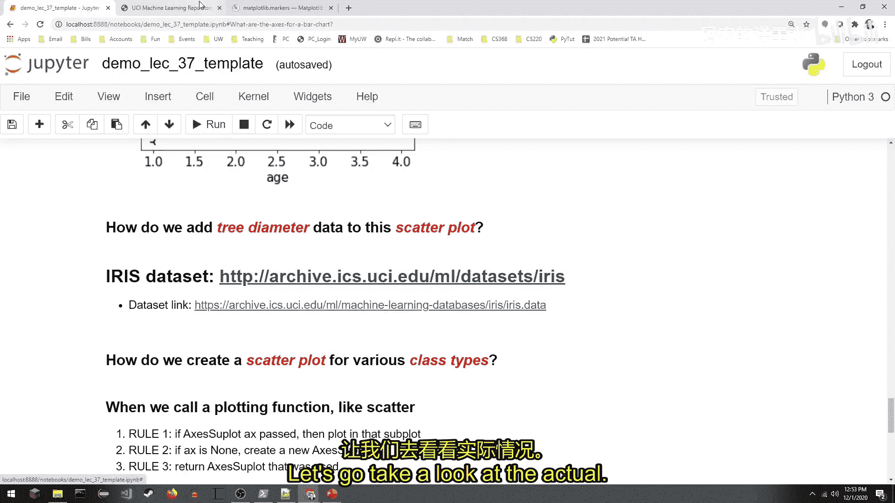
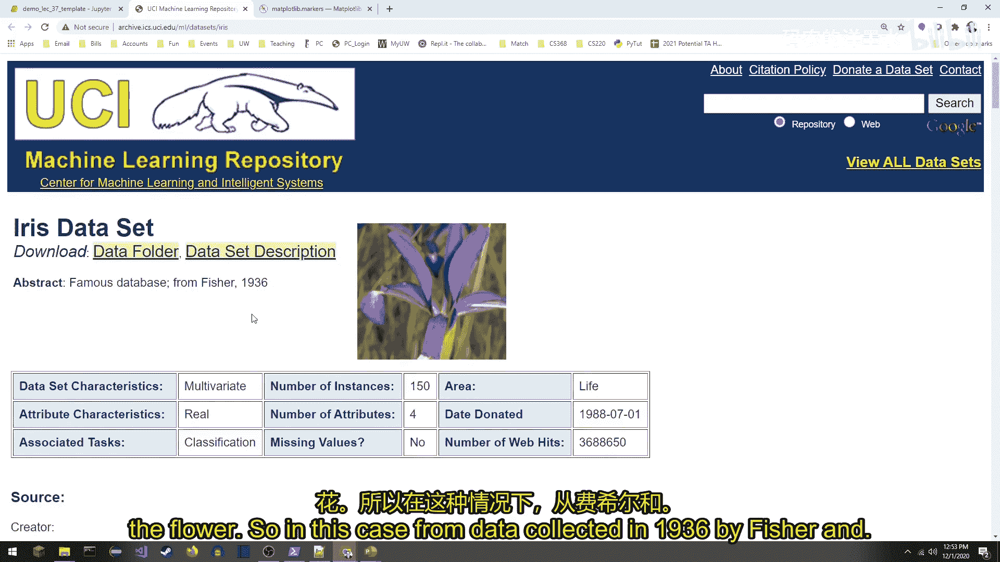
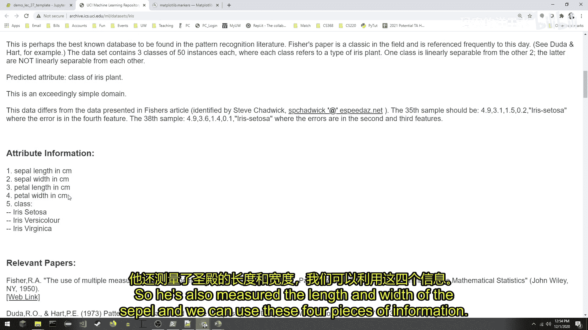
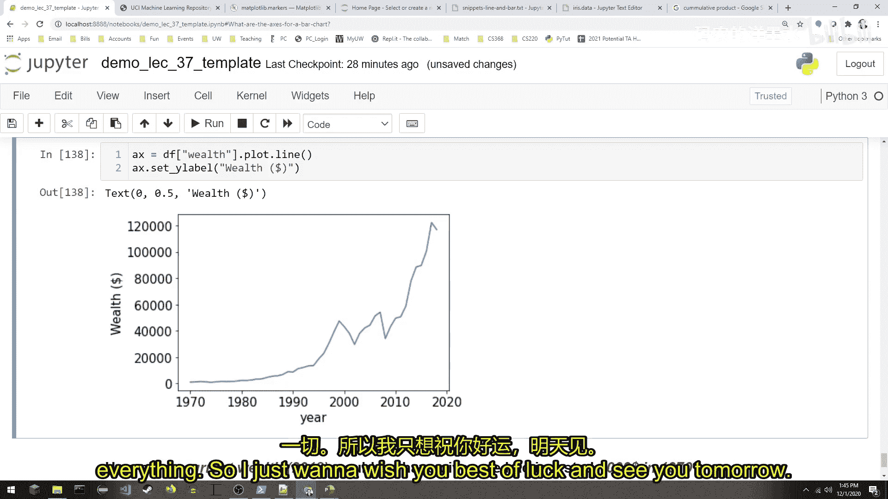

# 031：绘图进阶


在本节课中，我们将学习如何为散点图添加更多细节，例如通过颜色、大小和形状来编码额外数据维度。我们还将回顾线图的绘制方法，并学习如何美化图表，如设置坐标轴标签和刻度。

---

## 快速回顾：绘制简单条形图

上一节我们介绍了绘图的基本概念，本节中我们来看看如何绘制一个简单的条形图。这非常简单，我们通过Pandas连接到Matplotlib来创建图表。

要创建一个基本的条形图，你需要一个Series，然后调用其`.plot`方法并指定图表类型。

```python
my_series.plot(kind='bar')
```

---

## 条形图的坐标轴

以下是条形图中坐标轴的含义：
*   **X轴**：对应Series的索引。
*   **Y轴**：对应Series的数值。

---

## 回顾：树木数据的散点图

上一节我们使用了一个关于树木的DataFrame来创建散点图。现在，我们想在这个散点图中加入更多信息，例如树木的直径。

我们首先加载数据并创建基础散点图。

```python
import pandas as pd
import matplotlib.pyplot as plt

# 创建示例数据
trees_data = [
    {'age': 1, 'height': 2, 'diameter': 0.8},
    {'age': 2, 'height': 3, 'diameter': 1.0},
    {'age': 3, 'height': 4, 'diameter': 1.2},
    {'age': 4, 'height': 5, 'diameter': 1.4},
    {'age': 5, 'height': 6, 'diameter': 1.6}
]
trees_df = pd.DataFrame(trees_data)

# 基础散点图：年龄 vs. 高度
trees_df.plot(kind='scatter', x='age', y='height')
```

在散点图中，X轴和Y轴是必须的，它们直接显示数值。除此之外，我们还可以通过点的**颜色**、**大小**和**形状**来传达额外信息。

---

## 控制散点图外观：颜色

我们可以通过`color`（或缩写`c`）参数来改变点的颜色。颜色可以是名称（如`'red'`）或缩写（如`'r'`代表红色，`'b'`代表蓝色，`'k'`代表黑色）。

更强大的是，我们可以将一个数值序列（如直径）传递给`color`参数，Matplotlib会自动根据数值大小使用灰度表示。

```python
# 使用灰度表示直径
trees_df.plot(kind='scatter', x='age', y='height', c=trees_df['diameter'])
```

使用颜色（尤其是灰度）表示连续数据时需要注意：
1.  在白色背景上，接近白色的点可能看不见。可以通过设置`vmin`参数来调整灰度范围的下限。
2.  人类很难精确区分3-4种以上的灰度 shades。
3.  需要考虑色盲用户的体验。
4.  通常需要图例来解释颜色含义。

```python
# 调整灰度范围，确保所有点可见
min_diameter = trees_df['diameter'].min()
trees_df.plot(kind='scatter', x='age', y='height', c=trees_df['diameter'], vmin=min_diameter-0.5)
```

---

## 控制散点图外观：大小

我们可以通过`s`参数来改变点的大小。可以给一个固定值，也可以传递一个数值序列，让点的大小对应数据值。

```python
# 点的大小对应直径（乘以一个系数使其更明显）
trees_df.plot(kind='scatter', x='age', y='height', s=trees_df['diameter']*25)
```

使用大小编码数据时需谨慎，因为人类对面积变化的感知不是线性的（例如，数值翻倍会使点的面积变为四倍），这可能导致误解。





---



## 控制散点图外观：形状


我们可以通过`marker`参数来改变点的形状。Matplotlib提供了多种标记样式，例如`'.'`（点），`'s'`（方形），`'*'`（星形），`'^'`（三角形）等。

```python
# 改变点的形状为三角形
trees_df.plot(kind='scatter', x='age', y='height', marker='^')
```

使用不同形状通常更适合表示**分类数据**（如不同的物种）。对于像直径这样的连续数据，用形状编码可能不直观，除非将其分成几个类别。

**注意**：应避免同时使用颜色和大小来编码**完全相同**的数据维度，这会让图表显得冗余，并可能误导观众。

---

## 实战：鸢尾花数据集分析

现在让我们分析一个真实数据集：经典的鸢尾花数据集。它包含三种鸢尾花（Setosa, Versicolor, Virginica）的花萼和花瓣测量数据。

我们首先加载数据并查看其类别。

```python
# 加载鸢尾花数据集（假设文件名为iris.data）
column_names = ['sepal_length', 'sepal_width', 'petal_length', 'petal_width', 'class']
iris_df = pd.read_csv('iris.data', names=column_names)

# 查看数据集中有哪些类别
flower_classes = set(iris_df['class'])
print(flower_classes)
```

我们的目标是在同一张图上绘制所有类别的数据，并用颜色和形状区分它们。

```python
# 准备颜色和形状列表
colors = ['red', 'green', 'blue']
markers = ['^', '*', 'o']  # 三角形，星形，圆形

plot_area = None  # 初始化绘图区域

# 循环每个类别，将数据添加到同一张图中
for flower_class, color, marker in zip(flower_classes, colors, markers):
    # 筛选当前类别的数据
    class_data = iris_df[iris_df['class'] == flower_class]
    # 绘制散点图，并指定颜色和形状
    plot_area = class_data.plot(kind='scatter', x='petal_length', y='petal_width',
                                color=color, marker=marker, s=75,
                                ax=plot_area,  # 关键：将点添加到现有绘图区域
                                label=flower_class)

# 显示图例
plt.legend()
plt.show()
```

**关键点**：为了将所有数据画在同一张图上，我们在循环中使用了`ax=plot_area`参数，并将`.plot`方法返回的新绘图区域赋值回`plot_area`变量，以便下次迭代时继续添加数据。

---

## 绘制线图

线图常用于展示数据随时间或其他连续变量的趋势。绘制方法与条形图、散点图类似。

### 从Series绘制线图

对于一个Series，`.plot(kind='line')`会将其值按索引顺序连接起来。

```python
# 创建一个Series
s = pd.Series([100, 300, 200, 400, 50], index=[0, 1, 2, 23, 24])
s.plot(kind='line')
```

注意，如果索引不是按顺序排列的，线图可能会产生奇怪的折线。可以使用`.sort_index()`对Series进行排序。

```python
s_sorted = s.sort_index()
s_sorted.plot(kind='line')
```

### 从DataFrame绘制线图（以温度数据为例）

我们可以直接绘制整个DataFrame，Pandas会为每一列画一条线。

```python
# 示例：月平均高低温数据
data = {
    'high': [26, 30, 42, 58, 70, 78, 82, 80, 72, 58, 42, 30],
    'low': [13, 16, 26, 38, 49, 58, 63, 61, 53, 41, 29, 18]
}
temp_df = pd.DataFrame(data)

# 绘制DataFrame，每列一条线
ax = temp_df.plot(kind='line')
ax.set_xlabel('Month')
ax.set_ylabel('Temperature (F)')
```

### 美化线图：设置刻度和标签

默认的X轴刻度是数字（0-11），我们希望将其改为月份名称。

```python
# 设置X轴刻度位置和标签
month_ticks = range(12)
month_labels = ['Jan', 'Feb', 'Mar', 'Apr', 'May', 'Jun',
                'Jul', 'Aug', 'Sep', 'Oct', 'Nov', 'Dec']

ax.set_xticks(month_ticks)
ax.set_xticklabels(month_labels, rotation=45)  # 旋转标签45度，避免重叠
```

### 数据转换示例：华氏度转摄氏度

对DataFrame进行数学运算是逐元素进行的，非常方便。

```python
# 将温度从华氏度转换为摄氏度
temp_df_celsius = (temp_df - 32) * 5 / 9
# 重命名列
temp_df_celsius.columns = ['high_c', 'low_c']
# 绘制摄氏度图表
temp_df_celsius.plot(kind='line')
```

---

## 综合案例：标普500投资回报可视化

最后，我们看一个综合案例：计算并可视化从1970年开始投资标普500的累积财富增长。

```python
# 加载标普500历史回报数据
sp500_df = pd.read_csv('sp500.csv')
print(sp500_df.head())

# 计算累积回报（累积乘积）
sp500_df['cumulative_return'] = (sp500_df['return'] / 100 + 1).cumprod()

# 计算财富增长（假设初始投资1000美元）
initial_investment = 1000
sp500_df['wealth'] = initial_investment * sp500_df['cumulative_return']

# 将‘year’列设置为索引，以便作为X轴
sp500_df.set_index('year', inplace=True)

# 绘制财富增长曲线
ax = sp500_df['wealth'].plot(kind='line')
ax.set_ylabel('Wealth (USD)')
ax.set_title('Growth of $1000 Investment in S&P 500')
plt.show()
```

这个案例展示了如何从原始数据开始，通过计算衍生列，最终生成一个有意义的线图来讲述数据故事。

---



本节课中我们一起学习了如何增强散点图的信息量，包括用颜色、大小和形状编码数据。我们还回顾并深化了线图的绘制技巧，学习了如何设置坐标轴、刻度和标签来制作更清晰、更专业的图表。通过鸢尾花数据集和标普500的案例，我们练习了从数据加载、处理到可视化的完整流程。