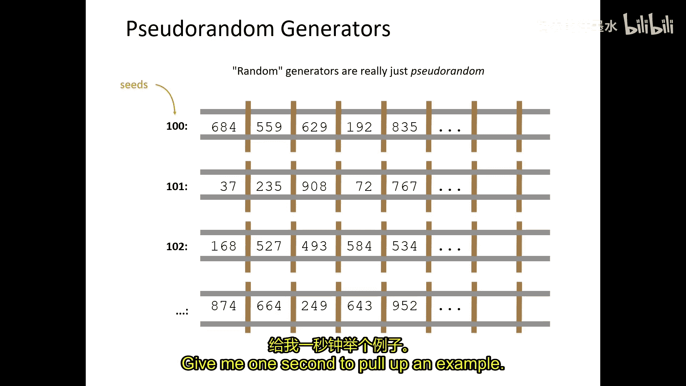
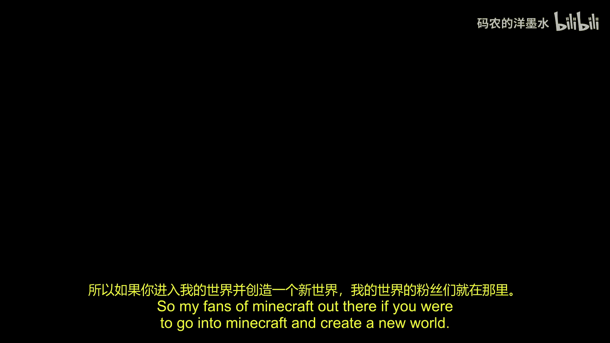
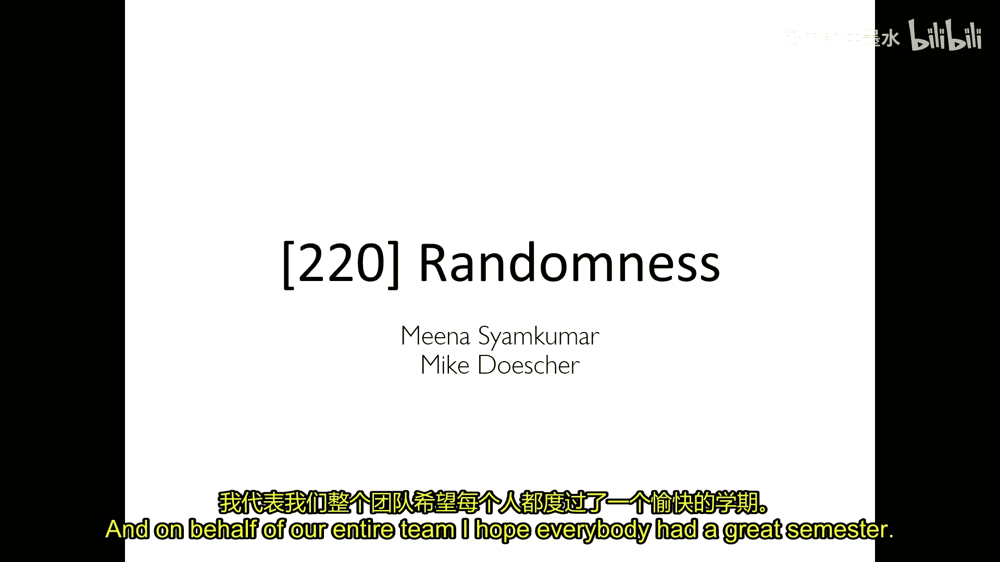

# 032：随机性与模拟 🎲

在本节课中，我们将要学习Python中的随机性概念及其在数据编程中的应用。我们将探讨如何生成随机数据，如何通过模拟来分析概率事件，以及如何避免编程中与随机性相关的常见错误。

---

## 概述 📋

随机性在计算机科学和数据科学中扮演着重要角色，从游戏开发到安全加密，再到复杂系统的模拟，都离不开随机数的生成与分析。本节课程将介绍Python中生成随机数的基本方法，并通过实际案例展示如何利用随机性进行数据模拟和概率分析。

---

## 随机数生成 🎯

上一节我们介绍了课程的整体安排，本节中我们来看看如何在Python中生成随机数。Python内置的`random`模块和NumPy库中的`random`子模块都提供了强大的随机数生成功能。

### 使用`choice`函数

`choice`函数允许我们从给定的列表中随机选择一个元素。以下是其基本用法：

```python
from numpy.random import choice

options = ['石头', '布', '剪刀']
selected = choice(options)
print(selected)
```

运行上述代码，每次都会从`['石头', '布', '剪刀']`中随机选择一个元素输出。

### 生成多个随机选择

我们可以通过指定`size`参数来一次性生成多个随机选择，结果会以NumPy数组的形式返回。

```python
multiple_choices = choice(options, size=5)
print(multiple_choices)
```

这段代码会生成一个包含5个随机选择的数组，例如`['布', '石头', '剪刀', '布', '石头']`。

### 创建随机序列

我们可以将生成的随机数组转换为Pandas Series，以便进行更复杂的数据分析。

```python
import pandas as pd

random_series = pd.Series(choice(options, size=5))
print(random_series)
```

这将创建一个索引为0到4、值为随机选择的Pandas Series。

---

## 多维随机数据 📊

除了生成一维序列，我们还可以创建多维的随机数据数组，这在模拟多组实验时非常有用。

### 生成二维数组

通过向`size`参数传递一个元组，我们可以指定生成数组的行数和列数。

```python
# 生成一个5行2列的二维数组
rows = 5
cols = 2
array_2d = choice(options, size=(rows, cols))
print(array_2d)
```

生成的数组结构如下：
- **行**： 垂直方向（从上到下）
- **列**： 水平方向（从左到右）

### 访问多维数组元素

访问多维数组元素的方式与访问列表的列表类似。

```python
# 访问第3行（索引2），第1列（索引0）的元素
element = array_2d[2, 0]
print(element)
```

### 创建随机数据框

我们可以直接将生成的二维数组转换为Pandas DataFrame，以便进行结构化数据分析。

```python
df = pd.DataFrame(choice(options, size=(rows, cols)))
print(df)
```

---

## 分析随机性偏差 ⚖️

生成随机数据后，一个自然的问题是：这个过程是否公平？我们如何检验随机性是否存在偏差？

### 计算频率分布

我们可以使用Pandas的`value_counts`方法来统计每个选项出现的次数。

```python
# 生成一个较大的随机序列
large_series = pd.Series(choice(options, size=300000))

# 计算各选项出现的次数
value_counts = large_series.value_counts()
print(value_counts)
```

在理想情况下，如果选择是均匀随机的，每个选项出现的次数应该大致相等。

### 可视化频率分布

为了更直观地观察分布，我们可以将计数结果绘制成条形图。

```python
import matplotlib.pyplot as plt

# 按指定顺序（石头、布、剪刀）获取计数并绘图
ordered_counts = value_counts[['石头', '布', '剪刀']]
ordered_counts.plot(kind='bar')
plt.show()
```

通过观察条形图，我们可以判断随机生成过程是否存在明显的偏差。

### 控制选择概率

`choice`函数允许我们通过`p`参数指定每个选项被选中的概率。

```python
# 指定概率：石头70%，布20%，剪刀10%
probabilities = [0.7, 0.2, 0.1]
biased_choice = choice(options, p=probabilities, size=10)
print(biased_choice)
```

**注意**：概率列表中的所有值之和必须为1。

---





## 随机数种子与可重现性 🌱

在编程和数据分析中，有时我们需要能够重现相同的“随机”结果，这时就需要使用随机数种子。

### 设置随机数种子

通过设置种子，我们可以让随机数生成器从同一个起点开始，从而每次生成相同的序列。

```python
from numpy.random import seed

seed(220)  # 设置种子为220
print(choice([0, 1, 2, 3, 4, 5], size=3))
```

无论运行多少次，只要种子相同，生成的随机序列就会相同。

### 使用时间作为种子

在实际应用中，我们经常使用当前时间作为种子，这样每次运行都能得到不同的序列，但同时也能够记录种子值以便重现。

```python
import time

now = int(time.time())  # 获取当前时间戳
seed(now)
print(f"种子: {now}")
print(choice([0, 1, 2, 3, 4, 5], size=3))
```

---

## 模拟与概率分析 📈

随机性的一个重要应用是进行概率模拟，帮助我们理解某些事件发生的可能性。

### 抛硬币模拟

假设我们想模拟抛100次硬币，并统计正面朝上的次数。

```python
flips = 100
trials = 10000

# 模拟10000次实验，每次抛100次硬币
results = choice(['正面', '反面'], size=(trials, flips))
df = pd.DataFrame(results)

# 统计每次实验中正面朝上的次数
heads_count = df.apply(lambda row: (row == '正面').sum(), axis=1)
```

### 分析极端结果

我们可以计算在100次抛掷中，正面朝上次数少于40次或多于60次的实验比例。

```python
extreme_cases = heads_count[(heads_count <= 40) | (heads_count >= 60)]
extreme_percentage = len(extreme_cases) / trials * 100
print(f"极端结果比例: {extreme_percentage:.2f}%")
```

### 连续事件模拟

我们还可以模拟更复杂的情况，例如在16次抛掷中出现连续7次或更多正面的概率。

```python
def has_consecutive_heads(sequence, n=7):
    """检查序列中是否包含连续n个正面"""
    joined = ''.join(sequence)
    return joined.find('H' * n) != -1

consecutive_count = 0
for _ in range(trials):
    trial = choice(['H', 'T'], size=16)
    if has_consecutive_heads(trial, 7):
        consecutive_count += 1

probability = consecutive_count / trials * 100
print(f"连续7次正面概率: {probability:.2f}%")
```

---

## 总结 🎓

本节课中我们一起学习了Python中随机性的核心概念和应用。我们掌握了如何使用`choice`函数生成随机数据，如何创建和分析多维随机序列，以及如何通过设置种子确保结果的可重现性。我们还通过抛硬币的案例，学习了如何利用随机模拟来分析概率事件，评估结果的统计显著性。



理解随机性对于数据编程至关重要，它不仅帮助我们创建更真实的模拟，还能让我们在分析数据时保持批判性思维，区分真正的模式与随机噪声。