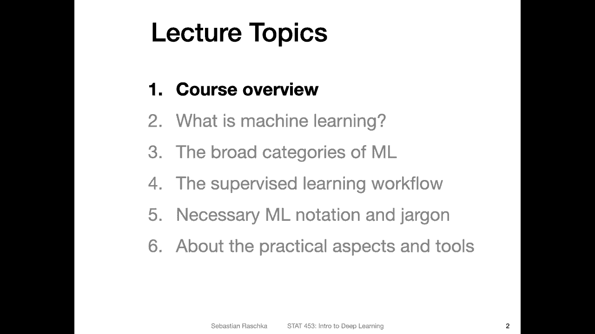
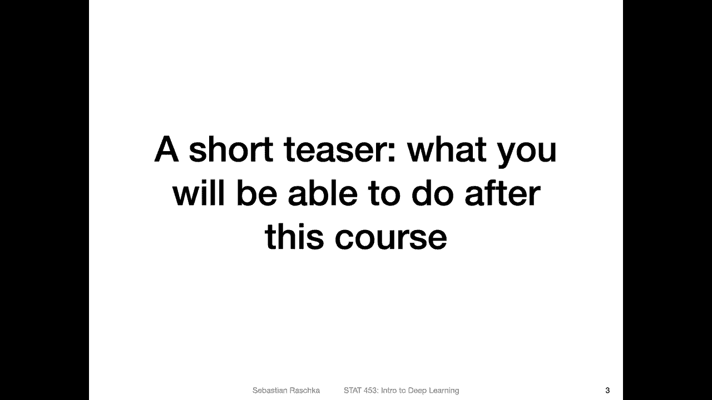
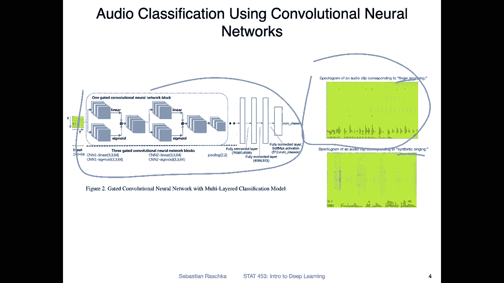
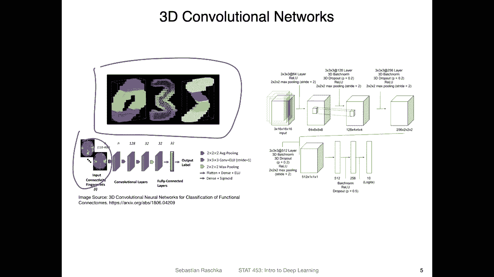
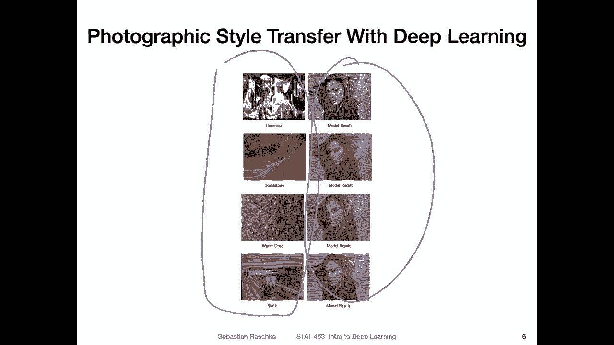
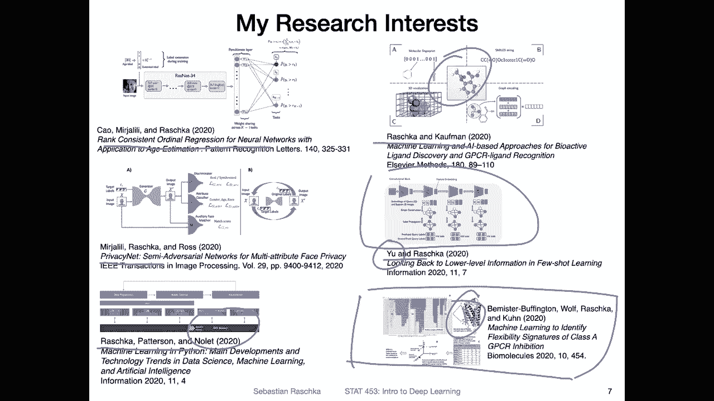
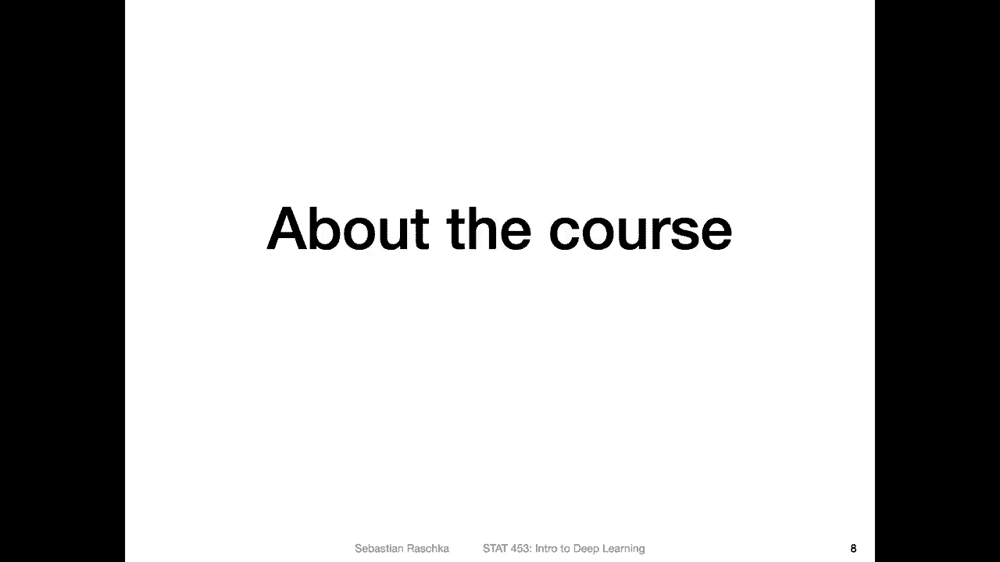
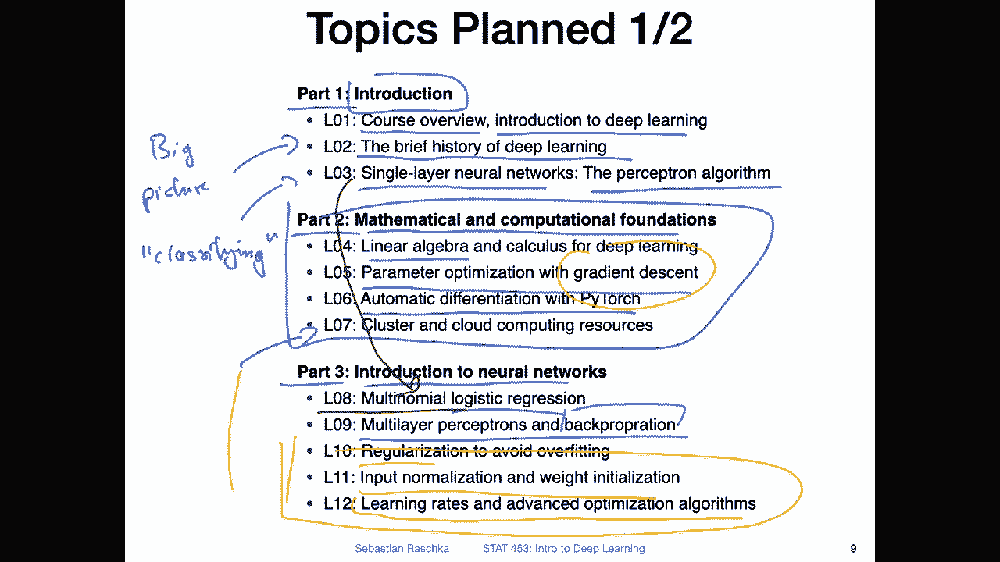
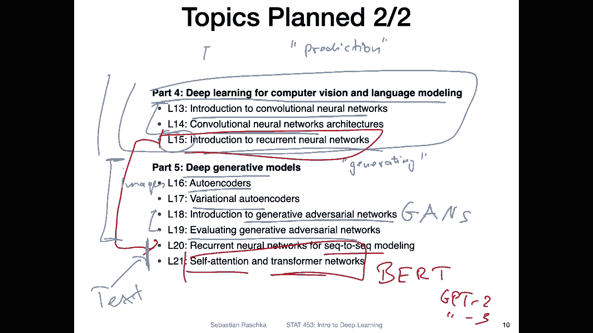

# 2：L1.1.1 - 课程概述第 1 部分：动机和主题 🚀

在本节课中，我们将要学习本课程的总体框架、学习目标以及涵盖的核心主题。我们将了解深度学习能实现哪些令人兴奋的应用，并预览整个学期的学习路线图。

---

现在，让我们开始本周准备的内容。

首先，我想通过一个简短的预告，展示你在完成本课程后能够实现的目标。

当然，这是一个漫长的旅程，未来有15周的时间。但在某个时刻，你将能够运用在本课程中学到的深度学习知识，完成一些非常酷的事情。

以下是上学期学生们完成的一些课程项目示例。

例如，在这个项目中，学生们将音频信号（例如语音文本）转换为频谱图。

然后，他们应用卷积神经网络来分类不同的文本，并从音频片段中提取语言信息。在这个案例中，实际上处理的不是语言，而是识别打响指和唱歌的声音，以区分不同的音频输入。这是上学期的一个课程项目示例。

另一个项目是使用3D卷积神经网络。这是所谓的MNIST数据集的3D版本，在本课程中你会经常看到它，至少在后面的入门讲座中，因为它是一个用于神经网络入门的简单数据集。

在这个项目中，学生们处理功能磁共振成像（fMRI）数据，例如脑部扫描等，并对不同类型的脑部扫描进行分类。这是另一个有趣的项目。

此外，学生们还使用了不同类型的生成对抗网络，这也会在本课程后期涉及。你将能够生成新数据，或混合来自不同数据源的数据。

在这个项目中，学生们将艺术绘画或照片等艺术输入，与模特肖像照片混合。输出结果基本上显示在右侧，就像一张融合了不同风格的人物肖像。这是风格迁移的一个例子。

我选择这三个项目的原因有些随意。老实说，我只是浏览了上学期的项目，挑选了那些有漂亮图示的，这样在幻灯片上看起来更美观。

当然，你可以自由选择任何你感兴趣的主题作为课程项目，我稍后会详细讨论。我不想一开始就用太多信息让你不知所措，只是想展示一些你在学期末能够完成的示例。

如果你对我的研究感兴趣，我主要从事机器学习和深度学习领域的工作。这里我整理了一个我参与项目的概述，也算是介绍一下我自己和我的兴趣所在。

例如，去年我研究了**秩一致自回归网络**，我们称该方法为**CORAL**。你可以将其视为对有序输入的分类，即当你的类别标签具有顺序时，我们想要对它们排序或预测标签的正确顺序及其相关的数值。我们开发了应用于年龄分类的网络。

我们还研究了面部隐私，我们称此方法为**Privacy-Net**。我们可以从输入图像中隐藏面部属性，例如年龄、性别和种族等，以保护个人隐私。

此外，我还与英伟达的人员合作，撰写了一篇关于Python、机器学习和深度学习领域最新趋势的综述文章，特别关注GPU内存。这也是我们稍后讨论本课程将使用的工具时会更多涉及的内容。

我和我的一个学生还合著了另一篇关于**基于机器学习和AI的生物活性配体发现方法**的综述文章。我的一个学生正在研究小分子配体的发现与合成，同样使用生成模型和生成式深度学习模型，应用于分子合成与设计领域。

我的另一个学生正在研究**小样本学习**。小样本学习是深度学习的一个分支，关注如何从小数据集中学习。大多数时候，人们会使用元学习或迁移学习。我们将在本课程后期更多地讨论迁移学习，但不会涵盖小样本学习。不过，我可能会邀请我的学生在学期后期做一次小型客座讲座，如果他有时间的话。Zhongji也参与了这篇论文的工作，他同时也是本学期的助教。如果你感兴趣，可以向Zhongji请教更多关于不同小样本学习方法的问题，我想他会在办公时间非常乐意与你深入探讨。

最后，我也从事一些传统机器学习方法的研究。这是一项合作，我们使用了非深度学习的传统机器学习方法，具体是最近邻方法，用于与计算生物学相关的预测。这里涉及的是G蛋白偶联受体（GPCR）的结构，这是一种非常重要的蛋白质受体，在人体内与小分子结合。实际上，大多数药物靶点都是针对GPCR的。但这里的研究更像是基础计算生物学研究，分析这些蛋白质的结构组成。

这只是关于我的一点简单介绍。你可能看出，我喜欢研究深度学习，并对计算生物学应用有浓厚兴趣。这两个基本上是我的主要研究领域，也是我非常热衷的方向。

---

上一节我们了解了课程可能实现的应用和讲师的研究背景，现在让我们更具体地谈谈课程本身。

对于本课程，我计划涵盖许多主题，主要是深度学习和生成对抗网络，正如课程标题所示。

我将本课程结构分为五个部分。这里是第1、2、3部分，下一页幻灯片将展示剩余的两个部分。

首先，是**引言部分**。这正是我们现在所处的位置。我将简要概述本课程，并介绍机器学习和深度学习。这就是我们本周要做的事情。

然后，我也想简要谈谈深度学习的历史。我认为这很有趣，因为它能帮助你理解这些概念和动机从何而来。因为“深度学习”这个术语相对较新，大约在十年前出现，但它有着悠久的历史。你可以将深度学习视为神经网络的一个时髦称呼。而神经网络已经存在了至少60到70年，一些早期出现的想法推动了后来不同思想的发展。我们将涵盖许多与神经网络相关的内容。因此，你可以将这次讲座视为一个宏观概述。我们将简要介绍历史，然后在后续介绍本课程中不同主题时，我们会逐步展开，并将其与历史联系起来，同时阐明学习它们的原因及其用处。

接着，我们将讨论一种早期的机器学习方法：**单层神经网络**，即**感知机算法**。这是一个非常传统的算法，如今已不常用，但我认为它是分类问题的一个简单入门。分类就是将事物归入不同的类别。我认为这将是一个很好的主题入门。

然后，我们将进入**第二部分**，关注**数学与计算基础**。这意味着介绍一些必要的数学知识，如线性代数。确实，在深度学习中通常使用线性代数来更简洁地表达事物。从技术上讲，我们可以在不使用线性代数的情况下进行深度学习，但那样会很难书写，并且实现起来很慢，因为我们在实践中使用的计算库依赖线性代数计算例程，这有助于我们比使用Python循环更高效地执行某些计算。因此，线性代数对深度学习非常重要。我们不需要任何高级的线性代数概念，基本上只需要简单的向量点积和矩阵乘法。但我认为仍然值得单独用一节课来讲解，因为为后续课程打好基础会使后面的学习更容易一些。

之后，我们将讨论**梯度下降**。这是一个微积分主题。梯度下降是训练神经网络的主要方法。

在复习了这个主题之后，我们将讨论**使用PyTorch进行自动微分**。你可以将自动微分视为计算机上的微积分。我们将使用一个名为PyTorch的工具，它是一个用于线性代数、自动微分以及神经网络训练或深度学习的库。它还允许我们在GPU上实现计算以提高效率。我将在第7讲中解释如何使用集群和云计算资源，但这部分会相对简短，因为本课程的主要主题当然是深度学习，计算方面是必要的，但对于这门入门课程，你不需要成为专家程序员或计算机用户。你应该熟悉计算机上的某些操作和编程方面，但我们这里不是教授机器学习工程，更多的是提供概念性概述。你可以使用我将在这节课中谈到的一些免费资源来完成课程。当然，如果你感兴趣，也可以使用更高级的资源，例如校园的HTC集群等，但这门课不作要求。

在数学与计算基础之后，我们将最终讨论**神经网络**。在**第三部分**，我将为深度学习奠定基础。我们将从**逻辑回归**开始，你可以将其视为单层神经网络。这基本上是对我们之前讨论的单层网络的扩展，现在它是可微分的。

以逻辑回归为起点，我们将添加额外的隐藏层，使其成为一个深度网络，也称为**多层感知机**。然后，我们将学习如何使用**反向传播算法**来训练这样的多层感知机。

第10到12讲更像是训练深度神经网络的技巧，例如避免过拟合的**正则化技术**、**输入归一化**和**权重初始化**。这些技巧使神经网络的训练更加稳健和快速。我们还将讨论**学习率**和一些**高级优化算法**，本质上是梯度下降的更高级版本。这些对于在实践中使神经网络良好工作非常重要。这些主题，尤其是第10和11讲，可能听起来不那么令人兴奋，但它们超级有用和重要，是使神经网络良好工作的关键。

然后，我们将进入本课程中有趣的部分，或者说是更高级的部分。在**第四部分**，我们将讨论用于**计算机视觉**和**语言建模**的深度学习。我们将花大量时间在**卷积神经网络**上，这是一个大主题。

我们还将讨论**循环神经网络**，它们用于语言建模。卷积神经网络更多用于图像建模，尽管你也可以使用一维卷积网络处理文本。但文本将更多地在第15讲中重点介绍。这些内容也将为我们将要讨论的深度生成模型奠定基础。

在深度生成模型方面，我们将讨论**自编码器**、所谓的**变分自编码器**，然后讨论**生成对抗网络**。你可能已经听说过它们，即GANs。这只是生成对抗网络的完整写法。这也是一个非常大的主题，我们将有两节课来讲解：一节介绍，另一节关于一些更高级的GANs，例如**Wasserstein GAN**，以及如何评估和比较不同的GANs。因为在这个部分，我们关注的是**预测**，而在这里的第二部分，我们关注的是**生成**事物，这有点不同，评估这些模型也更具挑战性，因此我们将有一节课专门讨论。

我还计划涵盖循环神经网络在生成建模方面的一些内容，例如在序列到序列的上下文中生成新文本。在第15讲中，我将首先尝试只关注预测部分，但我们也会重新讨论这个主题，用于生成新的文本数据，并进入一个更高级的主题：为RNN添加所谓的**注意力机制**，并在**Transformer**的背景下解释**自注意力**。这些可能是你在媒体上听说过的模型（如BERT或GPT-2、GPT-3）的基础构建模块。我们也会讨论这些。

我不想让这里显得太拥挤，但这个部分基本上是关于图像的，而最后这两个部分将是关于文本的。因此，我们将涵盖图像和文本的生成模型。

---

本节课中，我们一起学习了本课程的动机、涵盖的精彩应用示例以及整体的教学大纲结构。我们从课程结束时可实现的项目预览开始，了解了深度学习在音频分类、医学图像分析和艺术风格迁移等领域的应用。接着，我们简要了解了讲师的研究方向。最后，我们详细梳理了课程的五个主要部分：从引言和历史，到数学与计算基础，再到神经网络基础、计算机视觉与语言建模的深度学习应用，以及深度生成模型。这为我们接下来的学习描绘了清晰的路线图。