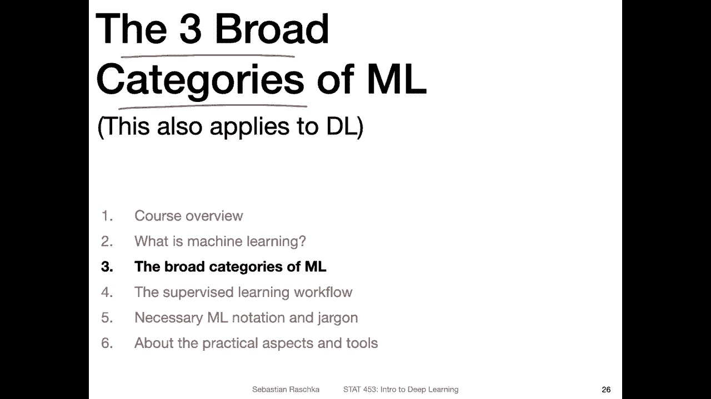
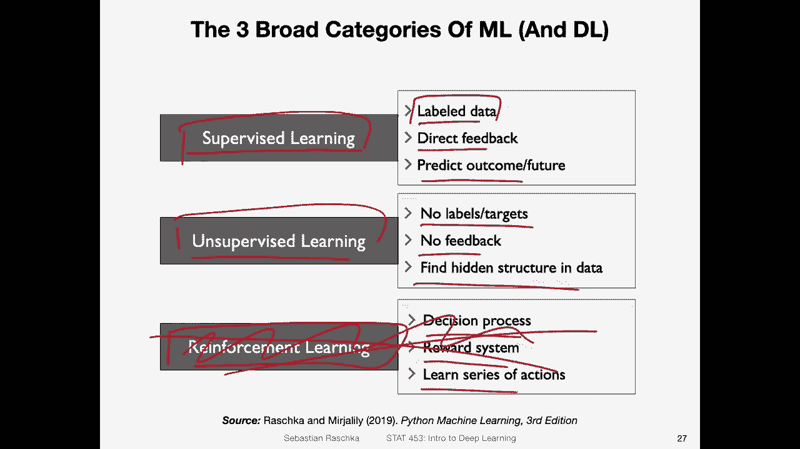
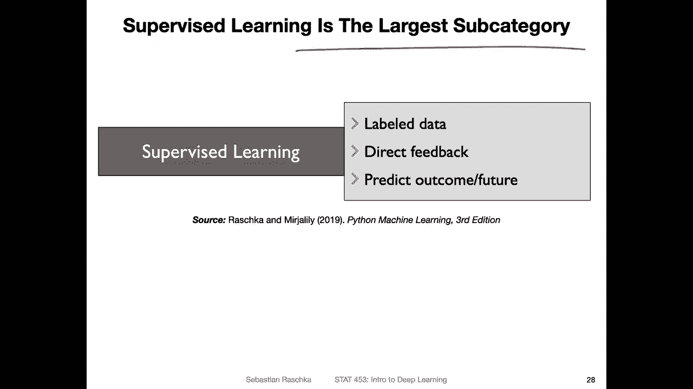
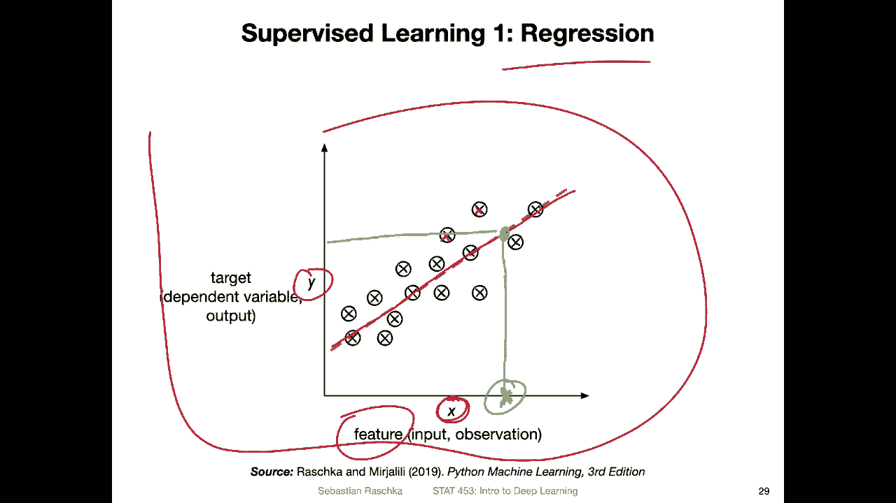
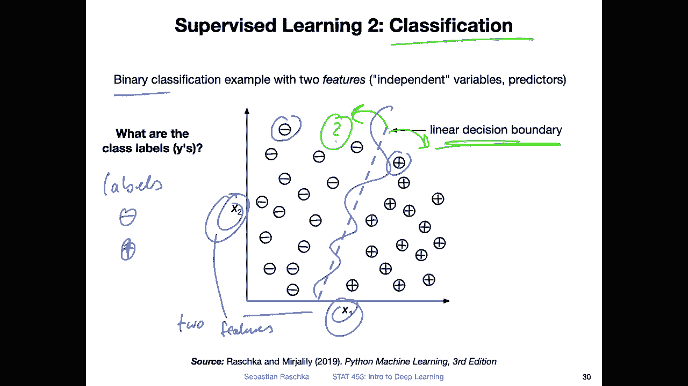
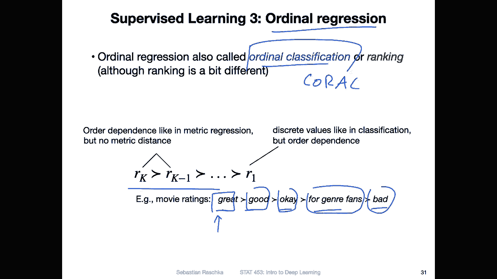
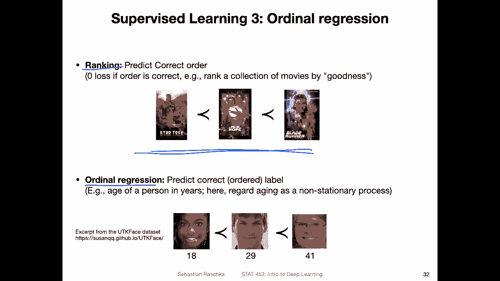
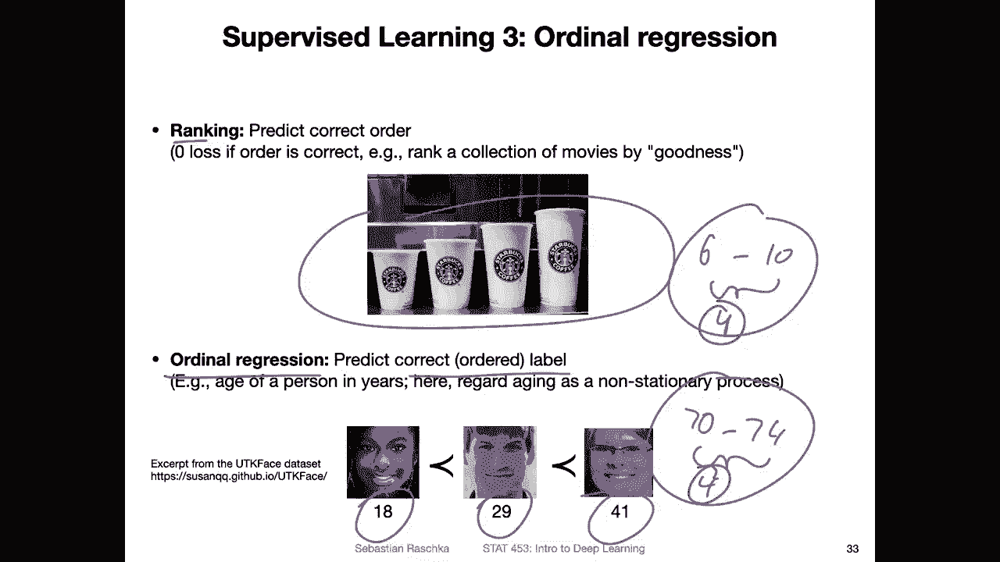
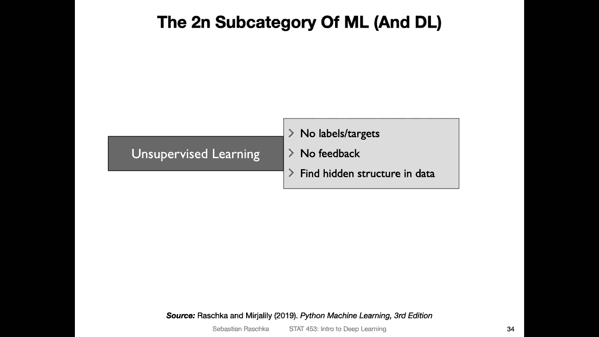

# 5：L1.3.1 - 机器学习的三大类别（第1部分）：监督学习 🧠

在本节课中，我们将学习机器学习的三大主要类别，并重点介绍其中最重要的一类：监督学习。我们将了解监督学习的基本概念、常见类型及其应用场景。

---

## 机器学习的三大类别

机器学习主要分为三大类别：监督学习、无监督学习和强化学习。

上一节我们介绍了机器学习的整体框架，本节中我们来看看这三大类别的具体含义。

---

## 什么是监督学习？

监督学习是机器学习或深度学习中最常见的形式。它是机器学习中最大的子类别，其核心特点是使用带有标签的数据。

如果你回想垃圾邮件分类的例子，那就是一个监督学习问题。我们的目标是预测一封电子邮件是否是垃圾邮件，而标签数据则是垃圾邮件和非垃圾邮件的示例。监督学习还涉及直接反馈，我们可以判断预测是否正确。例如，在训练过程中，模型对一封已知标签的邮件进行预测，我们可以根据已知的正确标签提供直接反馈。

以下是监督学习的关键特点：
*   **使用标签数据**：每个训练样本都有对应的正确答案（标签）。
*   **提供直接反馈**：模型可以根据预测结果与真实标签的差异进行学习和调整。
*   **目标明确**：旨在学习从输入到输出的映射关系。

---

## 监督学习的类型

监督学习主要包含几种类型：回归、分类以及序数回归。

### 1. 回归 📈

回归是监督学习的一种。你可能已经从其他统计学课程中见过回归的例子，例如线性回归模型。

在机器学习中，我们通常将自变量 `x` 称为**特征**，将因变量 `y` 称为**目标**。模型的目标是拟合一个函数（例如线性函数 `y = wx + b`），以便当我们有一个新的观测值（只知道其特征 `x`）时，可以预测其目标值 `y`。

**公式示例（简单线性回归）：**
`y_pred = w * x + b`
其中，`w` 是权重，`b` 是偏置项。

### 2. 分类 🏷️

分类是比回归更常见的监督学习任务，尤其在深度学习领域。大多数系统都专注于分类，例如识别图像中的物体（是猫还是狗）。

回想之前展示的ATM机识别手写数字的例子，那就是一个分类任务，旨在将数字分类为0、1、2等。

以下是一个二分类问题的简单示例，我们只有两个可能的标签（例如“+”和“-”），以及两个特征（`x1` 和 `x2`）。目标是学习一个**决策边界**，以便对新的数据点进行分类。例如，决策边界左侧的点被预测为“-”，右侧的点被预测为“+”。

在实践中，我们通常处理高维数据，决策边界也可能非常复杂。深度神经网络正是通过学习这些复杂的决策边界来工作的。

### 3. 序数回归与排序 🔢

除了回归和分类，还存在第三种类型，称为序数回归或序数分类。这与分类相似，但标签之间存在**顺序关系**。

例如，电影评级（优秀 > 良好 > 一般 > 较差 > 很差）就具有顺序信息。虽然你可以使用分类器将其分类到这些类别中，但序数回归模型会额外利用类别之间的排序信息。

另一个紧密相关的任务是**排序**，它更侧重于预测正确的顺序，而不仅仅是单个标签。

一个具体的例子是年龄预测。年龄具有顺序性，但不同年龄段的“距离”意义可能不同（例如，6岁到10岁的变化远大于70岁到74岁的变化）。因此，使用标准的度量回归（假设所有间隔相等）可能不合适，而序数回归是更自然的选择。

不过，在本课程中，我们将主要关注监督学习中的分类任务。

---

## 总结

本节课我们一起学习了机器学习的三大类别，并深入探讨了其中最重要的一类——监督学习。

我们了解到：
*   监督学习使用带有标签的数据进行训练，并提供直接反馈。
*   监督学习主要包括**回归**（预测连续值）、**分类**（预测离散类别）和**序数回归**（预测有序类别）等类型。
*   在后续课程中，我们将更深入地学习分类等具体任务。

在下一个视频中，我们将继续介绍另外两个类别：无监督学习和强化学习。