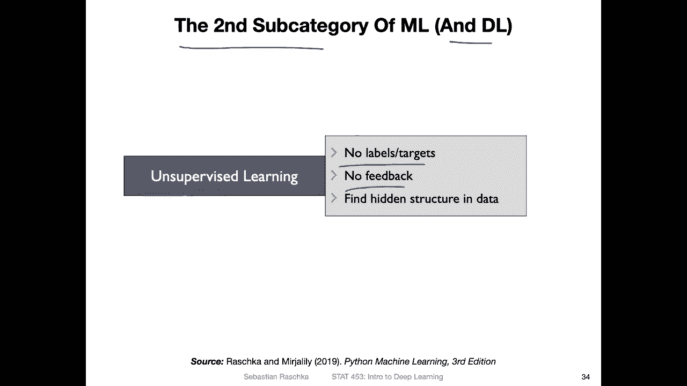
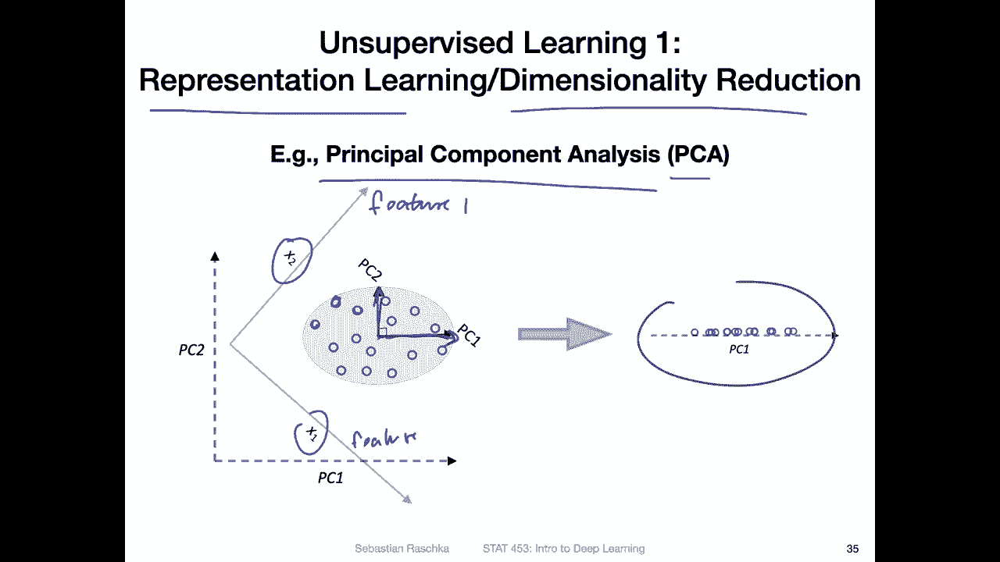
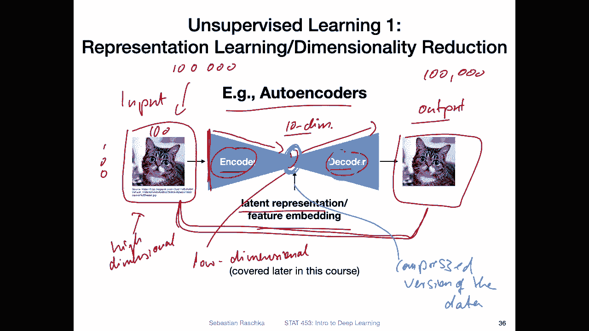
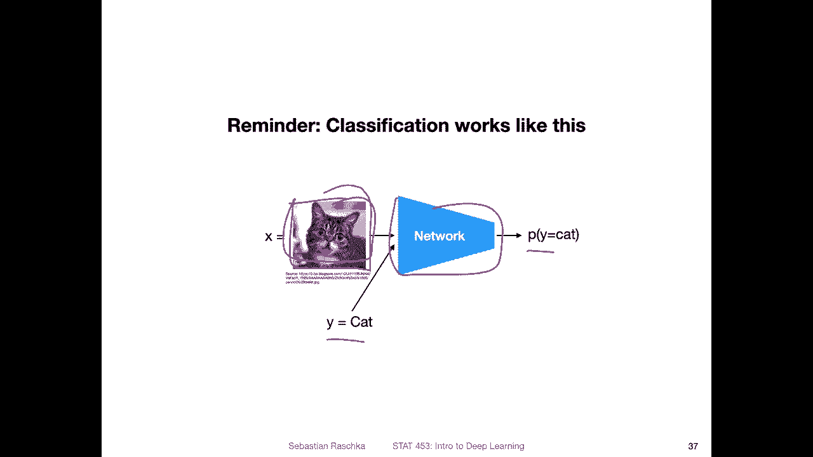
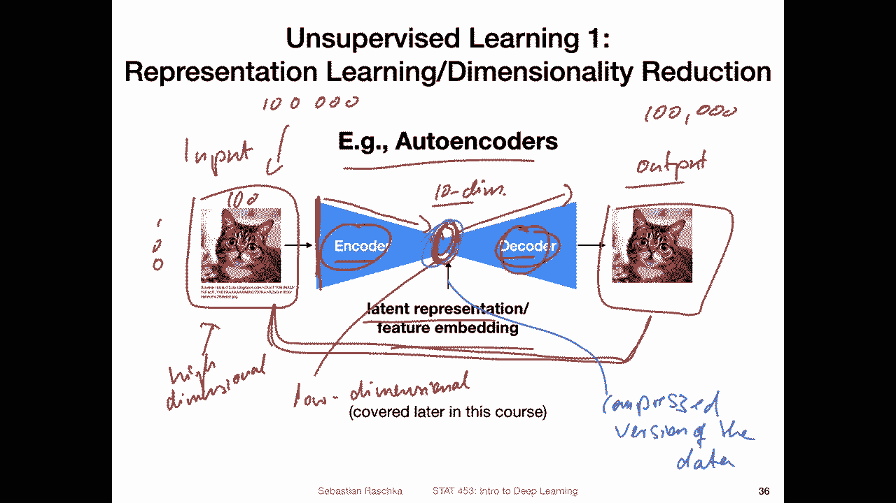
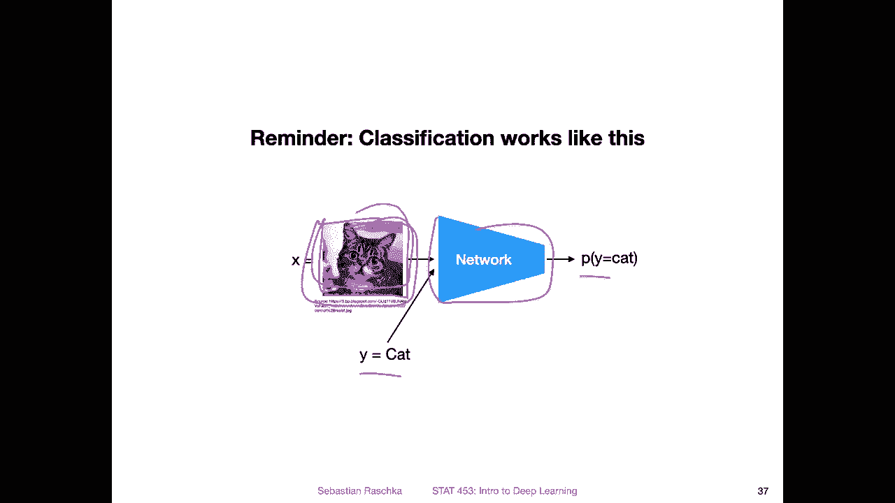
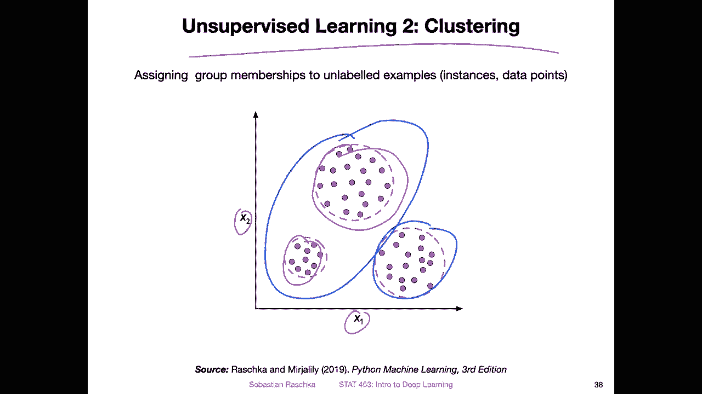
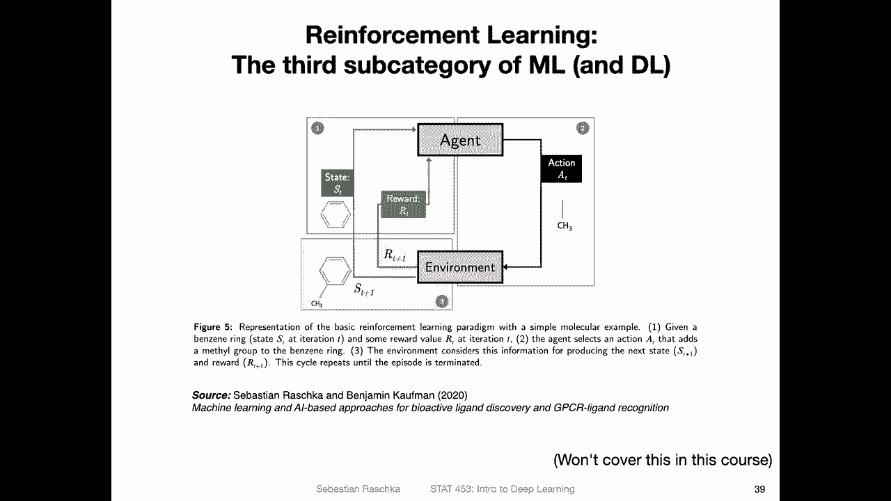

# 6：L1.3.2 - 机器学习的广泛类别第 2 部分：无监督学习 🧠

在本节课中，我们将要学习机器学习的第二个主要子类别——无监督学习。与监督学习不同，无监督学习不使用任何标签或目标值，其核心在于从数据中发现隐藏的结构或模式。

上一节我们介绍了监督学习，本节中我们来看看无监督学习。

## 📚 无监督学习概述

无监督学习不使用任何标签或目标值，因此没有明确的反馈信号。它的核心目标是发现数据中隐藏的结构。

从这个意义上讲，我们也可以将无监督学习视为**表示学习**。它有时也用于**降维**，但这并非其唯一应用。

## 🔍 降维与表示学习示例：主成分分析

以下是降维的一个经典示例。

你可能在统计学课程中听说过**主成分分析**，简称 **PCA**。它是一种线性变换技术，通过旋转数据并提取输入的线性组合来实现降维。

考虑以下示例，这里有两个特征：特征1和特征2，这些是我们的输入。图中的圆圈代表数据点在这个空间中的分布。

通过主成分分析，我们找到这个数据集的**特征向量**。我们利用这些特征向量来旋转数据，从而得到两个**主成分**，它们本质上是特征向量。

通常，我们按特征值的大小降序排列这些主成分，并保留对应较大特征值的特征向量。在本例中，第一个主成分对应的特征值大于第二个。

在实际应用中，我们可能会使用第一个主成分来获得数据的压缩表示。如果你不了解PCA的工作原理，无需担心，这只是一个无监督学习的示例。

## 🤖 另一个示例：自编码器

无监督学习的另一个例子是**自编码器**，我们将在本课程的第5部分深入讨论它。

自编码器的工作原理如下，这是一个非常简单的概念。你有一个输入数据，这是你的输入数据。然后，自编码器会产生一个输出。

自编码器由两部分组成：一个**编码器**和一个**解码器**。首先，输入的维度通常很高。然后，通过隐藏层，学习到一个维度更小的表示，我们称之为**潜在表示**或**嵌入**。

例如，你可以将图像中的每个像素视为一个特征。如果我们有一个100x100像素的图像，我们就有了10000个输入特征，这是一个非常高维的输入。然后，编码器（一个神经网络）可以将其压缩到一个更低的维度，比如10维。

接着，解码器执行相反的操作，它将低维的潜在表示作为输入，并尝试重建出高维的输出（例如原来的10000维）。**目标就是重建输入**。

那么，为什么这样做是有用的呢？关键在于这个**潜在表示**。你可以将其视为数据的压缩版本。如果解码器能够从这个低维表示中成功重建原始图像，那就意味着这个低维空间足以编码数据中的重要信息。因此，它也是一种降维技术。

实际上，如果自编码器使用线性激活函数，它与主成分分析有着密切的关系。我们将在第5部分更详细地讨论自编码器。

## 🆚 与分类任务的对比

为了更清晰地对比，我们回顾一下分类任务是如何工作的。深度学习的多数应用是关于分类的。

考虑我们有一个输入数据点，比如一张猫的图片。在训练期间，我们有一个标签（这里是“猫”），网络会输出一个概率，即该图像是猫的概率。当我们输入一个新的数据（可能是狗或猫）时，它会输出一个属于“猫”类别的概率。

**分类器**是根据已有的标签对图像进行分类。而无监督学习则完全不同，它不预测任何标签，而是学习可以用于重建输入的隐藏表示。

## 📊 无监督学习的另一示例：聚类

无监督学习的另一个例子是**聚类**。你可能之前听说过聚类，它旨在为未标记的样本分配组别成员身份。

考虑一个数据集，同样有两个特征X1和X2。这里没有任何聚类标签，我们只是根据相似性对它们进行分组。仅通过观察，你可以认为这些靠得更近的点可能属于一个簇，而那些点属于另一个簇。

在现实中，簇的边界有时并不清晰，数据也通常是高维的。聚类的核心是发现组别成员关系。

这里与分类的关键区别在于，我们不知道真实的标签。我们只能说这些点可能是一个簇，那些点是另一个簇。存在一些衡量聚类质量的内部度量标准，但我们并没有一个绝对正确的答案。

需要说明的是，聚类在本课程中不会扮演重要角色，我们不会深入讨论它，它更像是数据挖掘领域的主题。

## 📝 课程总结

本节课中我们一起学习了机器学习的第二个主要类别——无监督学习。我们了解到，无监督学习不依赖于标签，其核心目标是从数据中发现隐藏的结构或模式。

我们探讨了无监督学习的两个主要应用方向：
1.  **表示学习与降维**：例如主成分分析和自编码器，它们旨在学习数据的压缩、低维表示。
2.  **聚类**：根据相似性将数据点分组。

下一节视频，我们将简要介绍强化学习。