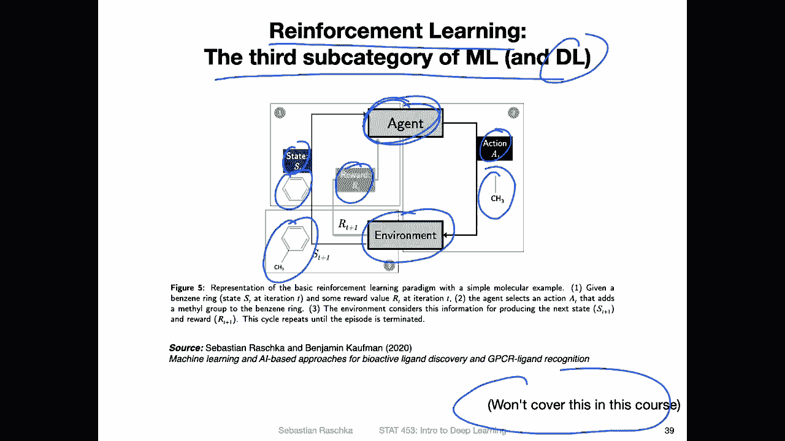
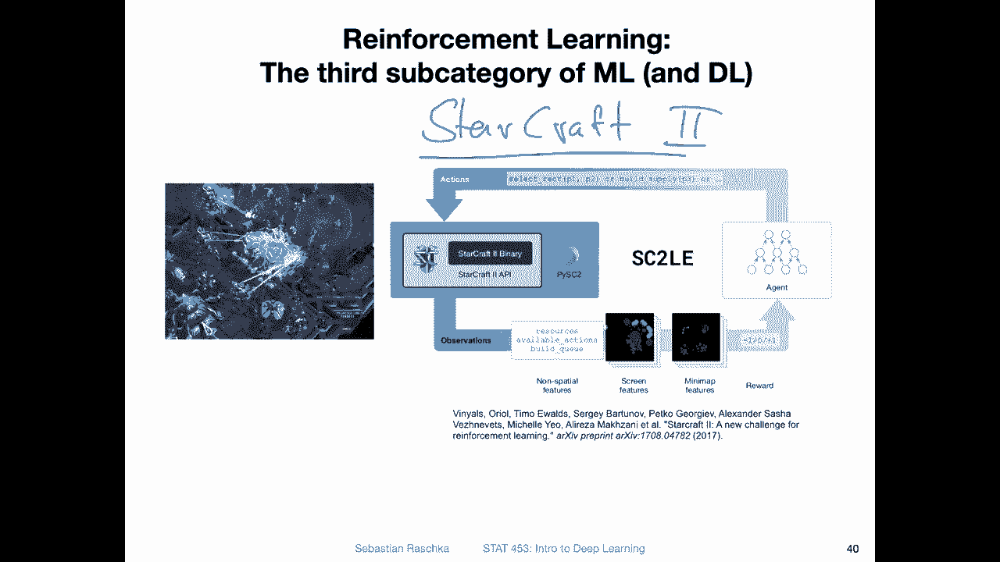

# 7：L1.3.3 - 强化学习 🎮

在本节课中，我们将要学习机器学习的第三个主要子类别：强化学习。我们将了解它的基本概念、工作原理以及一个具体的应用实例。

---

## 概述

强化学习是机器学习的一个重要分支，它关注的是智能体（Agent）如何通过与环境（Environment）的交互来学习一系列动作（Actions），以达成某个目标或最大化累积奖励（Reward）。虽然我们不会在本课程中深入探讨其技术细节，但了解其基本思想对于构建完整的机器学习知识体系很有帮助。

上一节我们介绍了监督学习和无监督学习，本节中我们来看看强化学习。

---

## 强化学习的基本概念

强化学习的核心是智能体、环境、状态、动作和奖励这几个要素的交互循环。其目标是通过学习一个策略（Policy），使得智能体在特定状态下选择的动作能获得最大的长期回报。

一个经典的强化学习循环可以表示为以下公式：

**`状态（S_t） -> 动作（A_t） -> 奖励（R_t） -> 新状态（S_{t+1}）`**

在这个循环中，智能体观察当前状态，执行一个动作，环境对此做出反应并给出一个即时奖励，同时转移到下一个状态。

---

## 工作原理：以药物设计为例

为了更好地理解，我们来看一个药物分子设计的例子。

智能体面对的环境初始状态可能是一个简单的苯环分子。智能体观察这个状态后，需要采取一个动作，例如为这个苯环添加一个甲基化学基团。

这个动作会改变环境，生成一个新的分子状态（苯环加上甲基）。同时，系统会根据这个动作的结果（例如，新分子的某种特性）给予智能体一个奖励信号。

以下是这个交互过程的关键步骤：

1.  **当前状态**：智能体观察环境，例如一个苯环结构。
2.  **采取动作**：智能体从可能的动作集合中选择一个，如“添加甲基”。
3.  **环境更新**：动作执行后，环境进入新的状态（甲基化苯环）。
4.  **获得奖励**：环境根据新状态的质量（如药物活性）给出一个奖励值。

这个过程会重复多轮，直到形成一个完整的小分子化合物。每一步的奖励（可能是零或负值）会引导智能体学习如何构建出具有理想属性的分子。

---

## 更复杂的实例：星际争霸2

一个更具体且令人印象深刻的例子是使用强化学习来玩《星际争霸2》这款复杂的即时战略游戏。

在这个环境中：
*   **状态** 是当前游戏画面所包含的所有信息（单位、资源、地图等）。
*   **动作** 是玩家在任一时刻可以执行的所有操作（建造、移动、攻击等）。
*   **奖励** 通常是延迟的，最终体现在游戏的胜利或失败上。

几年前，DeepMind公司开始研究用强化学习训练AI玩《星际争霸2》。这个游戏的复杂性极高，有大量同时发生的事件和可能的动作。令人印象深刻的是，最终开发的AI系统能够击败世界上绝大多数顶尖的人类玩家。

这个项目的终极目标并非仅仅是成为游戏高手，而是为了开发能够泛化到其他重要领域（如自动驾驶）的通用强化学习系统。

---

## 总结

本节课中我们一起学习了机器学习的第三个广泛类别——强化学习。我们了解到强化学习关注的是智能体通过与环境交互、根据获得的奖励来学习最优行动序列的范式。我们通过药物分子设计的简化例子和《星际争霸2》的复杂实例，直观地理解了其“状态-动作-奖励”的核心循环。

需要再次说明的是，强化学习本身是一个庞大而独立的领域，本课程不会深入其技术细节。但理解它的基本思想，有助于我们看清机器学习解决不同问题的全貌。