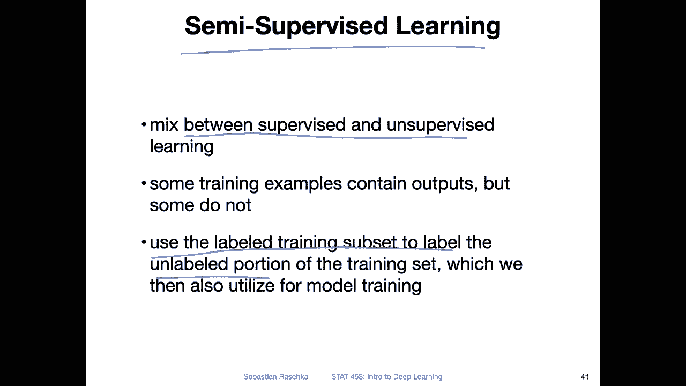
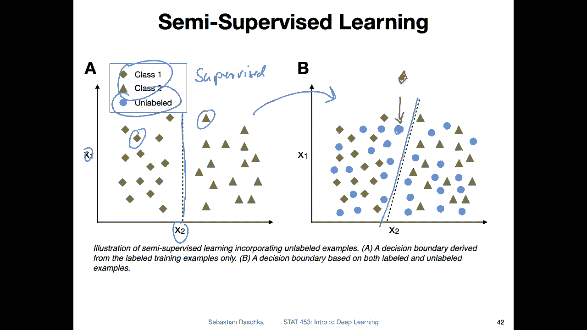
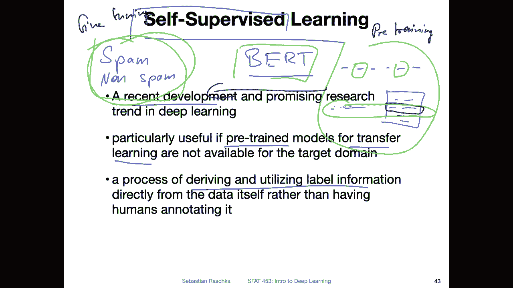
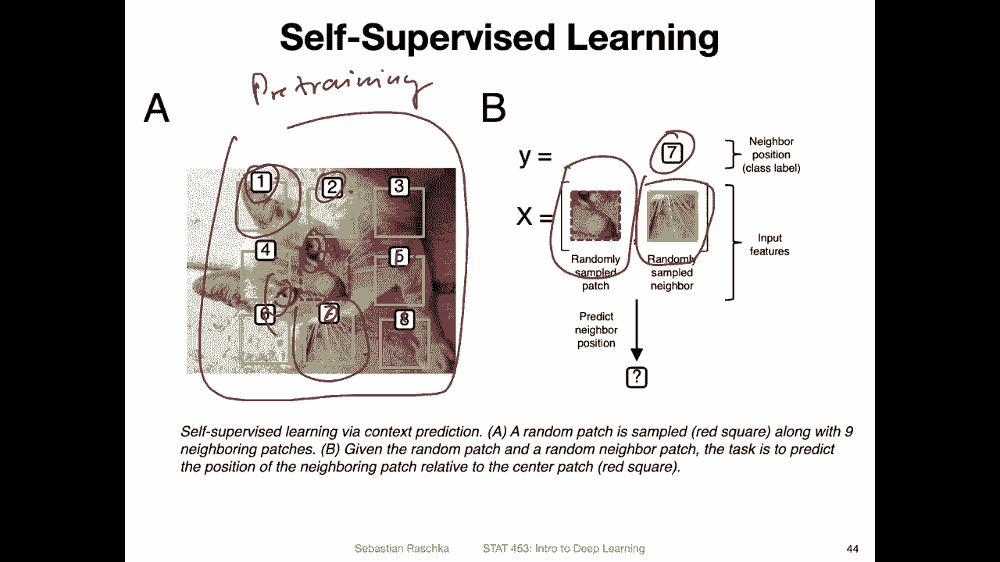
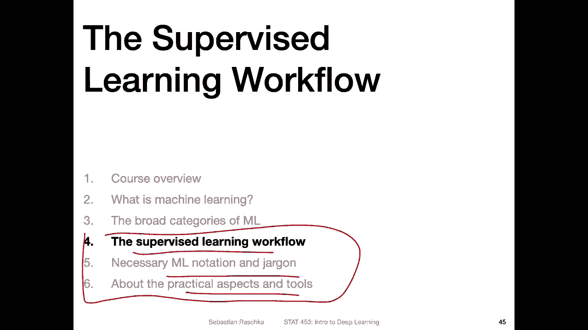

# 8：L1.3.4 - 机器学习的广泛类别第 4 部分：监督学习的特殊案例 📚

在本节课中，我们将要学习监督学习中的两个特殊案例：半监督学习和自监督学习。它们是机器学习领域非常有趣且重要的研究方向，尤其在大数据时代，为解决标注数据稀缺的问题提供了有效思路。

上一节我们介绍了机器学习的三大主要类别：监督学习、无监督学习和强化学习。本节中，我们来看看监督学习框架下的两个特殊变体。

## 🔄 半监督学习

半监督学习是监督学习和无监督学习的混合体。在这种场景下，我们拥有部分训练样本的标签，但另一部分样本没有标签。

半监督学习的核心思想是：利用已标注的训练数据子集，来为未标注部分的训练数据生成标签，从而帮助我们构建一个更好的决策边界。

以下是一个简单的图示示例：

在左侧，我们有一个严格意义上的监督学习数据集，只有两个类别（类别1和类别2）。我们据此绘制了一条决策边界。

现在，考虑一个情况：我们拥有更多数据，但这些数据是未标注的。如右侧所示，蓝色圆点代表未标注的数据点。

一个半监督学习系统在考虑了这些未标注数据点后，可能会推导出一条略有不同的决策边界。虽然类别1和类别2示例的位置没有改变，但系统可以利用这些未标注数据做出假设（例如，假设某个蓝色点属于菱形类别1），从而将决策边界调整得更像一条对角线。

即使假设不一定完全正确，我们仍然可以利用这些数据来改进系统。在这种情况下，新的决策边界可能略有不同，并且可能是一个更好的边界。

## 🤖 自监督学习

自监督学习是当前深度学习研究中一个非常热门和前沿的领域。它对于训练需要大量数据的大型模型特别有用，尤其是在我们无法获取海量标注数据的情况下。

自监督学习通常涉及在一个大型数据集上**预训练**一个模型，然后在一个较小的目标任务数据集上对其进行**微调**。这个过程有时也被称为**迁移学习**，因为我们将模型从一个任务的知识迁移到另一个任务上。

它之所以被称为“自监督”，是因为我们直接从数据本身推导或利用标签信息，而不是依赖人工进行标注。

以下是自监督学习的两个典型例子：

**1. 自然语言处理示例（如BERT模型）**

假设你想构建一个垃圾邮件分类系统，但只有10万封标注邮件，这对于一个参数众多的大型模型来说数据量不足。

你可以先在互联网的所有文本上预训练模型。如何获得这些文本的“标签”呢？你可以从数据集中自行构造标注任务。

*   **掩码语言建模**：研究人员会随机掩盖（例如15%）文本中的单词，然后让系统预测这些被掩盖的单词。这样，你就利用数据本身（被掩盖单词的正确答案）作为监督信号。
*   **下一句预测**：给系统两个句子，让它预测第二个句子是否是第一个句子的原文后续。通过从不同文档组合句子，可以自行构造这个分类任务。

通过这些任务，模型学会了理解语言。之后，你可以将这个预训练好的系统，应用到较小的垃圾邮件分类数据集上进行微调，从而完成最终的目标任务。

**2. 计算机视觉示例**

假设你想训练一个猫狗分类器，但标注数据很少。你可以利用未标注的图像进行自监督预训练。

例如，你可以将一张图像分割成9个部分（3x3网格）。然后，你拿走其中一部分（比如第9块），并向系统呈现另一部分（比如第7块），让系统预测被拿走的那个部分在原图中的位置（是位置1、位置5还是位置3？）。

你通过一个简单的Python算法进行图像分割，因此你知道所有“块”的正确位置标签。通过让模型学习拼图，它必须理解图像中物体的结构（比如猫的耳朵、眼睛的位置），从而学会识别物体。

完成这种预训练后，你就可以将网络应用到较小的目标数据集（如动物分类）上进行微调。

自监督学习是一个前沿话题，我们可能会在本课程末尾关于Transformer的部分再次简要提及。对于这门入门课程来说，它算是一个稍微进阶的主题，在此介绍是为了让你知道它的存在，或许你可以在课程项目中探索它。

## 📝 总结与预告

本节课中，我们一起学习了监督学习的两个特殊案例：**半监督学习**和**自监督学习**。它们扩展了监督学习的边界，使其在数据标注不完全或稀缺的情况下仍能有效工作。

至此，我们已经涵盖了机器学习的所有主要广泛类别。

在接下来的课程中，我们将更深入地探讨监督学习的工作流程，详细介绍训练一个监督学习系统的不同步骤。同时，我会介绍一些相关的数学符号和术语（例如如何表示训练集、损失函数等），并简要介绍我们将要使用的主要工具PyTorch。这些内容都只是概述，如果有些细节目前看起来复杂，请不要担心，我们会在后续课程中更缓慢、细致地展开讲解。

下一讲，我们将聚焦于监督学习的工作流程。

