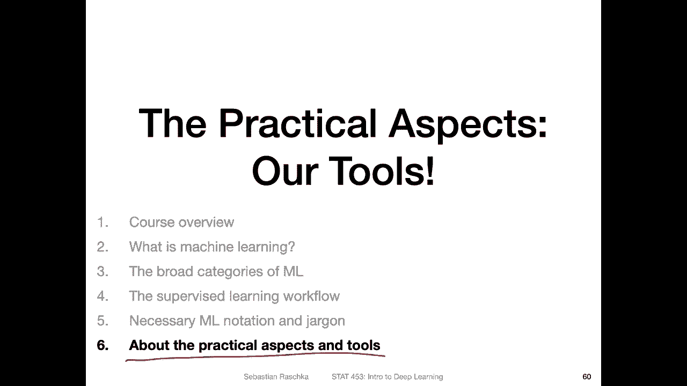

# 10：机器学习符号与专有名词教程 📚

在本节课中，我们将学习机器学习中常用的符号表示和核心专有名词。这些术语和符号是理解后续课程内容的基础，也是机器学习与深度学习社区的通用语言。

---

## 监督学习回顾 🔍

上一节我们介绍了机器学习的基本概念，本节中我们来看看监督学习的符号表示。监督学习的目标是学习一个函数，该函数能够将输入特征 **X** 映射到输出目标 **Y**。

*   **X** 代表特征（Features），也称为观测值（Observations）。它通常是一个向量，例如一朵花的萼片长度、萼片宽度、花瓣长度和花瓣宽度，或者一张图像的像素值。
*   **Y** 代表目标（Targets），即我们希望模型预测的值。

在书写时，我们使用特定符号来区分不同类型的数据：
*   标量（Scalar）：使用普通字体，如 `x`。
*   向量（Vector）：使用粗体或带箭头的字体，如 **x** 或 $\vec{x}$。
*   矩阵（Matrix）：使用大写粗体或带下划线的字体，如 **X** 或 $\underline{X}$。

---

## 结构化数据与非结构化数据 🗂️

接下来，我们区分两种主要的数据类型。

**结构化数据**通常指以表格形式组织的数据，例如数据库（SQL）、Excel 电子表格或 CSV 文件。其特点是数据有清晰的行和列。

**非结构化数据**通常指原始数据，例如图像、音频信号或文本句子。在深度学习兴起之前，处理这类数据通常需要大量的**特征工程**，即手动从原始数据中提取有意义的特征。

以下是特征工程的一个例子：
假设我们有一张人脸图像，任务是进行人脸识别。传统方法可能先提取面部的关键点（如 67 个特征点），用这些简化后的特征向量代替原始的成千上万个像素值，从而降低问题的复杂度。

```python
# 示例：使用库提取面部关键点（特征工程）
# 此代码仅为示意，并非实际可运行代码
landmarks = extract_face_landmarks(image)
# landmarks 现在是一个包含67个特征点的向量，而非所有像素
```

---

## 训练集与符号表示 📊

现在，我们来看看如何用数学符号表示一个机器学习数据集。

一个**训练集**通常记为 **D**，它由许多**训练样本**组成。每个训练样本是一对数据：特征向量和对应的目标标签。

*   **n** 代表训练集中的样本数量。
*   **m** 代表每个特征向量的维度（即特征的数量）。
*   我们使用上标括号表示样本索引，例如 $\mathbf{x}^{(i)}$ 代表第 `i` 个训练样本的特征向量。
*   我们使用下标表示特征索引，例如 $x^{(i)}_j$ 代表第 `i` 个样本的第 `j` 个特征值。

因此，整个训练集可以视为一个**设计矩阵** **X**，其形状通常为 `n × m`（n 行，m 列），每一行是一个样本的特征向量。

数据来源于某个未知的**数据生成分布**，存在一个未知函数 $f$ 将特征映射到真实标签。机器学习模型的目标就是学习一个假设函数 $h$（或称模型），来近似这个未知函数 $f$。模型的预测输出记为 $\hat{y}$。

---

## 分类与回归任务 🎯

根据输出类型的不同，监督学习主要分为两类任务：

在**分类**任务中，模型将 M 维特征向量映射到 K 个离散的类别标签之一。例如，鸢尾花数据集（Iris Dataset）就是将花的四个特征映射到三个品种之一。

模型函数表示为：$h: \mathbb{R}^m \rightarrow \{c_1, c_2, ..., c_k\}$

在**回归**任务中，模型将 M 维特征向量映射到一个连续的实数值。

模型函数表示为：$h: \mathbb{R}^m \rightarrow \mathbb{R}$

---

## 图像数据的处理 🖼️

图像是非结构化数据，但我们可以将其转换为结构化形式以供某些模型使用。例如，一张 28x28 的灰度图像可以按行展开，拼接成一个长度为 784 的像素值向量。

原始图像（矩阵）: `shape = (28, 28)`
展开后的特征向量: `shape = (784,)`

然而，在深度学习中，更常见的做法是直接以张量形式处理图像。例如，在卷积神经网络中，一批图像通常被表示为四维张量，其维度为 `(批量大小 N, 通道数 C, 高度 H, 宽度 W)`。对于黑白图像，通道数 C 为 1。

---

## 核心术语对照表 📖

最后，我们整理一份机器学习常用术语的同义词表，以帮助大家理解不同语境下的表述。

以下是模型训练相关术语：
*   训练模型 = 拟合模型 = 参数化模型 = 从数据中学习

以下是单个数据点相关术语：
*   训练样本 = 训练记录 = 训练实例 = 训练样例（为避免歧义，推荐使用“训练样本”指代单个数据点）

以下是输入数据相关术语：
*   特征 = 观测值 = 预测变量 = 自变量 = 输入 = 属性 = 协变量（在机器学习中，“特征”最常用）

以下是真实值相关术语：
*   目标 = 真实值 = 输出 = 响应变量 = 因变量（分类任务中常称为“类别标签”或“标签”）

以下是模型输出相关术语：
*   输出 = 预测值（这是模型的产物，应与“目标”区分开）

---

## 总结 ✨




本节课中我们一起学习了机器学习的基础符号和核心专有名词。我们明确了监督学习中特征 **X** 与目标 **Y** 的表示方法，区分了结构化与非结构化数据，介绍了训练集、设计矩阵的符号体系，并梳理了分类、回归任务以及图像数据处理的基本概念。最后，我们汇总了常见的术语同义词，为后续课程的学习打下了坚实的语言基础。