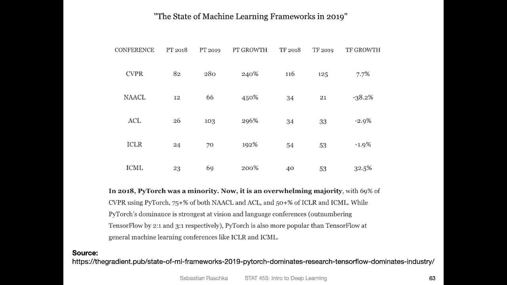
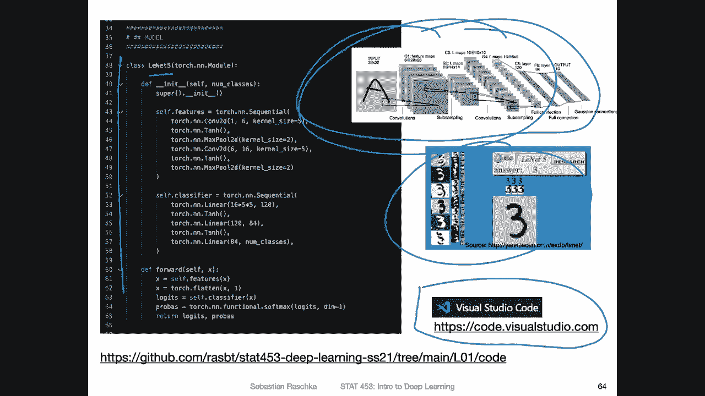
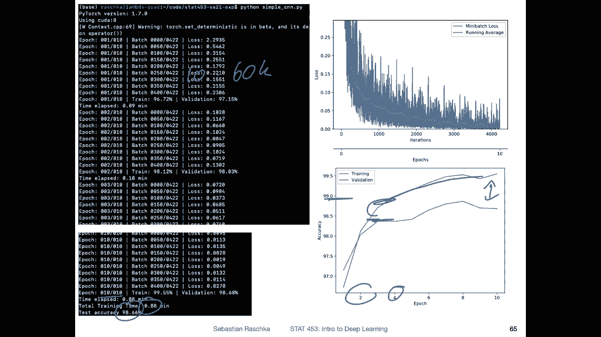
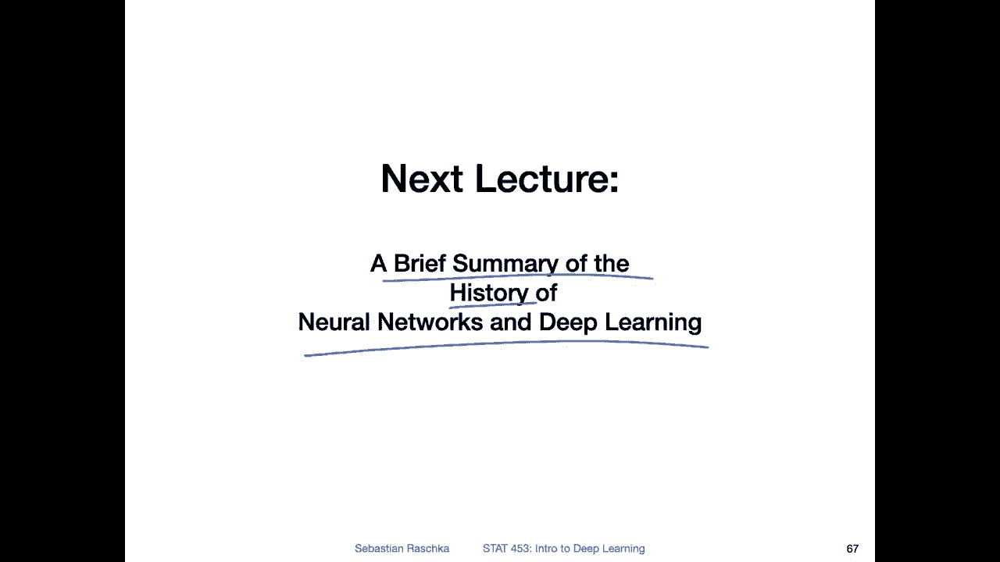

# 11：L1.6 - 实践工具与环境介绍 🛠️

在本节课中，我们将介绍本课程将使用的编程语言、核心库以及开发工具。我们将重点了解Python科学计算生态系统，并解释为何选择PyTorch作为主要的深度学习框架。

## Python科学计算生态系统

上一节我们概述了课程的整体结构，本节中我们来看看实践环节将使用的具体工具。正如你所猜测的，我们将主要使用Python作为编程语言。

以下是Jake VanderPlas在2015年绘制的图表，它清晰地展示了Python科学计算生态系统的不同层次：



*   **基础层**：Python语言本身，是所有上层库的基础。
*   **核心计算库**：例如`IPython`交互式计算环境、`NumPy`线性代数库。
*   **科学计算扩展**：`SciPy`在NumPy基础上提供了更多科学计算算法。
*   **数据操作与可视化**：`pandas`是数据处理库，`Matplotlib`是可视化库。
*   **交互式笔记本**：`Jupyter`生态系统提供了Jupyter Notebook。
*   **机器学习库**：`scikit-learn`是传统机器学习库，`MLxtend`是其功能扩展库。

需要说明的是，`scikit-learn`和`MLxtend`是我们在另一门课程（统计451）中使用过的库，但**本课程几乎不会使用它们**。本课程将专注于深度学习，而非传统机器学习，因此两门课程的重叠度极低。

## 本课程核心工具

在了解了整个生态系统后，我们聚焦到本课程将主要使用的工具。

在本课程中，我们将主要使用 **Python** 和 **PyTorch**。PyTorch是一个构建在Python之上的深度学习库。我们当然也会少量使用`NumPy`进行基础计算（特别是在下节课用于平缓入门），并在需要时使用`Matplotlib`进行可视化。但课程的核心将真正聚焦于PyTorch。

### 关于Jupyter Notebook

我个人非常喜欢Jupyter Notebook，并经常将其用于数据分析。然而，根据我的经验，在处理深度学习代码时，我最近开始更倾向于使用常规的Python脚本文件。

这主要有几个原因：深度学习代码有时较为冗长且运行耗时，有时需要在不同计算机上通过终端运行。在某些方面，脚本文件处理起来更方便。此外，在脚本编辑器或集成开发环境（IDE）中有更好的代码提示和高亮功能，调试代码也更容易。我稍后会再对此进行说明。

### 为何选择PyTorch？

接下来，我们解释一下选择PyTorch作为教学框架的原因。

我个人的使用历史如下：大约在2013-2014年，我开始使用名为`Theano`的库进行深度学习。2015年，谷歌发布了`TensorFlow`，我也开始像其他人一样使用它，并在过去几年中大量使用。

然而在2017年，`PyTorch`问世，它让许多事情变得方便得多。我个人感觉这个库更有条理，它支持动态计算图，并且更接近NumPy的风格。如今，PyTorch和TensorFlow的功能已经非常相似，都支持静态和动态图。但在2017-2019年间，从个人角度看，PyTorch比TensorFlow友好得多。

深度学习社区也非常青睐PyTorch。从下图的可视化数据可以看出，在2017年至2019年期间，各大顶级机器学习和深度学习会议上，PyTorch的使用量（图中实线）呈现出急剧增长，而TensorFlow的增长则相对平缓甚至有所下降。



因此，许多人最近都转向了PyTorch。当你阅读新论文并在GitHub上寻找代码时，现在最常找到的也是PyTorch实现（当然也常有TensorFlow代码）。PyTorch已经变得非常流行。

一个库的流行性很重要，因为如果你想实现更复杂的模型，会更容易找到教程、示例代码或论文对应的实现。对于本课程，我仍然认为PyTorch比TensorFlow更有条理、更易用，它更类似NumPy，学习曲线相对平缓，相信你会欣赏这一点。

## 开发环境建议


在介绍了核心库之后，我们来看看编写代码的环境。

正如之前提到的，对于深度学习，我如今更倾向于使用文本编辑器或IDE。原因在于，例如，如果我在这里打错字，编辑器会将其标出，并且提供了更多便捷功能。深度学习代码有时很长，我发现在文本编辑器中开发代码更为容易。

我仍然大量使用Jupyter Notebook，例如今天就在处理一篇论文的可视化工作。对于数据分析这类任务，Jupyter Notebook确实非常出色。但对于编写网络结构等较长的代码，我个人觉得文本编辑器更方便。

我推荐使用诸如 **Visual Studio Code** 这样的文本编辑器。它免费、快速，并支持Windows、Linux和macOS等所有主流操作系统。它对Python有很好的支持，包括调试等功能。

## 一个简单的PyTorch示例

为了让你对PyTorch代码有一个直观感受，这里有一个简短的示例。

我实现了一个之前提到过的**LeNet-5**网络。在PyTorch中，实现这个相当复杂的卷积网络实际上只需要几行代码。当然，训练模型还需要更多代码，但其实并不复杂。在本课程后续，我们将逐步详细讲解。现在你无需理解其工作原理，我只想展示代码其实并不复杂。

```python
# 这是一个简化的LeNet-5模型结构示例
import torch.nn as nn


class LeNet5(nn.Module):
    def __init__(self):
        super(LeNet5, self).__init__()
        self.conv1 = nn.Conv2d(1, 6, 5)
        self.pool = nn.AvgPool2d(2, 2)
        self.conv2 = nn.Conv2d(6, 16, 5)
        self.fc1 = nn.Linear(16 * 4 * 4, 120)
        self.fc2 = nn.Linear(120, 84)
        self.fc3 = nn.Linear(84, 10)

    def forward(self, x):
        x = self.pool(torch.relu(self.conv1(x)))
        x = self.pool(torch.relu(self.conv2(x)))
        x = x.view(-1, 16 * 4 * 4)
        x = torch.relu(self.fc1(x))
        x = torch.relu(self.fc2(x))
        x = self.fc3(x)
        return x
```

运行这段代码（在配备GPU的计算机上），对包含60,000张图像的训练集进行10轮（epoch）训练，耗时不到一分钟，速度非常快。训练后，模型在验证集上可以达到接近99%的准确率。



你可以看到，甚至在第二轮或第四轮训练后，准确率就已经接近99%，这令人印象深刻。图中也能看到验证集和训练集准确率之间存在差距，这暗示了过拟合现象，我们后续也会详细讨论。这只是深度学习工作方式的一个快速演示。


## 课程资料与总结



如果本节介绍中仍有不清楚的地方，请不要过于担心，这只是一个概述。我注意到我在此处或彼处涉及了太多细节。

我实际上为此撰写了一篇博客文章，因为我计划基于我的讲义编写一本小教科书（这是一个进行中的项目）。无论如何，我已将第一章作为博客文章上传，你可以阅读我所讲述内容的所有书面形式。

对于那些只对传统机器学习概述感兴趣的人，可以找到451课程的讲义。当然，你不必阅读它。另外，也许有帮助的是我的《Python机器学习》书籍的**第一章**，它可以说是这篇博客文章的较短版本，是从不同角度撰写的，是我很久以前写的东西。

本节课中我们一起学习了本课程将使用的核心编程语言Python、深度学习框架PyTorch，以及推荐的开发环境。我们了解了选择PyTorch的原因，并通过一个简单示例感受了其代码风格。


在下一讲中，我们将回顾神经网络与深度学习的简史，概述其令人兴奋之处，并介绍主要的网络架构。这将为你提供整个学期将要涵盖主题的全景概览。