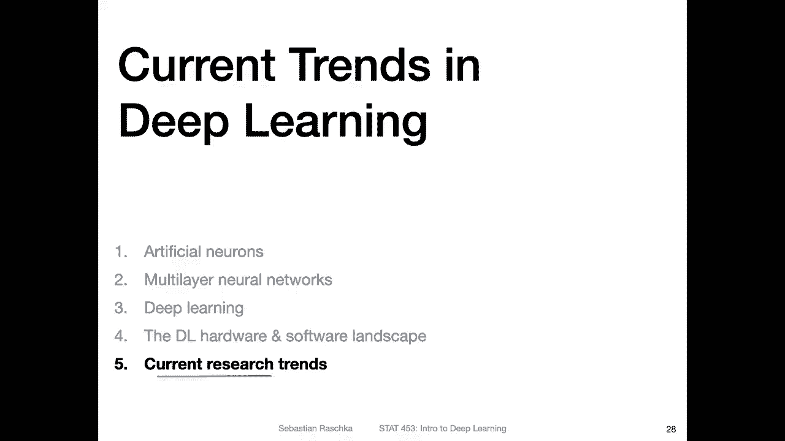
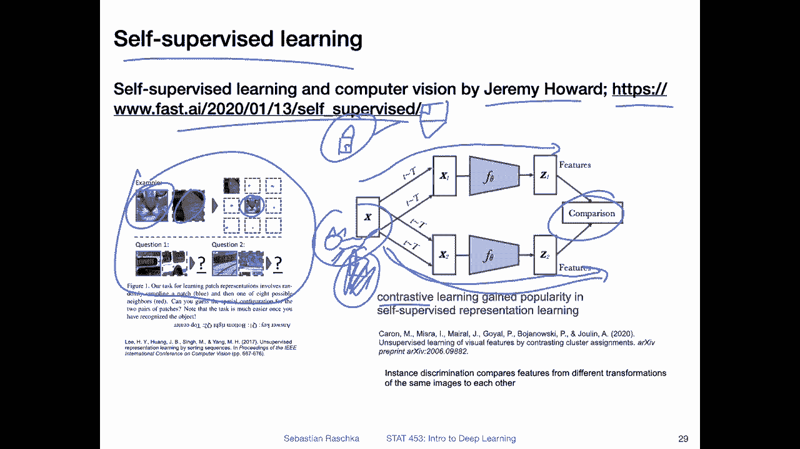
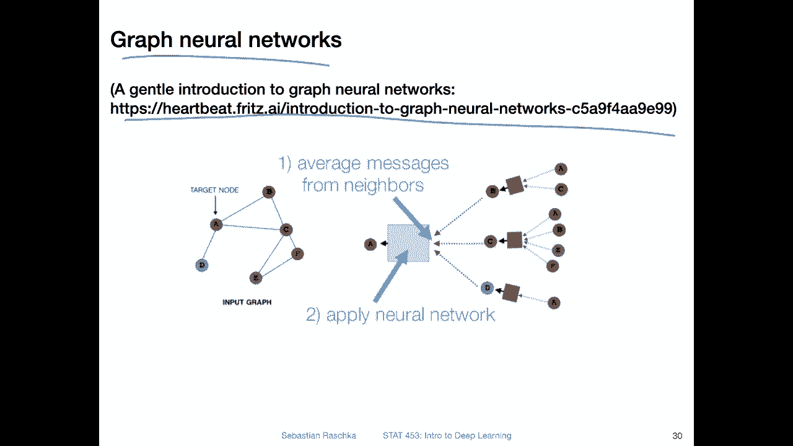
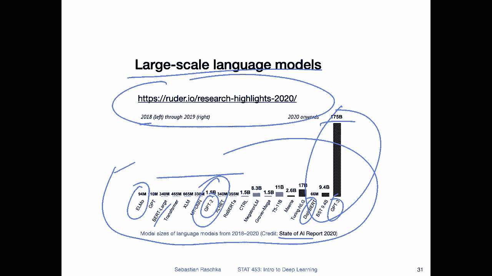
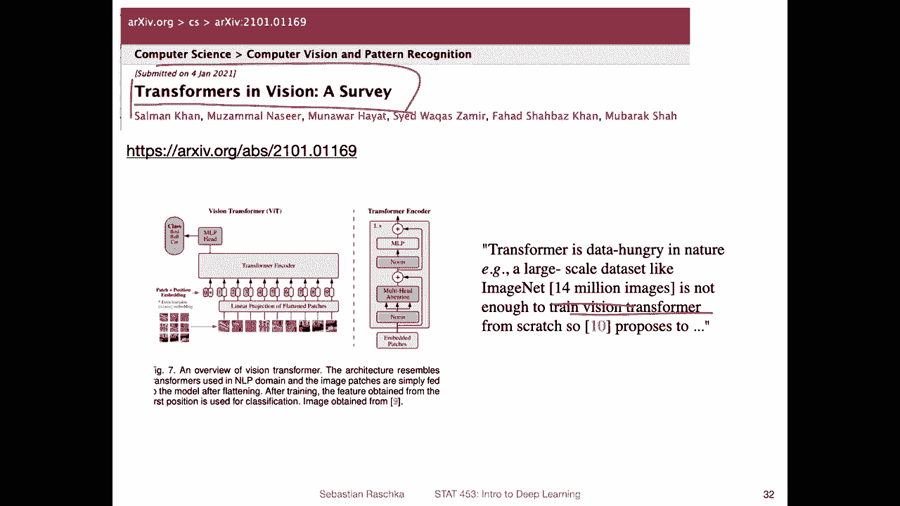
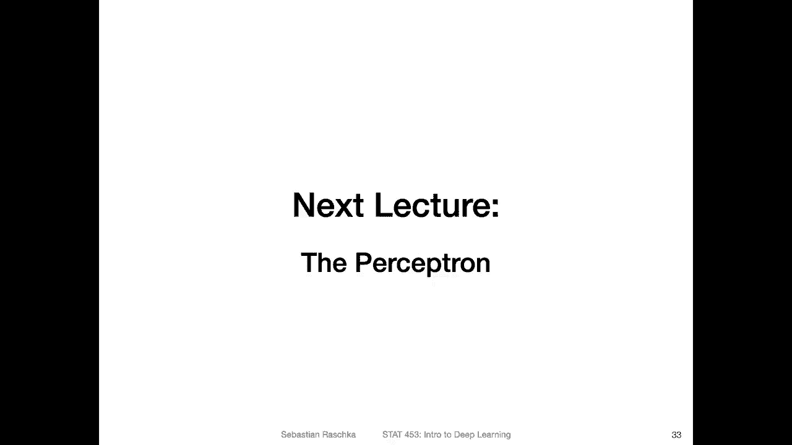
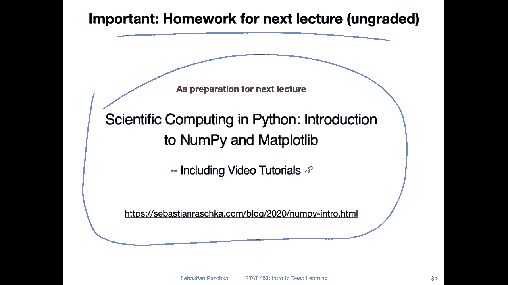

# 18：L2.5 - 深度学习的当前趋势 📈

在本节课中，我们将简要了解深度学习领域近年来的主要研究趋势。这些趋势代表了该领域最前沿的发展方向，虽然部分内容超出了本课程的核心范围，但了解它们有助于你把握深度学习的未来脉络。

上一节我们回顾了深度学习的发展简史，本节中我们来看看当前最受关注的一些研究方向。

## 自监督学习 🤖

自监督学习在过去几年变得非常流行。上一讲我简要解释了自监督学习的工作原理。本质上，它是关于利用**未标记数据**，通过创建一些**人工标签**，然后将其用于监督学习。这主要适用于那些没有目标任务标签的数据集。

以下是自监督学习的常见思路：
*   将图像分割成独立部分，然后预测图像的相邻部分。
*   例如，如果你有猫的脸部图像，这里有一只耳朵，你只向网络展示脸部，网络应该预测耳朵的位置（是在左上角、右上角等等）。
*   通过这种方式，你教会网络更好地理解猫等物体的结构。

## 对比学习 🔄

我去年看到的另一个趋势是对比学习。这是自监督学习的一种形式，其核心思想是生成同一图像的两个版本。

其基本流程如下：
1.  假设你有一张房子的图像。
2.  你将原始图像输入网络。
3.  然后，你创建同一张房子的增强版本（例如，将其旋转180度），并将这个增强版本也输入同一个网络。
4.  网络需要预测这两个输入是否属于同一个物体。

通过这种方式，你训练网络识别出这个倒置的房子确实是同一个物体。反之，如果你输入一张猫的图像，网络应该预测这是不同的物体。这样，你就在训练网络更好地识别物体。

请注意，这里你不需要类别标签。你只是通过**数据增强**（如旋转）来自己创建标签。因为你知道旋转后的图像仍然是同一栋房子，所以你无需人工标注就能免费获得这些标签。当然，这通常不是最终目标任务，但它对于在目标数据集上微调网络之前的**预训练**阶段非常有帮助，通常能使网络性能更好。

不过，这超出了本课程的范围，属于更高级或更近期的主题。我们不会在本课程中使用它。如果你感兴趣，Jeremy Howard 有一篇非常友好的入门文章，你可以从中了解更多关于自监督学习的知识。当然，你也可以在课程项目中尝试使用它。

## 图神经网络 🕸️

另一个近期的研究趋势是关注用于图结构数据的**图神经网络**。传统上，深度学习主要关注文本和图像数据。如今，如果数据是图结构（例如，我研究的小分子结构），人们也开始使用图神经网络。你可以将原子视为节点，共价键视为边，从而将其建模为图神经网络。

这是一个很大的主题，同样超出了本课程的范围。但我发现了一篇不错的图神经网络入门介绍，如果你感兴趣可以阅读。它涉及许多论文，我不想特别推荐某一篇，但这篇介绍对初学者比较友好，主要与**消息传递**机制相关。

## 大规模语言模型 📚

同样，一个近期的趋势是大规模语言模型的研究。这大约始于2018年，当时人们训练了具有9400万个参数的模型，然后不断扩展规模。你可能听说过GPT-2（我认为是2019年），现在有GPT-3，拥有1750亿个参数。语言模型变得越来越大。当然，也有一些研究致力于保持模型的小型化，例如DistilBERT，它是BERT的一个小型版本。但总体趋势是朝着更大的模型发展。

当然，这对于大多数学术研究者来说是遥不可及的。这通常是大公司才能做的事情。我记得训练这样一个模型的成本高达数十万美元甚至更多。所以，这通常只有在大公司工作才能实现。

这里有一篇有趣的博客文章，总结了2020年以自然语言处理为主的研究亮点。如果你对这些大规模语言模型感兴趣，这会是一篇不错的读物。实际上，在本课程后期讨论**Transformer模型**时，我们会涉及其中一些模型，因为它们都基于Transformer架构。

## 视觉Transformer 👁️

另一个趋势是视觉领域的Transformer。人们现在也开始将Transformer架构应用于计算机视觉。然而，这同样需要非常大的规模。例如，有论文指出，即使是像ImageNet这样包含1400万张图像的数据集，也不足以训练一个视觉Transformer。因此，这主要也是学术研究难以企及的。

这些Transformer模型可能在非常庞大的数据集（例如5亿张图像）上表现非常好。然而，对于大多数应用场景，**卷积神经网络**目前仍然优于它们。实际上，卷积神经网络最近也有新的架构出现。因此，卷积神经网络仍然是计算机视觉领域的**主流选择**，是实践中你会使用的东西。视觉Transformer目前还处于非常实验性的阶段，在常见图像任务上还远未达到与卷积网络竞争的水平。但我认为指出这个发展方向是有趣且值得的。

---

好了，在下一讲中，我们将更详细地讨论感知机算法，并在课堂上提供一些代码示例。上周我提到代码示例可能会稍后提供，但我认为尽早介绍它们可能真的很有用。

我有一个不计分的家庭作业练习给你。你不需要提交任何东西，这只是为你自己准备的预习材料。我已经在Canvas上发布了这个练习，但请务必看一下，作为接下来课程的准备。这是一个关于NumPy和线性代数的介绍。当然，作业或考试中不会有任何专门关于NumPy的问题，但它将真正帮助你理解PyTorch的工作原理以及我们如何实现代码，因为线性代数是其基础。

如果你对此有任何疑问，请告诉我。这只是一个关于NumPy的简要回顾。如果你已经熟悉NumPy，也可以跳过。但我建议你看一下，看看是否对你有意义。如果全是新内容，你可能需要更仔细地阅读。

那么，如果你有任何问题请告诉我。下周四的课程将是关于感知机的。

---

本节课中，我们一起学习了深度学习的几个当前趋势：**自监督学习**、**对比学习**、**图神经网络**、**大规模语言模型**以及**视觉Transformer**。了解这些趋势有助于你把握领域前沿，虽然其中部分内容超出了本课程的核心，但为未来的深入学习奠定了基础。下一讲，我们将回归课程核心，深入探讨感知机算法。