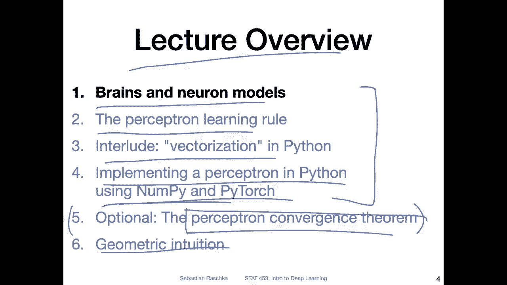
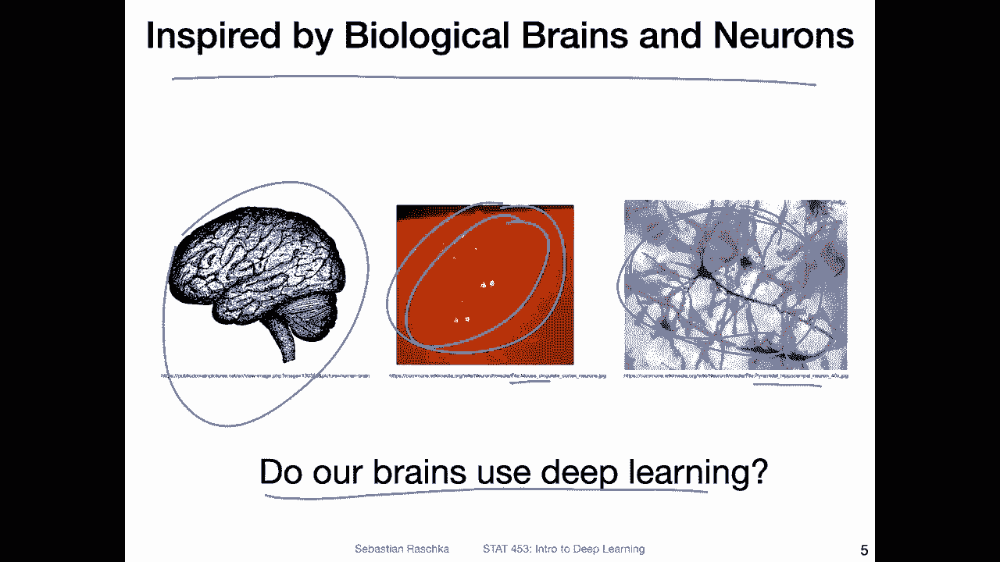
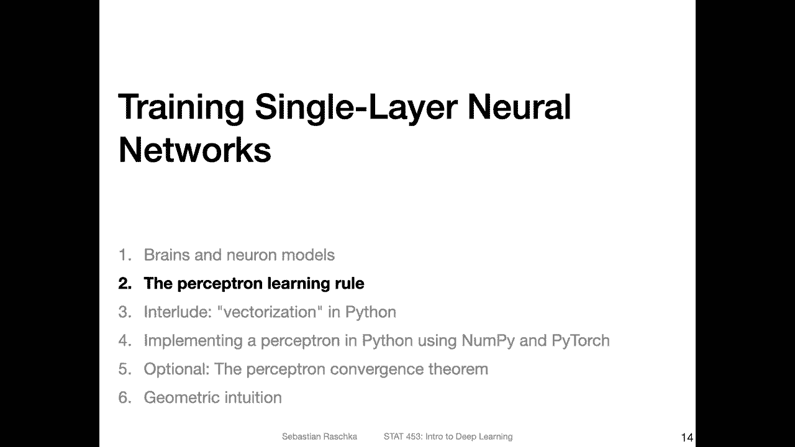

# 20：L3.1 - 关于大脑和神经元 🧠

## 概述

在本节课中，我们将要学习大脑和神经元模型的基本概念，为后续理解感知机学习规则打下基础。我们会从生物神经元的结构入手，介绍其计算模型，并探讨人工神经网络与生物大脑之间的异同。

## 大脑与神经元模型

上一节我们回顾了深度学习的历史，了解到其灵感来源于生物大脑和神经元的工作原理。

以下是一张大脑的图片，放大后可以看到其中的一些神经元。这张图实际上取自维基百科上老鼠的大脑，展示了一种特定类型的神经元——海马体锥体神经元。大脑中存在许多不同类型的神经元，这只是其中一种。

一个常见的问题是：我们的大脑是否真的在使用深度学习算法？目前我们无法完全确定地回答这个问题，因为人类对大脑的具体工作机制仍有许多未知和未解之谜。然而，我们可以相对肯定地说，可能并非如此。大脑非常复杂，深度学习虽然在物体检测等特定任务上表现良好，但人脑的能力与神经网络的能力仍有很大差异。我们尚未实现通用人工智能，这可能表明深度学习的工作方式有所不同。

回顾上一讲中提到的由Geoffrey Hinton等人发表的论文，其核心观点是大脑可能使用一种与反向传播相关的算法，但这一点也尚未完全明确。不过，大脑是否进行深度学习其实并不那么重要，因为深度学习对于我们关心的某些任务（如图像分类）已经相当高效。

这类似于飞机与鸟类的类比。人们受鸟类飞行的启发制造了第一架飞机，但精确模仿鸟类（例如让飞机扇动翅膀）并非必要，甚至可能效率更低。因此，有时将某物作为灵感来源，并在此基础上发展出不同的、有用的东西就足够了。

出于兴趣，我们查阅了维基百科上关于神经元数量的数据。人脑大约有160亿到340亿个神经元，而虎鲸则有430亿个。如果仅凭神经元数量决定智能，那么虎鲸可能比人类更聪明，但这显然不是事实。同样，回顾深度学习历史讲座中提到的大规模语言模型（如GPT-3），其参数量可能达到1700亿或800亿。如果将一个参数视为一个神经元，这些模型在计算规模上甚至超过了人脑，但它们并不具备人脑的理解能力。它们擅长记忆从互联网摄取的大量信息，而人类更擅长理解。这表明，差异不仅仅在于参数数量，还有其他尚未被发现的因素。

在本讲中，我们实际上不讨论深度神经网络，而是从简单的单层神经网络或单个神经元模型开始，即生物神经元的计算模型。

## 生物神经元与McCulloch-Pitts模型

本节中，我们来具体看看生物神经元的结构及其最早的数学模型。

生物神经元是一种神经细胞。它包含细胞核（处理信号）、树突（接收其他神经元输入的连接）以及轴突（传输信号）。信号从树突传入，在细胞核处进行整合处理，如果神经元被激活，信号则通过轴突末梢传递到其他神经元的树突。

最早的数学模型是我们在历史课中讨论过的McCulloch-Pitts模型。以下是其大致结构：

*   **输入 (x):** 模型的输入信号。
*   **权重 (w):** 与每个输入相关联的参数。
*   **加权和 (z):** 在“细胞核”处，对所有输入进行加权求和。在深度学习中，我们通常称此值为预激活值，用字母 **z** 表示，有时也称为净输入。
    *   **公式:** `z = w1*x1 + w2*x2 + ... + wm*xm`
*   **阈值函数:** 将加权和 **z** 与一个阈值进行比较，并输出一个二进制信号（0或1）。如果 **z** 超过阈值，则输出1（传输信号）；否则输出0（不传输信号）。

以下是使用该模型实现逻辑门电路的例子：

**与门 (AND Gate):**
*   设置所有权重为1，阈值为1.5。
*   计算加权和 `z = x1 + x2`。
*   仅当 `x1` 和 `x2` 均为1时，`z=2 > 1.5`，输出1；其他情况输出0。

**或门 (OR Gate):**
*   设置所有权重为1，阈值为0.5。
*   计算加权和 `z = x1 + x2`。
*   只要 `x1` 或 `x2` 中有一个为1，`z` 就至少为1，大于0.5，因此输出1；仅当两者均为0时输出0。

你还可以实现非门（NOT Gate）。作为一个课后练习，请尝试思考：能否找到一组权重和一个阈值，使这个简单的McCulloch-Pitts模型实现**异或门（XOR Gate）**的功能？你可以稍后在课程论坛上分享或验证你的想法。

## 过渡到感知机

以上是对神经元模型的简要介绍。接下来，我们将进入本节课的核心部分，详细讨论**感知机模型及其学习规则**。

## 总结

本节课我们一起学习了生物神经元的基本结构及其最早的数学模型——McCulloch-Pitts模型。我们了解到，虽然深度学习受大脑启发，但两者的工作机制并不完全相同。我们从简单的神经元计算模型出发，看到了如何通过加权和与阈值函数实现基本的逻辑运算，为下一讲深入学习感知机模型做好了准备。