# 21：L3.2- 感知器学习规则 🧠

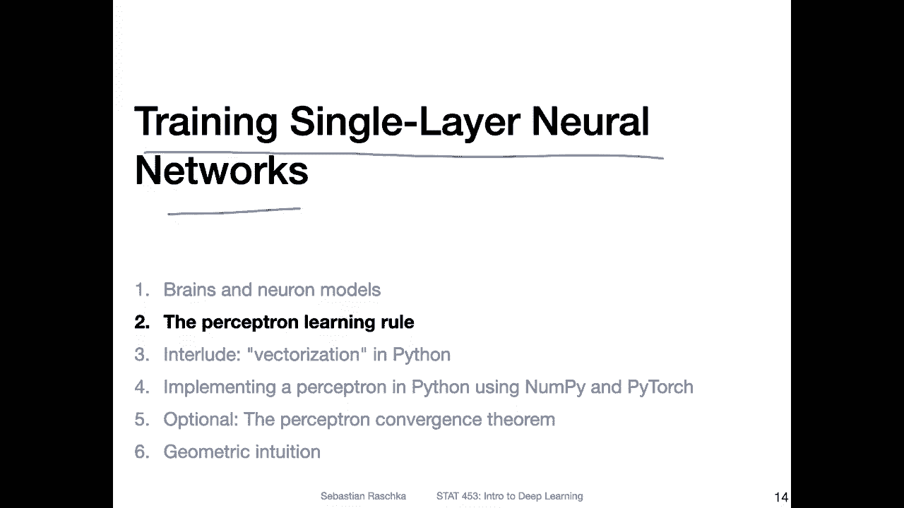

在本节课中，我们将要学习如何训练单层神经网络，特别是感知器学习规则。我们将从感知器的基本模型开始，逐步理解其工作原理、数学表示以及如何通过算法自动学习权重，以解决分类问题。

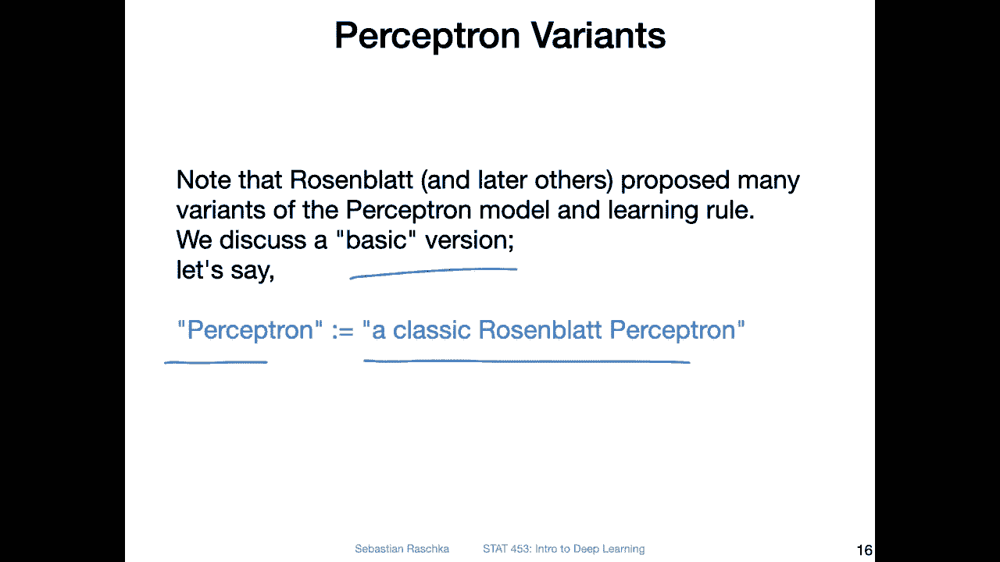

---

## 感知器模型简介 📐

上一节我们介绍了神经网络的历史背景，本节中我们来看看感知器的具体模型。感知器是一种受生物神经元启发的计算模型，由罗森布拉特提出，它提供了一种自动寻找权重的方法，用于解决分类问题。

感知器的核心是一个数学模型，它接收多个输入，计算加权和，然后通过一个阈值函数输出分类结果（0或1）。其计算过程可以用以下公式表示：

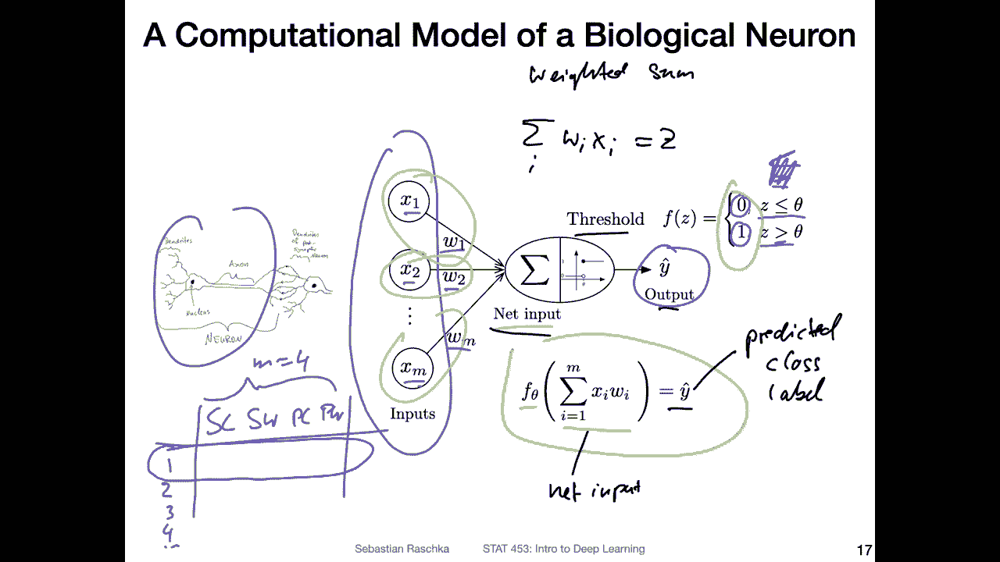

**净输入 Z**：`Z = Σ (w_i * x_i) + b`，其中 `b` 是偏置单元（即负的阈值 `-θ`）。

**输出 ŷ**：`ŷ = f(Z)`，其中 `f` 是阈值函数，当 `Z > 0` 时输出 1，否则输出 0。

在感知器中，激活函数和阈值函数是同一个函数，这是它与后续更复杂模型（如逻辑回归）的一个关键区别。

---

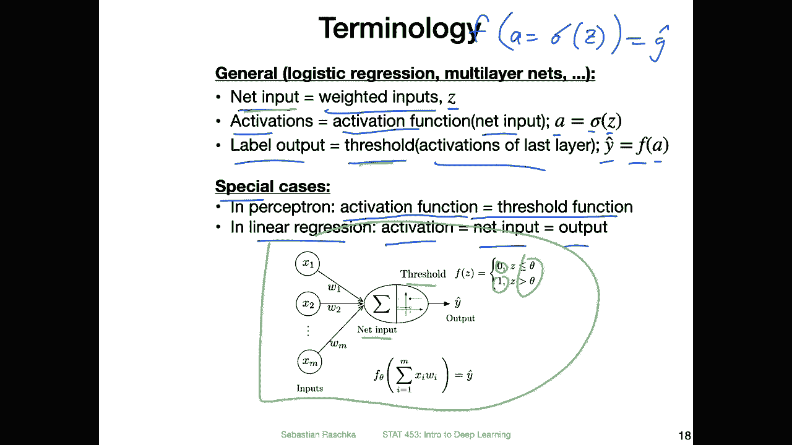

## 模型的数学表示与简化 ✨

为了使模型更便于训练和表示，我们通常会对公式进行一些调整。核心思想是将阈值 `θ` 整合进权重中，作为一个额外的偏置参数。

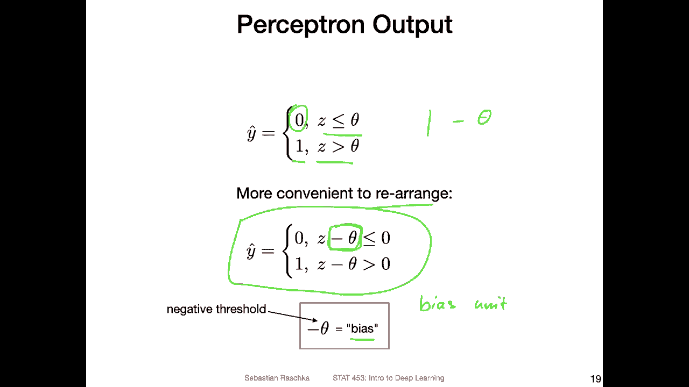

以下是两种常见的表示方法：

1.  **显式偏置表示**：`Z = Σ (w_i * x_i) + b`，其中 `b = -θ`。这是现代深度学习框架中更常见的写法。
2.  **隐式偏置表示**：通过修改输入向量，在开头增加一个恒为1的特征 `x_0`，并将偏置 `b` 视为权重 `w_0`。这样，净输入可以简洁地写成向量点积形式：`Z = w^T · x`。

虽然第二种表示在数学上更紧凑，但在实际编程中，第一种（显式偏置）通常更高效，因为它避免了为每个输入样本复制和修改数组的操作。

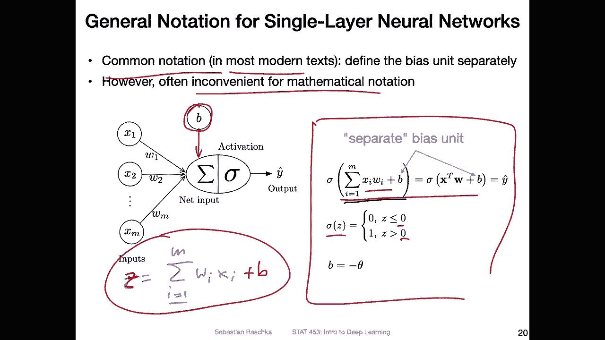

---

## 感知器学习算法 🔄

现在我们已经了解了感知器如何做出预测，本节中我们来看看它如何通过学习来自动调整权重。感知器学习规则是一个迭代算法，其目标是找到一个能够完美区分两类数据的线性决策边界（前提是数据是线性可分的）。

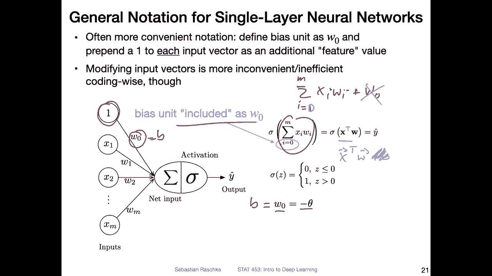

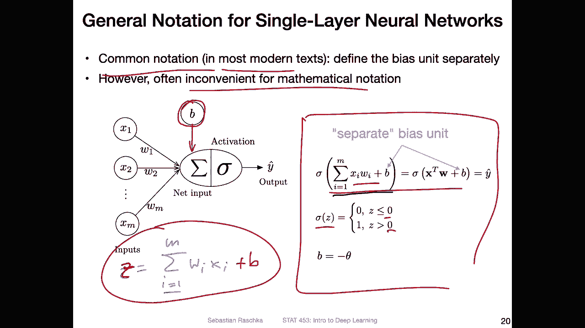

算法的核心思想是：**根据预测错误来调整权重**。

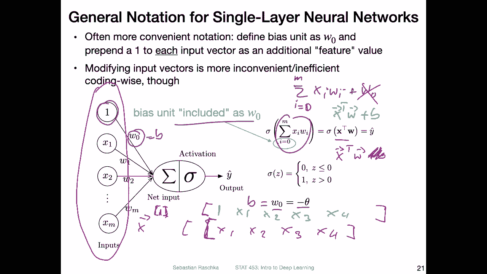

以下是感知器学习算法的步骤：

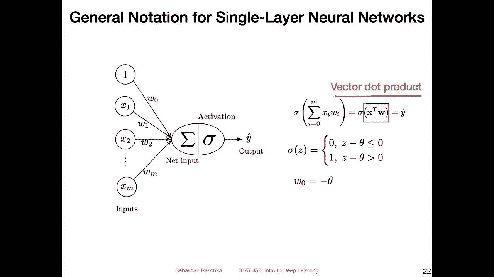

1.  **初始化权重**：将所有权重（包括偏置）初始化为0或小的随机数。
2.  **迭代训练**：对于训练集中的每一个样本 `(x_i, y_i)`，重复以下步骤：
    *   A. 计算预测输出 `ŷ_i`。
    *   B. 计算预测误差 `error = y_i - ŷ_i`。
    *   C. 根据误差更新权重：`w_new = w_old + error * x_i`。

这个更新规则非常直观：
*   如果预测正确（`error = 0`），权重保持不变。
*   如果预测为0但真实标签为1（`error = 1`），则将输入向量 `x_i` 加到权重上，使决策边界向该样本移动。
*   如果预测为1但真实标签为0（`error = -1`），则从权重中减去输入向量 `x_i`。

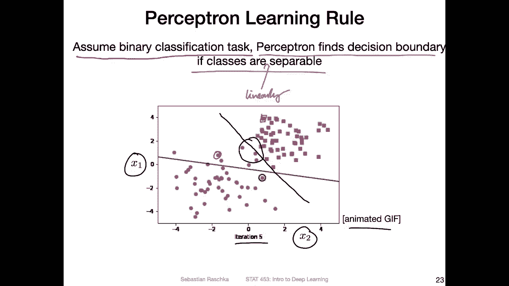

通过在整个数据集上多次迭代（多个轮次），权重会不断调整，直到所有样本都被正确分类或达到最大迭代次数。

---

## 算法特性与局限性 ⚠️

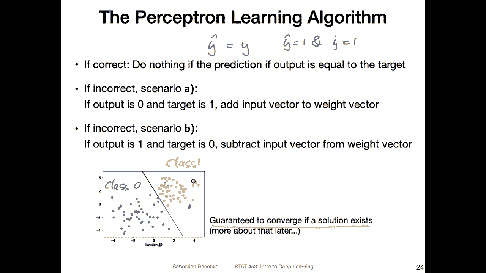

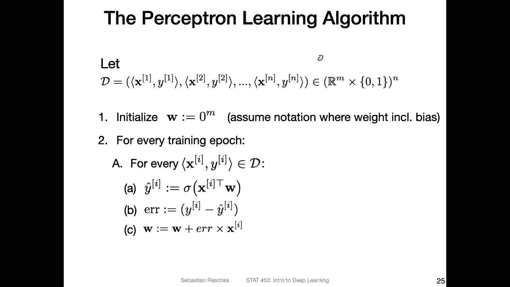

感知器学习算法具有一个重要的理论保证：**如果训练数据是线性可分的，那么该算法保证能在有限步内收敛**，找到一个完美的分类超平面。

然而，它也有明显的局限性：
1.  **仅适用于线性可分问题**：如果数据不是线性可分的（这在现实世界中很常见），感知器将无法收敛，权重会持续振荡。
2.  **仅支持二分类**：标准的感知器只能输出0或1，无法直接处理多分类问题。
3.  **对学习顺序敏感**：由于它一次处理一个样本，样本的呈现顺序会影响最终得到的决策边界。

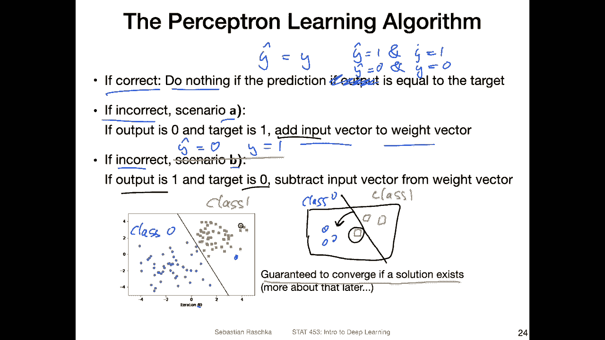

这些局限性促使了后续更强大算法的发展，例如支持向量机（SVM）和可以处理非线性问题的多层神经网络。

---

## 总结 📝

本节课中我们一起学习了感知器学习规则。我们从感知器的生物灵感出发，理解了其作为单层神经网络的数学模型。我们学习了如何通过整合偏置项来简化模型表示，并深入探讨了感知器学习算法的核心步骤：初始化、预测、计算误差和更新权重。

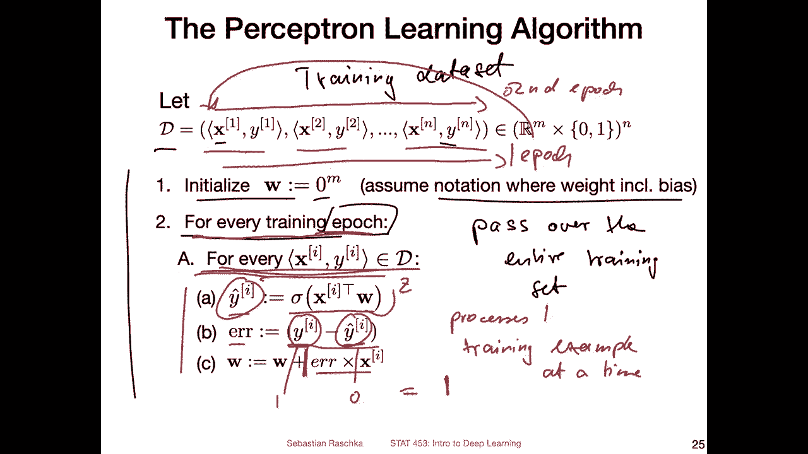

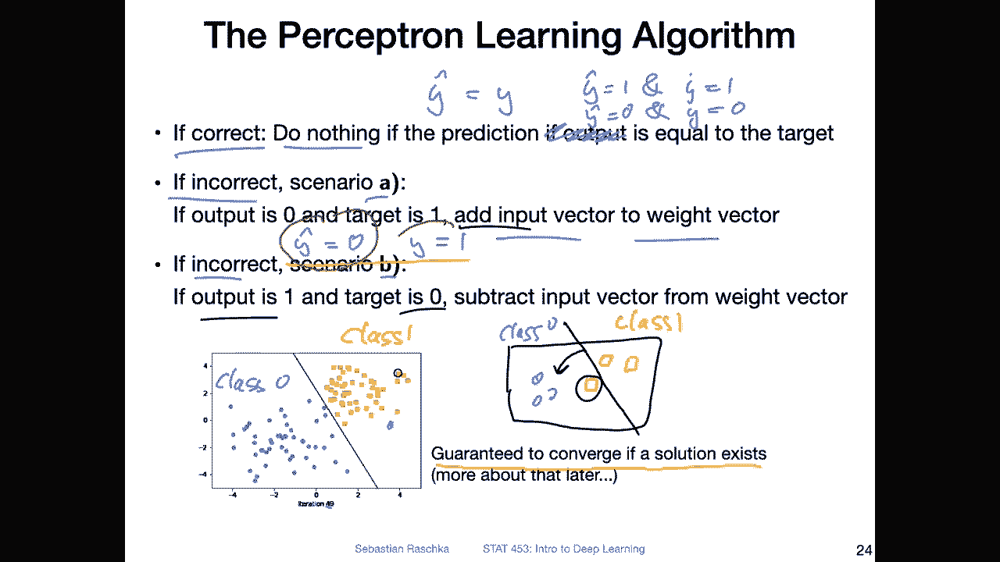

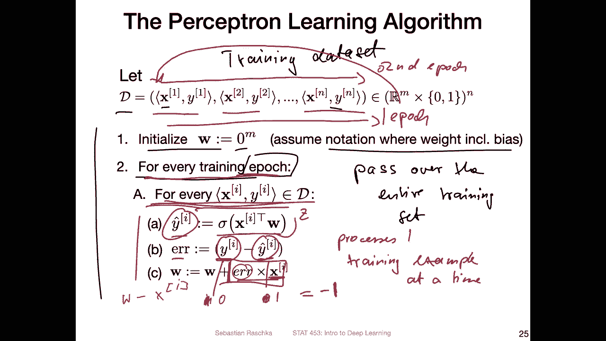

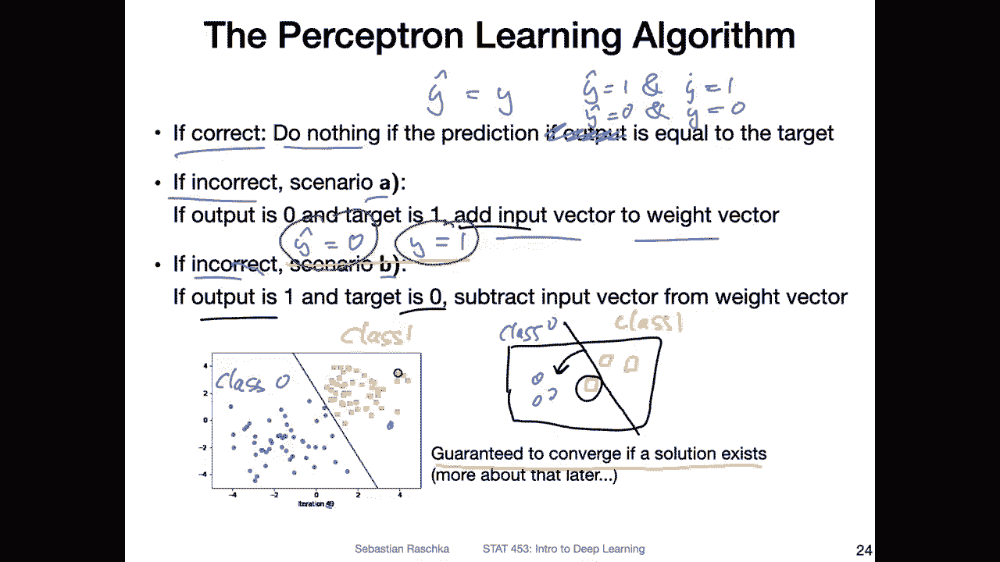

关键要点包括：
*   感知器是用于二分类的线性模型。
*   其学习规则通过 `w_new = w_old + (y - ŷ) * x` 来迭代调整权重。
*   该算法在数据线性可分时保证收敛，但无法处理非线性问题。

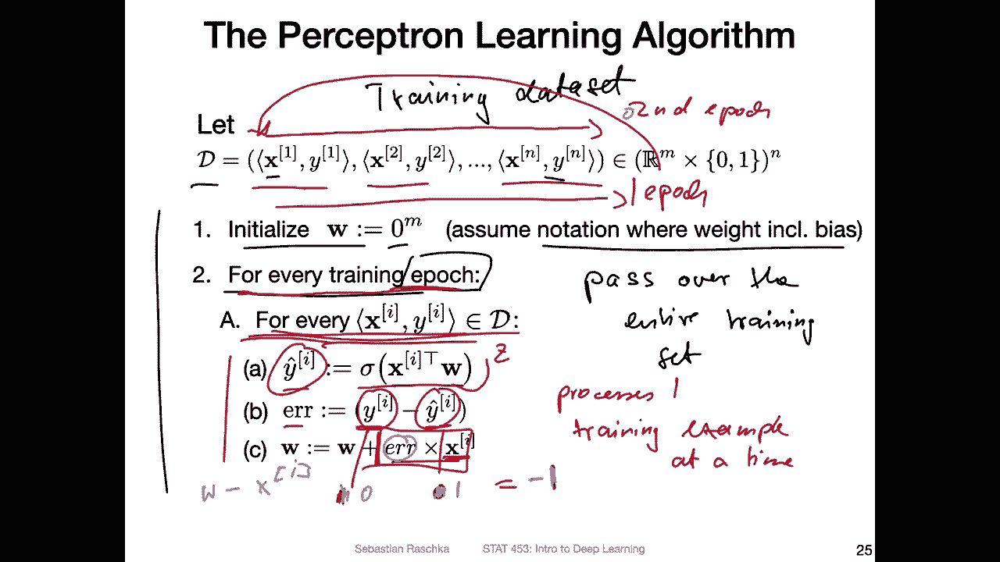

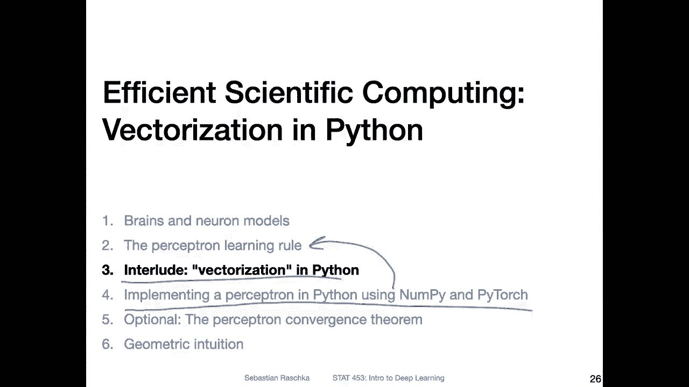

尽管感知器本身比较简单，但它是理解现代神经网络中梯度下降等更复杂学习算法的重要基石。在接下来的课程中，我们将看到如何用代码实现感知器，并学习能够克服其局限性的更高级模型。