# 29：L4.3 - 向量、矩阵和广播 🧮

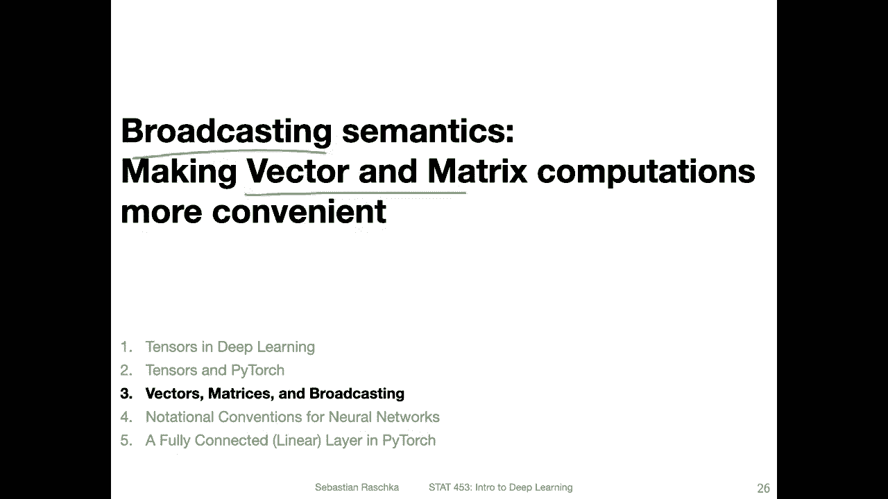

在本节课中，我们将要学习一个在计算机上处理向量和矩阵运算时非常便利的概念——**广播**。与传统的纸笔线性代数运算相比，广播机制能让我们的代码更简洁、更高效。

## 从向量运算说起

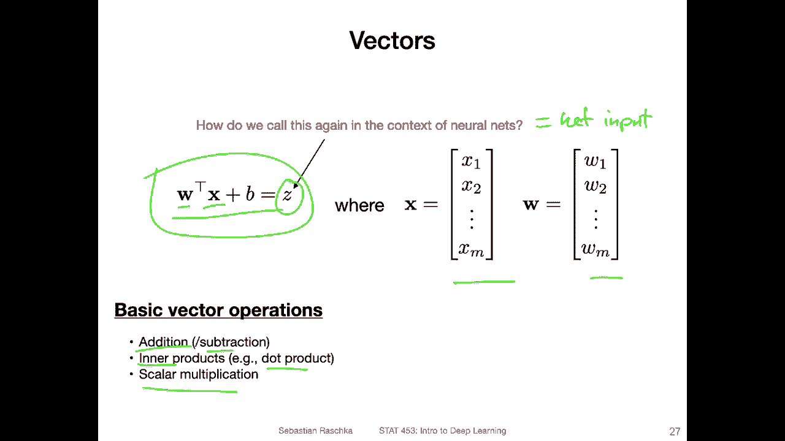

上一节我们介绍了感知机的基本概念。让我们回顾一下净输入的计算公式：

**Z = Wᵀx + b**

其中，`x` 和 `w` 是向量，`b` 是标量。在传统线性代数中，支持的向量基本运算包括向量加法（或减法）、内积（点积）和标量乘法。

然而，在计算机实践中，我们有一些更便利的操作，它们可能不符合传统线性代数的严格定义，但能极大简化代码。

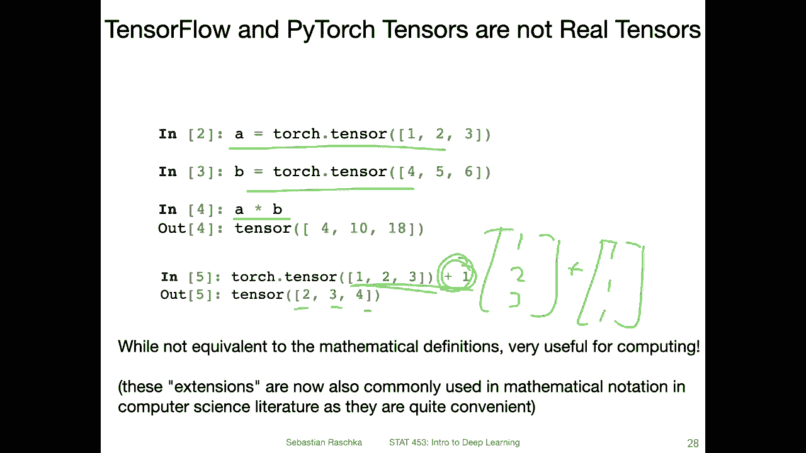

以下是两种常见的便利操作：

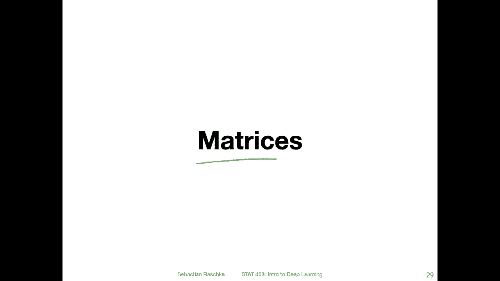

1.  **向量与标量相加**：在 PyTorch 等框架中，可以直接将一个标量加到一个向量上，该标量会自动加到向量的每一个元素上。
    ```python
    # 传统线性代数做法：需创建全1向量
    # 计算机便利做法：直接相加
    vector + scalar
    ```

2.  **逐元素向量乘法**：两个形状相同的向量可以直接进行逐元素相乘，这不同于点积。
    ```python
    # 这不是点积，而是逐元素乘法
    vector_a * vector_b
    ```

这些便利操作都与**广播**概念相关，我们将在后续详细解释。

## 矩阵运算与并行化优势

现在，让我们来看看矩阵。回想一下感知机算法，它通常被视为一种在线算法，即一次处理一个训练数据点。

但是，在进行预测时，我们可以一次性处理所有测试样本。这意味着我们可以输入一个包含 N 个样本的巨型矩阵（设计矩阵），并一次性完成所有计算，从而避免使用循环。这种方式效率更高，因为计算机可以利用底层例程进行并行计算。

并行化主要在两个层面发生：

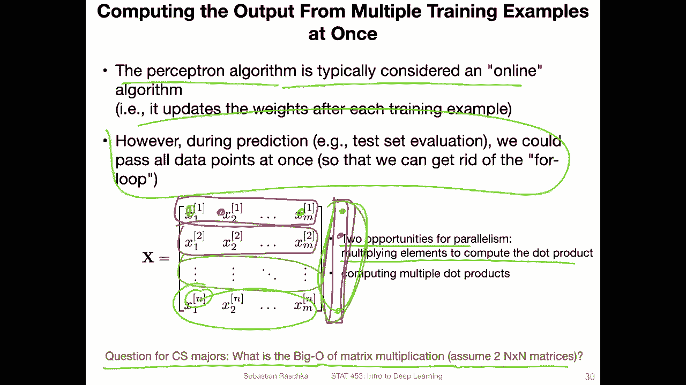

1.  **计算单个点积时的并行**：计算权重向量 `w` 与一个特征向量 `x` 的点积时，向量各元素的乘法可以同时进行。
2.  **计算多个点积时的并行**：如果有多个处理器，可以同时计算权重向量与多个不同特征向量的点积。

假设我们有一个 `N x M` 的设计矩阵 `X`（N个样本，M个特征）和一个 `M x 1` 的权重向量 `w`，那么净输入 `Z` 的计算可以表示为：

**Z = Xw + b**

这里，`b` 作为一个标量，会被加到结果向量的每一个元素上。最终，`Z` 是一个 `N x 1` 的向量，包含了所有样本的净输入。

## PyTorch 中的灵活实践

在 PyTorch（和 NumPy）中，对于维度的要求比传统线性代数宽松。例如，我们可以直接用矩阵乘以一个一维向量。

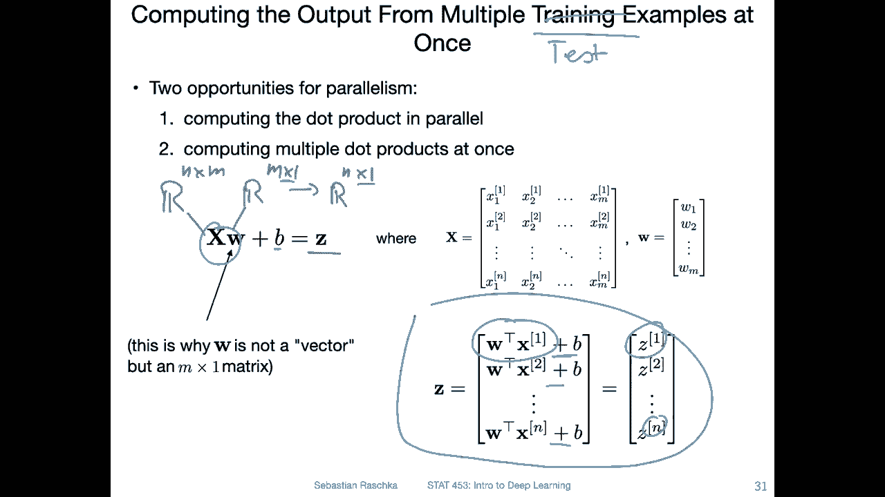

```python
import torch

# 一个 2x3 的矩阵
X = torch.tensor([[0, 1, 2],
                  [3, 4, 5]])
# 一个一维向量
w = torch.tensor([1, 2, 3])

# PyTorch 允许这样的乘法
result = torch.mm(X, w.view(-1, 1))  # 使用 view 将 w 变为列向量
# 或者更直接地（利用广播）
result = X @ w  # 结果是一个一维张量
```

需要注意的是，在传统线性代数中，`Z = Xw + b` 里的 `b` 是标量，不能直接与向量相加。但在深度学习的实践中，我们普遍接受这种“不严谨”但极其方便的写法。其背后的等价传统写法是创建一个全1向量 `1`，然后计算 `Z = Xw + b * 1`。

## 广播机制详解

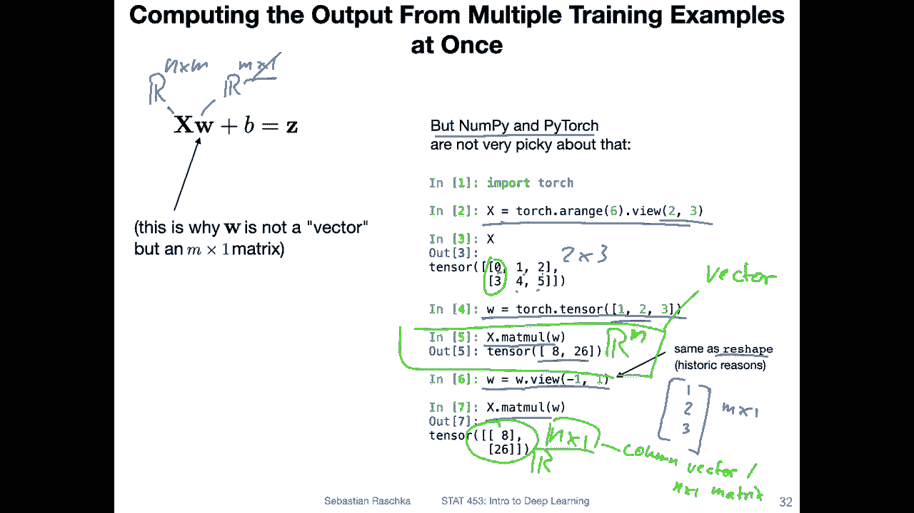

本节中我们来看看广播的核心机制。广播允许在不同形状的数组（张量）之间进行算术运算。

广播的规则是：从尾部维度开始，向前逐维比较。如果两个数组在某个维度上大小相等，或其中一个数组在该维度的大小为1，或其中一个数组没有该维度，则它们是可广播的。广播时，大小为1的维度会被扩展以匹配另一个数组的对应维度。

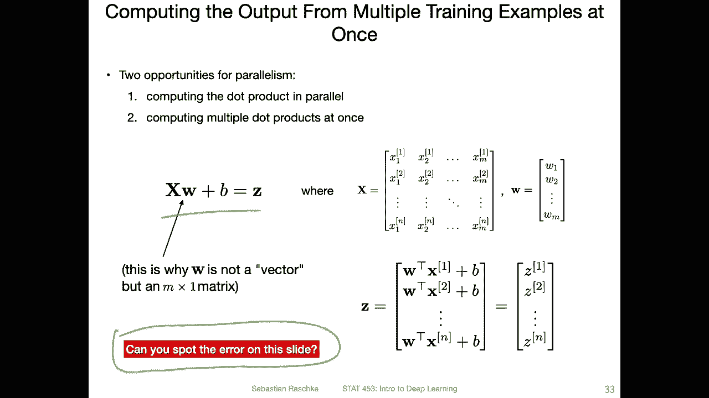

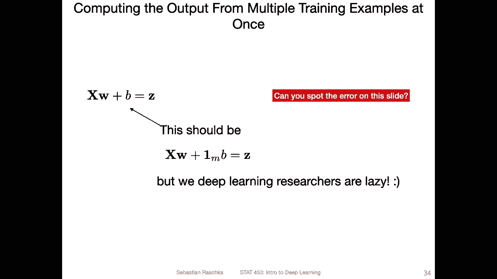

以下是一个广播的典型例子：

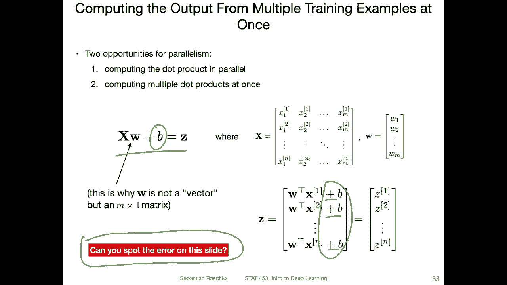

```python
# 一个 2x3 的矩阵
matrix = torch.tensor([[4, 5, 6],
                       [7, 8, 9]])
# 一个一维向量
vector = torch.tensor([1, 2, 3])

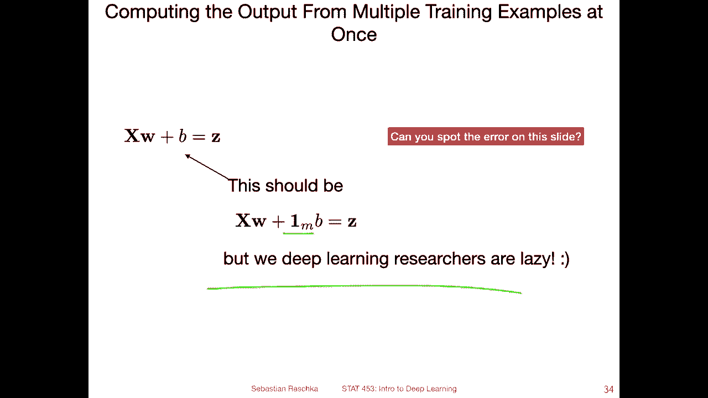

# 广播发生：vector 被隐式复制，仿佛变成了一个 2x3 的矩阵
# [[1, 2, 3],
#  [1, 2, 3]]
result = matrix + vector
print(result)
# 输出：
# tensor([[ 5,  7,  9],
#         [ 8, 10, 12]])
```

在这个例子中，向量 `[1, 2, 3]` 被广播（复制）以匹配矩阵 `matrix` 的形状，然后执行逐元素加法。这种机制使得代码无需显式复制数据就能工作，既简洁又高效。

## 总结

本节课中我们一起学习了**广播**这一核心概念。我们了解到：

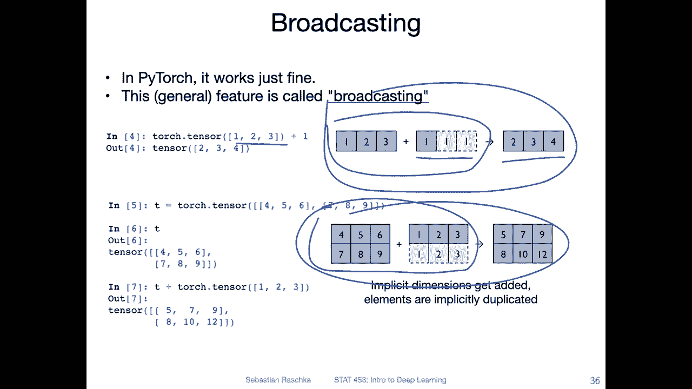

1.  在计算机上进行线性代数运算（尤其是深度学习）时，规则比传统纸笔运算更宽松，旨在提升编码便利性。
2.  使用矩阵一次性处理多个数据样本，可以利用硬件并行能力提升计算效率。
3.  **广播机制**允许不同形状的数组进行算术运算，系统会自动复制（扩展）维度较小的数组以匹配较大的数组，这是实现代码简洁性的关键。

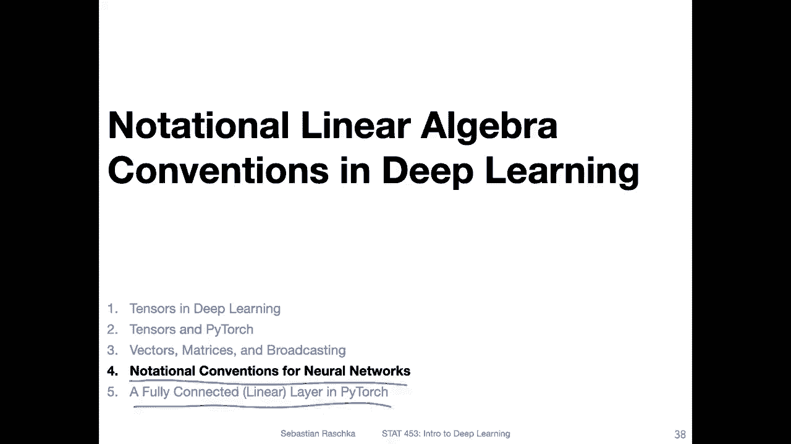

理解这些计算上的便利和广播机制，为我们后续学习更复杂的多层神经网络打下了重要的基础。在接下来的课程中，我们将应用这些知识来理解全连接层和相关的 PyTorch 实现惯例。