# 31：L4.5 - PyTorch 中的全连接（线性）层 📚

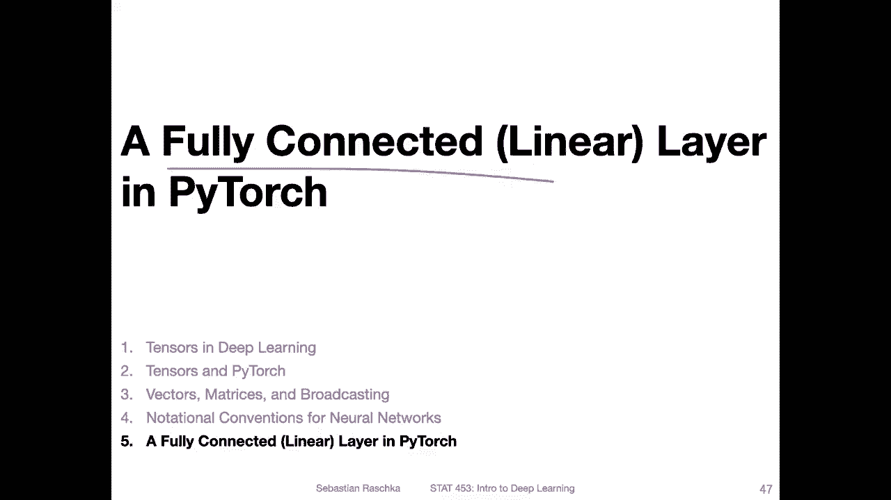

在本节课中，我们将学习 PyTorch 中的全连接层（也称为线性层或稠密层）。我们将了解其数学原理、PyTorch 的实现方式，以及它与传统线性代数表示法的区别。

---

## 🔍 什么是全连接/线性层？

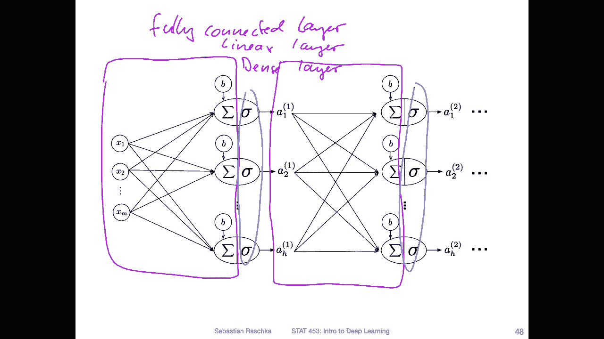

上一节我们介绍了神经网络的基本结构，本节中我们来看看其中的核心组件——全连接层。

在一个多层神经网络中，如果不考虑激活函数，层与层之间的变换就是一种线性变换。这种层有时被称为全连接层，有时也被称为稠密层。在 PyTorch 中，它被称为线性层，因为它执行的是线性变换。在 Keras 和 TensorFlow 的语境中，人们则称之为稠密层。这些术语是等价的。

神经网络本质上就是多个这样的全连接层与非线性激活函数交错连接而成的。

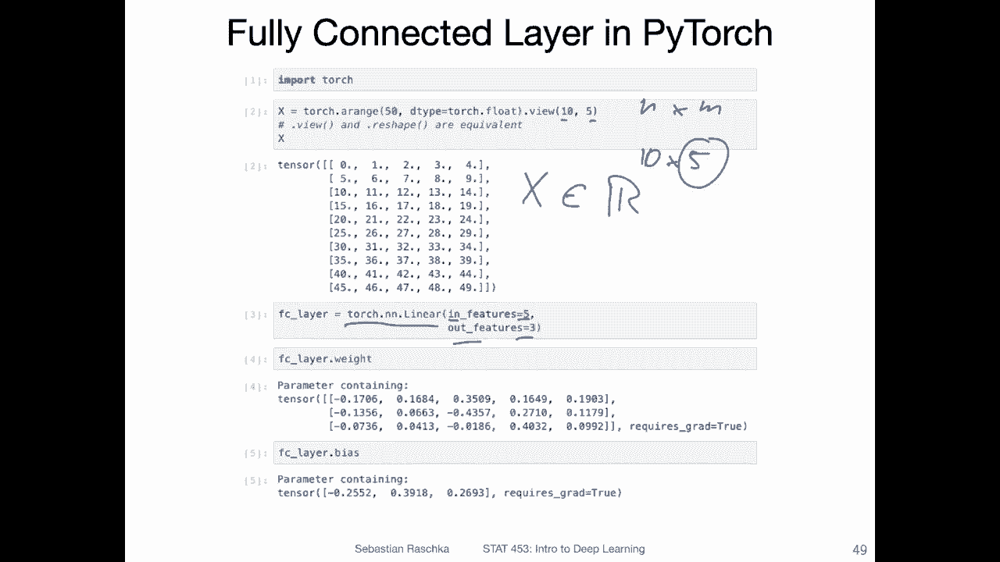

---

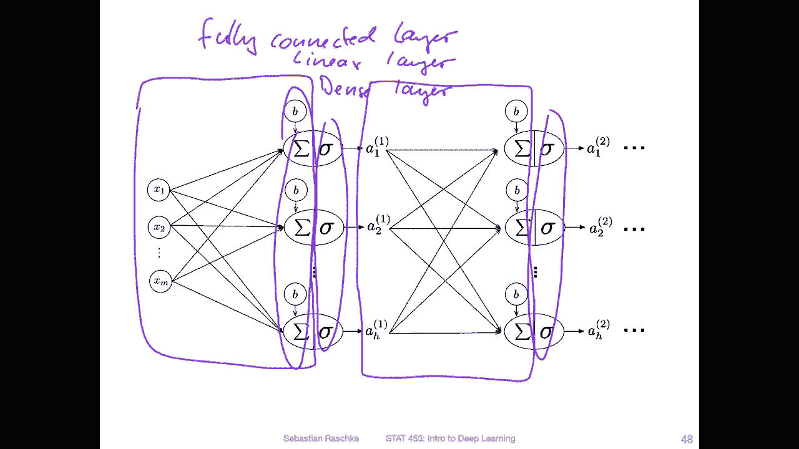

## 🧮 PyTorch 中实现全连接层

了解了基本概念后，我们来看看如何在 PyTorch 中具体实现一个全连接层。

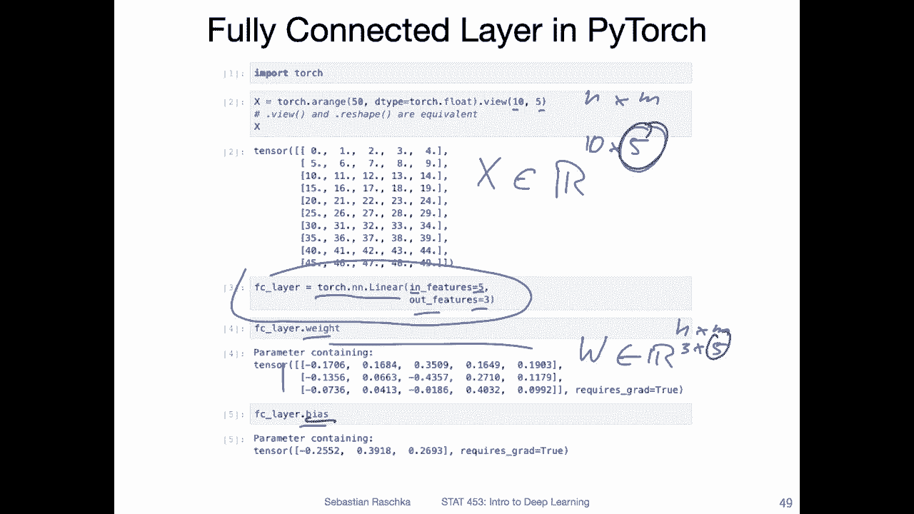

在 PyTorch 中实现全连接层非常简单，有一个名为 `torch.nn.Linear` 的函数。我们从一个数据集开始。假设我们创建一些随机数据作为有效的训练数据。

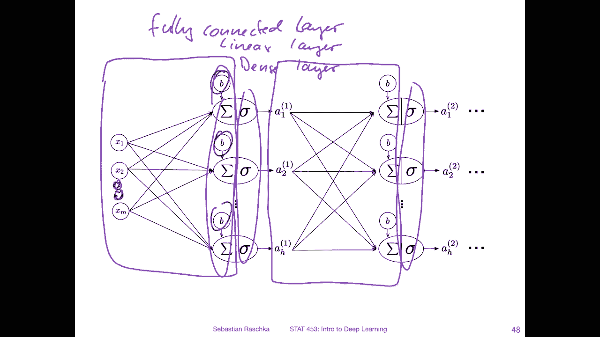

以下是一个设计矩阵，维度为 10×5（10个样本，5个特征）。当我们初始化这个线性层时，需要指定输入特征数和输出特征数。这里我们有5个输入特征，假设我们想要3个输出特征。

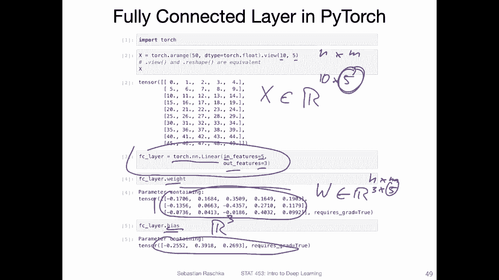

每个线性层在初始化后，都附有一个权重矩阵和一个偏置向量作为其属性。权重矩阵的维度是 `输出特征数 × 输入特征数`（本例中为 3×5）。偏置向量的维度等于输出特征数（本例中为3），因为每个输出都连接着一个偏置单元。

以下是初始化后的维度信息：
*   输入 `X` 的维度：`10 × 5`
*   权重 `W` 的维度：`3 × 5`
*   偏置 `B` 的维度：`3`

当我们对这个 `10×5` 的输入 `X` 应用线性层（即进行 `X @ W.T + B` 运算）后，输出是一个 `10×3` 的矩阵。

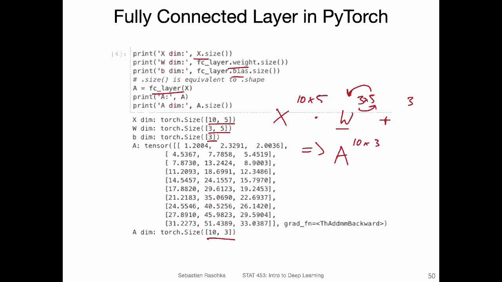

---

## 🔄 理解 PyTorch 的矩阵乘法约定

看到上面的计算过程，你可能会疑惑维度是如何匹配的。这涉及到 PyTorch 所遵循的特定矩阵乘法约定。

在上一节中，我们提到了将权重矩阵 `W` 放在输入 `X` 之前的传统表示法。而 PyTorch 则采用将 `X` 放在前面的约定。这并非出于几何视角，而是出于数据流视角，因为这样可以使用更少的转置操作，并且更形象地表示了数据在网络中的流动：从 `X` 开始，乘以权重矩阵 `W`，得到输出 `A`。

以下是两种约定的对比：

**传统约定（单样本）**：
*   输入 `x` 为 `M × 1` 的列向量。
*   运算为 `W @ x`，其中 `W` 为 `H × M` 矩阵。
*   输出为 `H × 1` 的列向量。

**PyTorch 约定（单样本）**：
*   输入 `x` 为 `1 × M` 的行向量。
*   运算为 `x @ W.T`，其中 `W` 为 `H × M` 矩阵。
*   输出为 `1 × H` 的行向量。

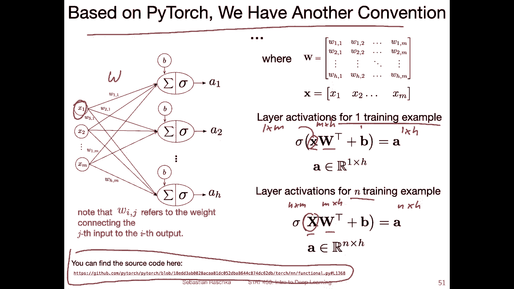

**PyTorch 约定（多样本）**：
*   输入 `X` 为 `N × M` 的设计矩阵。
*   运算为 `X @ W.T`，其中 `W` 为 `H × M` 矩阵。
*   输出为 `N × H` 的矩阵。

PyTorch 约定的优势在于，无论处理单个还是多个数据点，我们都可以使用相同的运算形式，这在计算上非常方便。

---

## 📝 重要注意事项与总结

在编写和实现矩阵乘法时，始终思考点积是如何计算的，这一点非常重要。因为即使维度匹配，计算也可能并非你的本意。务必写下维度、你正在计算的内容以及你期望的输出。

理论直觉和传统约定（将 `W` 作为变换矩阵放在前面）并不总是与代码中的实际便利性相符。为了帮助你在阅读教材（可能使用不同约定）和编写代码之间转换，以下是一些有用的等式规则：

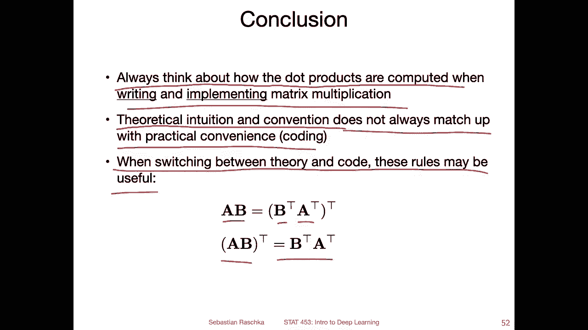

*   `(A @ B) == (B.T @ A.T).T`
*   `W @ x == x.T @ W.T`

最后，总结一下传统约定与 PyTorch 约定：
*   传统方式：`A = W @ X` （需要处理 `X` 的转置以适应多样本）
*   PyTorch 方式：`A = X @ W.T` （更简洁，易于处理单样本和多样本）

PyTorch 的选择是基于深度学习通常处理大量输入和输出的实际情况，它减少了所需的转置操作。

---

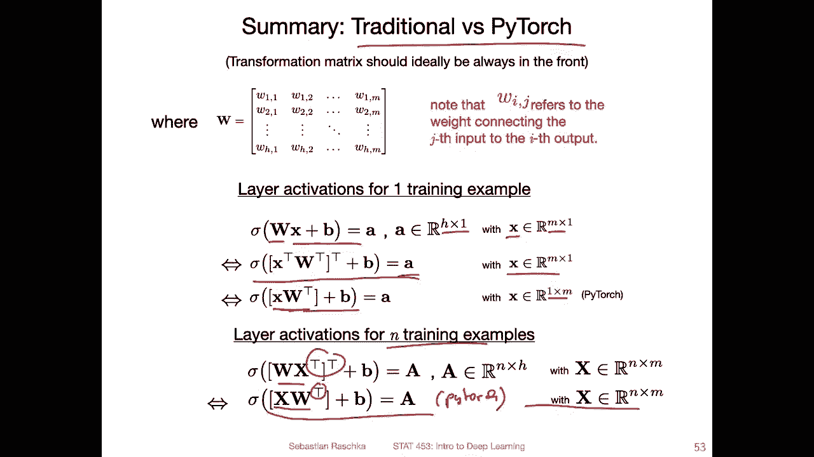

## 🧪 课后思考与实验

作为一个小练习，你可以重新审视感知机的代码。在不运行代码的情况下，思考一下：如果我们一次性输入一个 `N×M` 的设计矩阵（多个训练样本）进行预测，感知机能否预测类别标签？如果可以，为什么？如果不可以，需要对代码做出什么修改？

你可以运行代码，用设计矩阵作为预测输入，来验证你的直觉。此外，也可以思考训练方法：我们是否也能在训练方法中通过矩阵乘法实现某种并行化（同时处理多个训练样本）？在不根本改变感知机学习规则的前提下，这样做有意义吗？

---

## 🎯 本节课总结

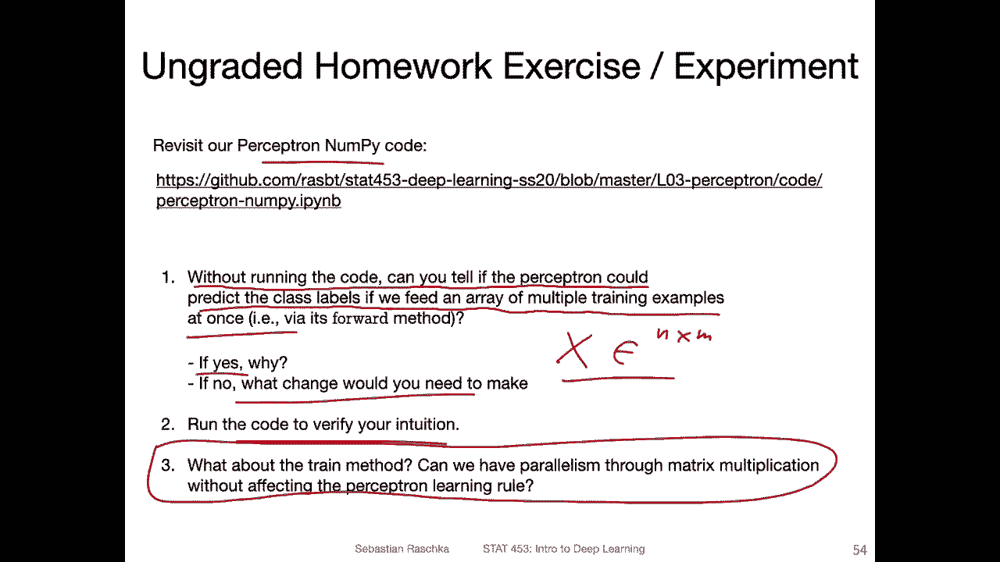

在本节课中，我们一起学习了：
1.  全连接层（线性层/稠密层）的基本概念。
2.  如何在 PyTorch 中使用 `torch.nn.Linear` 实现它。
3.  PyTorch 在矩阵乘法中采用的 `X @ W.T + B` 约定及其相对于传统约定的优势。
4.  在实现线性代数运算时，仔细检查维度的重要性。

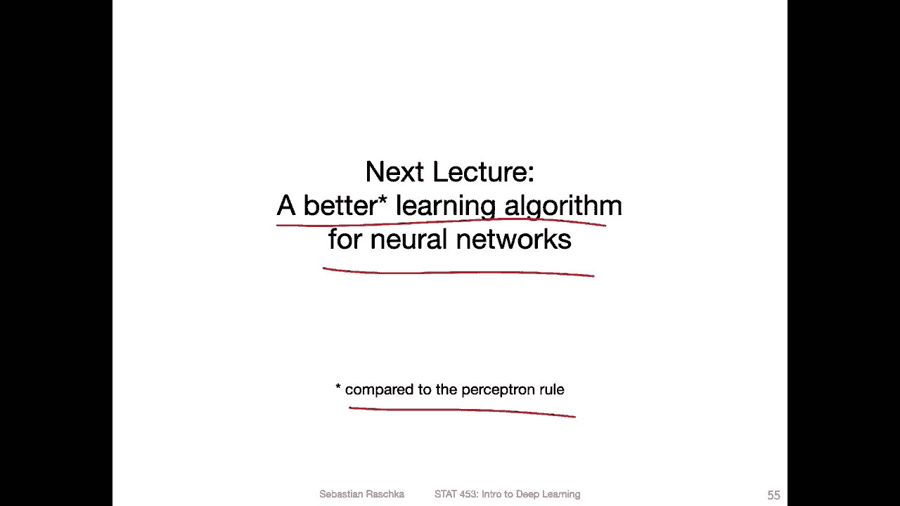

下一讲，我们将讨论一个更适合神经网络的学习算法。我们上周学习了感知机规则，但它并非一个非常优秀的学习规则，我们将在下一讲中开发更好的方法。