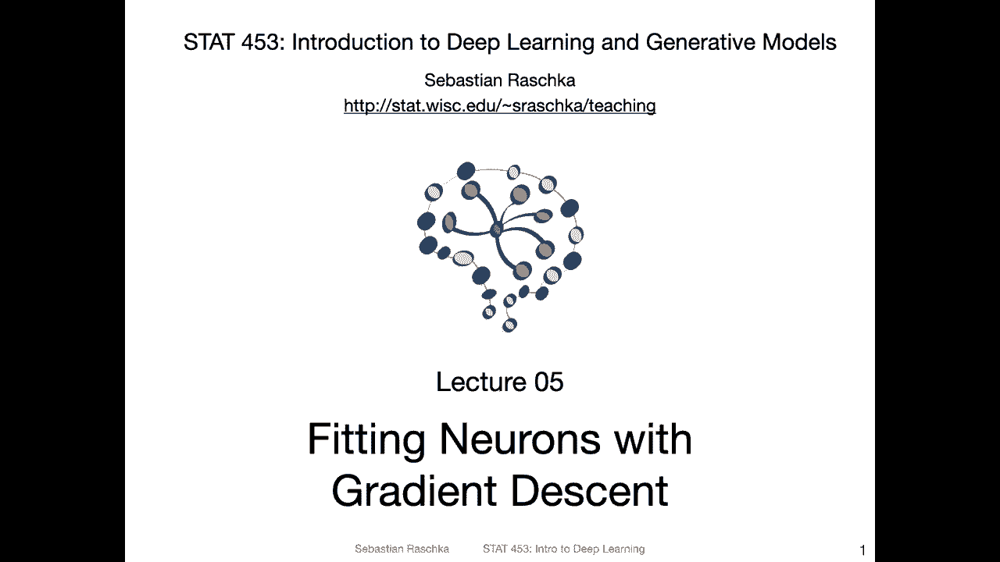
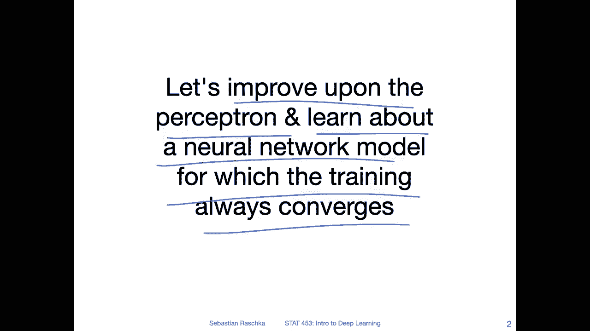
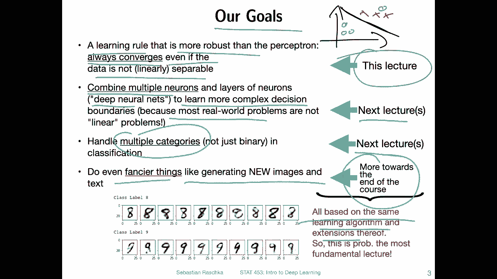
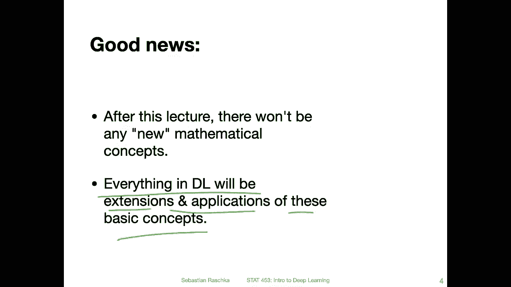
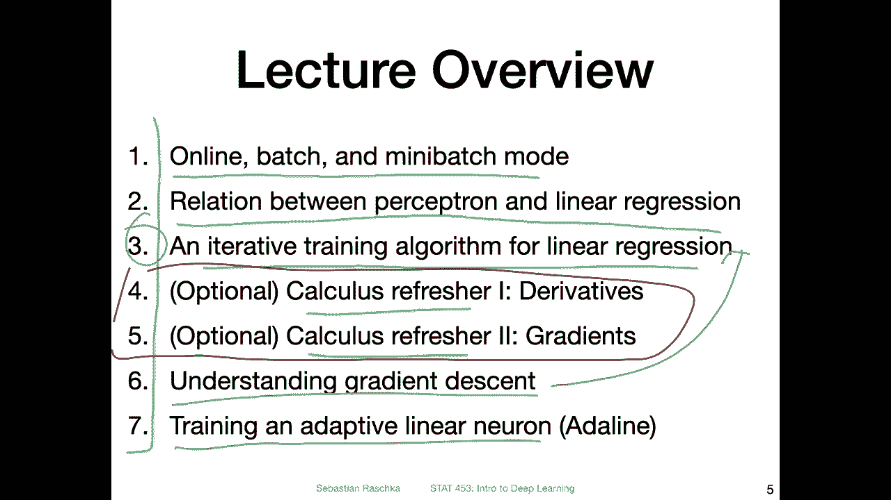

# 32：L5.0 - 梯度下降 🎯

## 概述

在本节课中，我们将学习一种比感知机更稳健的学习规则——梯度下降。我们将探讨如何训练一个即使在数据非线性可分时也能保证收敛的神经网络模型。本节课的核心是为后续学习多层神经网络和解决更复杂问题（如多分类、图像生成等）奠定算法基础。所有后续的深度学习内容都将是本节课所涵盖的线性代数与微积分基本概念的延伸与应用。



---

## 学习模式：在线、批量与小批量 📊

上一节我们介绍了课程的整体目标，本节中我们来看看神经网络训练的几种不同模式。这些模式是通用的概念，适用于所有类型的神经网络，包括单层网络、多层网络、卷积网络等深度学习模型。

以下是三种主要的学习模式：



*   **在线学习**：每次只使用一个训练样本更新模型权重。
*   **批量学习**：每次使用整个训练数据集计算梯度并更新权重。
*   **小批量学习**：每次使用一个小的、随机抽取的数据子集（小批量）来更新权重。

---

## 感知机与线性回归的关系 🔗

了解了基本的学习模式后，我们来看看感知机与另一个经典模型——线性回归之间的联系。理解这种关系有助于我们过渡到新的学习算法。

感知机是一个用于二元分类的模型，而线性回归则用于预测连续值。尽管任务不同，但它们在模型形式（一个线性函数）上具有相似性。我们将学习一种用于线性回归的迭代训练算法，这能帮助我们理解如何训练神经网络，因为两者在原理上密切相关。

---

## 微积分复习（可选） 📚

在深入梯度下降算法之前，我们需要一些微积分知识作为工具。本节是一个可选的复习环节，旨在帮助那些很久没有接触微积分或对相关概念不太确定的同学。如果你已经非常熟悉，可以跳过本节以缩短学习时间。

微积分的核心概念是导数和梯度，它们描述了函数的变化率。在机器学习中，我们使用梯度来指示如何调整模型参数以减小误差。

对于一个单变量函数 `f(x)`，其在点 `x` 的导数定义为：
`f'(x) = lim (h->0) [f(x+h) - f(x)] / h`

对于一个多变量函数 `f(w1, w2, ..., wn)`，其梯度是一个向量，包含对所有参数的偏导数：
`∇f = [∂f/∂w1, ∂f/∂w2, ..., ∂f/∂wn]`

---

## 梯度下降算法 ⬇️

现在，我们进入本节课的核心：梯度下降算法。这是一种通过迭代调整参数来最小化损失函数（或称成本函数）的优化方法。

梯度下降的基本思想是：要找到函数的最小值，我们可以沿着当前点梯度（即最陡上升方向）的反方向移动一小步。因为梯度的反方向是函数值下降最快的方向。



权重更新公式如下：
`w_new = w_old - η * ∇J(w_old)`
其中：
*   `w` 代表模型参数（权重）。
*   `η` 是学习率，控制每次更新的步长。
*   `∇J(w)` 是损失函数 `J` 在权重 `w` 处的梯度。

---

## 训练线性神经元：Adaline 🧠

我们将梯度下降算法应用到一个具体的模型上：自适应线性神经元（Adaline）。Adaline 使用线性激活函数，并通过最小化实际输出与连续目标值之间的平方误差和来学习，这本质上就是一个线性回归问题。



以下是训练 Adaline 的关键步骤：

1.  **初始化权重**：为所有权重和偏置项设置小的随机值或零。
2.  **计算网络输出**：对于给定的输入，计算线性加权和 `z = w^T * x + b`。
3.  **计算损失**：使用均方误差等损失函数计算预测输出与实际目标之间的误差。
4.  **计算梯度**：计算损失函数相对于每个权重和偏置的梯度。
5.  **更新参数**：使用梯度下降公式更新所有权重和偏置。
6.  **重复**：对多个周期（遍历整个训练集）重复步骤 2-5，直到模型收敛。

---

## PyTorch 代码示例 💻

最后，我们将通过一个实际的 PyTorch 代码示例，展示如何使用梯度下降来训练一个线性神经元（Adaline 模型）。这将帮助我们巩固对理论的理解，并了解如何在实践中实现它。

```python
import torch
import torch.nn as nn
import torch.optim as optim

# 1. 准备模拟数据
torch.manual_seed(1)
X = torch.randn(100, 2)  # 100个样本，2个特征
y = 3 * X[:, 0] - 2 * X[:, 1] + 1 + 0.1 * torch.randn(100)  # 真实关系 + 噪声

# 2. 定义线性模型 (Adaline)
class LinearNeuron(nn.Module):
    def __init__(self, input_dim):
        super().__init__()
        self.linear = nn.Linear(input_dim, 1)  # 线性层

    def forward(self, x):
        return self.linear(x)  # 线性激活，直接输出加权和

model = LinearNeuron(input_dim=2)

# 3. 定义损失函数和优化器（梯度下降）
criterion = nn.MSELoss()  # 均方误差损失
optimizer = optim.SGD(model.parameters(), lr=0.01)  # 随机梯度下降优化器

# 4. 训练循环
num_epochs = 50
for epoch in range(num_epochs):
    # 前向传播
    predictions = model(X).squeeze()
    loss = criterion(predictions, y)

    # 反向传播与优化
    optimizer.zero_grad()  # 清零历史梯度
    loss.backward()        # 计算梯度
    optimizer.step()       # 更新参数 (w = w - lr * gradient)

    if (epoch+1) % 10 == 0:
        print(f'Epoch [{epoch+1}/{num_epochs}], Loss: {loss.item():.4f}')

# 5. 查看学习到的参数
print("\nLearned weights and bias:")
print(f"Weights: {model.linear.weight.data}")
print(f"Bias: {model.linear.bias.data}")
```

---

## 总结



本节课我们一起学习了机器学习中的核心优化算法——梯度下降。我们从比较不同的学习模式开始，建立了感知机与线性回归的联系，并复习了必要的微积分知识。随后，我们深入探讨了梯度下降的原理，并将其应用于训练线性神经元（Adaline）。最后，通过 PyTorch 代码示例，我们实践了完整的训练流程。这些概念是理解所有现代深度学习模型如何被训练的基础，在后续课程中，我们将把这些知识扩展到更复杂的网络结构和任务中。