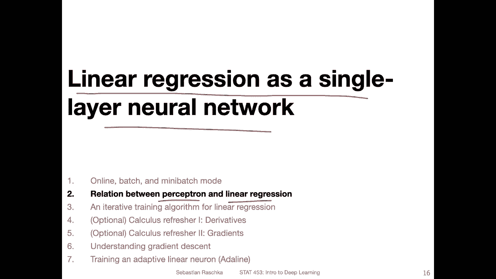
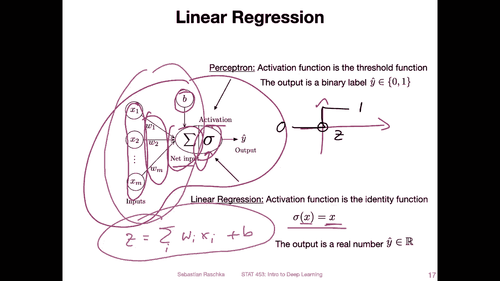
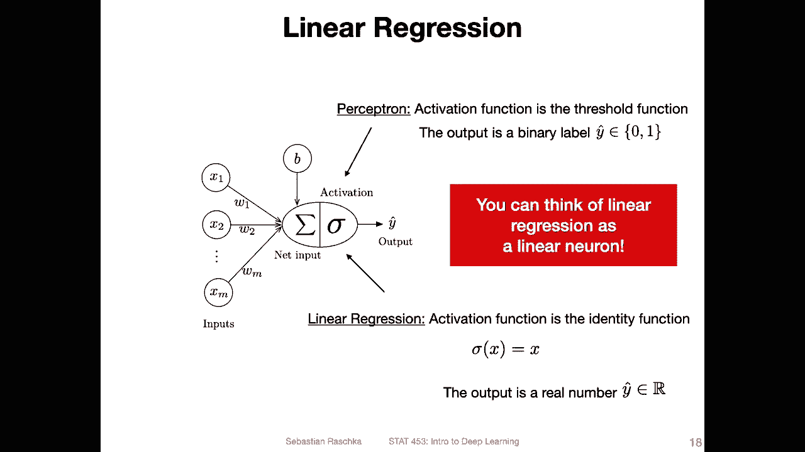
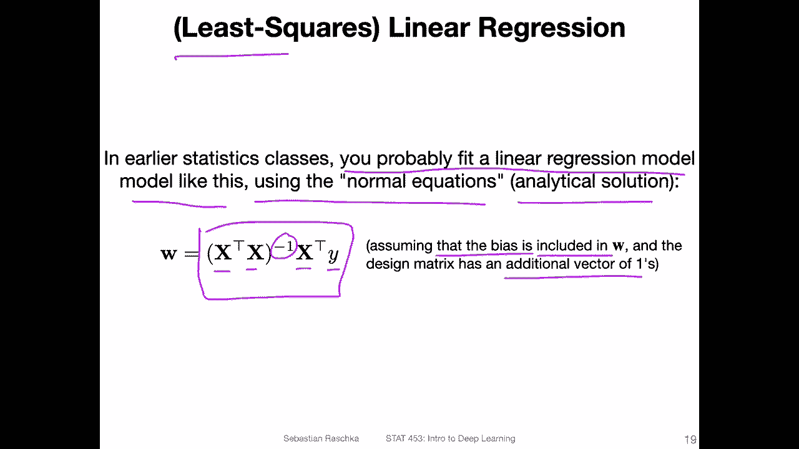
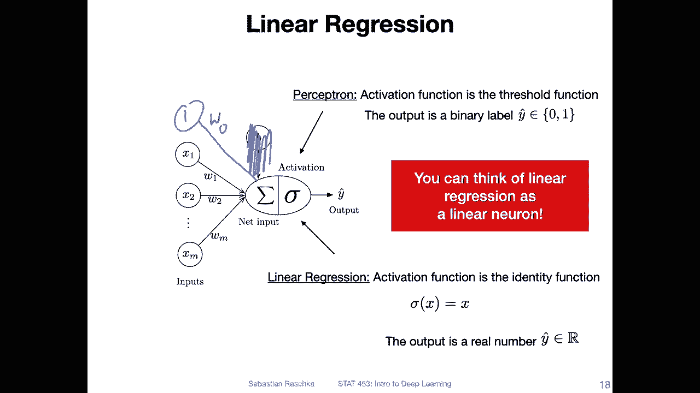
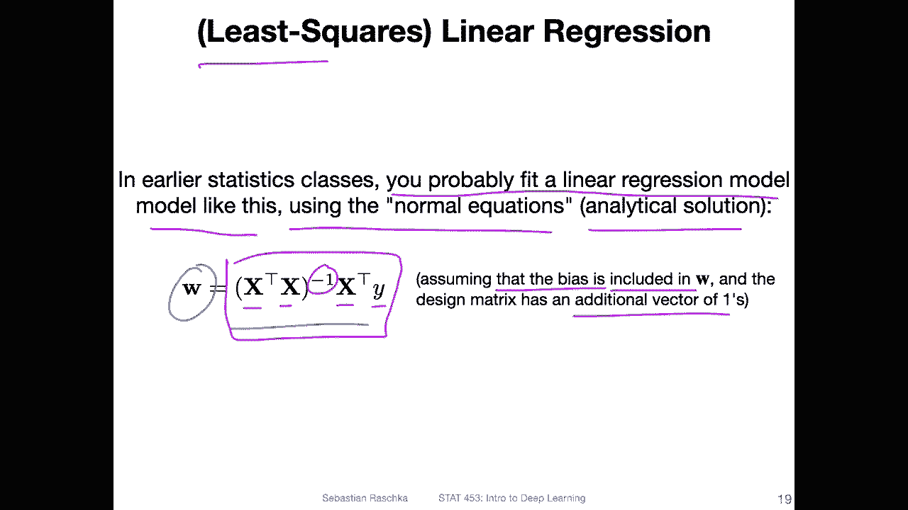
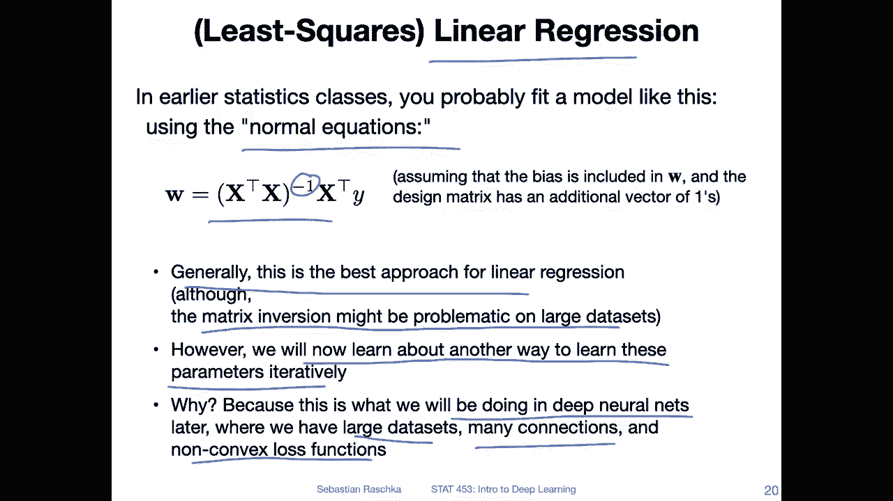

# 34：L5.2 - 感知器与线性回归的关系 📊

在本节课中，我们将探讨感知器与线性回归之间的紧密联系。理解这种关系有助于我们更好地掌握梯度下降等概念，并为后续学习自适应线性神经元（Adaline）奠定基础。



## 感知器模型回顾 🔄

上一节我们介绍了感知器算法，本节中我们来看看它的基本结构。感知器模型包含多个计算步骤。

以下是感知器算法的核心流程：

1.  **计算净输入**：基于数据集特征、权重以及偏置单元计算净输入。
2.  **应用激活函数**：在感知器中，激活函数是阈值函数。其规则为：如果净输入 `z > 0`，则输出 `1`；否则输出 `0`。公式表示为：
    ```
    if z > 0:
        return 1
    else:
        return 0
    ```

## 线性回归作为单层神经网络 🧠

线性回归可以看作是感知器的一个特例。在感知器模型中，如果我们用恒等函数替换阈值激活函数，就得到了线性回归模型。

恒等函数意味着直接输出输入值，不做任何变换。因此，线性回归的预测值就是其净输入值。其计算过程与感知器完全相同：



*   净输入 `z` 的计算公式为：`z = w1*x1 + w2*x2 + ... + wn*xn + b`
*   预测输出 `y_hat` 即为 `z`：`y_hat = z`



通过这种方式，我们可以将线性回归理解为一个**单层神经网络**或**线性神经元**。

## 线性回归的参数求解方法 ⚙️

在传统的统计学课程中，线性回归通常通过解析法求解。

以下是求解最小二乘线性回归的解析方法：





*   使用**正规方程**可以直接计算出最优参数。其公式为：
    ```
    w = (X^T * X)^(-1) * X^T * y
    ```
    其中，`X` 是设计矩阵（通常包含一列 `1` 以将偏置项 `b` 并入权重向量 `w` 中），`y` 是目标值向量。

这种方法在大多数数据集上高效且直接，是实践中推荐使用的方法。然而，当数据集非常庞大时，矩阵求逆运算可能带来计算挑战。



## 引入迭代学习算法的原因 🚀

尽管正规方程是线性回归的推荐解法，但在本课程中，我们将学习一种不同的、迭代式的参数学习方法。

以下是采用迭代方法的主要原因：

1.  **为深度学习做准备**：深度神经网络通常具有大规模数据集、大量连接（神经元）以及非凸的损失函数，不存在封闭形式的解析解，必须依赖迭代优化算法。
2.  **降低学习门槛**：由于大家已从其他课程熟悉线性回归，用它来引入梯度下降等迭代算法，将使概念理解变得更容易。

在接下来的视频中，我们将详细介绍这种迭代算法，并结合一些微积分概念，观察其在实际中如何工作。

## 总结 📝



本节课我们一起学习了感知器与线性回归之间的关系。我们了解到线性回归本质上是使用恒等函数作为激活函数的单层感知器。同时，我们回顾了通过正规方程解析求解线性回归参数的方法，并阐述了为何在本课程中需要转向学习迭代优化算法，这为我们进入梯度下降和神经网络的核心训练方法做好了准备。