# 36：L5.4- (选修)微积分复习 1- 导数 📚

在本节课中，我们将要学习导数的基本概念。导数是微积分的核心，它描述了函数值随输入变化的速率，也就是我们常说的“斜率”。理解导数对于后续学习梯度下降等机器学习算法至关重要。

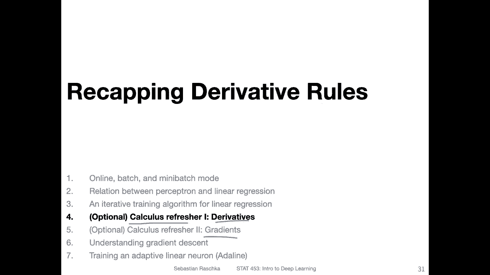

---

## 📈 什么是导数？

上一节我们介绍了课程目标，本节中我们来看看导数的基本定义。

导数可以理解为函数的“变化率”或“斜率”。我们通过一个简单的例子来理解：函数 **F(x) = 2x**。

假设我们选取输入值 **x = 3**，那么输出值 **F(3) = 2 * 3 = 6**。
我们再选取第二个点，将输入值增加 **Δx = 4**，得到 **x = 7**，此时输出值 **F(7) = 2 * 7 = 14**。

在这两个点之间，输出值的变化是 **14 - 6 = 8**，输入值的变化是 **7 - 3 = 4**。因此，斜率（变化率）为 **8 / 4 = 2**。

更正式地，我们可以用以下公式计算两点间的平均斜率：

```
斜率 = [F(a + Δa) - F(a)] / [(a + Δa) - a] = [F(a + Δa) - F(a)] / Δa
```

对于函数 **F(x) = 2x**，其斜率恒为 **2**。这意味着输入值每增加1个单位，输出值就增加2个单位。

---

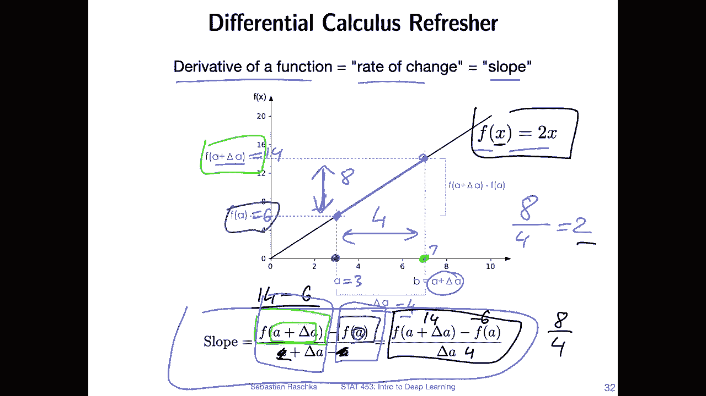

## 🔬 导数的正式定义

上一节我们通过一个较大的变化量理解了斜率的概念，本节中我们来看看导数的正式定义，它关注的是输入值发生**无穷小**变化时的瞬时变化率。

导数的正式定义是当 **Δx** 趋近于0时，上述斜率公式的极限值。它有两种常见的表示法：

*   **拉格朗日表示法**：**F'(x)**
*   **莱布尼茨表示法**：**dF(x)/dx**

莱布尼茨表示法在深度学习中讨论偏导数和梯度时会更加有用。

让我们用这个正式定义来计算 **F(x) = 2x** 的导数：

```
dF(x)/dx = lim(Δx -> 0) [F(x + Δx) - F(x)] / Δx
          = lim(Δx -> 0) [2(x + Δx) - 2x] / Δx
          = lim(Δx -> 0) [2x + 2Δx - 2x] / Δx
          = lim(Δx -> 0) [2Δx] / Δx
          = lim(Δx -> 0) 2
          = 2
```

计算结果表明，函数 **2x** 的导数确实是 **2**。

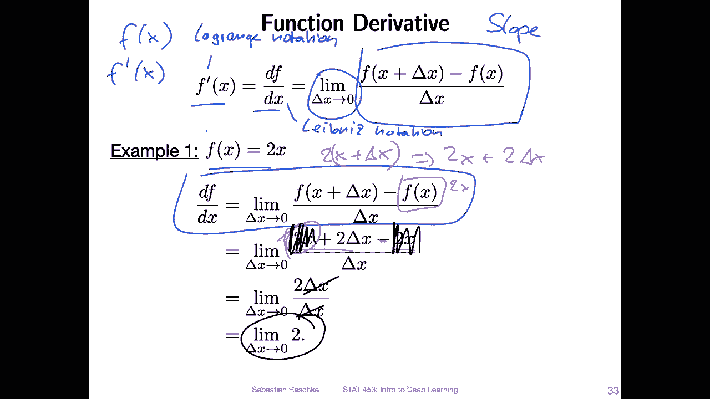

---

## 🧮 计算更复杂函数的导数

上一节我们计算了线性函数的导数，本节中我们来看看如何计算更复杂函数的导数，例如 **F(x) = x²**。

我们同样使用导数的定义公式：

```
dF(x)/dx = lim(Δx -> 0) [F(x + Δx) - F(x)] / Δx
          = lim(Δx -> 0) [(x + Δx)² - x²] / Δx
          = lim(Δx -> 0) [x² + 2xΔx + (Δx)² - x²] / Δx
          = lim(Δx -> 0) [2xΔx + (Δx)²] / Δx
          = lim(Δx -> 0) [2x + Δx]
          = 2x
```

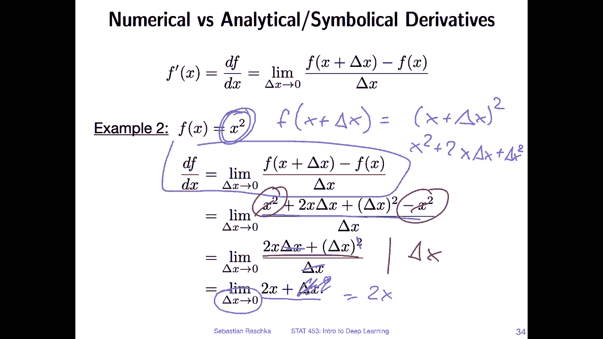

因此，函数 **x²** 的导数是 **2x**。

---

## 🎨 导数的几何意义

上一节我们进行了符号计算，本节中我们从几何角度直观理解导数的概念。

对于函数 **F(x) = x²**（一个抛物线），在某一点（例如 x=1）的导数，就是该点处**切线**的斜率。
我们之前用 **Δx** 计算斜率的方法，实际上是连接点 **(x, F(x))** 和点 **(x+Δx, F(x+Δx))** 的**割线**的斜率。

当 **Δx** 非常大时，这条割线是切线的一个粗糙近似。
随着 **Δx** 不断减小并趋近于0，这条割线会无限逼近该点的切线。因此，导数在几何上就是函数图像在某一点切线的斜率。

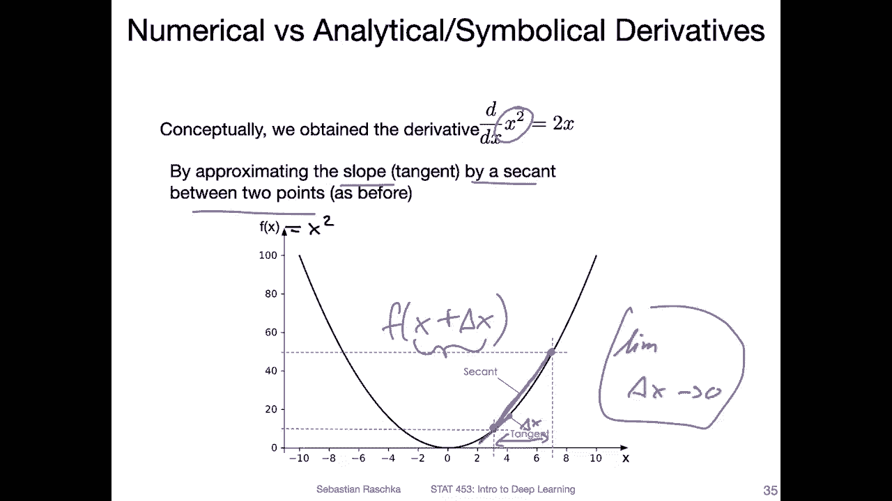

---

## 📋 常用导数公式

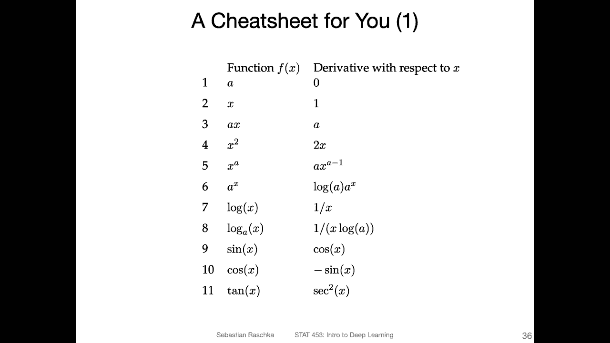

以下是机器学习中最常用的一些导数公式，可以作为速查表使用：

*   **d/dx (c) = 0** （常数函数的导数为0）
*   **d/dx (xⁿ) = n*xⁿ⁻¹** （幂函数法则）
*   **d/dx (eˣ) = eˣ**
*   **d/dx (ln(x)) = 1/x**
*   **d/dx (sin(x)) = cos(x)**
*   **d/dx (cos(x)) = -sin(x)**

---

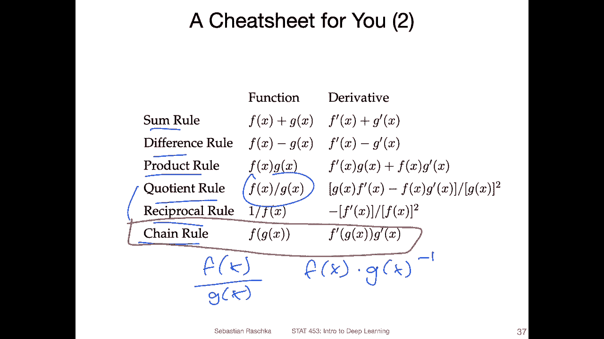

## ⚙️ 重要的导数运算法则

除了基本公式，掌握导数的运算法则对于处理复杂函数至关重要。

以下是核心的运算法则：
*   **加法法则**：**d/dx [f(x) + g(x)] = f'(x) + g'(x)**
*   **减法法则**：**d/dx [f(x) - g(x)] = f'(x) - g'(x)**
*   **乘法法则**：**d/dx [f(x) * g(x)] = f'(x)*g(x) + f(x)*g'(x)**
*   **链式法则**：**d/dx [f(g(x))] = f'(g(x)) * g'(x)**

其中，**链式法则**是深度学习的基石。在计算损失函数相对于权重的导数（即梯度下降的核心）时，本质上就是链式法则的反复应用。

---

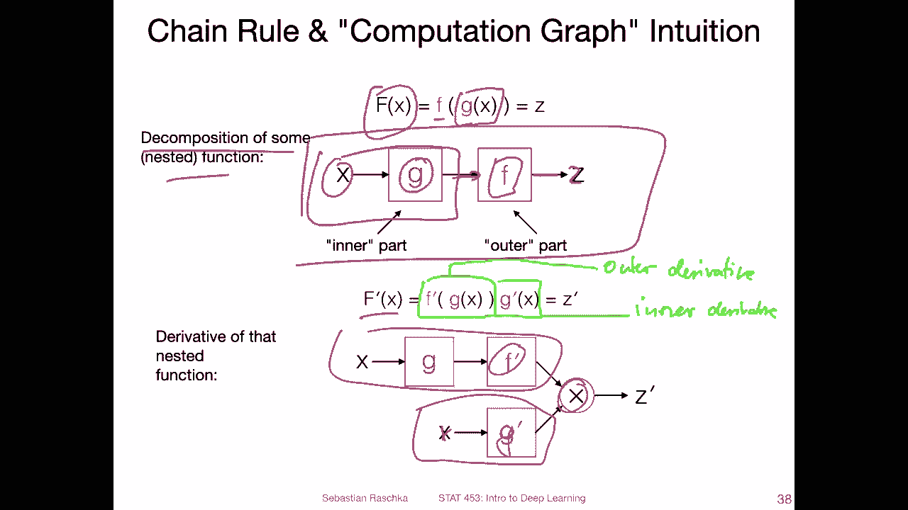

## 🔗 链式法则详解

上一节我们提到了链式法则的重要性，本节中我们深入理解其工作原理。

假设有一个复合函数 **F(x) = f(g(x))**。计算其导数的链式法则为：
```
dF/dx = (df/dg) * (dg/dx)
```
我们可以将其视为一个计算图：
1.  输入 **x** 首先进入内层函数 **g**，得到中间结果 **u = g(x)**。
2.  中间结果 **u** 再进入外层函数 **f**，得到最终输出 **F(x) = f(u)**。
3.  求导时，先计算外层函数 **f** 对中间结果 **u** 的导数 **df/du**。
4.  再计算内层函数 **g** 对输入 **x** 的导数 **dg/dx**。
5.  最后将这两个导数相乘，得到最终结果。

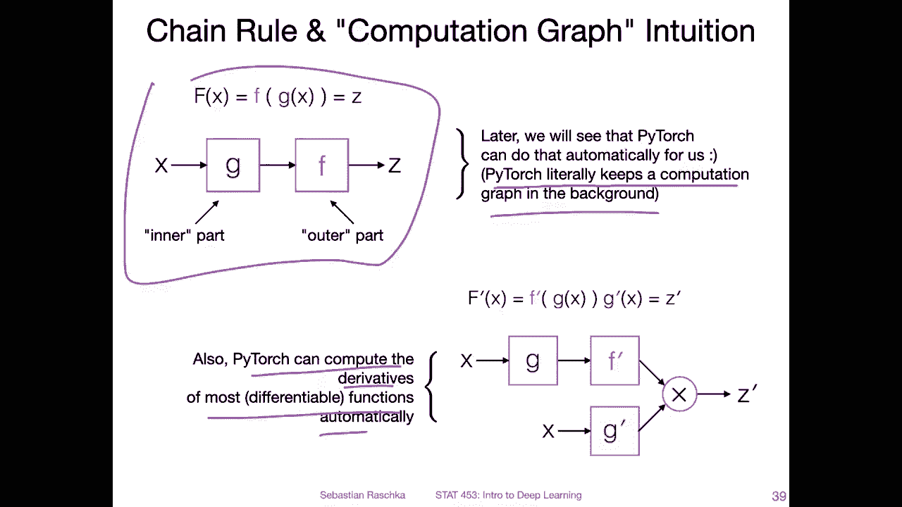

幸运的是，在PyTorch等现代深度学习框架中，`autograd`（自动求导）包会自动构建这样的计算图并为我们计算导数。

---

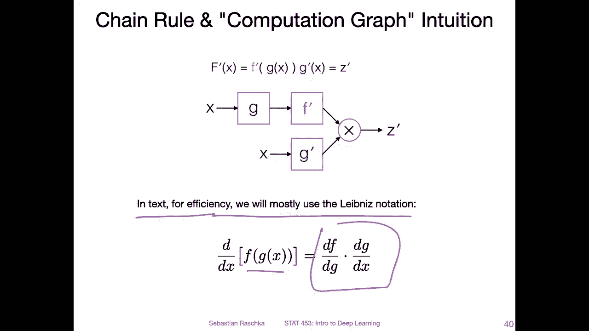

## 📝 链式法则应用示例

让我们通过一个具体例子来应用链式法则：计算函数 **F(x) = ln(√x)** 的导数。

1.  识别内外函数：外层 **f(u) = ln(u)**，内层 **g(x) = √x = x^(1/2)**。
2.  分别求导：
    *   外层导数：**df/du = 1/u = 1/√x**
    *   内层导数：**dg/dx = (1/2) * x^(-1/2) = 1/(2√x)**
3.  应用链式法则：
    ```
    dF/dx = (df/du) * (dg/dx) = (1/√x) * (1/(2√x)) = 1/(2x)
    ```

链式法则可以推广到任意多层嵌套的函数。对于函数 **F(x) = f₅(f₄(f₃(f₂(f₁(x)))))**，其导数是所有层导数从外到内的连续乘积。

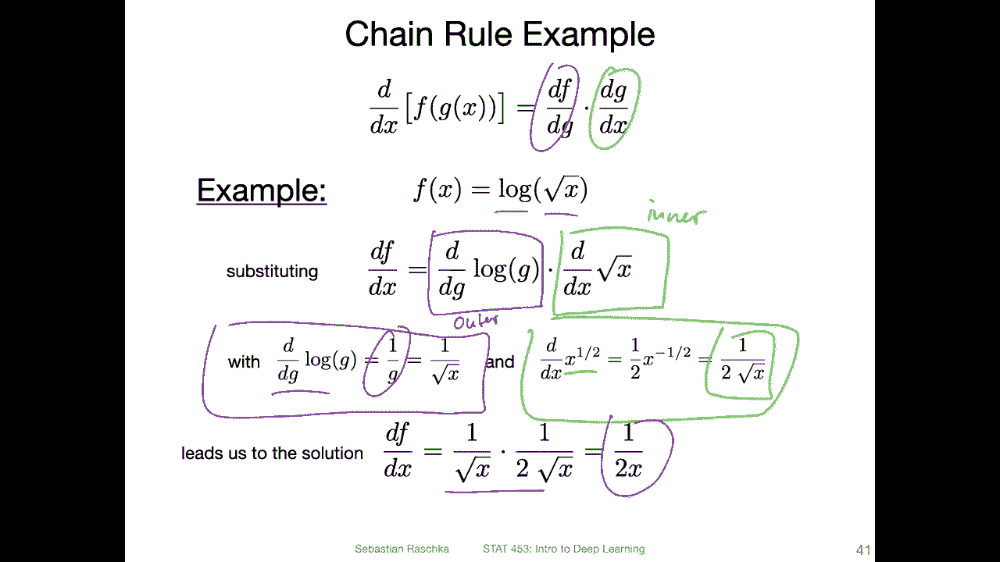

---

## 🎯 课程总结

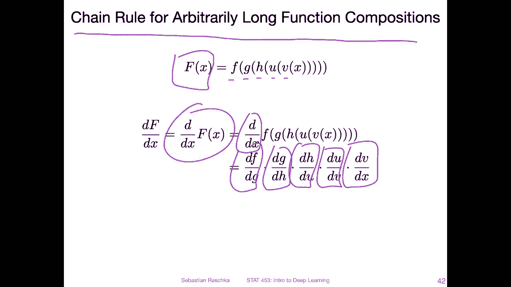

本节课中我们一起学习了导数的核心概念。
我们首先从直观的“斜率”和“变化率”入手，然后学习了导数的正式定义和计算方法。
我们探讨了常见函数的导数公式、重要的运算法则（尤其是链式法则），并通过几何视角和计算图加深了理解。
掌握这些基础知识，将为后续学习梯度下降和神经网络的反向传播打下坚实的数学基础。