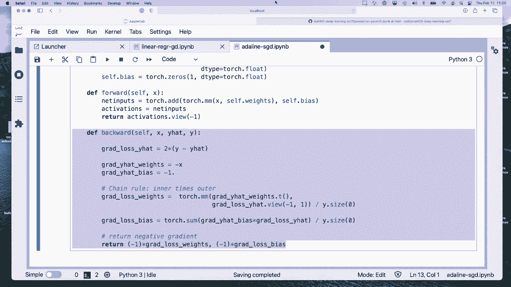

# 40：L5.8 - Adaline 代码示例 📘


在本节课中，我们将通过代码示例学习线性回归和Adaline模型，并分别使用梯度下降和随机梯度下降进行训练。我们将从数据准备、模型实现、训练过程到结果评估，一步步进行讲解。


## 概述


我们将实现两个模型：一个使用梯度下降训练的线性回归模型，另一个使用随机梯度下降训练的Adaline模型。这两个模型的核心计算步骤非常相似，主要区别在于训练时更新权重的方式。Adaline模型在训练完成后，会使用一个阈值函数来预测类别标签。


## 1. 环境与数据准备


首先，我们需要导入必要的库并准备数据集。


```python
import torch
import numpy as np
import pandas as pd
import matplotlib.pyplot as plt
```


我们使用一个简单的玩具数据集，它包含两个特征 `x1`、`x2` 和一个连续的输出值 `y`，这是一个回归问题。数据集共有1000个样本点。


```python
# 读取数据
df = pd.read_csv('toy_dataset.csv')
print(df.tail()) # 查看最后5行数据
```


## 2. 构建设计矩阵与数据划分


接下来，我们将特征和标签转换为PyTorch张量，并划分为训练集和测试集。


上一节我们介绍了数据集，本节中我们来看看如何将其转换为模型可用的格式并进行划分。


```python
# 构建特征矩阵X和标签向量y
X = df[['x1', 'x2']].values
y = df['y'].values
X_tensor = torch.tensor(X, dtype=torch.float32)
y_tensor = torch.tensor(y, dtype=torch.float32).view(-1, 1) # 确保y是列向量
# 生成随机索引以打乱数据
indices = torch.randperm(len(X_tensor))
X_shuffled = X_tensor[indices]
y_shuffled = y_tensor[indices]
# 按7:3比例划分训练集和测试集
train_size = int(0.7 * len(X_shuffled))
X_train = X_shuffled[:train_size]
y_train = y_shuffled[:train_size]
X_test = X_shuffled[train_size:]
y_test = y_shuffled[train_size:]
# 标准化特征（零均值，单位方差）
X_mean = X_train.mean(dim=0)
X_std = X_train.std(dim=0)
X_train = (X_train - X_mean) / X_std
X_test = (X_test - X_mean) / X_std
```


使用一致的随机索引打乱数据，可以确保特征和标签的对应关系不被破坏。标准化处理有助于模型更快、更稳定地收敛。


## 3. 实现线性回归模型（梯度下降）


现在，我们来实现线性回归模型。我们将采用面向对象的方式，手动实现前向传播和反向传播（梯度计算）。


以下是线性回归模型类的核心组成部分：


```python
class LinearRegressionGD:
    def __init__(self, num_features):
        # 初始化权重和偏置为0
        self.weights = torch.zeros(num_features, 1, dtype=torch.float32)
        self.bias = torch.zeros(1, dtype=torch.float32)

    def forward(self, x):
        # 计算净输入（线性组合）
        net_input = torch.matmul(x, self.weights) + self.bias
        # 线性激活函数，直接输出净输入
        activation = net_input
        return activation.view(-1) # 返回一维向量

    def backward(self, x, y_true, y_pred):
        # 计算损失函数关于预测值y_pred的梯度
        # 损失函数为均方误差：L = (1/n) * Σ(y_true - y_pred)^2
        # ∂L/∂y_pred = (2/n) * (y_pred - y_true)
        n = x.shape[0]
        grad_loss_y_pred = (2.0 / n) * (y_pred - y_true)

        # 计算预测值关于权重和偏置的梯度
        # y_pred = X * W + b
        # ∂y_pred/∂W = X^T
        # ∂y_pred/∂b = 1
        grad_y_pred_weights = x.t()
        grad_y_pred_bias = torch.ones(n)

        # 根据链式法则，计算损失关于权重和偏置的梯度
        grad_loss_weights = torch.matmul(grad_y_pred_weights, grad_loss_y_pred.view(-1, 1))
        grad_loss_bias = torch.sum(grad_loss_y_pred * grad_y_pred_bias)

        # 返回负梯度（因为我们要沿梯度反方向更新）
        return -grad_loss_weights, -grad_loss_bias
```


**模型解释**：
*   `forward` 方法计算模型的预测输出，即 **`y_pred = X * W + b`**。
*   `backward` 方法根据链式法则，手动计算损失函数关于权重 `W` 和偏置 `b` 的梯度。这是梯度下降算法的核心。


## 4. 训练与评估函数


有了模型，我们需要编写训练循环来迭代更新参数。


```python
def train(model, X_train, y_train, epochs=100, learning_rate=0.01):
    cost_history = []
    for epoch in range(epochs):
        # 前向传播，计算预测值
        y_pred = model.forward(X_train)

        # 计算当前损失（均方误差）
        loss = torch.mean((y_train.view(-1) - y_pred) ** 2)
        cost_history.append(loss.item())

        # 反向传播，计算梯度
        grad_weights, grad_bias = model.backward(X_train, y_train.view(-1), y_pred)

        # 更新权重和偏置：W = W - η * ∇W
        model.weights += learning_rate * grad_weights
        model.bias += learning_rate * grad_bias

        # 每10个epoch打印一次损失
        if (epoch + 1) % 10 == 0:
            print(f'Epoch {epoch+1:3d}/{epochs} | Loss: {loss.item():.2f}')

    return cost_history
# 实例化并训练模型
model = LinearRegressionGD(num_features=2)
cost_history = train(model, X_train, y_train, epochs=100, learning_rate=0.1)
# 绘制损失下降曲线
plt.plot(cost_history)
plt.xlabel('Epoch')
plt.ylabel('Mean Squared Error Loss')
plt.title('Gradient Descent Training Loss')
plt.show()
```


训练过程中，损失应随着迭代次数增加而平稳下降，最终收敛。


## 5. 模型预测与解析解对比


训练完成后，我们可以在训练集和测试集上进行预测，并评估性能。


```python
def evaluate_mse(model, X, y):
    y_pred = model.forward(X)
    mse = torch.mean((y.view(-1) - y_pred) ** 2)
    return mse.item()
train_mse = evaluate_mse(model, X_train, y_train)
test_mse = evaluate_mse(model, X_test, y_test)
print(f'Training MSE: {train_mse:.2f}')
print(f'Test MSE: {test_mse:.2f}')
# 打印模型学到的参数
print(f'Model weights: {model.weights.view(-1).tolist()}')
print(f'Model bias: {model.bias.item()}')
```


为了验证梯度下降的正确性，我们可以与线性回归的解析解（闭式解）进行对比。解析解公式为：

**`W* = (X^T * X)^(-1) * X^T * y`**


```python
# 计算解析解
X_train_np = X_train.numpy()
y_train_np = y_train.numpy().reshape(-1, 1)
# 为X添加一列1，用于计算偏置项
X_b = np.c_[np.ones((X_train_np.shape[0], 1)), X_train_np]
weights_analytic = np.linalg.inv(X_b.T.dot(X_b)).dot(X_b.T).dot(y_train_np)
print(f'Analytic solution weights: {weights_analytic[1:].flatten()}')
print(f'Analytic solution bias: {weights_analytic[0].item()}')
```


理想情况下，梯度下降得到的参数应与解析解非常接近。


## 6. 实现Adaline模型（随机梯度下降）


现在，我们转向Adaline模型。其代码结构与线性回归几乎完全相同，关键区别在于使用**随机梯度下降**进行训练，即每次使用一个小批量数据来更新权重。


我们使用鸢尾花数据集的一个子集，并将其转换为二分类问题。


```python
# 数据准备（使用二分类鸢尾花数据）
from sklearn.datasets import load_iris
iris = load_iris()
X = iris.data[50:150, :2]  # 只取前两维特征和中间两类
y = iris.target[50:150] - 1 # 将标签转换为0和1
# ... (数据转换为张量、划分、标准化的步骤与之前类似)
```


Adaline模型类的实现与线性回归模型完全一致。


训练函数的区别在于引入了小批量迭代：


```python
def train_sgd(model, X_train, y_train, epochs=50, learning_rate=0.01, batch_size=10):
    cost_history = []
    n_samples = X_train.shape[0]

    for epoch in range(epochs):
        # 每个epoch开始时打乱数据
        indices = torch.randperm(n_samples)
        X_shuffled = X_train[indices]
        y_shuffled = y_train[indices]

        epoch_loss = 0
        # 将数据划分为小批量
        for i in range(0, n_samples, batch_size):
            X_batch = X_shuffled[i:i+batch_size]
            y_batch = y_shuffled[i:i+batch_size]

            # 前向传播
            y_pred = model.forward(X_batch)
            # 计算批次损失
            batch_loss = torch.mean((y_batch.view(-1) - y_pred) ** 2)
            epoch_loss += batch_loss.item()

            # 反向传播
            grad_weights, grad_bias = model.backward(X_batch, y_batch.view(-1), y_pred)

            # 更新权重
            model.weights += learning_rate * grad_weights
            model.bias += learning_rate * grad_bias

        avg_epoch_loss = epoch_loss / (n_samples // batch_size)
        cost_history.append(avg_epoch_loss)
        if (epoch + 1) % 10 == 0:
            print(f'Epoch {epoch+1:3d}/{epochs} | Avg Loss: {avg_epoch_loss:.2f}')

    return cost_history
```


与批量梯度下降相比，随机梯度下降的损失曲线下降更快，但会有更多的波动（噪声）。


## 7. Adaline的分类与评估


Adaline训练完成后，我们需要使用阈值函数将其连续输出转换为类别预测。


```python
def predict_class(model, X, threshold=0.5):
    # 获取连续预测值
    y_pred = model.forward(X)
    # 应用阈值函数
    class_labels = torch.where(y_pred > threshold, torch.ones_like(y_pred), torch.zeros_like(y_pred))
    return class_labels
def accuracy(y_true, y_pred):
    # 计算预测准确的百分比
    correct = (y_true.view(-1) == y_pred).float()
    return correct.mean().item()
# 训练模型
adaline_model = LinearRegressionGD(num_features=2) # 使用相同的模型类
cost_history_sgd = train_sgd(adaline_model, X_train, y_train, epochs=100, learning_rate=0.01)
# 预测并计算准确率
y_train_pred = predict_class(adaline_model, X_train)
y_test_pred = predict_class(adaline_model, X_test)
train_acc = accuracy(y_train, y_train_pred)
test_acc = accuracy(y_test, y_test_pred)
print(f'Training Accuracy: {train_acc * 100:.1f}%')
print(f'Test Accuracy: {test_acc * 100:.1f}%')
```


最后，我们可以绘制Adaline模型在数据集上的决策边界，直观地查看其分类效果。


## 总结


本节课中我们一起学习了：
1.  **线性回归与Adaline的关联**：两者共享相同的核心模型 `y_pred = X*W + b`，区别在于Adaline在预测时使用了阈值函数。
2.  **手动实现梯度计算**：我们通过链式法则，手动推导并编码实现了均方误差损失函数关于模型权重的梯度。
3.  **两种优化算法**：
    *   **批量梯度下降**：使用全部训练数据计算梯度，更新平稳，但计算开销大。
    *   **随机梯度下降**：使用小批量数据计算梯度，更新更快且能避免局部极小值，但损失曲线有噪声。
4.  **完整的机器学习流程**：涵盖了从数据准备、模型构建、训练循环到性能评估和结果可视化的所有步骤。
5.  **与解析解的对比**：验证了我们实现的梯度下降算法能够有效找到（接近）最优解。




通过本教程的实践，你应该对梯度下降的工作原理以及如何从零开始实现一个简单的学习算法有了扎实的理解。在接下来的课程中，我们将看到PyTorch如何利用自动微分功能，自动完成繁琐的梯度计算。