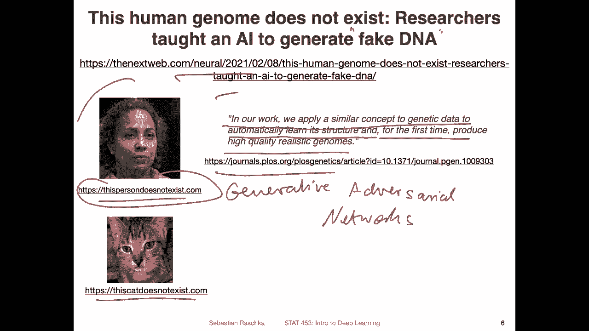
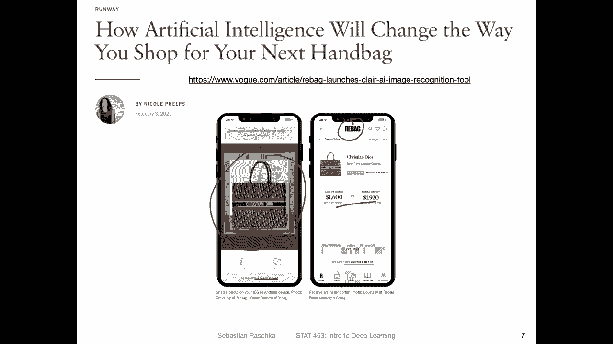

# 41：深度学习新闻 #3：2021年2月13日计算机视觉前沿 🚀

在本节课中，我们将回顾2021年2月13日当周深度学习领域，特别是计算机视觉方向的最新研究动态与有趣应用。我们将探讨无需归一化的高性能图像识别、深度学习理论假说、提升模型公平性的数据方法、训练数据影响力估计、生成对抗网络在基因组学中的应用，以及一个有趣的计算机视觉估价项目。

---

## 1. 无需归一化的高性能图像识别 🖼️

上一节我们介绍了本周新闻的概览，本节中我们来看看一项关于图像识别的重要研究。

研究人员开发了一种深度神经网络，在不使用批归一化（Batch Normalization）的情况下，取得了图像分类任务的新**State of the Art（SOTA）**结果。SOTA通常指在特定任务上达到了当前最佳或接近最佳的性能。

这项工作的新颖之处在于，他们通过一种**自适应梯度裁剪（adaptive gradient clipping）**技术，克服了不使用批归一化带来的训练不稳定性问题，从而构建了所谓的**归一化自由残差网络（Normalizer-Free Residual Networks）**。

以下是该研究性能评估的一个关键点：

*   **评估指标**：研究主要关注**ImageNet Top-1准确率**。在ImageNet数据集中，由于图像可能对应多个合理标签，研究者有时也会计算Top-5准确率。
*   **计算效率**：研究还评估了模型的计算效率，即**训练延迟（每秒/步）**。这有助于理解模型在不同规模（从计算成本低的F0到成本高的F5）下的表现。

研究结果表明，对于不同规模的模型，他们的方法在准确率上都优于其他高效架构（如EfficientNet、LambdaNet等），证明了无需批归一化也能获得优异性能的可能性。

---

## 2. 深度学习理论前沿：假说与讨论 🧠

在了解了具体的模型改进后，我们转向一些更理论性的讨论。本周Reddit机器学习板块有一些关于深度学习理论进展的有趣讨论。

以下是两个被广泛讨论的假说：

*   **彩票假说（Lottery Ticket Hypothesis）**：该假说认为，在一个庞大的、过参数化的网络中，随机初始化的子网络（即“中奖彩票”）本身就具有优异的性能潜力。近期有研究为该假说提供了支持和反对的证据，其有效性仍在讨论中。
*   **双下降现象（Double Descent Hypothesis）**：这一现象描述了模型误差随复杂度变化的非典型曲线。与传统观点认为测试误差会随模型变复杂而先降后升（过拟合）不同，实践发现误差在上升后可能会再次下降，形成一个“双下降”的走势。目前这仍是一个活跃的研究领域。

---

## 3. 通过移除偏见数据提升模型公平性与准确率 ⚖️

从理论回到实践，我们来看一个关于机器学习公平性的重要研究。该研究探讨了通过**移除训练数据中的偏见数据**来提升模型公平性甚至准确率的方法。

研究人员发现，在多个数据集上，通过识别并移除对模型造成不公平影响的训练样本，他们不仅能够将模型的**歧视率降低到接近0%**，同时还**观察到了相比使用全部数据训练的模型更高的准确率**。这与通常为提升公平性而牺牲准确率的做法相反，是一个“双赢”的结果。

他们的方法步骤如下：
1.  从带有偏见的训练数据开始。
2.  使用特征提取器生成**相似对（similar pairs）**，即敏感属性（如性别、种族）不同但其他特征相同的个体对。
3.  基于初始模型，按**对模型预测的影响力**对训练样本进行排序。
4.  移除影响力高的偏见数据点，在新数据上重新训练模型并测量歧视率。
5.  重复步骤3和4，直到歧视率不再改善。

---

## 4. 估计训练数据影响力的新方法：TracIn 🔍

与上一节的数据影响力概念相关，Google AI团队提出了一种名为**TracIn**的简单方法，用于估计单个训练样本对最终模型的影响。

与大多数可解释性方法关注特征重要性不同，TracIn关注**训练样本本身的影响力**。该方法在训练过程中记录每个训练样本引起的预测变化，特别有助于**检测异常值**和**解释模型预测**。

例如，在一个多分类任务中，TracIn可以显示，展示一个“安全带”图片可能会提高模型对“安全带”的分类能力，但同时可能会暂时增加模型对“西葫芦”分类的损失。这有助于理解不同数据点之间的权衡与影响。

---

## 5. GAN的新应用：生成“不存在”的基因组 🧬

接下来，我们将目光转向生成模型。生成对抗网络（GAN）曾被用于生成不存在的人脸（如“This Person Does Not Exist”网站）和猫脸。现在，研究人员将这一思路应用到了**基因组学**领域。

他们训练GAN来生成**高质量、逼真但完全虚构的人类基因组序列**。这项工作具有重要意义，因为真实的基因组数据涉及严重的隐私问题。使用这种生成的、不指向任何真实个体的基因组数据，可以在保护隐私的前提下，促进需要大量基因组数据的研究（如训练大规模基因分类模型），缓解数据分享和模型发布中的隐私顾虑。

---

## 6. 计算机视觉项目灵感：手袋价格评估应用 💼

最后，我们来看一个有趣的计算机视觉应用实例，或许能为大家的课程项目带来灵感。

一家名为Rebag的公司开发了一款应用，利用计算机视觉模型来**估计手袋的转售价格**。用户只需拍摄手袋的照片，模型即可给出估价。该项目历时六年开发，使用了数百万数据点进行训练。

这个项目展示了如何将一个直接的计算机视觉想法（图像识别与估价）通过大规模数据收集和模型优化，转化为一个实用的产品。这可以启发类似的课程项目，例如开发用于估计手机、笔记本电脑等其他商品价值的视觉模型。

---

## 总结 📝

本节课中我们一起学习了2021年2月中旬深度学习与计算机视觉领域的多项进展：
1.  介绍了无需批归一化也能达到SOTA性能的图像识别新方法。
2.  探讨了“彩票假说”和“双下降现象”等深度学习理论前沿讨论。
3.  学习了一种通过移除偏见数据来同时提升模型公平性与准确率的创新方法。
4.  了解了TracIn方法，它通过估计训练样本影响力来帮助解释模型和发现异常值。
5.  看到了GAN在生成虚构基因组数据以解决生物信息学隐私问题上的新颖应用。
6.  获得了一个关于构建计算机视觉估价应用的实用项目灵感。

希望这些内容能帮助你了解当前的研究动态并激发你的学习兴趣。