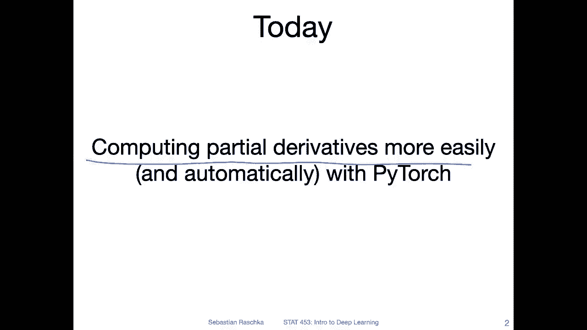
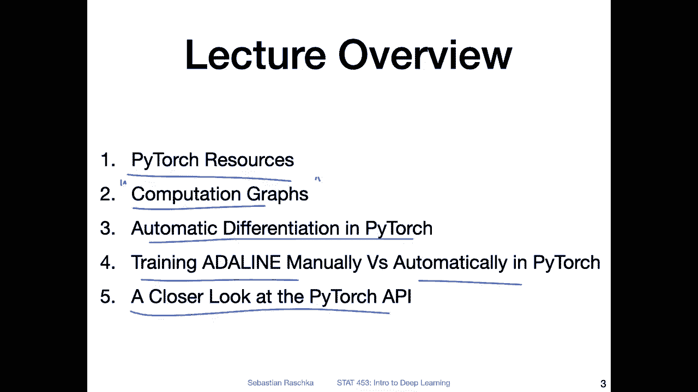

# 42：L6.0 - PyTorch 中的自动微分 🧠

在本节课中，我们将要学习 PyTorch 框架中的核心功能——自动微分。我们将了解它如何自动计算梯度，从而省去手动推导复杂损失函数导数的繁琐过程，并探索其背后的计算图原理。

---

## 第一部分：PyTorch 学习资源 📚

上一节我们介绍了本课程的目标，本节中我们来看看如何获取更多关于 PyTorch 的信息和帮助。

除了本课程，以下资源可以帮助你找到更多信息、教程，并跟进 PyTorch 的新版本发布与发展动态。

以下是 PyTorch 的主要学习资源：

*   **官方文档**：最权威的 API 参考和教程来源。
*   **PyTorch 论坛**：社区讨论和问题解答的平台。
*   **GitHub 仓库**：查看源代码、提交问题或参与贡献。
*   **相关课程与博客**：许多大学和开发者提供了额外的学习材料。

---

## 第二部分：理解计算图 🕸️

了解了资源获取途径后，本节中我们来看看自动微分背后的核心概念——计算图。

计算图是一种用于可视化一系列计算（如神经网络的前向预测过程）的数据结构。在 PyTorch 内部，它会自动构建这样的计算图。

一个计算图由**节点**（代表变量或操作）和**边**（代表数据流）组成。例如，一个简单的运算 `c = a + b` 可以表示为两个输入节点 `a`、`b` 通过一个 “+” 操作节点，连接到输出节点 `c`。



---

## 第三部分：PyTorch 的自动微分机制 ⚙️

基于计算图的概念，本节我们来了解 PyTorch 的 Autograd 模块如何实现自动微分。

PyTorch 在张量（Tensor）上进行运算时会动态构建计算图。当我们调用 `.backward()` 函数时，它会依据这个计算图，利用**反向传播**算法，从输出开始反向遍历，自动计算所有相关参数的梯度。

关键步骤如下：

1.  在前向传播中记录所有操作。
2.  在损失张量上调用 `.backward()`。
3.  Autograd 沿计算图反向传播，计算每个参数的梯度并存储在张量的 `.grad` 属性中。

---

## 第四部分：应用于 Adaline 模型 🔄

上一讲我们手动训练了 Adaline 模型，并手工计算了导数。本节我们将看到如何使用 PyTorch 自动完成这些繁琐的工作。

我们将使用 PyTorch 重写 Adeline 的训练过程。核心是使用 `torch.autograd` 功能，只需定义前向传播和损失函数，然后调用 `loss.backward()`，PyTorch 便会自动计算所有权重参数的梯度。

以下是关键代码对比：

```python
# 手动更新权重（上节课）
# 需要手动推导公式并编码
gradient = ... # 复杂的导数计算
weights = weights - learning_rate * gradient

# 自动更新权重（本节课）
loss = criterion(output, target)
loss.backward() # 自动计算梯度
with torch.no_grad():
    weights -= learning_rate * weights.grad
    weights.grad.zero_() # 梯度清零
```

---

## 第五部分：PyTorch API 设计模式 🏗️

最后，我们来更深入地了解 PyTorch 的 API 设计，这有助于我们后续实现更复杂的多层神经网络。

PyTorch 主要提供两种子 API 风格：

以下是两种主要的 API：

*   **面向对象 API（`torch.nn.Module`）**：通过创建类（继承自 `nn.Module`）来定义模型，将层作为属性，前向传播定义为类方法。这种方式结构清晰，易于管理复杂模型。
*   **函数式 API（`torch.nn.functional`）**：提供一系列函数式接口（如 `F.relu`, `F.linear`），更适用于需要精细控制的前向传播过程，例如在自定义层中。

在实际项目中，通常结合使用两者：用 `Module` 类组织模型结构，在类内部的 `forward` 方法中使用函数式 API 进行具体计算。

---

## 总结 📝



本节课中我们一起学习了 PyTorch 的自动微分机制。我们首先了解了如何获取 PyTorch 学习资源，然后引入了计算图的概念来解释自动微分的原理。接着，我们将其应用于 Adaline 模型，体验了 `.backward()` 函数如何替代繁琐的手动求导。最后，我们概览了 PyTorch 面向对象和函数式两种 API 设计模式，为后续构建更复杂的神经网络打下基础。掌握自动微分是高效进行深度学习开发的关键一步。