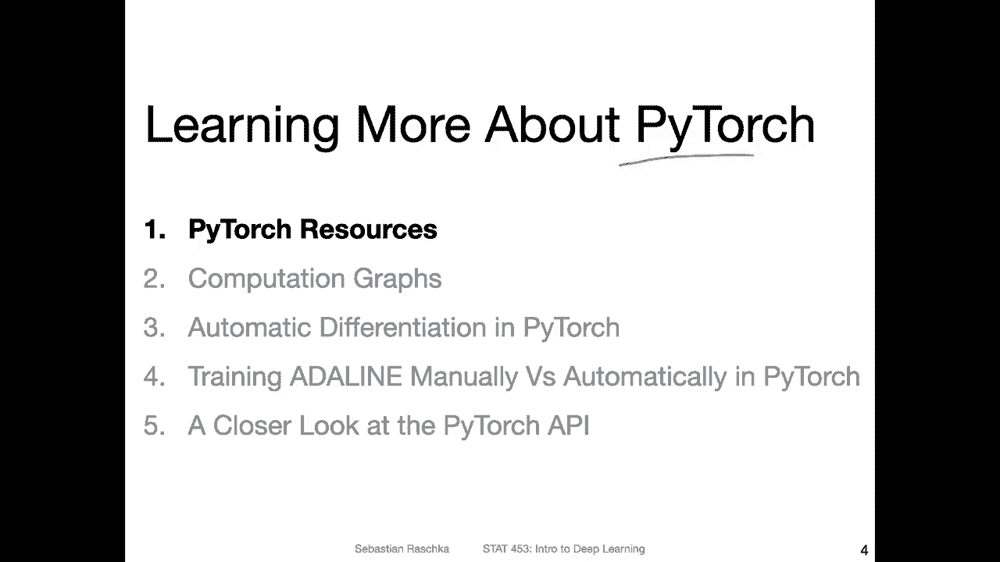
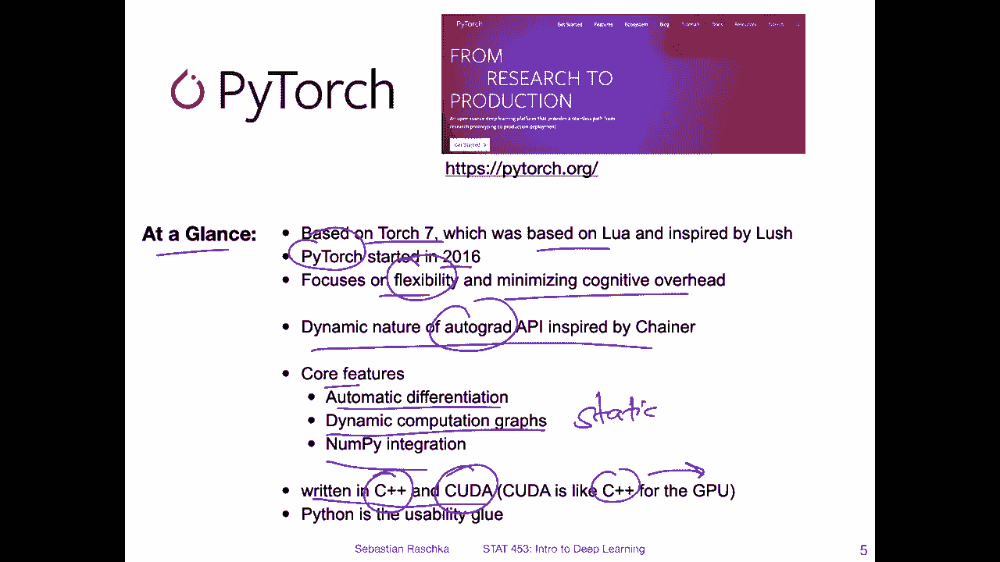
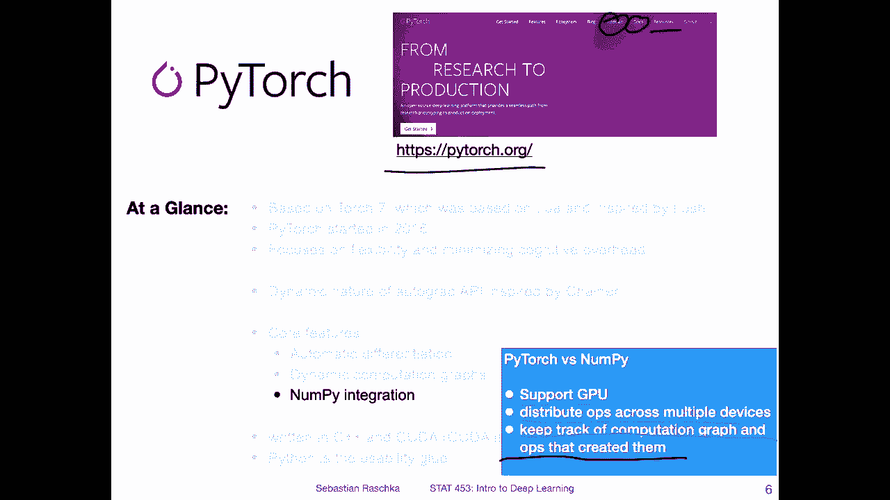
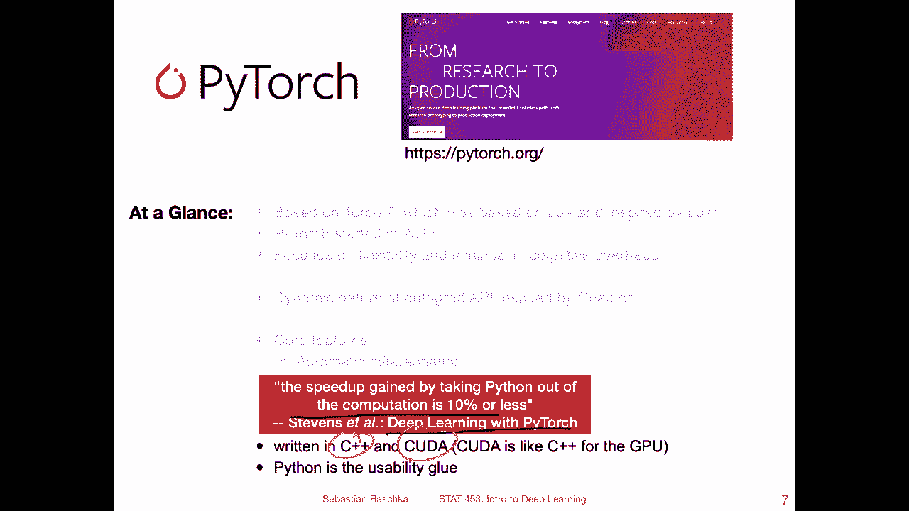
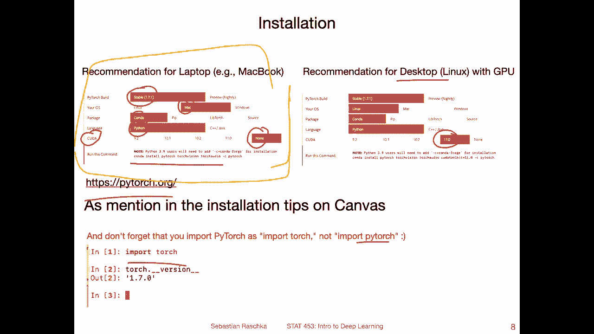
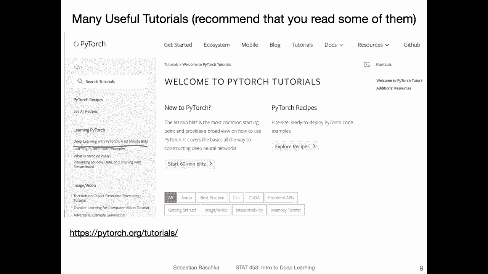
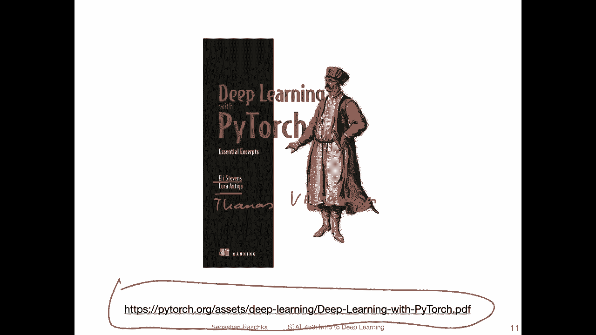
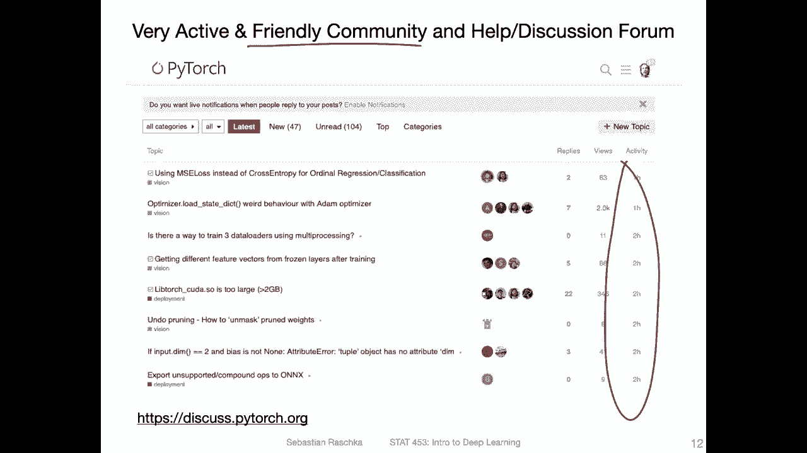
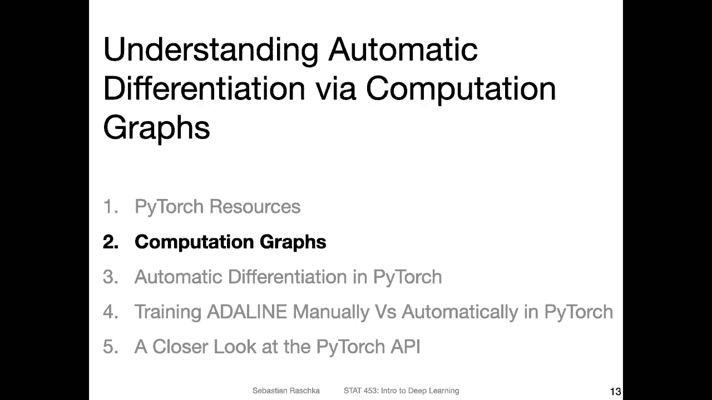

# 43：L6.1 - 深入了解 PyTorch 🧠

在本节课中，我们将要学习 PyTorch 的更多信息，包括其核心概念、优势、安装方法以及如何获取更多学习资源。PyTorch 是本课程及未来项目中会频繁使用的深度学习库，了解其背景和特性将帮助你更高效地使用它。

## PyTorch 概览 📖

PyTorch 是一个基于 Python 的深度学习库。正如你在之前的课程中所见，它与 NumPy 非常相似，都使用多维数组（在 PyTorch 中称为张量）作为核心数据结构。

然而，PyTorch 在此基础上为深度学习提供了更多便利功能。

## PyTorch 的起源与发展 🔄

上一节我们介绍了 PyTorch 的基本概念，本节中我们来看看它的历史。PyTorch 基于 Torch 7 构建，后者是一个在 5 到 10 年前非常流行的深度学习库。Torch 7 有一个主要弱点：它基于 Lua 语言实现。

虽然 Lua 与 Python 相似且便于与 C 语言文件交互，但它毕竟不是 Python。由于许多开发者更倾向于使用 Python，因此在 2016 年左右，社区开始将 Torch 7 移植到 Python 中，这个项目就是 PyTorch。

PyTorch 最初使用了大量 Torch 7 的代码，但后来逐渐被重写的代码所取代。它的设计重点在于**灵活性**和**最小化认知负担**。

一个编程框架可以通过抽象所有复杂性来变得易于使用，但如果过于简化并提供固定的构建模块，在进行自定义研究（例如开发自己的网络层）时就会变得困难。PyTorch 在这两者之间取得了平衡。

## 核心特性 ⚙️

以下是 PyTorch 的几个核心特性：

*   **自动微分**：当你执行计算时，PyTorch 可以自动计算导数，你无需深入了解背后的数学原理，这非常方便。
*   **动态计算图**：这与静态计算图形成对比。早期的 TensorFlow 或 Theano 等库使用静态图，你需要先定义整个计算流程，然后才能运行，这使得调试变得困难。PyTorch 采用动态方法，更像 NumPy，代码定义后立即执行，无需编译任何计算图，因此更易于使用。
*   **NumPy 集成**：你可以在 PyTorch 张量和 NumPy 数组之间进行转换。然而，通常我们尽量避免在 PyTorch 中混用 NumPy，因为来回转换会使代码变得冗长。如今，大多数工作都可以直接使用 PyTorch 张量完成。

## 性能与实现 🚀

PyTorch 的大部分底层代码是用 C++ 和 CUDA 编写的，这就是为什么它比普通的 Python 代码高效得多。

*   C++ 是一种底层语言，非常适合科学计算。
*   CUDA 可以看作是专门为 GPU 设计的类 C++ 语言。

Python 更像是包裹在 C++ 和 CUDA 代码之上的“可用性粘合剂”，它使一切变得方便易用。

## 为何选择 PyTorch 而非 NumPy？ 🤔

既然 PyTorch 和 NumPy 如此相似，我们为什么选择 PyTorch 呢？原因如下：

*   **GPU 支持**：这对于高效训练深度神经网络至关重要，速度可能比 CPU 快数百甚至数千倍。
*   **多设备分布式计算**：支持跨多个 GPU 进行计算，对于训练大型模型尤其有帮助。
*   **计算图追踪**：PyTorch 会记录创建的操作和计算图。虽然这在不需要计算梯度时会占用额外内存，但在深度学习中，我们通常需要计算梯度以最小化损失函数。PyTorch 允许我们在需要时启用或禁用这个功能，非常灵活。

本质上，PyTorch 就是 **NumPy 加上了一系列让深度学习研究变得更简单的便利功能**。

## 安装指南 💻

关于安装，我在 Canvas 上发布过详细的说明和建议。这里简要总结一下：

*   **笔记本电脑**：建议安装 CPU 版本。除非你拥有高端游戏本，否则在笔记本电脑的 GPU 上运行可能会导致过热。我个人只在笔记本电脑上调试代码，确保在 CPU 上运行无误后，再通过更改一行代码切换到 GPU 环境运行。
*   **安装方法**：访问 PyTorch 官方网站，根据你的操作系统（Mac、Windows、Linux）、包管理器（推荐 Conda）和是否需要 CUDA 来获取安装命令。对于本课程，建议一并安装 `torchvision` 和 `torchaudio` 库。
*   **免费 GPU 资源**：在本课程中，你无需购买昂贵的 GPU。我将在后续课程中展示如何使用一些免费的在线 GPU 资源。
*   **重要提示**：导入 PyTorch 时，使用 `import torch`，而不是 `import pytorch`。

## 学习资源与社区 📚

PyTorch 拥有丰富的学习资源和活跃的社区：

*   **官方教程**：网站上的“Tutorials”板块包含许多有用内容，特别推荐《Deep Learning with PyTorch: A 60 Minute Blitz》入门教程。
*   **PyTorch 书籍**：有一本名为《Deep Learning with PyTorch》的书籍，作者包括 Eli Stevens、Luca Antiga 和 Thomas Viehmann。网站上提供免费在线阅读版本。
*   **讨论论坛**：PyTorch 拥有一个非常友好和活跃的社区。如果你遇到深入的技术问题，可以在官方论坛提问，通常能很快得到解答。

## 总结 🎯

本节课中，我们一起学习了 PyTorch 的核心概念、历史、特性以及其相对于 NumPy 的优势。我们还了解了其高性能背后的实现原理，获得了安装指南，并探索了进一步学习的宝贵资源。

PyTorch 以其灵活性、动态计算图和强大的社区支持，成为深度学习研究和应用的优秀工具。在接下来的视频中，我们将深入探讨计算图以及 PyTorch 如何利用它们进行自动微分。