# 44：L6.2 - 理解基于计算图的自动微分 🧮

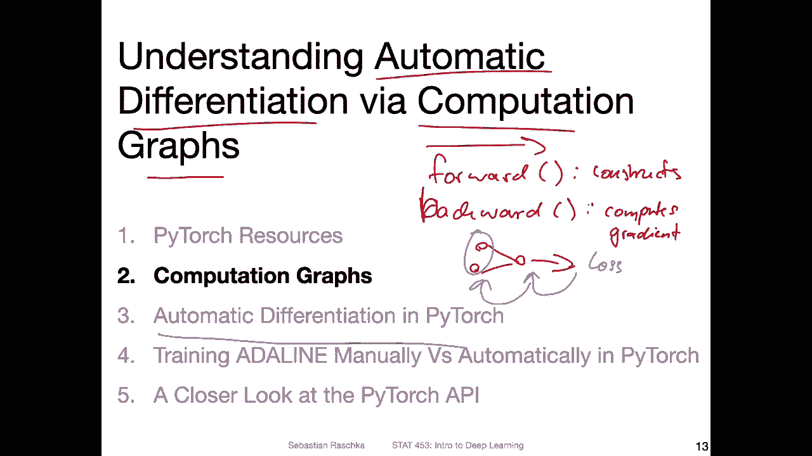

在本节课中，我们将要学习计算图的概念，它是理解现代深度学习框架（如 PyTorch）中自动微分机制的基础。我们将通过一个具体的例子，一步步拆解计算图如何表示计算过程，以及如何利用链式法则在图上进行反向传播以计算梯度。

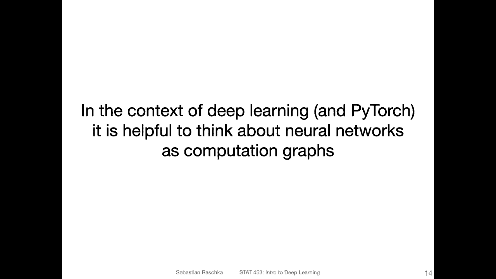

---

## 概述

在 PyTorch 中实现神经网络模型时，通常会定义两个核心方法：`forward` 和 `backward`。`forward` 方法用于构建计算图，而 `backward` 方法则通过反向遍历该图来计算梯度。理解计算图的结构和工作原理，是掌握自动微分的关键。

## 从神经网络到计算图

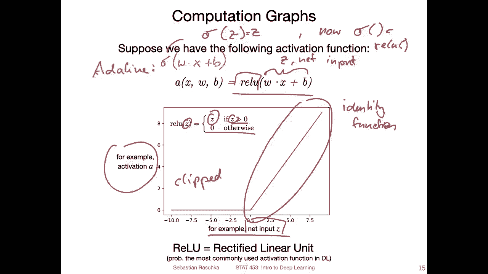

在深度学习和 PyTorch 的语境下，将神经网络视为计算图是非常有帮助的，因为神经网络本质上就是一系列嵌套的计算操作链。

为了有一个具体的例子，我们来看一个非线性激活函数。回想一下 Adaline 模型，我们计算净输入，然后将其传递给一个阈值函数。现在，我们不再使用恒等函数作为激活函数，而是使用 **ReLU 函数** 来让例子更有趣。

ReLU 函数的定义如下：
```
a = relu(z) = max(0, z)
```
其数学含义是：如果输入 `z` 大于 0，则输出 `z`；否则输出 0。

在计算图中，ReLU 函数在 `z > 0` 时斜率为 1，在 `z <= 0` 时斜率为 0。虽然在数学上 `z = 0` 这一点不可导，但在计算实践中，我们通常将其导数定义为：
```
relu'(z) = 1 if z > 0 else 0
```
这种调整在计算中是可行的，因为实践中我们很少会精确地遇到 `z = 0` 的情况。

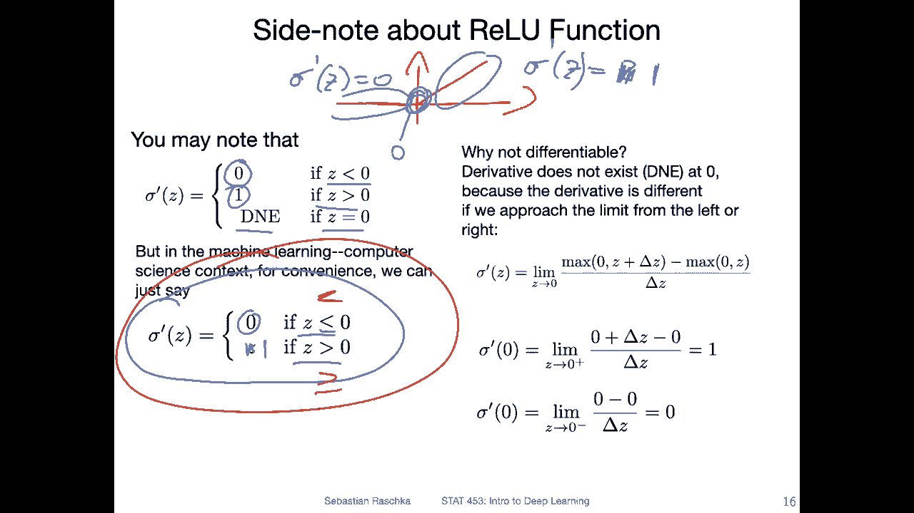

## 构建一个计算图示例

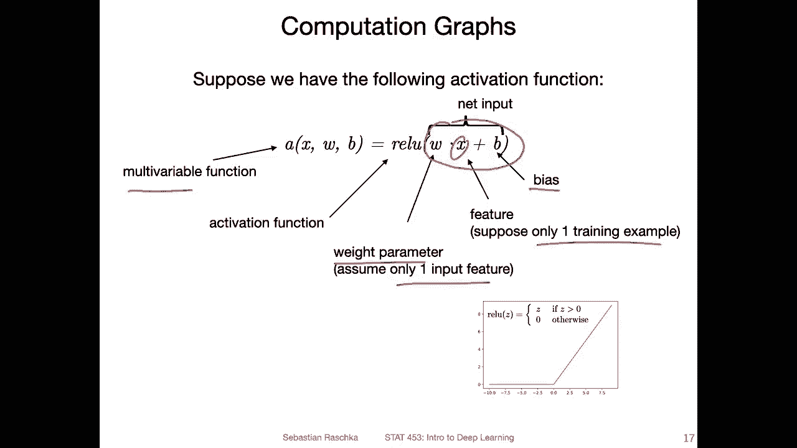

现在，我们考虑一个具有三个输入的函数：一个特征 `x`、一个偏置项 `b` 和一个权重 `w`。其计算过程是：先计算净输入 `z = w*x + b`，然后将其输入 ReLU 激活函数。

我们可以用计算图清晰地表示这个过程。我们引入两个中间变量来简化图示：
*   `u = w * x`
*   `v = u + b`
*   `a = relu(v)`

对应的计算图如下所示：


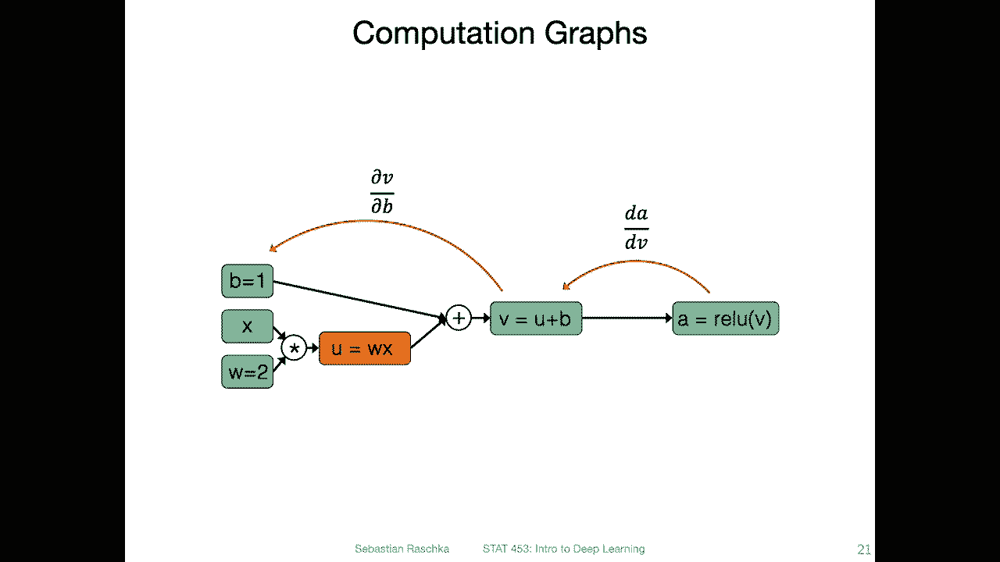

在深度学习中，我们通常关心损失函数对权重或偏置的偏导数。我们可以使用链式法则，将这个复杂的导数分解为图上多个简单步骤的导数组合。例如，计算输出 `a` 对权重 `w` 的导数，可以分解为：
1.  `a` 对 `v` 的导数
2.  `v` 对 `u` 的导数
3.  `u` 对 `w` 的导数

然后利用链式法则将它们相乘：`da/dw = (da/dv) * (dv/du) * (du/dw)`。

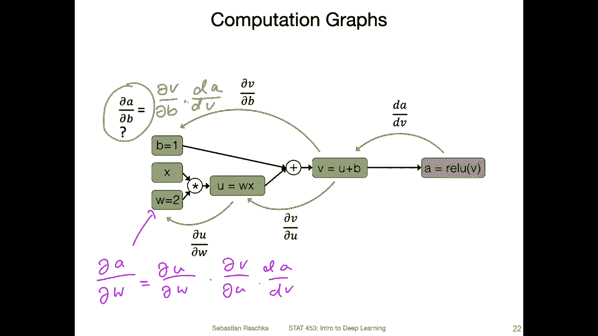

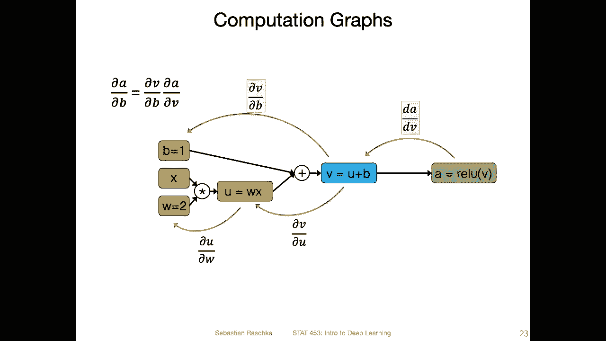

## 通过具体数值理解反向传播

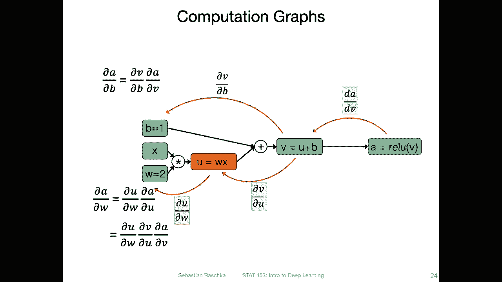

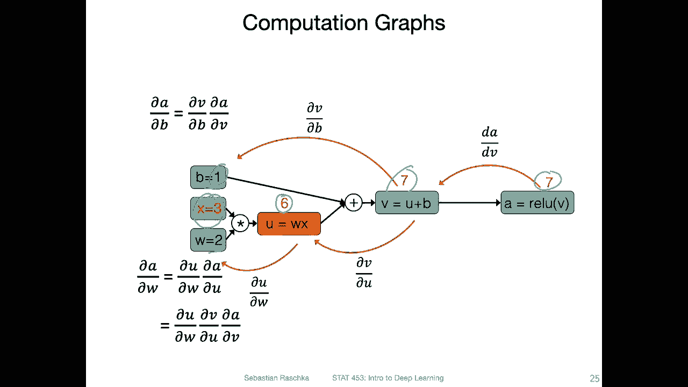

让我们用一个具体例子来实践。假设：`b = 1`, `w = 2`, `x = 3`。
*   前向传播：
    *   `u = w * x = 2 * 3 = 6`
    *   `v = u + b = 6 + 1 = 7`
    *   `a = relu(7) = 7`
*   反向传播（计算梯度）：
    *   `da/dv = relu'(7) = 1` （因为输入大于0）
    *   `dv/du = 1` （加法的导数）
    *   `dv/db = 1` （加法的导数）
    *   `du/dw = x = 3` （乘法的导数）

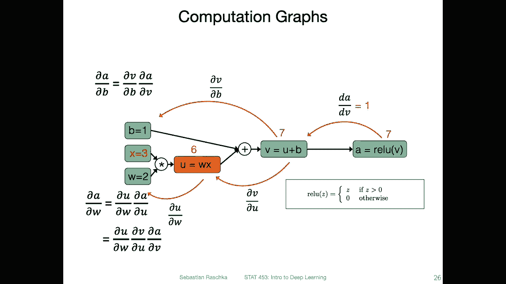

现在，我们可以组合这些梯度：
*   输出 `a` 对权重 `w` 的梯度：`da/dw = (da/dv) * (dv/du) * (du/dw) = 1 * 1 * 3 = 3`
*   输出 `a` 对偏置 `b` 的梯度：`da/db = (da/dv) * (dv/db) = 1 * 1 = 1`

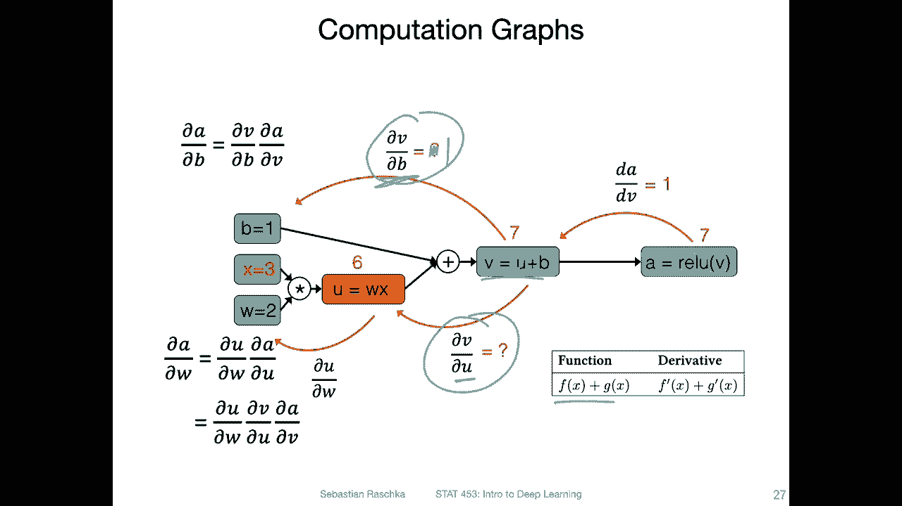

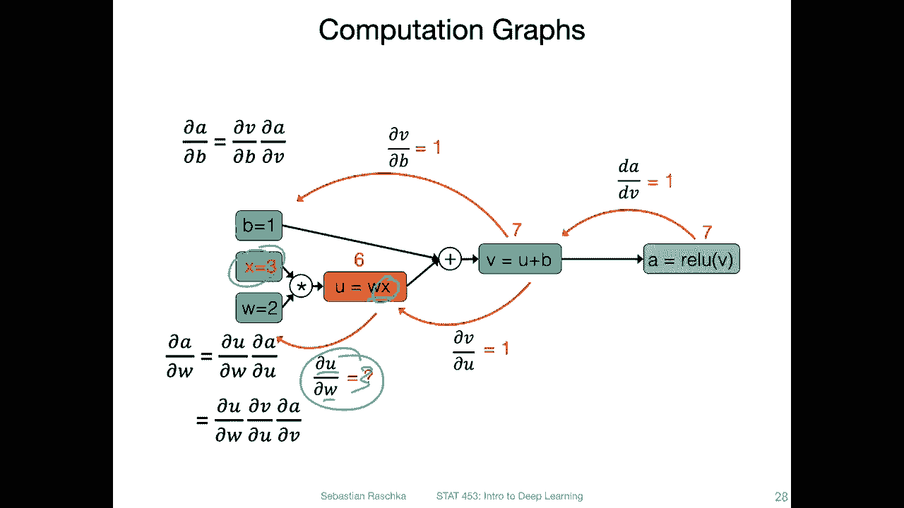

这就是我们利用计算图和链式法则计算梯度的方式。

## 更复杂的计算图结构

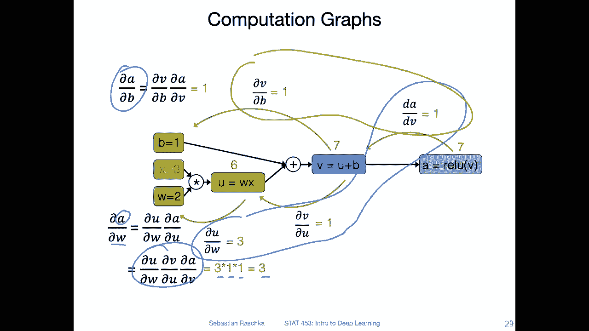

上面的例子是一个简单的单路径计算图。在实践中，我们会遇到更复杂的结构。

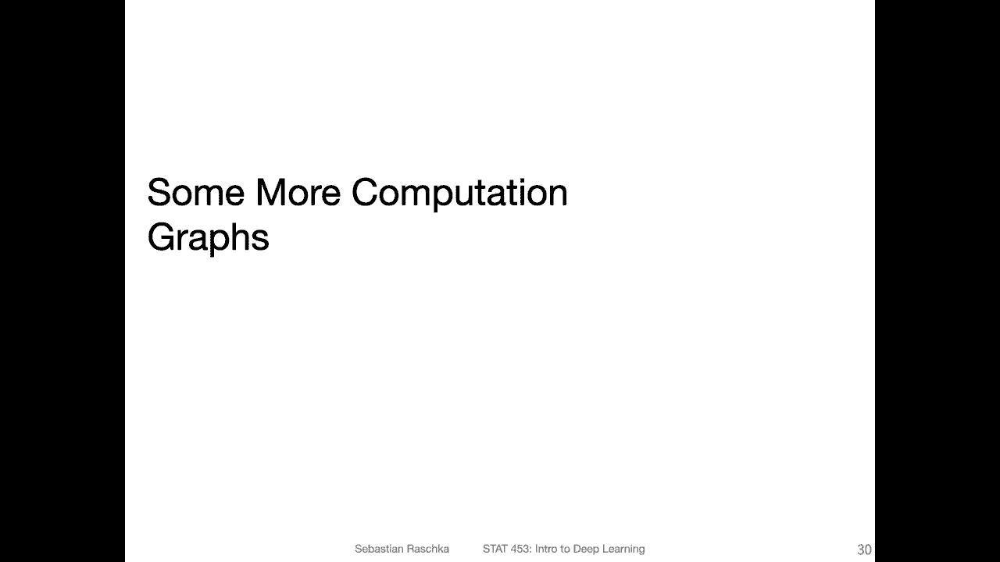

**1. 带有损失函数的单路径图：**
一个完整的模型通常包括损失计算。例如，在 Adaline 中，我们在激活函数输出 `a` 后，会计算预测输出 `o` 与真实标签 `y` 之间的均方误差损失 `L`。此时，计算损失 `L` 对权重 `w` 的梯度，路径会变得更长：`dL/dw = (dL/do) * (do/da) * (da/dv) * (dv/du) * (du/dw)`。


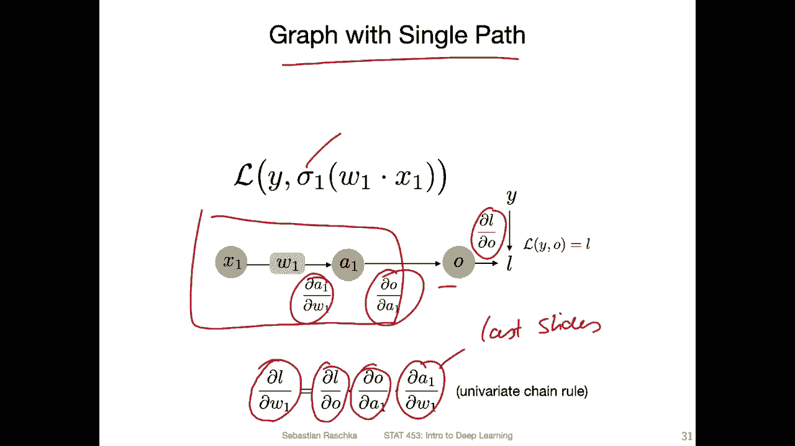

**2. 权重共享的图：**
在某些架构（如卷积神经网络）中，同一个权重参数可能被用在多个地方。在这种情况下，计算该权重的梯度时，需要考虑所有使用到它的路径，并使用多元链式法则将来自不同路径的梯度相加。


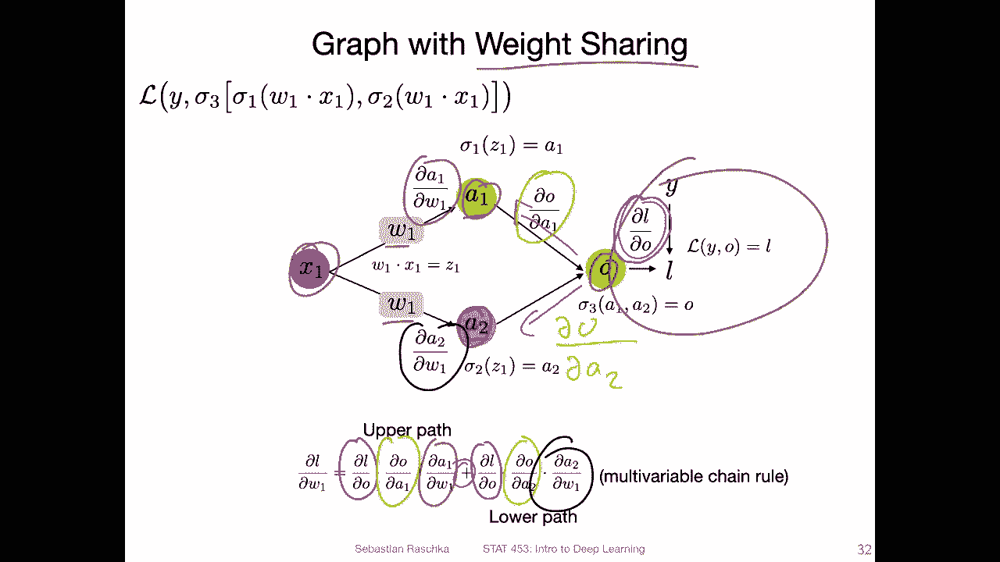

**3. 多层感知机（MLP）的图：**
在一个具有多个隐藏层的 MLP 中，计算底层某个权重的梯度会涉及更长的、可能分叉又合并的路径。例如，为了计算第一层权重 `W1` 的梯度，梯度信号需要从损失函数开始，反向流经第二层激活、第一层激活，最终到达 `W1`，并且可能通过该层神经元的多个后续连接进行汇聚。


手动为复杂网络推导和编码这些梯度计算非常繁琐且容易出错。这正是深度学习框架的价值所在：我们只需要定义前向计算（构建计算图），框架的自动微分引擎会自动为我们完成反向传播和梯度计算。

## 总结

本节课中，我们一起学习了计算图的核心概念。我们了解到：

1.  计算图是表示计算过程的有向无环图，其中节点代表变量或操作，边代表数据流。
2.  在计算图上，前向传播执行计算，反向传播利用链式法则计算梯度。
3.  通过将复杂的导数分解为图上局部操作的导数，我们可以系统地计算任何参数的梯度。
4.  实际神经网络的计算图可能非常复杂，包含损失计算、权重共享和多条路径，手动计算梯度不切实际。
5.  现代深度学习框架（如 PyTorch）的自动微分功能，正是基于计算图这一抽象，自动为我们管理了梯度的计算，极大提高了开发效率。

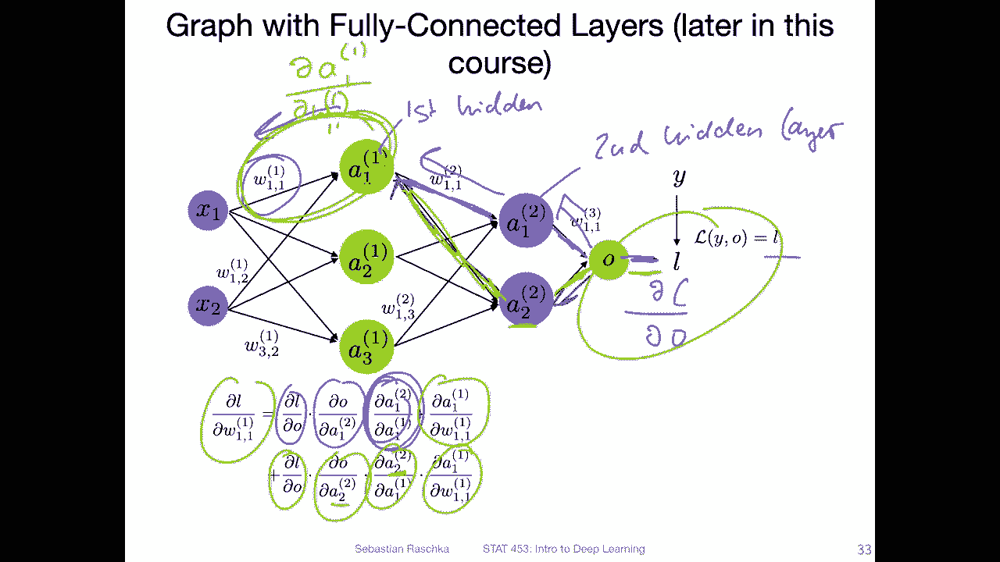

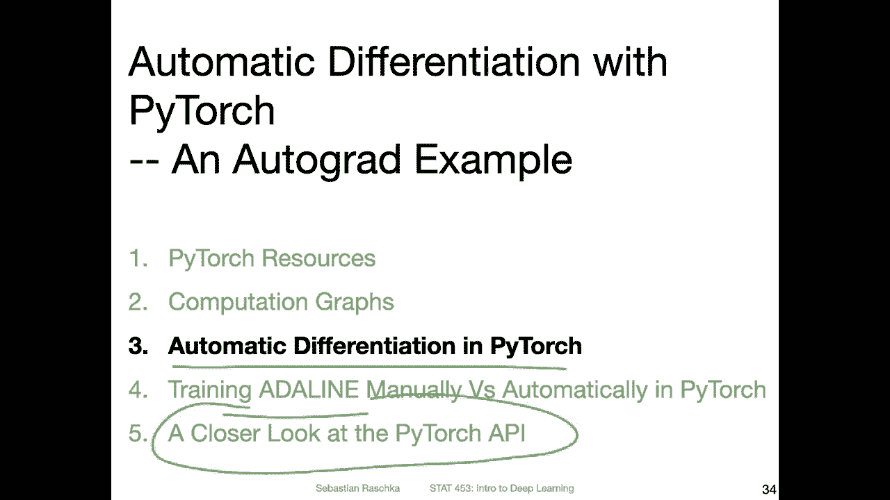

在接下来的课程中，我们将看到如何在 PyTorch 中具体实现自动微分，并将其应用于像 Adaline 这样的实际模型中。