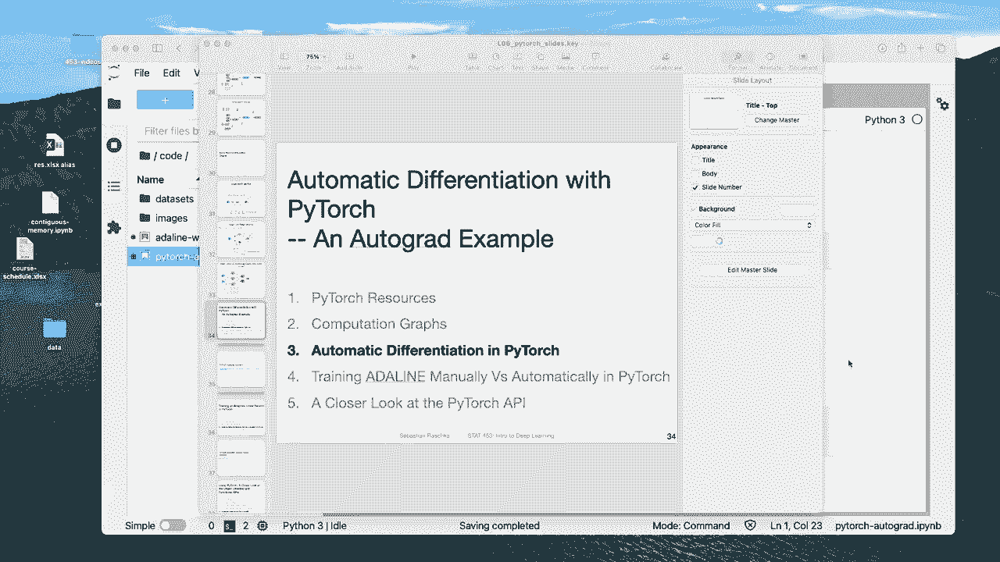
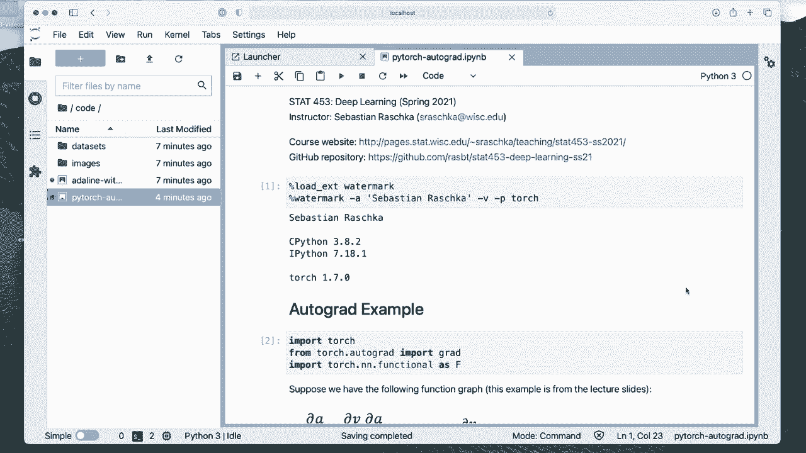
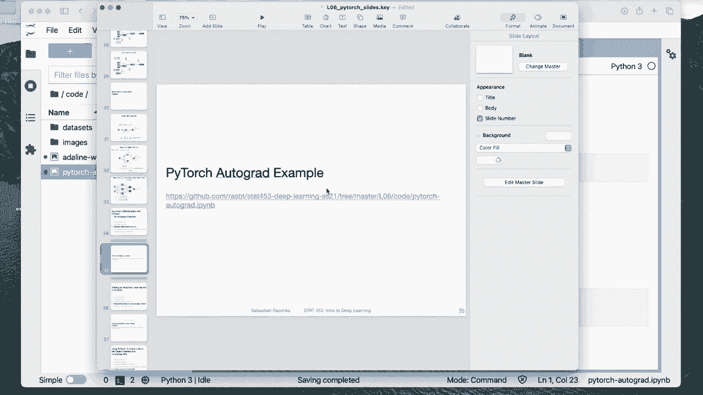
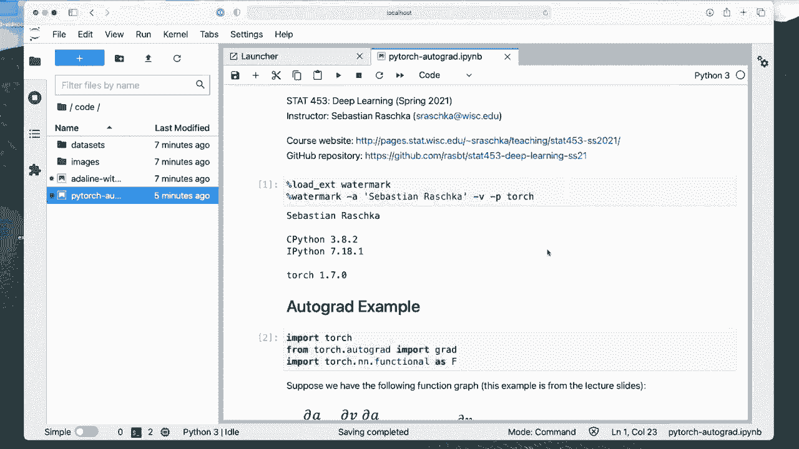
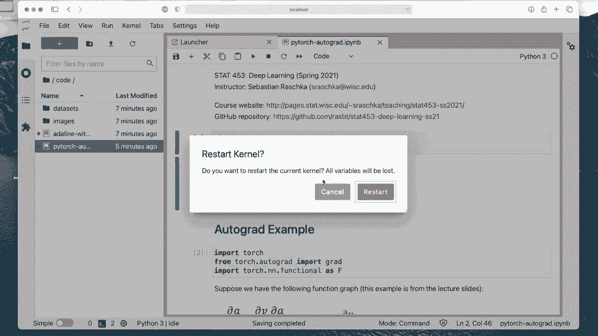
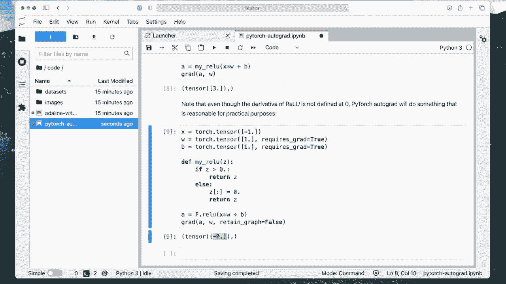
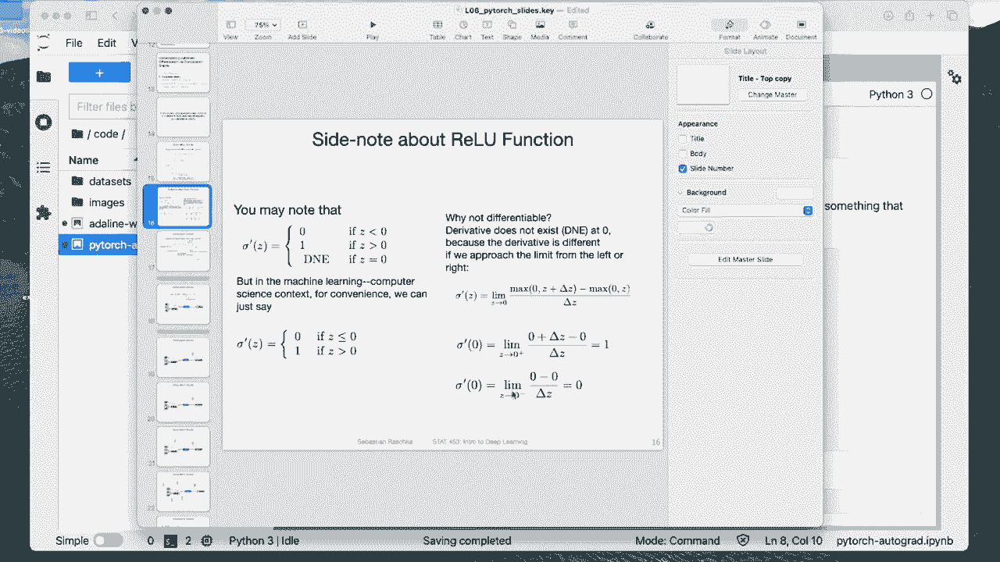
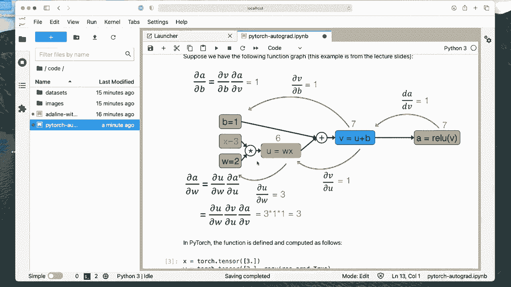

# 45：L6.3 - PyTorch 中的自动微分 🧠

在本节课中，我们将要学习 PyTorch 中自动微分的基本概念。我们将了解计算图是如何构建的，以及如何使用 `autograd` API 来计算梯度。这些知识是理解后续模型训练的基础。







---





上一节我们介绍了计算图的概念，本节中我们来看看如何在 PyTorch 中具体实现它。

首先，我们导入必要的库并查看环境版本。

```python
import torch
import torch.nn.functional as F
```

接下来，我们定义一个简单的计算图。这个图与我们之前讨论的示例相同，包含输入 `x`、权重 `w`、偏置 `b` 和一个激活函数。

```python
x = torch.tensor([1.0, 2.0])
w = torch.tensor([1.0, -1.0], requires_grad=True)
b = torch.tensor([0.5], requires_grad=True)

z = torch.dot(x, w) + b
a = F.relu(z)
```

请注意，我们为 `w` 和 `b` 设置了 `requires_grad=True`。这告诉 PyTorch 我们需要计算这些张量的梯度，因此它会为此构建并保存计算图。默认情况下，`requires_grad` 是 `False`，这是一个节省内存的好设计，因为并非所有操作都需要计算梯度。

当我们运行上述代码时，PyTorch 会在后台创建一个类似下图的内部计算图。


---

现在，让我们看看如何计算梯度。我们将使用 `torch.autograd.grad` 函数。

以下是计算 `a` 对 `w` 的梯度的方法：

```python
grad_w = torch.autograd.grad(outputs=a, inputs=w, retain_graph=True)
print(grad_w)  # 输出应为 tensor([3., 3.])
```

参数 `retain_graph=True` 表示在计算梯度后保留计算图。如果不设置，计算图会在调用后立即被销毁，这是为了在深度神经网络训练中防止内存无限增长。每次前向传播都会动态重建计算图。

接着，我们计算 `a` 对 `b` 的梯度：

```python
grad_b = torch.autograd.grad(outputs=a, inputs=b)
print(grad_b)  # 输出应为 tensor([1.])
```

这次我们没有保留计算图。如果尝试再次计算梯度，将会出错，因为图已被销毁。

---

PyTorch 的自动微分机制非常灵活，甚至可以处理包含条件语句的自定义函数。

例如，我们可以自己实现一个 ReLU 函数：

```python
def my_relu(x):
    return torch.where(x > 0, x, torch.tensor(0.0))

# 使用自定义函数
a_custom = my_relu(z)
grad_w_custom = torch.autograd.grad(outputs=a_custom, inputs=w, retain_graph=True)
```

即使函数在某个点（如 `x=0`）的数学导数未定义，PyTorch 也会采用合理的处理方式（例如将梯度设为 0），而不会导致程序崩溃。这体现了其自动微分的鲁棒性。

---



本节课中我们一起学习了 PyTorch 自动微分的核心机制。我们了解到：



1.  通过设置 `requires_grad=True` 来声明需要计算梯度的张量。
2.  PyTorch 会为此自动构建计算图。
3.  使用 `torch.autograd.grad` 函数可以计算指定输出对指定输入的梯度。
4.  计算图默认在梯度计算后被销毁以节省内存，可通过 `retain_graph=True` 保留。
5.  自动微分系统能够灵活处理包括自定义函数在内的各种操作。



在下一节课中，我们将把这些概念应用于一个完整的例子：训练 Adaline 自适应线性神经元模型。