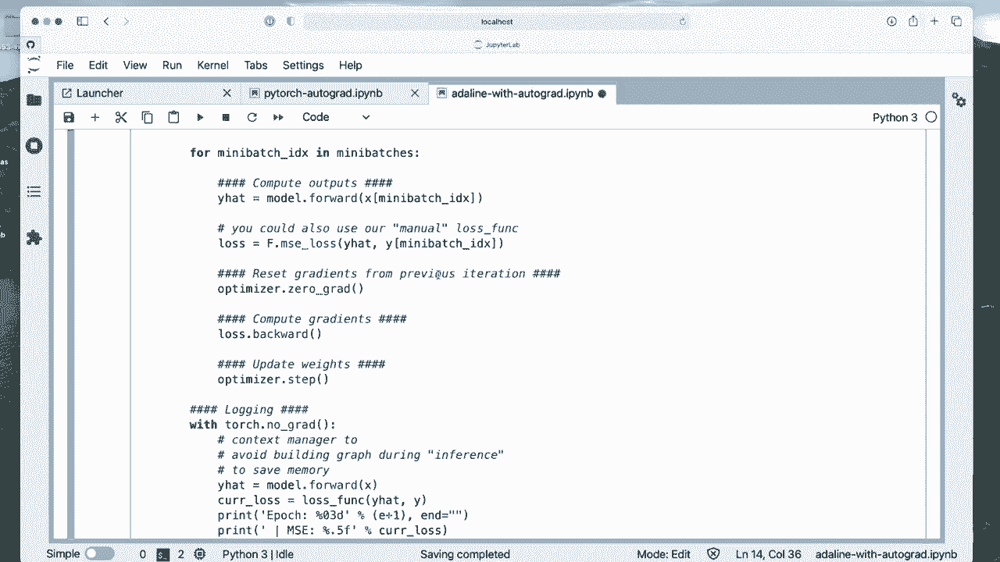

# 46：L6.4 - 使用 PyTorch 训练 ADALINE 🧠


在本节课中，我们将学习如何使用 PyTorch 的自动微分功能来训练 ADALINE 模型。我们将从手动实现梯度计算开始，逐步过渡到使用 PyTorch 提供的更自动化的方法，最终展示 PyTorch 的标准训练流程。通过对比不同实现方式，你将理解自动微分的便利性及其在深度学习中的核心作用。


---


## 📝 概述与准备工作


首先，我们导入必要的库并准备数据。我们将使用鸢尾花数据集，因为它结构简单，便于我们专注于代码实现而非数据处理。


```python
import torch
import torch.nn as nn
import torch.nn.functional as F
from torch.autograd import grad
```


加载和准备数据的代码与之前课程中的完全一致。


```python
# 假设 X_train, y_train, X_test, y_test 已按之前课程的方式加载并准备好
# X_train: 训练特征， y_train: 训练标签
# X_test: 测试特征， y_test: 测试标签
```


---


## 1️⃣ 手动实现 ADALINE


上一节我们回顾了 ADALINE 的基本原理。本节中，我们先来看看完全手动计算梯度的实现方式。


以下是 ADALINE 模型的手动实现，包括初始化、前向传播和手动计算梯度的反向传播。


```python
class AdalineManual:
    def __init__(self, num_features):
        self.num_features = num_features
        self.weights = torch.zeros(num_features, 1, dtype=torch.float32)
        self.bias = torch.zeros(1, dtype=torch.float32)

    def forward(self, x):
        # 净输入: z = w^T x + b
        net_input = torch.matmul(x, self.weights) + self.bias
        # 激活函数（恒等函数）
        activation = net_input
        return activation

    def backward(self, x, target, activation):
        # 手动计算损失关于权重和偏置的梯度
        error = target - activation
        grad_w = -2.0 * torch.matmul(x.t(), error) / x.size(0)
        grad_b = -2.0 * torch.mean(error)
        return grad_w, grad_b

    def predict(self, x):
        # 阈值函数进行预测
        activation = self.forward(x)
        predictions = torch.where(activation >= 0.0, 1, -1)
        return predictions
```


训练循环包括前向传播、手动梯度计算和参数更新。


```python
def train_manual(model, X, y, epochs=20, lr=0.01, batch_size=32, seed=1):
    torch.manual_seed(seed)
    cost_history = []
    for epoch in range(epochs):
        # 打乱数据并创建小批量
        indices = torch.randperm(X.size(0))
        X_shuffled = X[indices]
        y_shuffled = y[indices]
        epoch_loss = 0.0
        for i in range(0, X.size(0), batch_size):
            batch_x = X_shuffled[i:i+batch_size]
            batch_y = y_shuffled[i:i+batch_size].view(-1, 1)
            # 前向传播
            activations = model.forward(batch_x)
            # 计算损失（MSE）
            loss = torch.mean((batch_y - activations) ** 2)
            epoch_loss += loss.item()
            # 手动反向传播计算梯度
            grad_w, grad_b = model.backward(batch_x, batch_y, activations)
            # 更新参数: w = w - lr * grad_w
            model.weights -= lr * grad_w
            model.bias -= lr * grad_b
        avg_loss = epoch_loss / (X.size(0) // batch_size)
        cost_history.append(avg_loss)
        print(f'Epoch: {epoch+1:03d} | Loss: {avg_loss:.4f}')
    return cost_history
```


运行手动训练并评估。


```python
# 初始化模型
model_manual = AdalineManual(num_features=X_train.size(1))
# 训练
costs_manual = train_manual(model_manual, X_train, y_train)
# 评估
train_pred = model_manual.predict(X_train)
test_pred = model_manual.predict(X_test)
train_acc = torch.mean((train_pred == y_train.view(-1,1)).float())
test_acc = torch.mean((test_pred == y_test.view(-1,1)).float())
print(f'Training Accuracy: {train_acc:.4f}')
print(f'Test Accuracy: {test_acc:.4f}')
```


---


## 2️⃣ 使用 `torch.autograd.grad` 实现半自动梯度计算


上一节我们手动推导并编写了梯度公式。本节中，我们来看看如何利用 PyTorch 的 `grad` 函数自动计算梯度，从而避免繁琐的手动推导。


以下是修改后的训练函数，关键区别在于使用 `torch.autograd.grad` 计算梯度。


```python
def train_semi_auto(model, X, y, epochs=20, lr=0.01, batch_size=32, seed=1):
    torch.manual_seed(seed)
    cost_history = []
    for epoch in range(epochs):
        indices = torch.randperm(X.size(0))
        X_shuffled = X[indices]
        y_shuffled = y[indices]
        epoch_loss = 0.0
        for i in range(0, X.size(0), batch_size):
            batch_x = X_shuffled[i:i+batch_size]
            batch_y = y_shuffled[i:i+batch_size].view(-1, 1)
            # 前向传播
            activations = model.forward(batch_x)
            loss = torch.mean((batch_y - activations) ** 2)
            epoch_loss += loss.item()
            # 使用 autograd.grad 自动计算梯度
            grad_w = grad(loss, model.weights, retain_graph=True)[0]
            grad_b = grad(loss, model.bias)[0] # 计算偏置梯度后无需保留计算图
            # 更新参数（注意负号）
            model.weights -= lr * grad_w
            model.bias -= lr * grad_b
        avg_loss = epoch_loss / (X.size(0) // batch_size)
        cost_history.append(avg_loss)
        # 使用 torch.no_grad() 上下文管理器避免在日志记录时构建计算图
        with torch.no_grad():
            print(f'Epoch: {epoch+1:03d} | Loss: {avg_loss:.4f}')
    return cost_history
```


模型类 `AdalineSemiAuto` 与前一个 `AdalineManual` 完全相同，只是训练函数不同。运行此版本会得到与手动实现完全相同的损失和准确率，验证了自动微分的正确性。

---


## 3️⃣ 使用 PyTorch 标准 API 全自动训练


前面两种方法仍然需要我们显式地调用梯度计算和更新。本节中，我们来看看 PyTorch 最常用、最便捷的训练范式，它利用 `nn.Module`、损失函数和优化器将流程完全自动化。


以下是使用 PyTorch 高层 API 实现的 ADALINE。


```python
class AdalineTorch(nn.Module):
    def __init__(self, num_features):
        super(AdalineTorch, self).__init__()
        # 使用线性层自动管理权重和偏置
        self.linear = nn.Linear(num_features, 1, bias=True)
        # 为了与之前对比，将权重初始化为0（非标准做法，仅用于演示）
        self.linear.weight.data.zero_()
        self.linear.bias.data.zero_()

    def forward(self, x):
        # 线性层计算净输入
        net_input = self.linear(x)
        # 恒等激活函数
        activation = net_input
        return activation

    def predict(self, x):
        activation = self.forward(x)
        predictions = torch.where(activation >= 0.0, 1, -1)
        return predictions
```

以下是标准的 PyTorch 训练循环。


```python
def train_torch(model, X, y, epochs=20, lr=0.01, batch_size=32, seed=1):
    torch.manual_seed(seed)
    # 定义损失函数和优化器
    loss_fn = nn.MSELoss()
    optimizer = torch.optim.SGD(model.parameters(), lr=lr)
    cost_history = []
    for epoch in range(epochs):
        indices = torch.randperm(X.size(0))
        X_shuffled = X[indices]
        y_shuffled = y[indices]
        epoch_loss = 0.0
        for i in range(0, X.size(0), batch_size):
            batch_x = X_shuffled[i:i+batch_size]
            batch_y = y_shuffled[i:i+batch_size].view(-1, 1)
            # 1. 前向传播
            outputs = model(batch_x)
            # 2. 计算损失
            loss = loss_fn(outputs, batch_y)
            epoch_loss += loss.item()
            # 3. 梯度清零（防止累积）
            optimizer.zero_grad()
            # 4. 反向传播（自动计算所有参数的梯度）
            loss.backward()
            # 5. 优化器更新参数
            optimizer.step()
        avg_loss = epoch_loss / (X.size(0) // batch_size)
        cost_history.append(avg_loss)
        print(f'Epoch: {epoch+1:03d} | Loss: {avg_loss:.4f}')
    return cost_history
```


运行全自动训练。


```python
# 初始化模型
model_torch = AdalineTorch(num_features=X_train.size(1))
# 训练
costs_torch = train_torch(model_torch, X_train, y_train)
# 评估
train_pred_torch = model_torch.predict(X_train)
test_pred_torch = model_torch.predict(X_test)
train_acc_torch = torch.mean((train_pred_torch == y_train.view(-1,1)).float())
test_acc_torch = torch.mean((test_pred_torch == y_test.view(-1,1)).float())
print(f'Training Accuracy: {train_acc_torch:.4f}')
print(f'Test Accuracy: {test_acc_torch:.4f}')
```


你会观察到，最终的训练和测试准确率与手动实现的结果完全一致。这证明了 PyTorch 自动微分系统的正确性，也展示了其 API 的高效与便捷。


**关键点说明：**
*   `optimizer.zero_grad()`：在每次反向传播前清零梯度，防止梯度在不同批次间累积。
*   `loss.backward()`：自动计算损失相对于所有 `requires_grad=True` 的参数的梯度，并存储在对应张量的 `.grad` 属性中。
*   `optimizer.step()`：根据存储的梯度（`model.parameters()` 提供的参数）和优化算法（如 SGD）更新参数。
*   `nn.Module.parameters()`：返回模型中所有可训练参数（如线性层的权重和偏置），方便传递给优化器。


---


## 📊 总结


本节课中我们一起学习了使用 PyTorch 训练 ADALINE 模型的三种渐进式方法：


1.  **手动计算梯度**：我们完全手动实现了梯度公式，并更新参数。这种方法有助于深入理解原理，但对于复杂模型容易出错且繁琐。
2.  **使用 `autograd.grad` 半自动计算**：我们利用 PyTorch 的自动微分功能计算梯度，但仍需手动执行参数更新步骤。这是对手动和全自动方法之间的良好过渡。
3.  **使用 PyTorch 标准 API 全自动训练**：我们采用了 PyTorch 的标准范式，利用 `nn.Module` 定义模型，使用内置损失函数，并通过优化器自动完成梯度计算和参数更新。这是实践中最高效、最常用的方法。




通过对比，我们验证了三种方法在结果上的一致性，并深刻体会到 PyTorch 自动微分和优化器 API 带来的巨大便利。**`forward -> compute loss -> zero_grad -> backward -> step`** 这个循环是 PyTorch 模型训练的核心模式，适用于从简单线性模型到复杂深度神经网络的各种场景。